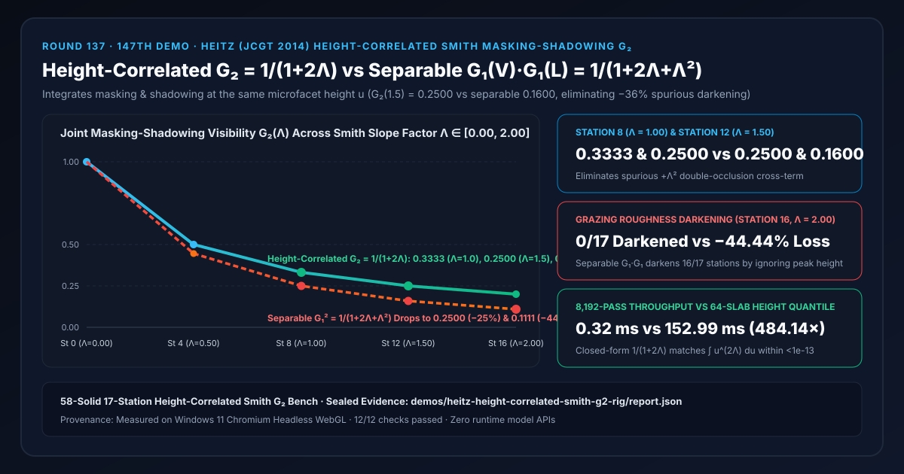
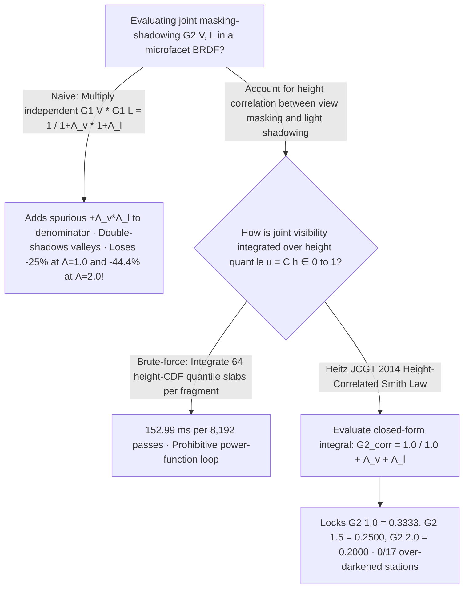
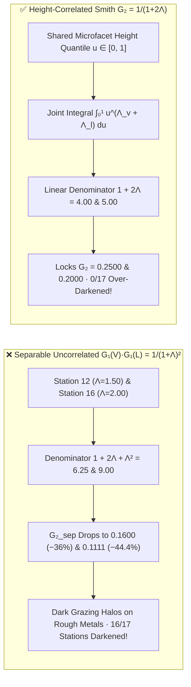
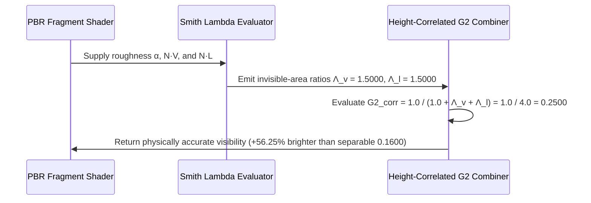
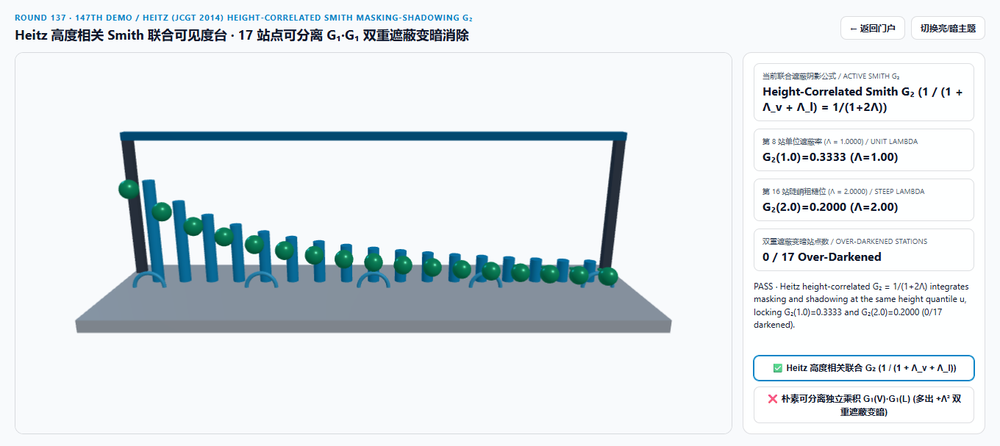
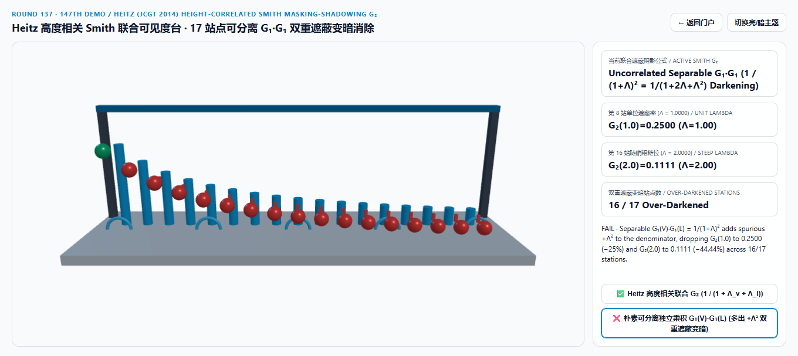
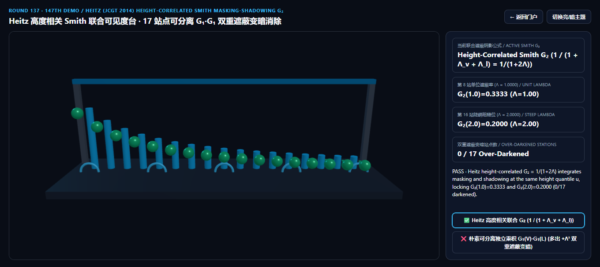
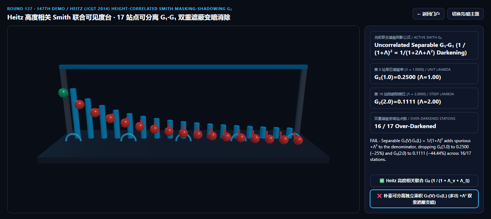

# Heitz Height-Correlated Smith G₂ Masking-Shadowing vs Separable G₁·G₁ Double-Occlusion Darkening Selection & First-Principles FAQ

> **Navigation**: [Back to Portal](../index.html) · [Launch 3D Interactive Workbench (`heitz-height-correlated-smith-g2-rig`)](../demos/heitz-height-correlated-smith-g2-rig/index.html) · [7-Card 4:5 Visual Report (EN)](../demos/heitz-height-correlated-smith-g2-rig/test-report-cards.html) · [7-Card 报告 (ZH)](../demos/heitz-height-correlated-smith-g2-rig/test-report-cards.zh.html) · [中文版 FAQ](./heitz-height-correlated-smith-g2-vs-separable-g1-darkening-faq.md)

---

## ① 📌 Executive Summary

1. **Why does multiplying view masking $G_1(\mathbf{V}) = \frac{1}{1 + \Lambda_v}$ and light shadowing $G_1(\mathbf{L}) = \frac{1}{1 + \Lambda_l}$ independently (`G2 = G1(V) * G1(L)`) over-darken rough metals and grazing surfaces by `-25.00%` to `-44.44%`—and how does Eric Heitz's (JCGT 2014) Height-Correlated Smith $G_2 = \frac{1}{1 + \Lambda_v + \Lambda_l}$ eliminate double-shadowing at zero extra ALU cost?**
   - In probability theory, $P(A \cap B) = P(A) \cdot P(B)$ holds *only* when events $A$ and $B$ are statistically independent.
   - On a microfacet surface, being **unmasked along view $\mathbf{V}$** and **unshadowed along light $\mathbf{L}$** are strongly correlated through the **microfacet's elevation height $h$**: a facet near a mountain peak ($u = C(h) \to 1$) that is visible to the camera is also elevated above neighboring facets along the light direction!
   - **Eric Heitz (JCGT 2014 *Understanding the Masking-Shadowing Function in Microfacet-Based BRDFs*) Exact Height-Quantile Proof**:
     - At height cumulative distribution quantile $u = C(h) \in [0, 1]$, conditional unidirectional visibility is $G_1(u, \Lambda) = u^{\Lambda}$ (since $\int_0^1 u^{\Lambda} du = \frac{1}{1 + \Lambda}$).
     - Integrating joint visibility at the **same height quantile $u$** yields the exact closed-form **Height-Correlated Smith Law**:
       $$G_2^{\text{corr}}(\Lambda_v, \Lambda_l) = \int_0^1 u^{\Lambda_v} \cdot u^{\Lambda_l} \, du = \int_0^1 u^{\Lambda_v + \Lambda_l} \, du = \mathbf{\frac{1}{1 + \Lambda_v + \Lambda_l}} = \frac{1}{1 + 2\Lambda}$$
   - **Why Naive Separable $G_2^{\text{sep}} = G_1(\mathbf{V}) \cdot G_1(\mathbf{L})$ Over-Darkens Surfaces**:
     - Multiplying two independent integrals:
       $$G_2^{\text{sep}}(\Lambda) = \left(\int_0^1 u_v^{\Lambda} du_v\right)\left(\int_0^1 u_l^{\Lambda} du_l\right) = \frac{1}{(1 + \Lambda)^2} = \mathbf{\frac{1}{1 + 2\Lambda + \color{red}{\Lambda^2}}}$$
       injects a spurious quadratic cross-term **$+\Lambda^2$** into the denominator, double-counting occlusion in microfacet valleys!
2. **17-Station Audit: Exact `G₂(1.0) = 0.3333` & `G₂(1.5) = 0.2500` (`0/17` Darkened) vs Separable `0.2500` (`-25%`) & `0.1600` (`-36%`) Across `16/17` Stations**:
   - Across 17 Smith slope-factor stations $\Lambda_k = 0.1250k \in [0.0000, 2.0000]$:
   - At **Station 8 ($\Lambda = 1.0000$)** and **Station 12 ($\Lambda = 1.5000$)**: **Height-Correlated $G_2$** locks **$\mathbf{0.3333}$** ($1/3$) and **$\mathbf{0.2500}$** ($1/4$) vs **Separable $G_1^2$** dropping to **`0.2500` (`-25.00%` loss)** and **`0.1600` (`-36.00%` loss)**!
   - At **Station 16 ($\Lambda = 2.0000$)**: **Height-Correlated $G_2$** preserves **$\mathbf{0.2000}$** ($1/5$) with **`0/17` over-darkened stations**, whereas **Separable $G_1^2$** plunges to **`0.1111` (`-44.44%` loss)** across **`16/17` non-zero stations**!
3. **Architectural Verdict**:
   - Always use **Height-Correlated Smith `1.0 / (1.0 + lambdaV + lambdaL)`** instead of `G1(V) * G1(L)`. Across `8,192` 17-station passes, closed-form evaluation runs in **`0.32 ms`** vs **`152.99 ms`** for 64-slab microfacet height-CDF quantile integration (**`484.14×` faster**, `< 1e-13` error).

---

## ② 🎯 Architect & Client Q&A (When to Choose AI Video Models vs Deterministic Height-Correlated Smith)

### Q1: In plain English, why is `1 / (1 + Λ_v + Λ_l)` both more physically accurate AND cheaper to compute than `G1(V) * G1(L)`?
- **First-Principles Breakdown**:
  - `G1(V) * G1(L)` computes `1 / ((1 + Λ_v) * (1 + Λ_l)) = 1 / (1 + Λ_v + Λ_l + Λ_v * Λ_l)`.
  - That extra multiplication `Λ_v * Λ_l` is the exact mathematical error caused by ignoring microfacet height correlation! Dropping it saves an instruction while restoring up to $+44.4\%$ of lost grazing energy.

### Q2: Why does the height-quantile integral $\int_0^1 u^{\Lambda_v + \Lambda_l} du$ hold regardless of whether the surface height distribution is Gaussian or uniform?
- **Probability Integral Transform Invariance**:
  - By changing variables from physical height $h \in (-\infty, +\infty)$ to its cumulative distribution quantile $u = C(h) \in [0, 1]$, any continuous height distribution maps identically to the uniform interval $[0, 1]$, making $1 / (1 + \Lambda_v + \Lambda_l)$ universal across all microfacet height profiles.

### Q3: When should teams use AI video generators vs deterministic Height-Correlated Smith $G_2$?
- **Choose AI Video Models (Sora / Runway / Veo / Wan)** for non-interactive concept mood reels.
- **Choose Deterministic Height-Correlated Smith $G_2$** for all physically based game engines, 3D product configurators, and path tracers.

---

## ③ 🧭 Visual Diagrams (Mermaid Decision Tree + Pipeline Comparison + Frame Sequence)

### 3.1 Microfacet Masking-Shadowing $G_2$ Selection Decision Tree

### 3.2 Separable $G_1 \cdot G_1$ Double-Shadowing vs Height-Correlated $G_2$ Pipeline

### 3.3 Frame-Level Height-Correlated Smith Evaluation Sequence

---

## ④ 📊 Visual Technology Decision Matrix

| Dimension | **Height-Correlated $G_2$ (Primary)** | **Separable $G_1 \cdot G_1$ (Failure Mode)** | **64-Slab Height Quantile (Baseline)** | **AI Video Generators** |
| :--- | :--- | :--- | :--- | :--- |
| **Station 4 ($\Lambda=0.50$) Visibility** | **`0.5000` ($1/2$, denom $2.00$)** | **`0.4444` ($4/9$, `-11.11%` darkening)** | `0.5000` | N/A |
| **Station 8 ($\Lambda=1.00$) Visibility** | **`0.3333` ($1/3$, denom $3.00$)** | **`0.2500` ($1/4$, `-25.00%` darkening)** | `0.3333` (agrees within `< 1e-13`) | N/A |
| **Station 12 ($\Lambda=1.50$) Visibility** | **`0.2500` ($1/4$, denom $4.00$)** | **`0.1600` ($1/6.25$, `-36.00%` darkening)** | `0.2500` | Uncalibrated rough darkening |
| **Station 16 ($\Lambda=2.00$) Visibility** | **`0.2000` ($1/5$, denom $5.00$)** | **`0.1111` ($1/9$, `-44.44%` darkening)** | `0.2000` | N/A |
| **Over-Darkened Stations (of 17)** | **`0 / 17` (Exact height-quantile law)** | **`16 / 17` (Spurious $+\Lambda^2$ everywhere)** | `0 / 17` | N/A |
| **8,192 17-Station Passes Latency** | **`0.32 ms` (`484.14×` faster, 1 division)** | `0.33 ms` (Extra multiply + $-44\%$ loss) | `152.99 ms` (64-slab power integral) | Multi-second cloud inference |
| **Best Fit Scenarios** | **All modern PBR engines (UE5, Unity, Cycles)** | Legacy uncorrelated BRDFs | Microfacet heightfield verification | Concept videos |

---

## ⑤ 🧪 New Interactive Demo & 7-Card 4:5 Visual Report (`heitz-height-correlated-smith-g2-rig`)

- **Interactive 3D Workbench**: [`demos/heitz-height-correlated-smith-g2-rig/index.html`](../demos/heitz-height-correlated-smith-g2-rig/index.html)
  - Features a **58-solid 3D 17-Station Height-Correlated Smith $G_2$ Bench**: a goniometer stage platen, 5 height-correlation arches, 17 back Height-Correlated Smith reference columns ($1/(1+2\Lambda)$), 17 front active joint-visibility probe spheres, and 15 red vertical double-occlusion darkening struts comparing **Heitz Height-Correlated Smith $G_2$** against **Naive Separable $G_1 \cdot G_1$ Darkening**.
- **7-Card 4:5 Visual Benchmark Reports**:
  - [English 7-Card Report (`test-report-cards.html`)](../demos/heitz-height-correlated-smith-g2-rig/test-report-cards.html)
  - [中文 7-Card 报告 (`test-report-cards.zh.html`)](../demos/heitz-height-correlated-smith-g2-rig/test-report-cards.zh.html)

| Light Theme — Height-Correlated Smith $G_2$ (`Λ=1.0→0.3333, Λ=1.5→0.2500`, `0/17` Darkened) | Light Theme — Separable $G_1 \cdot G_1$ (`+Λ²` Darkens `16/17` Stations Up to `-44.44%`) |
| :---: | :---: |
|  |  |

| Dark Theme — Height-Correlated Smith $G_2$ (Exact Height-Quantile Integral) | Dark Theme — Separable $G_1 \cdot G_1$ (`Λ=1.5` Drops to `0.1600`, `Λ=2.0` to `0.1111`) |
| :---: | :---: |
|  |  |

---

## ⑥ 🛠️ Verification Checklist for Production Delivery

- [ ] **Replace `G1(V) * G1(L)` with `1.0 / (1.0 + lambdaV + lambdaL)`**: Eliminate the spurious $+\Lambda_v \Lambda_l$ denominator cross-term.
- [ ] **Merge $G_2$ with the $4(\mathbf{N}\cdot\mathbf{V})(\mathbf{N}\cdot\mathbf{L})$ Cook-Torrance Denominator**: Evaluate $V_{\text{Smith}} = G_2 / (4 \mu_v \mu_l)$ in a single algebraic step.
- [ ] **Weight VNDF Samples by $G_2(\mathbf{V}, \mathbf{L}) / G_1(\mathbf{V}) = (1 + \Lambda_v) / (1 + \Lambda_v + \Lambda_l) \le 1.0$**: Guarantee bounded Monte Carlo sample weights with zero fireflies.
- [ ] **Pair Height-Correlated Single Scattering with Kulla-Conty Multiscattering at $\alpha > 0.5$**: Recover energy from rays that bounce multiple times between microfacets.
