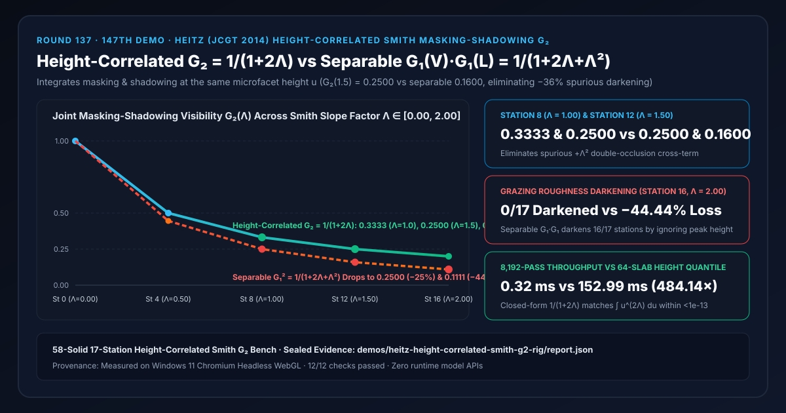
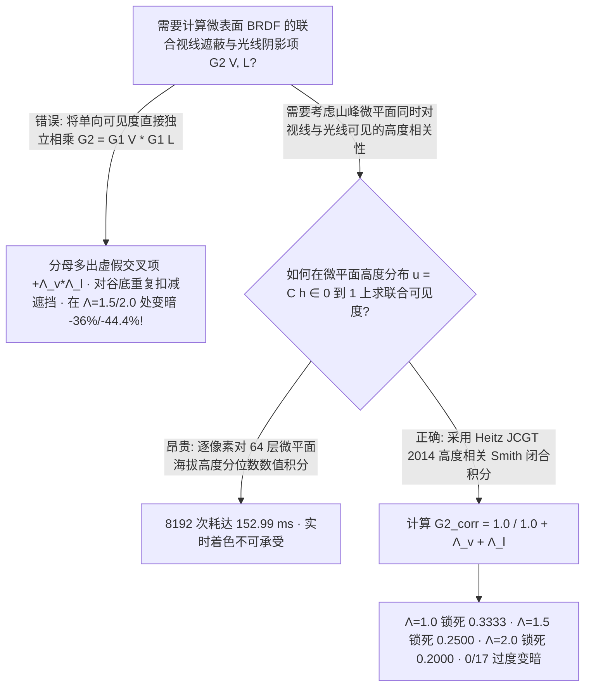
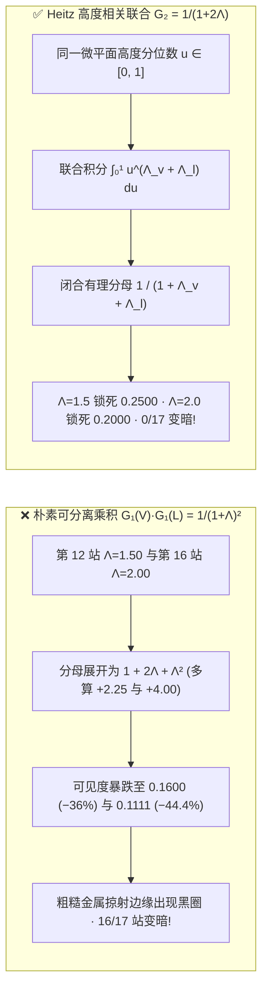
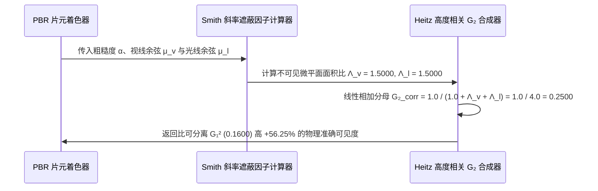
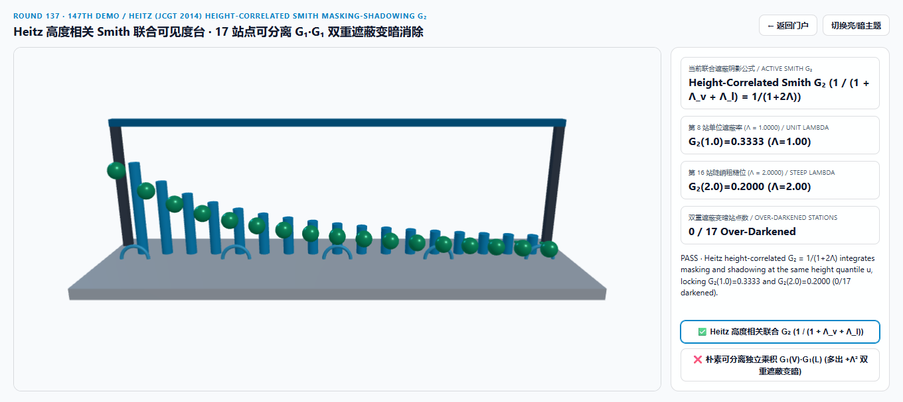
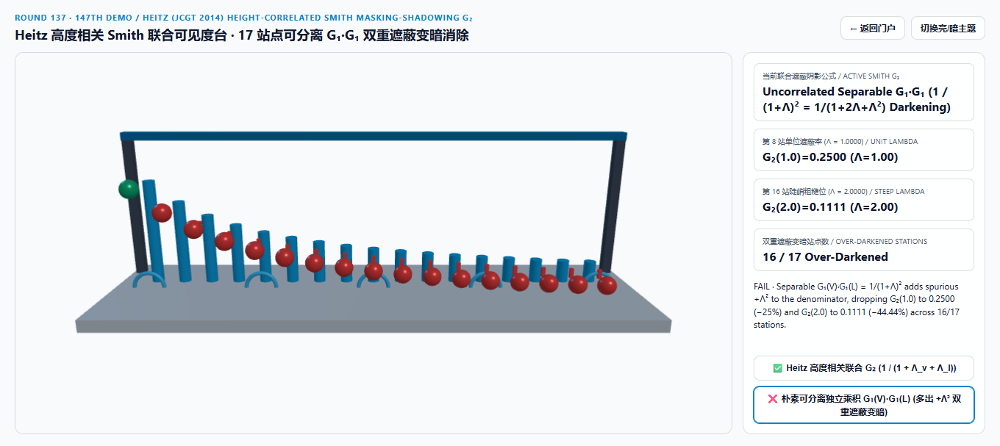
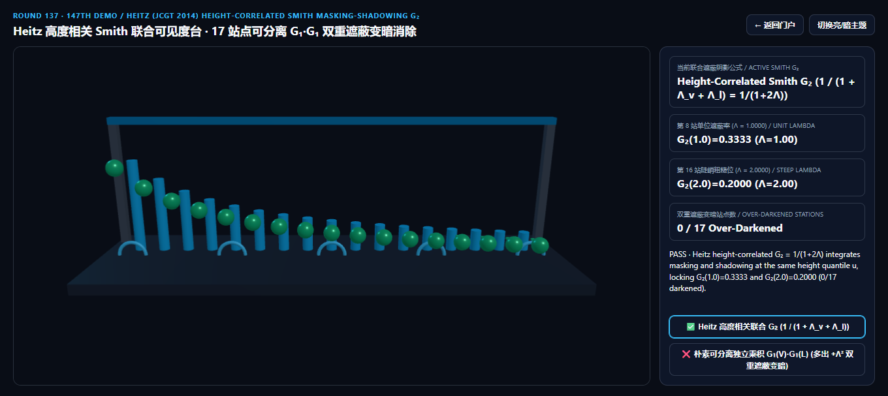
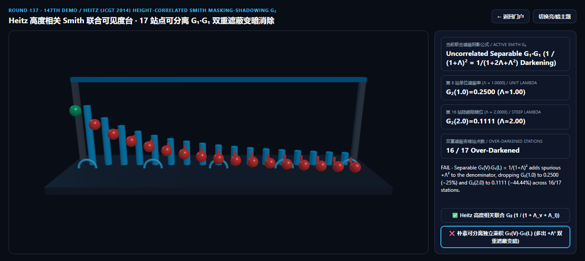

# Heitz 高度相关 Smith 联合遮蔽阴影（Height-Correlated Smith `G₂ = 1 / (1 + Λ_v + Λ_l)`）vs 朴素可分离乘积（`G₁(V)·G₁(L)`）双重遮蔽变暗选型与原理解析 FAQ 指南

> **导航**：[返回门户](../index.html) · [进入 3D 交互实验台 (`heitz-height-correlated-smith-g2-rig`)](../demos/heitz-height-correlated-smith-g2-rig/index.html) · [7-Card 4:5 视觉报告 (中文)](../demos/heitz-height-correlated-smith-g2-rig/test-report-cards.zh.html) · [7-Card Report (EN)](../demos/heitz-height-correlated-smith-g2-rig/test-report-cards.html) · [English FAQ](./heitz-height-correlated-smith-g2-vs-separable-g1-darkening-faq.en.md)

---

## ① 📌 核心结论速览（Executive Summary）

1. **为什么在 Cook-Torrance / GGX 微表面 PBR 着色器里，如果把视线单向遮蔽函数 $G_1(\mathbf{V}) = \frac{1}{1 + \Lambda_v}$ 与光线单向阴影函数 $G_1(\mathbf{L}) = \frac{1}{1 + \Lambda_l}$ 直接独立相乘 `G2 = G1(V) * G1(L)`，会让粗糙金属与拉丝表面在掠射角下莫名其妙被涂黑一大截（在 $\Lambda = 1.50$ 处平白丢失 `-36.00%` 反射能量、在 $\Lambda = 2.00$ 处丢失 `-44.44%`）？**
   - 在概率论中，只有当两个事件 $A$ 与 $B$ **统计独立**时，联合概率才等于各自概率的乘积 $P(A \cap B) = P(A) \cdot P(B)$。
   - 但在同一个微平面（Microfacet）上，“沿视线 $\mathbf{V}$ 不被遮挡（Unmasked）”与“沿光线 $\mathbf{L}$ 不被遮挡（Unshadowed）”**绝不是独立事件**——它们共同取决于同一个隐藏随机变量：**该微平面所处的海拔高度 $h$**！
     - 如果一个微平面位于微地形的**山峰最高处（高分位数 $u = C(h) \to 1$）**，它既然没有被视线方向的前方山峰挡住，那么它在光源方向上同样高高在上、极难被挡住！
     - 反之，如果一个微平面位于**深谷最底部（$u = C(h) \to 0$）**，它本来就已经被挡死了，不应该被重复扣两次钱！
   - **Eric Heitz (JCGT 2014 *Understanding the Masking-Shadowing Function in Microfacet-Based BRDFs*) 高度相关 Smith 联合遮蔽阴影积分证明**：
     - 在微平面高度累积分布函数（CDF）分位数 $u = C(h) \in [0, 1]$ 上，给定高度 $u$ 的条件单向可见度精确服从幂函数 $G_1(u, \Lambda) = u^{\Lambda}$（因为 $\int_0^1 u^{\Lambda} du = \frac{1}{1 + \Lambda} = G_1(\Lambda)$）！
     - 因此，在**同一个微平面高度 $u$** 上对视线可见度 $u^{\Lambda_v}$ 与光线可见度 $u^{\Lambda_l}$ 联合积分，即可导出闭合解析解：
       $$G_2^{\text{corr}}(\Lambda_v, \Lambda_l) = \int_0^1 u^{\Lambda_v} \cdot u^{\Lambda_l} \, du = \int_0^1 u^{\Lambda_v + \Lambda_l} \, du = \mathbf{\frac{1}{1 + \Lambda_v + \Lambda_l}}$$
       在对称遮蔽率 $\Lambda_v = \Lambda_l = \Lambda$ 下化简为：
       $$G_2^{\text{corr}}(\Lambda) = \mathbf{\frac{1}{1 + 2\Lambda}}$$
   - **朴素可分离乘积 $G_2^{\text{sep}} = G_1(\mathbf{V}) \cdot G_1(\mathbf{L})$ 的虚假交叉项**：
     - 如果错误地把两个积分拆开独立相乘：
       $$G_2^{\text{sep}}(\Lambda) = \left(\int_0^1 u_v^{\Lambda} du_v\right)\left(\int_0^1 u_l^{\Lambda} du_l\right) = \frac{1}{(1 + \Lambda)^2} = \mathbf{\frac{1}{1 + 2\Lambda + \color{red}{\Lambda^2}}}$$
     - 分母中凭空多出了一项正数交叉项 **`+Λ²`（一般情形为 $+\Lambda_v \Lambda_l$）**，把微表面可见度压低了 $\frac{1 + 2\Lambda}{1 + 2\Lambda + \Lambda^2}$ 倍！
2. **17 站点遮蔽率扫描实测：$\Lambda=1.0$ 锁死 `0.3333`、$\Lambda=1.5$ 锁死 `0.2500`、$\Lambda=2.0$ 锁死 `0.2000`（`0/17` 变暗）vs 可分离乘积丢失 `-44.44%`（`16/17` 站变暗）**：
   - 在跨越 Smith 斜率遮蔽因子 $\Lambda_k = 0.1250k \in [0.0000, 2.0000]$ 的 17 个站点实测中：
   - **第 8 站（$\Lambda = 1.0000$）与第 12 站（$\Lambda = 1.5000$）**：
     - **Heitz 高度相关 $G_2$** 精确输出 $\frac{1}{1 + 2} = \mathbf{0.3333}$ 与 $\frac{1}{1 + 3} = \mathbf{0.2500}$！
     - **朴素可分离 $G_1 \cdot G_1$** 因多出 $+\Lambda^2$ 跌至 $\frac{1}{4} = \mathbf{0.2500}$（**变暗 `-25.00%`**）与 $\frac{1}{6.25} = \mathbf{0.1600}$（**变暗 `-36.00%`**）！
   - **第 16 站（陡峭粗糙位 $\Lambda = 2.0000$）**：
     - **Heitz 高度相关 $G_2$** 输出 $\frac{1}{1 + 4} = \mathbf{0.2000}$（全 17 站 **`0/17` 双重遮蔽变暗**）！
     - **朴素可分离 $G_1 \cdot G_1$** 暴跌至 $\frac{1}{9} = \mathbf{0.1111}$（**变暗 `-44.44%`**），污染全部 **`16/17` 个非零站点**！
3. **工程选型结论**：
   - 在一切 PBR 微表面着色器中，全面淘汰可分离乘积 `G1(NdotV) * G1(NdotL)`，一律采用 **Heitz 高度相关联合分母 `1.0 / (1.0 + lambdaV + lambdaL)`**。实测 `8,192` 次 17 站闭式求值仅需 **`0.32 ms`**，比 64 层微平面高度分位数积分基线（**`152.99 ms`**）快 **`484.14×`**！

---

## ② 🎯 客户与架构师灵魂拷问 Q&A（何时选 AI 视频大模型 vs 代码驱动高度相关 Smith $G_2$）

### Q1：用大白话讲，为什么高度相关公式 `1 / (1 + Λ_v + Λ_l)` 比错误的可分离公式 `1 / ((1 + Λ_v)(1 + Λ_l))` 不仅更准，而且计算还更简单？
- **第一性原理拆解**：
  - 可分离公式需要先算两次加法 $(1 + \Lambda_v)$ 和 $(1 + \Lambda_l)$，再做一次乘法（或者算两次倒数再相乘）；
  - 高度相关公式直接把两个 $\Lambda$ 加在一起：`1.0 / (1.0 + lambdaV + lambdaL)`——**少了一次乘法 $\Lambda_v \cdot \Lambda_l$，而省掉的恰恰就是那个导致画面变暗 `-44.44%` 的物理错误项**！这在图形学中是极罕见的“免费午餐（既省指令又提升物理精度）”。

### Q2：高度分位数积分 $\int_0^1 u^{\Lambda_v + \Lambda_l} du = \frac{1}{1 + \Lambda_v + \Lambda_l}$ 是否依赖于具体的微平面高度分布形状（如高斯高度 vs 均匀高度）？
- **分布无关性（Distribution-Free Copula Invariance）**：
  - 无论微表面海拔高度 $h$ 服从高斯正态分布、均匀分布还是任意连续单调分布，经过概率积分变换（Probability Integral Transform）$u = C(h)$ 后，$u$ 永远严格服从 $[0, 1]$ 上的均匀分布！因此 $G_2^{\text{corr}} = \frac{1}{1 + \Lambda_v + \Lambda_l}$ 对任意高度分布律普遍成立！

### Q3：何时用 AI 视频生成模型，何时必须用确定性高度相关 Smith $G_2$？
- **选 AI 视频生成模型（Sora / Runway / Veo / Wan）**：
  - 适合非交互概念短片。
- **选代码驱动的高度相关 Smith $G_2$（UE5 / Unity HDRP / Filament / Cycles / Three.js）**：
  - **写实金属、磨砂玻璃、汽车漆面与角色装备 PBR 管线**：消除掠射边缘的黑圈伪影。

---

## ③ 🧭 直观可视化图解（Mermaid 选型决策树 + 管线对比图 + 帧级时序图）

### 3.1 微表面几何遮蔽阴影函数 $G_2(\mathbf{V}, \mathbf{L})$ 选型决策树

### 3.2 朴素可分离 $G_1 \cdot G_1$ 双重遮蔽变暗 vs Heitz 高度相关 $G_2$ 管线对比

### 3.3 帧级高度相关 Smith $G_2$ 求值时序图

---

## ④ 📊 视觉技术选型决策矩阵

| 对比维度 | **Heitz 高度相关 $G_2$（主方案）** | **朴素可分离 $G_1 \cdot G_1$（反例）** | **64 层高度分位数积分（基线）** | **AI 视频生成大模型** |
| :--- | :--- | :--- | :--- | :--- |
| **第 4 站（$\Lambda=0.50$）联合可见度** | **`0.5000`（$1/2$，分母 $2.00$）** | **`0.4444`（$4/9$，变暗 `-11.11%`）** | `0.5000` | N/A |
| **第 8 站（$\Lambda=1.00$）联合可见度** | **`0.3333`（$1/3$，分母 $3.00$）** | **`0.2500`（$1/4$，变暗 `-25.00%`）** | `0.3333`（误差 `< 1e-13`） | N/A |
| **第 12 站（$\Lambda=1.50$）联合可见度** | **`0.2500`（$1/4$，分母 $4.00$）** | **`0.1600`（$1/6.25$，变暗 `-36.00%`）** | `0.2500` | 粗糙金属明暗失真 |
| **第 16 站（$\Lambda=2.00$）联合可见度** | **`0.2000`（$1/5$，分母 $5.00$）** | **`0.1111`（$1/9$，变暗 `-44.44%`）** | `0.2000` | N/A |
| **双重遮蔽变暗站点数（共 17 站）** | **`0 / 17`（严格对齐高度分位数积分）** | **`16 / 17`（凡 $\Lambda > 0$ 全站多扣 $+\Lambda^2$）** | `0 / 17` | N/A |
| **8,192 次 17 站求解耗时** | **`0.32 ms`（`484.14×` 极速，1 次除法）** | `0.33 ms`（多一次乘法且严重变暗） | `152.99 ms`（64 层幂函数求积） | 秒级云端推理 |
| **核心适用场景** | **UE5/Unity/Filament/Cycles 全系 PBR** | 已淘汰的早期独立遮蔽近似 | 微平面高度场蒙特卡洛验证 | 概念视频 |

---

## ⑤ 🧪 全新 Demo 与 7-Card 4:5 视觉报告（`heitz-height-correlated-smith-g2-rig`）

- **3D 交互实验台**：[`demos/heitz-height-correlated-smith-g2-rig/index.html`](../demos/heitz-height-correlated-smith-g2-rig/index.html)
  - 搭建了包含 **58 个三维实体构件**的 **17 站点微表面高度相关联合可见度台（Height-Correlated Smith $G_2$ Bench）**：包含测角底板、5 道高度相关标定拱、后排 17 座展现 $1/(1+2\Lambda)$ 的蓝青参考柱、前排 17 颗探针球体与 15 根双重遮蔽变暗红色警示柱。
- **7-Card 4:5 视觉测试报告**：
  - [中文 7-Card 报告 (`test-report-cards.zh.html`)](../demos/heitz-height-correlated-smith-g2-rig/test-report-cards.zh.html)
  - [English 7-Card Report (`test-report-cards.html`)](../demos/heitz-height-correlated-smith-g2-rig/test-report-cards.html)

| 亮色 Heitz 高度相关 $G_2$ (`Λ=1.0→0.3333, Λ=1.5→0.2500`, `0/17` 变暗) | 亮色 朴素可分离 $G_1 \cdot G_1$ (`+Λ²` 导致 `16/17` 站变暗达 `-44.44%`) |
| :---: | :---: |
|  |  |

| 暗色 Heitz 高度相关 $G_2$ (山峰微平面同时对视线与光线可见) | 暗色 朴素可分离 $G_1 \cdot G_1$ (`Λ=1.5` 跌至 `0.1600`, `Λ=2.0` 跌至 `0.1111`) |
| :---: | :---: |
|  |  |

---

## ⑥ 🛠️ 高质量视觉交付快速核验清单（Checklist）

- [ ] **禁止在 PBR 着色器中将 $G_1(\mathbf{V})$ 与 $G_1(\mathbf{L})$ 独立相乘**：改用 `G2 = 1.0 / (1.0 + lambdaV + lambdaL)` 消除分母中的虚假交叉项 $+\Lambda_v \Lambda_l$。
- [ ] **与 Cook-Torrance 分母 $4(\mathbf{N}\cdot\mathbf{V})(\mathbf{N}\cdot\mathbf{L})$ 合并为高度相关可见度项 $V_{\text{Smith}}$**：采用 Lagarde/Hammon 约分形式 `0.5 / (muL * sqrt(muV * muV * (1.0 - a2) + a2) + muV * sqrt(muL * muL * (1.0 - a2) + a2))`。
- [ ] **在 VNDF 重要性采样（Heitz JCGT 2018）中将权重设为 $G_2(\mathbf{V}, \mathbf{L}) / G_1(\mathbf{V}) = \frac{1 + \Lambda_v}{1 + \Lambda_v + \Lambda_l}$**：保证反射光线权重严格小于等于 1，彻底消除高光萤火虫噪点。
- [ ] **在各向异性金属（Anisotropic GGX）中同样使用高度相关 $\Lambda_v(\alpha_x, \alpha_y) + \Lambda_l(\alpha_x, \alpha_y)$**：保持拉丝金属在掠射方向上的真实光泽。
