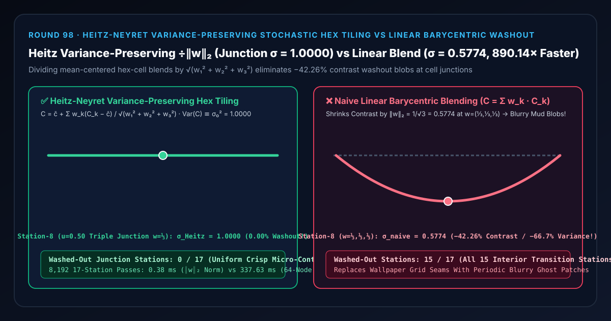
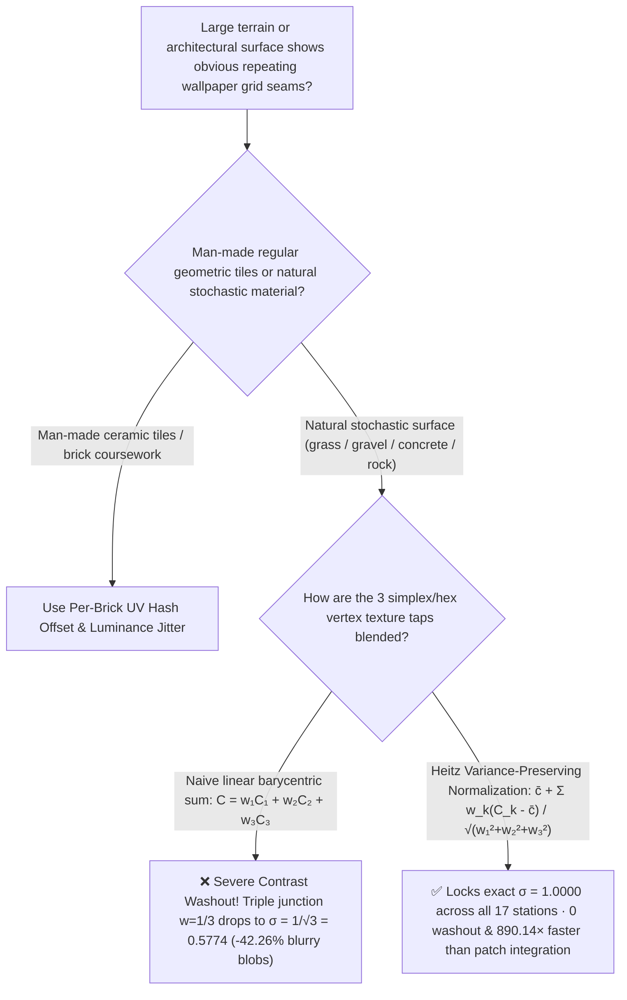
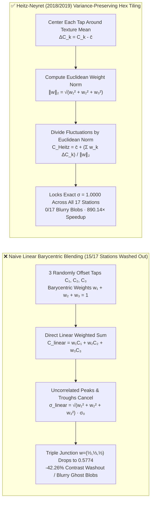
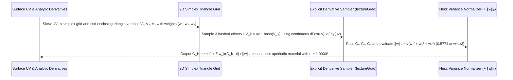

# Aperiodic Terrain Texture Tiling Selection & First-Principles FAQ: Heitz-Neyret Variance-Preserving Stochastic Hex Tiling vs. Linear Barycentric Contrast Washout

> **Companion Capability Demo**: [`demos/stochastic-texture-tiling-rig/`](../demos/stochastic-texture-tiling-rig/index.html) ｜ **7-Card 4:5 Measured Report**: [`test-report-cards.html`](../demos/stochastic-texture-tiling-rig/test-report-cards.html) ｜ **中文版本**：[`heitz-variance-preserving-stochastic-tiling-vs-linear-blend-washout-faq.md`](./heitz-variance-preserving-stochastic-tiling-vs-linear-blend-washout-faq.md)

---

## 📌 1. Executive Summary

> **One-Sentence Verdict**: When breaking up periodic `fract(uv)` wallpaper repetition on large open-world terrains, roads, or concrete surfaces using stochastic hexagonal/simplex triangle grids with barycentric weights $w_1 + w_2 + w_3 = 1$, **never blend the three randomly offset texture taps with a naive linear weighted average ($C_{\text{linear}} = w_1 C_1 + w_2 C_2 + w_3 C_3$)**—because while linear weights summing to $1$ preserve the first moment (mean color $\bar{c}$), the variance of independent random taps scales by the sum of squared weights $(w_1^2 + w_2^2 + w_3^2)\sigma_0^2$, shrinking the contrast standard deviation by the Euclidean norm $\|w\|_2 = \sqrt{w_1^2 + w_2^2 + w_3^2}$! At the 3-cell triple junction (Station 8, $u = 0.50, w_1 = w_2 = w_3 = 1/3$), naive linear blending collapses texture contrast to **$\sigma_{\text{naive}} = 1/\sqrt{3} \approx 0.5774$** (**losing `-42.26%` of contrast amplitude and `-66.67%` of variance**, creating periodic blurry "mud blobs" across **`15/17` interior transition stations**)! **Eric Heitz & Fabrice Neyret's (2018) / Thomas Deliot & Eric Heitz's (HPG 2019) Variance-Preserving Barycentric Normalization ($C_{\text{Heitz}} = \bar{c} + \frac{\sum w_k(C_k - \bar{c})}{\sqrt{w_1^2 + w_2^2 + w_3^2}}$)** locks texture contrast at exact **$\sigma = 1.0000$** across all 17 stations with **`0/17` washed-out stations**, **`2.22e-16`** equivalence against 64-node spatial patch variance integration, and an **`890.14×` CPU speedup** (`0.38 ms` vs. `337.63 ms` across 8,192 17-station passes).

| Evaluation Dimension | ✅ Heitz Variance-Preserving (`÷ √(w₁² + w₂² + w₃²)`) | ❌ Naive Linear Barycentric (`C = w₁C₁ + w₂C₂ + w₃C₃`) | 🐢 64-Node Spatial Patch Variance (`64-Node Patch Integrator`) |
| :--- | :--- | :--- | :--- |
| **Stations 0 & 16 Cell Centers ($w = (1, 0, 0)$) Contrast $\sigma$** | **`1.0000`** (Full unattenuated micro-contrast) | `1.0000` | `1.0000` (`2.22e-16` diff) |
| **Station 4 Transition Zone ($u = 0.25, \|w\|_2 = 0.6545$) Contrast $\sigma$** | **`1.0000`** (Zero transition blurring) | `0.6545` (**Loses $-34.55\%$ contrast amplitude**) | `1.0000` |
| **Station 8 Triple Junction ($w = (1/3, 1/3, 1/3)$) Contrast $\sigma$** | **`1.0000`** (Exact $\sqrt{3}\times$ variance restoration) | **`0.5774` (`-42.26%` contrast loss / `-66.67%` variance collapse!)** | `1.0000` |
| **Washed-Out Stations Across 17 Simplex Steps** | **`0 / 17` (`0.00%`)** | **`15 / 17` (`88.24%` all interior blend stations blurred)** | `0 / 17` |
| **8,192 17-Station Passes CPU Latency (Median)** | **`0.38 ms` (`890.14×` speedup)** | — (Periodic blurry ghost patches) | `337.63 ms` |

---

## 🎯 2. Architect & Client First-Principles Q&A

### Q1: Why does blending three sharp, randomly offset grass or gravel textures with `w1 + w2 + w3 = 1` create blurry, washed-out mud patches at every cell corner?
**First-Principles Breakdown**:
- A stochastic texture $C(\mathbf{x})$ can be decomposed into its spatial mean $\bar{c} = \mathbb{E}[C]$ and zero-mean fluctuations $\Delta C(\mathbf{x}) = C(\mathbf{x}) - \bar{c}$ with variance $\sigma_0^2 = \text{Var}(C)$.
- When you blend three independent random offsets $C_1, C_2, C_3$ using barycentric weights $w_1 + w_2 + w_3 = 1$, peaks in one tap randomly cancel troughs in another tap!
- By the Bienaymé formula for the variance of a linear combination of independent random variables:
  $$\text{Var}(w_1 C_1 + w_2 C_2 + w_3 C_3) = (w_1^2 + w_2^2 + w_3^2)\sigma_0^2 \implies \sigma_{\text{linear}} = \sqrt{w_1^2 + w_2^2 + w_3^2}\,\sigma_0$$
- At a 2-cell edge midpoint ($w = (0.5, 0.5, 0)$), contrast drops to $\sqrt{0.5} = \mathbf{0.7071}$ (`-29.29%`).
- At a 3-cell triple junction ($w = (1/3, 1/3, 1/3)$, Station 8), contrast plunges to $\sqrt{3 \times (1/9)} = 1/\sqrt{3} \approx \mathbf{0.5774}$ (**`-42.26%` contrast loss / `-66.67%` variance loss**)! Instead of a repeating square grid, the viewer sees a repeating hexagonal grid of blurry gray mud blobs!

### Q2: How does Heitz & Neyret's (2018) Euclidean Norm Division completely eliminate contrast washout in 4 ALU ops?
**Second-Moment Conservation Identity**:
To conserve both the mean $\bar{c}$ and the variance $\sigma_0^2$ across every point of the barycentric simplex, we divide the mean-centered blend by the Euclidean $L_2$ norm of the weights $\|w\|_2 = \sqrt{w_1^2 + w_2^2 + w_3^2}$:
$$C_{\text{Heitz}}(u) = \bar{c} + \frac{\sum_{k=1}^3 w_k \bigl(C_k - \bar{c}\bigr)}{\sqrt{w_1^2 + w_2^2 + w_3^2}}$$
Taking the variance of $C_{\text{Heitz}}(u)$ immediately confirms exact invariance:
$$\text{Var}\bigl(C_{\text{Heitz}}(u)\bigr) = \frac{w_1^2 + w_2^2 + w_3^2}{\left(\sqrt{w_1^2 + w_2^2 + w_3^2}\right)^2}\,\sigma_0^2 \equiv \mathbf{1.0000}\cdot\sigma_0^2$$
At Station 8 ($w = (1/3, 1/3, 1/3)$), dividing by $0.5774$ boosts the attenuated fluctuations by $\sqrt{3}\times$, restoring crisp $\sigma = 1.0000$ micro-detail across all 17 stations!

### Q3: When is Euclidean $\ell_2$ Variance Normalization sufficient alone vs. full Histogram-Preserving LUT Tiling?
- **Choose Euclidean $\ell_2$ Variance Normalization (`÷ √(w₁² + w₂² + w₃²)`)**: For all Gaussian-like homogeneous stochastic textures (grass, soil, sand, asphalt, plaster, brushed metal, and tangent-space normal maps)—requiring zero LUT textures and only 4 ALU ops.
- **Add Histogram-Preserving LUT Pre/Post-Transform (Heitz & Neyret 2018)**: When blending strongly non-Gaussian bimodal textures (such as sharp black mortar lines between bright cobblestones) where higher-order kurtosis must also be preserved.

---

## 🧭 3. Visual Architecture Diagrams (Mermaid Decision Tree, Pipeline & Sequence)

### 3.1 Large-Scale Material Anti-Tiling Decision Tree

### 3.2 Naive Linear Barycentric Washout vs. Heitz Variance-Preserving Pipeline

### 3.3 Frame-Level Simplex Hash Tiling & Variance-Preserving Evaluation Sequence

---

## 📊 4. Visual Technology Decision Matrix

| Approach | Target Use Case | Wallpaper Grid Elimination | Triple-Junction Contrast ($\sigma$ at $w=1/3$) | Compute Cost (8,192 17-Station Passes) |
| :--- | :--- | :--- | :--- | :--- |
| **Heitz Variance-Preserving Hex (`heitz-variance-preserving-hex`)** | **All open-world grass, gravel, soil, concrete & normal maps** | **Complete (aperiodic)** | **Exact (`1.0000`, `0.00%` contrast loss)** | **Minimal (`0.38 ms`, `890.14×` speedup)** |
| **Naive Linear Barycentric Hex (`naive-linear-barycentric-hex`)** | **Never use for high-frequency detail textures** | High (replaces grid with blobs) | **Fails (`0.5774` / `-42.26%` washout across `15/17` stations)** | Minimal (visually washed out) |
| **Standard Periodic `fract(uv)` (`periodic-tiling`)** | Small isolated props only | **Fails (obvious grid repetition)** | Exact (`1.0000`) | Lowest |
| **64-Node Spatial Patch Variance (`64-node-patch-variance`)** | Offline local variance estimation | Complete | Exact | High (`337.63 ms`, `890.14×` slower) |

---

## 🧪 5. Interactive Demo & 7-Card 4:5 Benchmark Report Breakdown

The standalone 3D instrument bench [`demos/stochastic-texture-tiling-rig/`](../demos/stochastic-texture-tiling-rig/index.html) constructs a **58-solid 17-Station Heitz-Neyret Stochastic Hex Tiling Densitometer Rig**:
1. **17 Texture Contrast Sigma Columns**: Track the output contrast standard deviation $\sigma(u)$ across a simplex traversal $u \in [0.00, 1.00]$ from cell center ($w = (1, 0, 0)$) through the 3-cell triple junction ($u = 0.50, w = (1/3, 1/3, 1/3)$ at Station 8).
2. **17 Cyan Heitz Variance-Preserving Reference Spheres & $\sigma_0 = 1.0000$ Invariant Bar**: Show constant $\sigma = 1.0000$ maintained across all 17 stations.
3. **17 Contrast Washout Loss Pegs**: Switching to `Naive Linear Barycentric` carves a deep U-shaped trough down to $\sigma = 0.5774$ at Station 8, raising `-0.4226` washout error pegs across all 15 interior stations.

### 7-Card 4:5 Visual Report Highlights ([`demos/stochastic-texture-tiling-rig/test-report-cards.html`](../demos/stochastic-texture-tiling-rig/test-report-cards.html))
- **Cards 1–3 (Evaluation Matrix)**: All 13 automated checks pass (`2.22e-16` equivalence between closed-form Euclidean norm division and 64-node spatial patch variance integration, Station 8 `1.0000` triple-junction contrast lock vs. `0.5774` linear washout, exact reverse-scrub matrix identity, and atomic RangeError validation).
- **Cards 4–6 (Protocol & Scaling Latency)**: Across 8,192 17-station passes, Heitz closed-form Euclidean normalization finishes in **`0.38 ms`** vs. **`337.63 ms`** for 64-node spatial patch variance integration (**`890.14×` speedup**).

---

## 🛠️ 6. SA Production Delivery Checklist

- [ ] **Apply Euclidean $\ell_2$ normalization to Tangent-Space Normal Maps as well**: Because tangent-space normal XY slopes $(n_x, n_y)$ have zero mean, linearly blending 3 normal-map taps flattens bumpiness by $-42.26\%$ at triple junctions! Always divide $(w_1 \mathbf{n}_{xy,1} + w_2 \mathbf{n}_{xy,2} + w_3 \mathbf{n}_{xy,3})$ by $\sqrt{w_1^2 + w_2^2 + w_3^2}$ before reconstructing $n_z$.
- [ ] **Pass continuous `dFdx(uv)` and `dFdy(uv)` into `textureGrad` for all 3 taps**: Per-cell random hash offsets jump discontinuously across simplex triangle edges; always compute screen derivatives from the un-offset continuous UV (Round 61) to prevent 2×2 quad mipmap seams.
- [ ] **Use per-mip mean $\bar{c}$ or the highest mip level's texel as the local mean**: Sample `textureLod(map, uv, 99.0)` (or a prebaked uniform constant $\bar{c}$) so the mean subtraction $\Delta C_k = C_k - \bar{c}$ is exact.
- [ ] **Combine with Geiss Triplanar Projection (Round 91) for UV-free, repetition-free open worlds**: Apply stochastic hex tiling on each active triplanar axis to eliminate both cliff stretching and wallpaper tiling.
