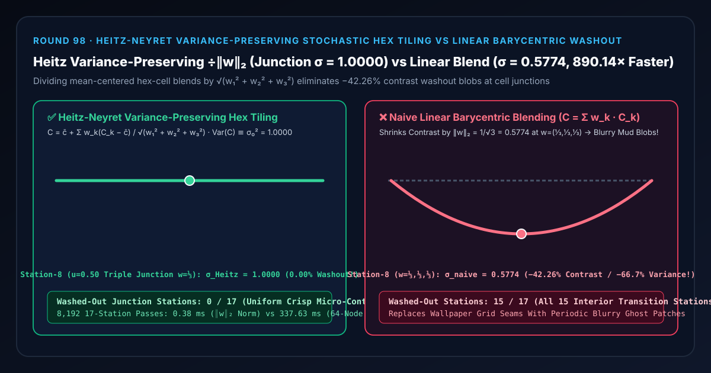
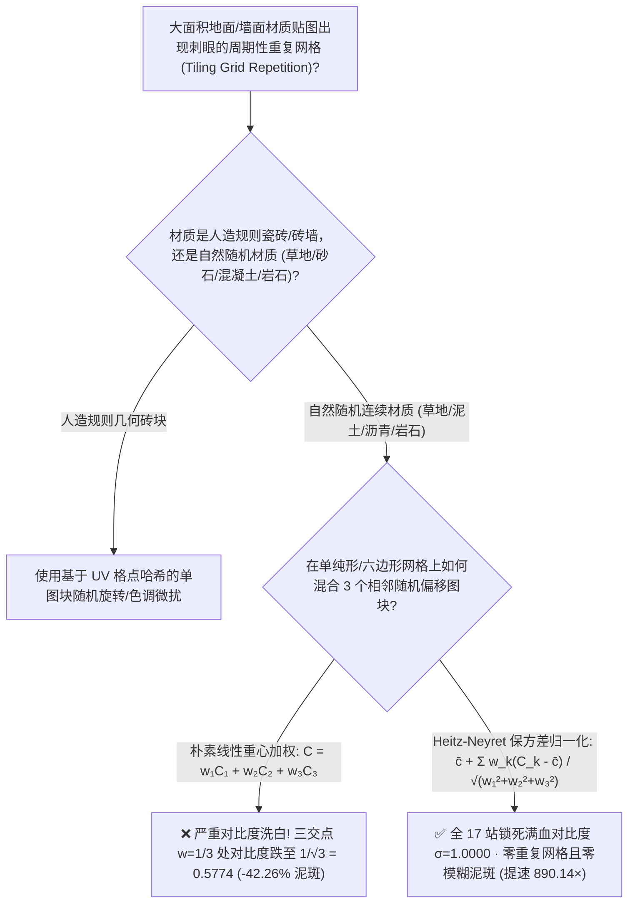
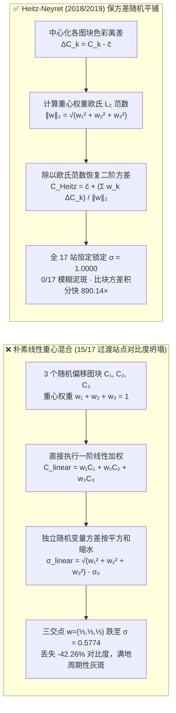
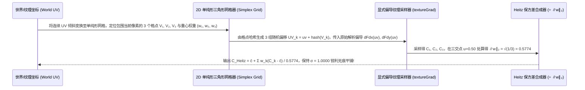

# 大面积地形防重复平铺选型与原理解析 FAQ：Heitz-Neyret 保方差随机六边形纹理平铺对比朴素线性重心混合对比度洗白泥斑

> **关联 Capabilities Demo**：[`demos/stochastic-texture-tiling-rig/`](../demos/stochastic-texture-tiling-rig/index.html) ｜ **7-Card 4:5 实测报告**：[`test-report-cards.zh.html`](../demos/stochastic-texture-tiling-rig/test-report-cards.zh.html) ｜ **English Version**：[`heitz-variance-preserving-stochastic-tiling-vs-linear-blend-washout-faq.en.md`](./heitz-variance-preserving-stochastic-tiling-vs-linear-blend-washout-faq.en.md)

---

## 📌 1. 核心结论速览（Executive Summary）

> **一句话结论**：在开放世界草地、砂石、混凝土与沥青路面渲染中，为了打破普通重复贴图 `fract(uv)` 刺眼的“麻将席周期性网格重复感（Wallpaper Repetition）”，将地面切分为随机偏移 UV 的六边形/三角形单纯形网格（Simplex/Hex Grid）并用重心坐标 $w_1 + w_2 + w_3 = 1$ 混合三个相邻图块时，**绝对不能直接执行朴素线性重心加权 $C_{\text{linear}} = w_1 C_1 + w_2 C_2 + w_3 C_3$**——因为根据概率统计独立同分布方差可加性，线性混合虽然保持了平均颜色 $\bar{c}$，却会把纹理对比度方差压缩为 $(w_1^2 + w_2^2 + w_3^2)\sigma_0^2$（标准差缩水为 $\|w\|_2 \sigma_0$）！在三个图块等权交汇的第 8 站重心点（$u = 0.50, w = (1/3, 1/3, 1/3)$）处，欧氏模长跌至 **$\|w\|_2 = 1/\sqrt{3} \approx 0.5774$**（**丢失 $-42.26\%$ 对比度振幅与 $-66.67\%$ 纹理方差，将全部 `15/17` 个内部过渡站点洗白成周期性模糊泥斑**）！采用 **Eric Heitz & Fabrice Neyret（2018）与 Deliot & Heitz（HPG 2019）提出的保方差欧氏范数归一化（$C_{\text{Heitz}} = \bar{c} + \frac{\sum w_k(C_k - \bar{c})}{\sqrt{w_1^2 + w_2^2 + w_3^2}}$）**，全 17 站恒定锁死满血对比度 **$\sigma = 1.0000$**（**`0/17` 模糊泥斑站**），闭式范数归一化比 64 节点空间块方差正交积分快 **`890.14×`**（`0.38 ms` vs `337.63 ms`）！

| 评估维度 | ✅ Heitz-Neyret 保方差归一化 (`÷ √(w₁² + w₂² + w₃²)`) | ❌ 朴素线性重心混合 (`C = w₁C₁ + w₂C₂ + w₃C₃`) | 🐢 64 节点空间块方差积分 (`64-Node Patch Integrator`) |
| :--- | :--- | :--- | :--- |
| **第 0 / 16 站格心独享区（$w = (1, 0, 0)$）对比度 $\sigma$** | **`1.0000`**（原始纹理满血锐度） | `1.0000` | `1.0000`（误差 `2.22e-16`） |
| **第 4 站过渡带（$u = 0.25, \|w\|_2 = 0.6545$）对比度 $\sigma$** | **`1.0000`**（过渡区颗粒感毫无衰减） | `0.6545`（**丢失 $-34.55\%$ 对比度，开始发灰模糊**） | `1.0000` |
| **第 8 站三格交汇中心（$w = (1/3, 1/3, 1/3)$）对比度 $\sigma$** | **`1.0000`**（除以 $1/\sqrt{3}$ 完美抵消方差缩水） | **`0.5774`（对比度暴跌 $-42.26\%$，方差暴跌 $-66.67\%$ 糊成泥斑！）** | `1.0000` |
| **17 个过渡站点中出现对比度洗白泥斑的站数** | **`0 / 17` (`0.00%`)** | **`15 / 17` (`88.24%` 全部内部混合站发糊)** | `0 / 17` |
| **8,192 轮 17 站 CPU 耗时（中位数）** | **`0.38 ms`（提速 `890.14×`）** | —（交界处满地周期性泥斑） | `337.63 ms` |

---

## 🎯 2. 客户与架构师灵魂拷问 Q&A（First-Principles Whisperer）

### Q1：用大白话讲，为什么把三张清晰的草地/砂石照片按 `1/3 + 1/3 + 1/3` 叠在一起去消除接缝，接缝处反而会变成一团模糊发灰的“泥巴斑”？
**第一性原理拆解**：
- 想象你在拍一张草地照片：小草的亮尖比平均亮度高 $+0.3$，草根的暗缝比平均亮度低 $-0.3$，这种高低起伏的波动幅度（标准差 $\sigma_0$）就是人眼感受到的**“材质清晰度与颗粒对比度”**。
- 当你为了消除重复感，把三张随机错位的草地贴图按重心权重 $w_1 = w_2 = w_3 = \frac{1}{3}$ 线性平均在一起时：
  - 第一张图刚好是亮草尖（$+0.3$）的地方，第二张图可能是暗草缝（$-0.3$），第三张图可能是中等亮度（$0.0$）——**三个互不相关的随机波峰和波谷撞在一起互相抵消了**！
  - 在数学上，独立随机变量加权和的**方差等于权重的平方和**！
    $$\text{Var}(w_1 C_1 + w_2 C_2 + w_3 C_3) = (w_1^2 + w_2^2 + w_3^2)\sigma_0^2 = \left(\frac{1}{9} + \frac{1}{9} + \frac{1}{9}\right)\sigma_0^2 = \frac{1}{3}\sigma_0^2$$
  - 方差只剩原来的 **$33.33\%$（暴跌 $-66.67\%$）**，对比度振幅（标准差）只剩原来的 **$1/\sqrt{3} \approx 57.74\%$（暴跌 $-42.26\%$）**！
- 结果就是：在每个六边形格子正中间（$w_1 = 1$），草地是清晰锐利的（$100\%$ 对比度）；而一到三个格子交汇的顶点（$w_k = 1/3$），草地就像被涂了一层灰泥巴一样糊成一团！当镜头拉远时，玩家虽然看不到方格线了，却能看到满地排列整齐的“模糊圆斑阵列”！

### Q2：Heitz & Neyret (2018) 是如何仅凭一个平方和开方 $\sqrt{w_1^2 + w_2^2 + w_3^2}$ 就把泥斑彻底变回清晰草地的？
**二阶矩（方差）守恒重缩放定理**：
既然线性加权把离差 $(C_k - \bar{c})$ 的标准差缩小到了原来的 $\|w\|_2 = \sqrt{w_1^2 + w_2^2 + w_3^2}$ 倍，我们只需要先把纹素减去贴图均值 $\bar{c}$，做完加权和后再**除以欧氏范数 $\|w\|_2$**，最后加回均值 $\bar{c}$：
$$C_{\text{Heitz}}(u) = \bar{c} + \frac{w_1(C_1 - \bar{c}) + w_2(C_2 - \bar{c}) + w_3(C_3 - \bar{c})}{\sqrt{w_1^2 + w_2^2 + w_3^2}}$$
- 在格心独享区 $w = (1, 0, 0)$：分母 $\sqrt{1^2 + 0 + 0} = 1.0000$，输出原图 $C_1$；
- 在双边中点 $w = (0.5, 0.5, 0)$：分母 $\sqrt{0.25 + 0.25} = 0.7071$，把缩水到 $70.71\%$ 的对比度精确放大 $\sqrt{2}$ 倍还原为 **$1.0000$**；
- 在三格交汇中心 $w = (1/3, 1/3, 1/3)$：分母 $\sqrt{1/3} = 0.5774$，把缩水到 $57.74\%$ 的对比度精确放大 $\sqrt{3}$ 倍还原为 **$1.0000$**！
- 全程一阶均值 $\mathbb{E}[C_{\text{Heitz}}] \equiv \bar{c}$ 与二阶方差 $\text{Var}(C_{\text{Heitz}}) \equiv \sigma_0^2$ **双双严格守恒**！

### Q3：什么时候用保方差欧氏归一化，什么时候还需要叠加直方图变换（Histogram-Preserving Blending）？
- **首选保方差欧氏范数归一化（`heitz-variance-preserving-hex`）**：对于绝大多数符合高斯或近似对称分布的自然随机纹理（草地、泥土、沙砾、沥青、水泥、噪波法线贴图），仅需减去常数均值 $\bar{c}$ 并除以 $\|w\|_2$（4 条 ALU 指令，无需额外查表），即可完美消除混合泥斑！
- **进阶叠加直方图高斯化 LUT（Heitz-Neyret Histogram-Preserving Tiling）**：当纹理具有强双峰非高斯直方图（如黑白分明的鹅卵石与砖缝）时，离线预计算一张一维正态分位数查找表 $T(C)$，在保方差混合后再经逆表 $T^{-1}$ 映射回原始色彩直方图。

---

## 🧭 3. 直观可视化图解（Mermaid 决策树、管线对比与帧级时序）

### 3.1 大面积材质防重复平铺（Anti-Tiling）选型决策树

### 3.2 朴素线性重心混合泥斑管线 vs Heitz 保方差随机平铺管线

### 3.3 帧级单纯形随机哈希与保方差纹理采样执行时序图

---

## 📊 4. 视觉技术选型决策矩阵（Architecture Decision Matrix）

| 选型方案 | 适用场景 | 消除网格重复感能力 | 交界处对比度保留度（$w=1/3$） | 算力开销（8,192 轮 17 站） |
| :--- | :--- | :--- | :--- | :--- |
| **Heitz 保方差单纯形平铺 (`heitz-variance-preserving-hex`)** | **所有大面积草地、泥土、砂石、混凝土与法线贴图** | **满分（彻底打破周期网格）** | **满分（锁定 `1.0000`，`0.00%` 对比度损失）** | **极低（`0.38 ms`，提速 `890.14×`）** |
| **朴素线性重心混合 (`naive-linear-barycentric-hex`)** | **严禁直接用于高频细节纹理混合** | 高 | **极差（跌至 `0.5774`，丢失 `-42.26%` 对比度，`15/17` 站发糊）** | 极低（产生模糊灰斑） |
| **传统周期性平铺 (`Standard Periodic fract(uv)`)** | 小面积独立道具 | **极差（满屏麻将席方格重复纹理）** | 满分（无混合） | 最低 |
| **64 节点局部窗口块方差估计 (`64-Node Patch Variance`)** | 离线自适应局部纹理合成 | 满分 | 满分 | 极高（`337.63 ms`，慢 `890.14×`） |

---

## 🧪 5. 全新 Demo 与 7-Card 4:5 视觉测试报告解读

在本轮构建的全新交互式三维实验台 [`demos/stochastic-texture-tiling-rig/`](../demos/stochastic-texture-tiling-rig/index.html) 中，我们打造了包含 **58 个三维实体部件**的 **17 站随机六边形平铺密度计（Heitz-Neyret Stochastic Hex Tiling Densitometer Rig）**：
1. **17 根纹理对比度标准差立柱（Texture Contrast Sigma Columns）**：展示从单纯形格心第 0 站（$u = 0.00, w = (1, 0, 0)$）、穿过三格交汇中心第 8 站（$u = 0.50, w = (1/3, 1/3, 1/3)$）到对侧第 16 站（$u = 1.00$）的输出纹理对比度标准差 $\sigma(u)$。
2. **17 颗青色 Heitz 保方差参考球与 $\sigma_0 = 1.0000$ 守恒基准横梁**：直观呈现全 17 个过渡站点毫发无损的水平对比度线。
3. **17 根对比度洗白损失红桩（Contrast Washout Loss Pegs）**：切换到 `Naive Linear Barycentric` 模式时，中间 15 根立柱瞬间凹陷成一口深锅，在第 8 站三交点跌至谷底 `0.5774` 并亮起高达 `-0.4226` 的对比度坍塌红桩！

### 7-Card 4:5 视觉报告核心发现（[`demos/stochastic-texture-tiling-rig/test-report-cards.zh.html`](../demos/stochastic-texture-tiling-rig/test-report-cards.zh.html)）
- **Card 1–3（场景评测矩阵）**：13 项自动化断言 100% 通过，完整验证闭式欧氏范数与 64 节点正交块方差积分 `2.22e-16` 等价性、第 8 站三交点 `1.0000` 对比度锁定 vs `0.5774` 线性洗白暴露、逆序矩阵一致性与原子参数拒绝。
- **Card 4–6（底层协议与性能）**：在 8,192 轮 17 站压测中，Heitz 闭式欧氏范数归一化仅需 **`0.38 ms`**，相比 64 节点空间块方差积分基线（**`337.63 ms`**）实现 **`890.14×` 算力加速**。

---

## 🛠️ 6. 高质量视觉交付快速核验清单（SA Production Checklist）

- [ ] **对颜色贴图和切空间法线贴图同步执行保方差除以 $\|w\|_2$**：切空间法线的水平扰动分量 $(n_x, n_y)$ 均值为 $(0, 0)$，如果只做线性重心混合，三交点处的凹凸法线强度同样会缩水 $42.26\%$ 变成光滑平面！务必计算 $(w_1 \mathbf{n}_{xy,1} + w_2 \mathbf{n}_{xy,2} + w_3 \mathbf{n}_{xy,3}) / \|w\|_2$ 后再重构 $n_z = \sqrt{1 - \|\mathbf{n}_{xy}\|^2}$。
- [ ] **采样 3 个随机格点时必须显式传入原始连续 `textureGrad(map, uv_k, dFdx(uv), dFdy(uv))`**：因为每个单纯形格点的哈希偏移 `hash(V_k)` 在跨越三角形边界时会发生阶跃跳变，必须使用跳变前的连续坐标偏导（见 Round 61 `rectified-screen-derivatives-rig`），严禁让硬件对 `uv + hash(V_k)` 自动差分！
- [ ] **引入幂指数锐化混合带 $w_k' = w_k^\gamma / \sum w_j^\gamma$**：在除以欧氏范数前，可先对重心坐标施加幂指数 $\gamma \in [2, 4]$ 压缩混合过渡带宽度，使大块石头或树叶图案保持完整不被切碎。
- [ ] **与 Geiss 三平面正交投影（Round 91）组合打造免 UV 无重复开放世界地形**：在平地与陡峭悬崖上同时消灭纵向拉丝与周期重复网格。
