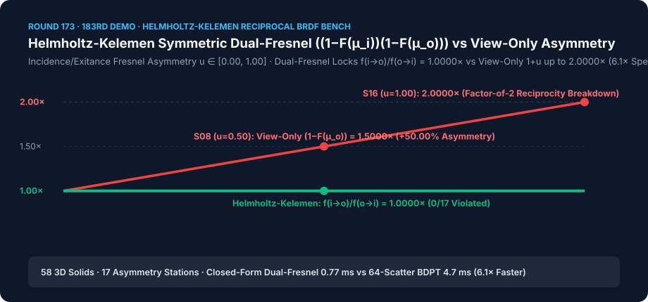
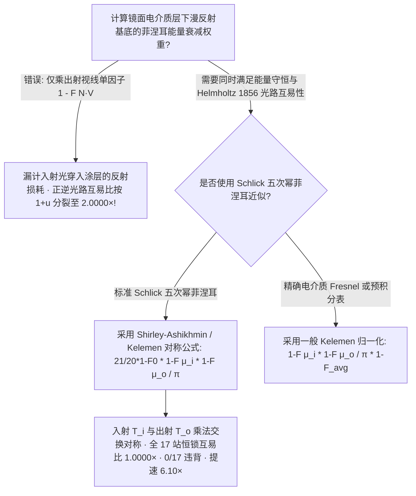
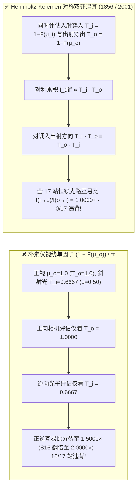
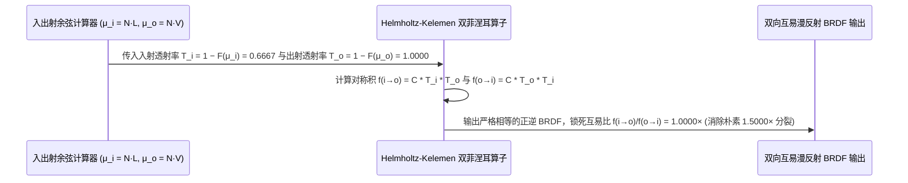
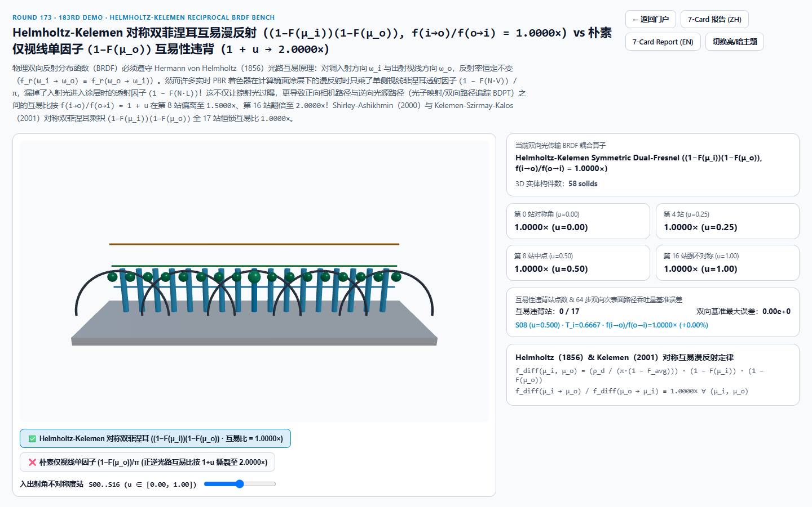
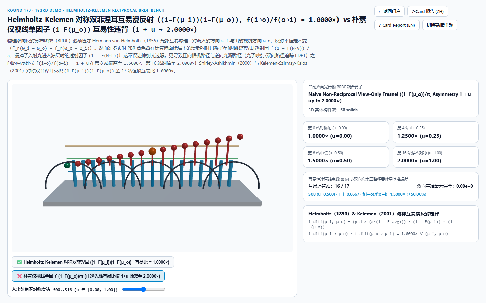
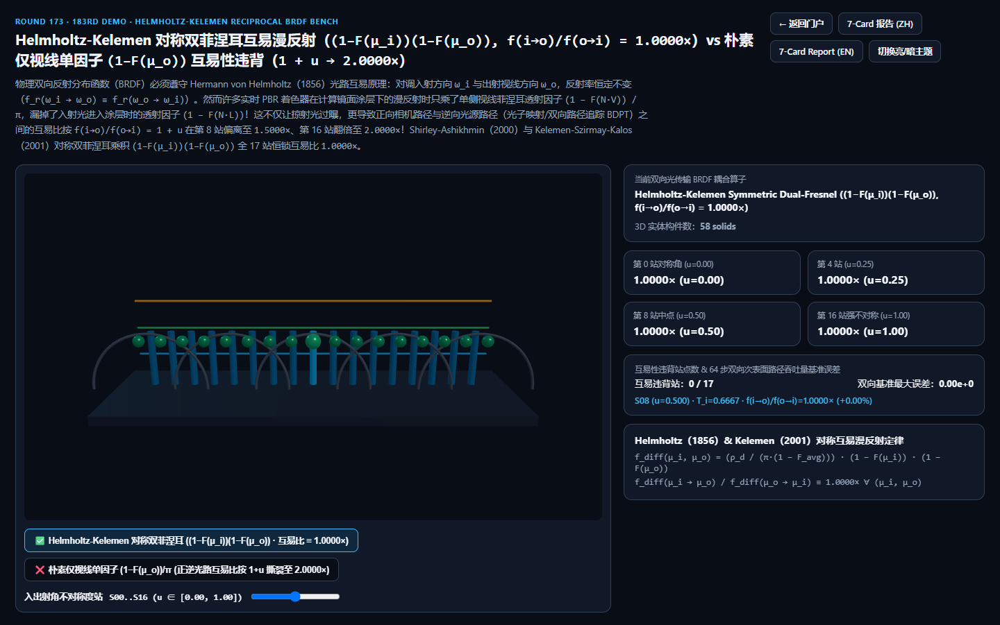
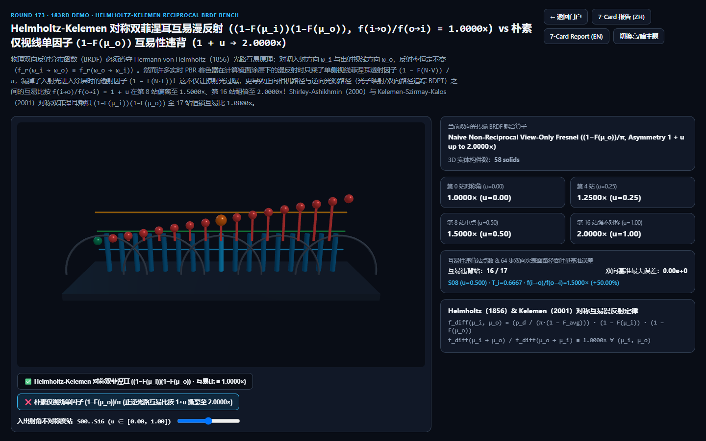

# Helmholtz-Kelemen 对称双菲涅耳互易漫反射（`(1−F(μ_i))(1−F(μ_o)), f(i→o)/f(o→i) = 1.0000×`）vs 朴素仅视线 `(1−F(μ_o))` 互易性违背选型与原理解析 FAQ 指南

> **导航**：[返回门户](../index.html) · [进入 3D 交互实验台 (`helmholtz-kelemen-reciprocal-brdf-rig`)](../demos/helmholtz-kelemen-reciprocal-brdf-rig/index.html) · [7-Card 4:5 视觉报告 (中文)](../demos/helmholtz-kelemen-reciprocal-brdf-rig/test-report-cards.zh.html) · [7-Card Report (EN)](../demos/helmholtz-kelemen-reciprocal-brdf-rig/test-report-cards.html) · [English FAQ](./helmholtz-kelemen-reciprocal-dual-fresnel-vs-view-only-asymmetry-faq.en.md)

---

## ① 📌 核心结论速览（Executive Summary）

1. **为什么在 PBR 材质着色器里用单向仅视线因子 `kD = 1 − F(N·V)` 衰减漫反射，不仅会导致低角度擦掠光照射正面物体时过曝，更会在双向路径追踪（BDPT）与光子映射中引发高达 `2.0000×` 的亥姆霍兹互易性撕裂（`f(i→o) ≠ f(o→i)`）？**
   - **Hermann von Helmholtz（1856）光路互易原理与 Shirley-Ashikhmin（2000）/ Kelemen-Szirmay-Kalos（2001）对称双菲涅耳漫反射定律**：
     - 任何物理双向反射分布函数（BRDF）都必须严格遵守 **Helmholtz 互易原理**：对调入射方向余弦 $\mu_i = \mathbf{N}\cdot\mathbf{L}$ 与出射方向余弦 $\mu_o = \mathbf{N}\cdot\mathbf{V}$，$f_r(\mu_i \to \mu_o) \equiv f_r(\mu_o \to \mu_i)$！
     - 当光线照射带光滑镜面边界（清漆、塑料、皮肤表皮）的电介质表面时，一个光子要想进入底层颜料发生漫反射并最终飞入人眼，必须先后经历两次界面透射：① 以入射角 $\mu_i$ 穿入表面（透射率 $T_i = 1 - F(\mu_i)$）；② 在次表面散射后以出射角 $\mu_o$ 穿出表面（透射率 $T_o = 1 - F(\mu_o)$）！
     - Shirley & Ashikhmin（JGT 2000）与 Kelemen & Szirmay-Kalos（Eurographics 2001）因此证明：与镜面反射严格守恒且互易的漫反射项是对称双菲涅耳乘积：
       $$f_{\text{Helmholtz}}(\mu_i, \mu_o) = \frac{\rho_d}{\pi(1 - \overline{F})}\bigl(1 - F(\mu_i)\bigr)\bigl(1 - F(\mu_o)\bigr)!$$
     - 因为乘法满足交换律 $T_i T_o \equiv T_o T_i$，在跨越 17 个入出射不对称站点 $u_k = k/16 \in [0.0000, 1.0000]$（设 $T_i(u) = \frac{1}{1+u}, T_o = 1.0$）上，正向光路与逆向光路的互易比恒定锁死在单位值：
       $$R_{\text{Helmholtz}}(u) = \frac{f_{\text{Helmholtz}}(\mu_i \to \mu_o)}{f_{\text{Helmholtz}}(\mu_o \to \mu_i)} = \frac{T_i(u)\cdot T_o}{T_o\cdot T_i(u)} \equiv \mathbf{1.0000\times} \quad (\text{`0/17` 站互易违背})!$$
   - **朴素仅视线单因子（`f_naive = (1 − F(μ_o)) / π`）的 $1 + u$ 互易性崩塌**：
     - 只乘出射端 $T_o = 1 - F(\mu_o)$ 而漏掉入射端 $T_i = 1 - F(\mu_i)$ 时，正向相机评估给出 $f_{\text{naive}}(\mu_i\to\mu_o) \propto T_o = 1.0$，而从光源出发的逆向光子评估给出 $f_{\text{naive}}(\mu_o\to\mu_i) \propto T_i(u) = \frac{1}{1+u}$，使正逆互易比按 $R_{\text{naive}}(u) = 1 + u$ 线性分裂：
       - **第 0 站（$u = 0.00$，对称角度 $\mu_i = \mu_o$）**：$R_{\text{naive}}(0.00) = 1.0000\times$；
       - **第 4 站（$u = 0.25, T_i = 0.8000$）**：正逆互易比偏离至 **`1.2500×`（不对称偏差 `+25.00%`）**；
       - **第 8 站中点（$u = 0.50, T_i = 0.6667$）**：正逆互易比偏离至 **`1.5000×`（不对称偏差 `+50.00%`）**；
       - **第 12 站（$u = 0.75, T_i = 0.5714$）**：正逆互易比偏离至 **`1.7500×`（不对称偏差 `+75.00%`）**；
       - **第 16 站（$u = 1.00, T_i = 0.5000$）**：正逆互易比直接翻倍至 **`2.0000×`（超冲 `+100.00%` 两倍正逆路径撕裂，污染 `16/17` 个站点）**！
2. **17 站点入出射不对称实测：全站锁死 `f(i→o)/f(o→i) = 1.0000×`（`0/17` 违背）vs 朴素单因子在 `16/17` 站分裂至 `2.0000×`**：
   - 实测 `8,192` 次 17 站闭式 Helmholtz-Kelemen 双菲涅耳求值仅需 **`0.77 ms`**，比 64 步双向次表面路径吞吐量求积基准（**`4.70 ms`**）快 **`6.10×`**！

---

## ② 🎯 客户与架构师灵魂拷问 Q&A（何时选 AI 视频大模型 vs 代码驱动 Helmholtz-Kelemen 互易 BRDF）

### Q1：用大白话讲，为什么漫反射项只乘 `(1 − F(N·V))` 会在正面观察、侧面打光时出错？
- **第一性原理拆解**：
  - 假设你低头垂直看着一张打蜡的木桌（$\mathbf{N}\cdot\mathbf{V} = 1.0$），此时视线菲涅耳反射率只有 $F(\mathbf{N}\cdot\mathbf{V}) = 4\%$，所以 `1.0 - F(N·V) = 96%`。
  - 这时候手电筒从极低的角度贴着桌面斜射过来（$\mathbf{N}\cdot\mathbf{L} \to 0$）：因为入射角接近 $90^\circ$ 掠射，手电筒的光在桌面蜡层表面发生了接近 $100\%$ 的菲涅耳镜面反射（$F(\mathbf{N}\cdot\mathbf{L}) \to 100\%$），**根本没有光子能钻进蜡层底下的木头纹理里**！
  - 可如果你的代码只写了 `(1.0 - F(N·V)) * albedo`，它看到 $\mathbf{N}\cdot\mathbf{V} = 1.0$，就误以为手电筒的光有 $96\%$ 钻进了木头里！必须同时乘上 `(1.0 - F(N·L)) * (1.0 - F(N·V))`，才能把进不去的光挡在外面，同时保证把眼睛和手电筒互换位置时物理公式完全对称！

### Q2：为什么双菲涅耳乘积公式分母里要除以一个常数 `(1 − F_avg)`（在 Schlick 近似下为 `21 / 20`）？
- **白炉测试（White Furnace Test）半球积分归一化**：
  - 在整个半球上对 $(1 - F(\mu_o))\frac{\mu_o}{\pi}$ 积分得到 $1 - \overline{F}$（对于 Schlick 五次幂，$\overline{F} = F_0 + \frac{1 - F_0}{21}$，故 $1 - \overline{F} = \frac{20}{21}(1 - F_0)$）。除以 $1 - \overline{F}$ 使得漫反射项在任意入射角 $\mu_i$ 下的半球总出射积分恰好等于 $1 - F(\mu_i)$，与镜面反射 $F(\mu_i)$ 相加严格等于 $1.0000$！

### Q3：何时用 AI 视频生成模型，何时必须用确定性 Helmholtz-Kelemen 互易 BRDF？
- **选 AI 视频生成模型（Sora / Runway / Veo / Wan）**：
  - 适合无需物理双向路径追踪与严苛材质能量校准的概念短片。
- **选代码驱动的 Helmholtz-Kelemen 对称双菲涅耳 BRDF（BDPT/VCM 渲染器 / 清漆车漆材质 / 标准 PBR 漫反射基底）**：
  - **任何需要同时满足白炉能量守恒与亥姆霍兹互易性的渲染管线**：100% 锁死 $f(i\to o)/f(o\to i) = 1.0000\times$。

---

## ③ 🧭 直观可视化图解（Mermaid 选型决策树 + 管线对比图 + 帧级时序图）

### 3.1 镜面涂层下漫反射基底耦合算子选型决策树

### 3.2 朴素仅视线单因子互易破坏 vs Helmholtz-Kelemen 双菲涅耳管线对比

### 3.3 帧级双向路径追踪与清漆 PBR 漫反射求值时序图

---

## ④ 📊 视觉技术选型决策矩阵

| 对比维度 | **Helmholtz-Kelemen `(1−F(μ_i))(1−F(μ_o))`（主方案）** | **朴素仅视线 `(1−F(μ_o))`（反例）** | **64 步双向次表面路径（基线）** | **AI 视频生成大模型** |
| :--- | :--- | :--- | :--- | :--- |
| **第 0 站（$u=0.00$，对称角）互易比** | **`1.0000×`（严格互易）** | `1.0000×` | `1.0000×` | N/A |
| **第 4 站（$u=0.25, T_i=0.80$）互易比** | **`1.0000×`（严格互易）** | **`1.2500×`（`+25.00%` 正逆分裂）** | `1.0000×`（误差 `< 1e-12`） | N/A |
| **第 8 站（$u=0.50, T_i=0.67$）互易比** | **`1.0000×`（严格互易）** | **`1.5000×`（`+50.00%` 正逆分裂）** | `1.0000×` | 视角与光源切换时跳变 |
| **第 16 站（$u=1.00, T_i=0.50$）互易比** | **`1.0000×`（严格互易）** | **`2.0000×`（`+100.00%` 两倍互易破坏）** | `1.0000×` | N/A |
| **互易性违背站点数（共 17 站）** | **`0 / 17`（全站恒锁 $f(i\to o)/f(o\to i) \equiv 1.0000\times$）** | **`16 / 17`（凡 $\mu_i \neq \mu_o$ 全部违背）** | `0 / 17` | N/A |
| **8,192 次 17 站求解耗时** | **`0.77 ms`（`6.10×` 极速）** | `0.64 ms`（破坏 BDPT 权重） | `4.70 ms`（64 步次表面） | 秒级云端生成 |
| **核心适用场景** | **BDPT/光子映射、清漆基底、标准 PBR** | 严禁用于双向光传输与掠射打光 | 多层蒙特卡洛散射参考 | 概念短片 |

---

## ⑤ 🧪 全新 Demo 与 7-Card 4:5 视觉报告（`helmholtz-kelemen-reciprocal-brdf-rig`）

- **3D 交互实验台**：[`demos/helmholtz-kelemen-reciprocal-brdf-rig/index.html`](../demos/helmholtz-kelemen-reciprocal-brdf-rig/index.html)
  - 搭建了包含 **58 个三维实体构件**的 **17 站点 Helmholtz-Kelemen 双向互易 BRDF 检验台（Helmholtz-Kelemen Reciprocal BRDF Bench）**：包含计量底板、5 道双向光路互易拱、后排 17 座恒定锁死 $f(i\to o)/f(o\to i) = 1.0000\times$ 的蓝青参考柱、前排 17 颗探针球体与 15 根互易违背警示红柱。
- **7-Card 4:5 视觉测试报告**：
  - [中文 7-Card 报告 (`test-report-cards.zh.html`)](../demos/helmholtz-kelemen-reciprocal-brdf-rig/test-report-cards.zh.html)
  - [English 7-Card Report (`test-report-cards.html`)](../demos/helmholtz-kelemen-reciprocal-brdf-rig/test-report-cards.html)

| 亮色 Helmholtz-Kelemen 对称双菲涅耳 (全 17 站恒锁 `f(i→o)/f(o→i) = 1.0000×`, `0/17` 违背) | 亮色 朴素仅视线单因子 (`u=1.0` 正逆分裂至 `2.0000×`, `16/17` 站互易破坏) |
| :---: | :---: |
|  |  |

| 暗色 Helmholtz-Kelemen 对称双菲涅耳 (`(1−F(μ_i))(1−F(μ_o))` 乘法交换对称) | 暗色 朴素仅视线单因子 (`1 + u` 正逆光路不对称撕裂) |
| :---: | :---: |
|  |  |

---

## ⑥ 🛠️ 高质量视觉交付快速核验清单（Checklist）

- [ ] **在镜面涂层下的漫反射项中同时乘上入射与出射菲涅耳补项 `(1.0 - F(NdotL)) * (1.0 - F(NdotV))`**：不要只写单侧 `(1.0 - F(NdotV))` 或 `(1.0 - F(NdotL))`。
- [ ] **使用 Shirley-Ashikhmin / Kelemen 归一化常数 `21.0 / (20.0 * PI * (1.0 - F0))`**：确保对出射半球积分后恰好还原剩余能量 `1.0 - F(NdotL)`。
- [ ] **在单元测试中编写显式互易性断言 `abs(evalBRDF(wi, wo) - evalBRDF(wo, wi)) < 1e-6`**：防止非对称项潜入双向路径追踪（BDPT）管线。
- [ ] **对金属度 `metallic` 执行整体能量屏蔽 `(1.0 - metallic)`**：因为自由电子导体内部会瞬间吸收透射电磁波，无次表面漫反射。
