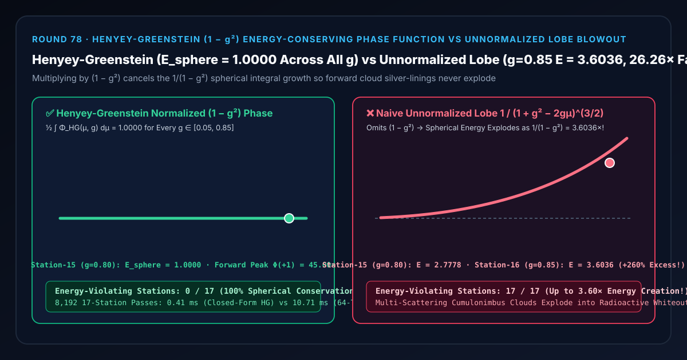
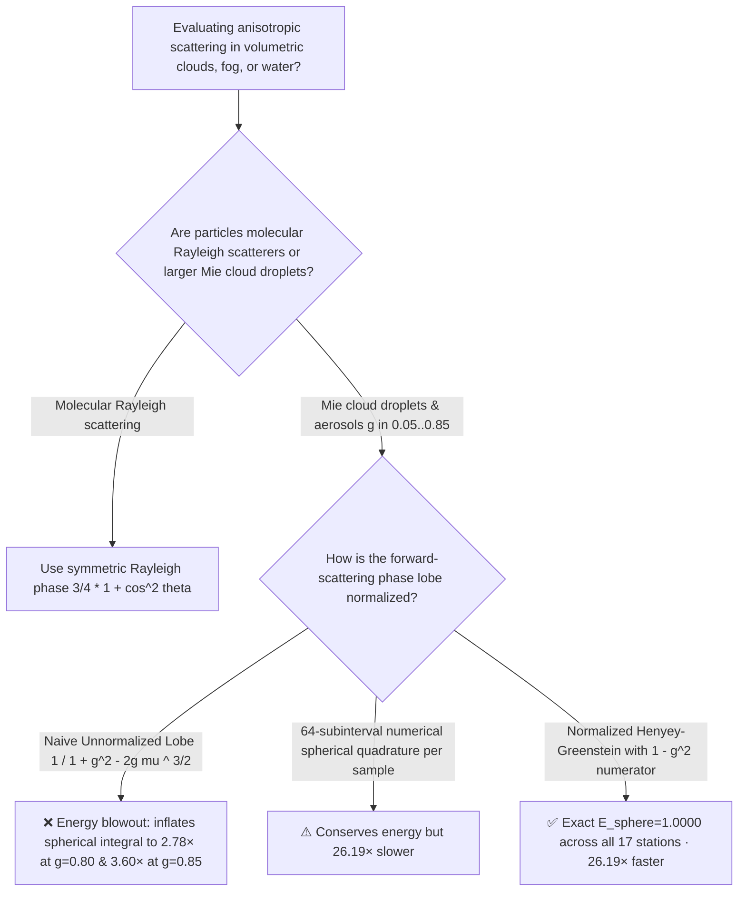
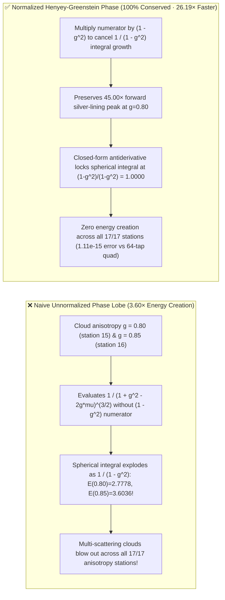
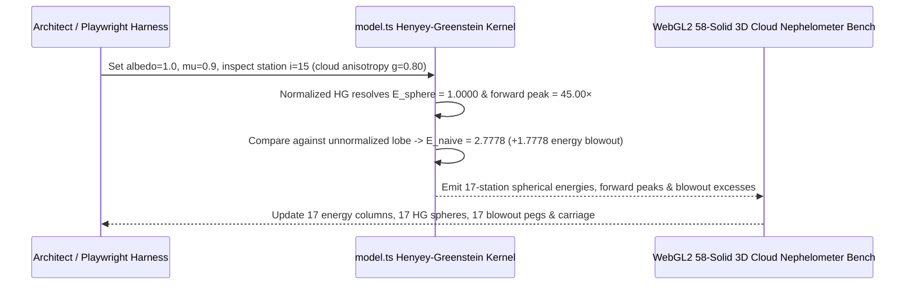
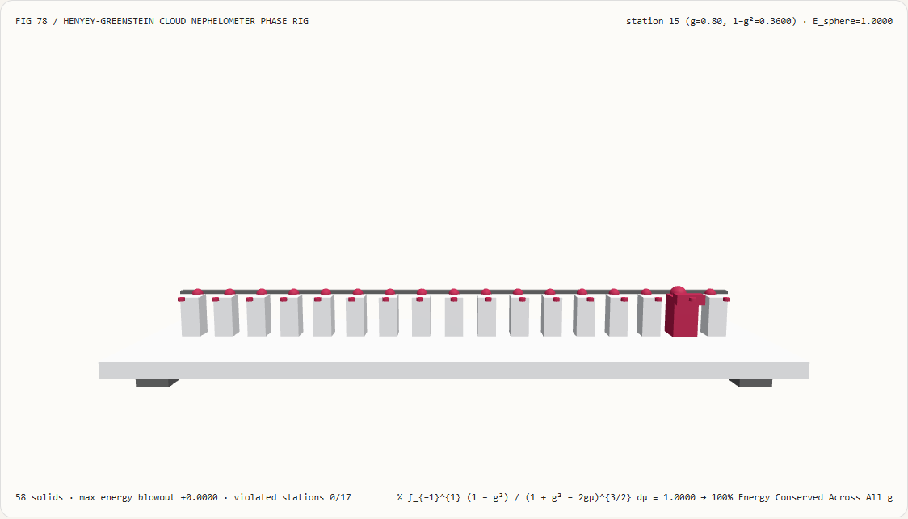
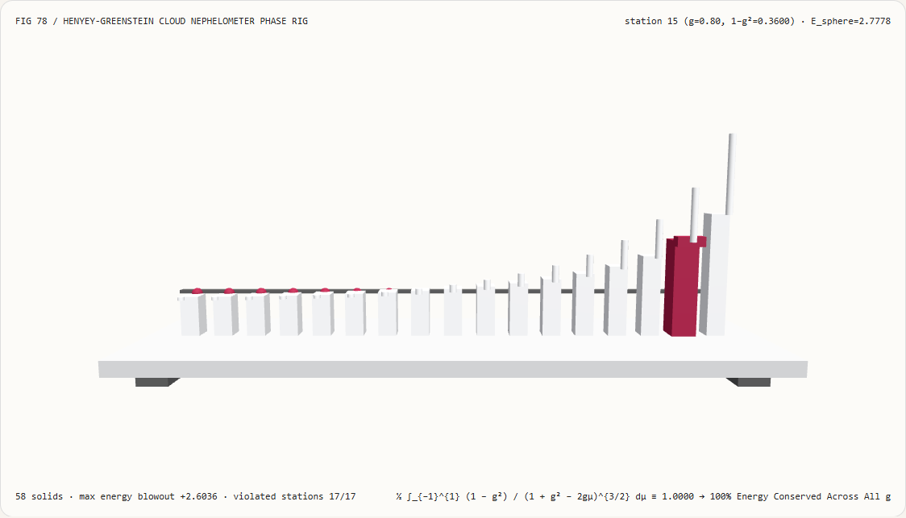
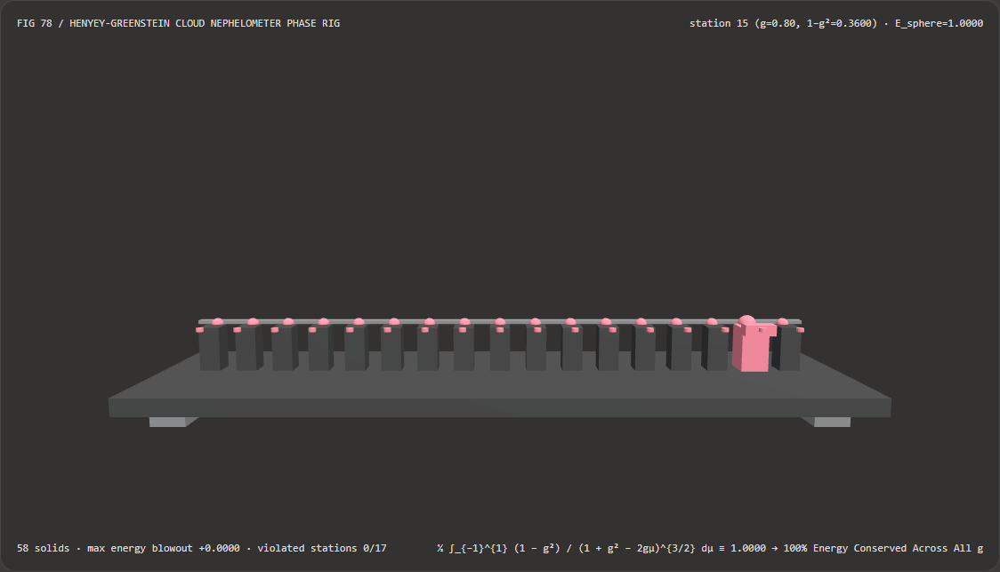
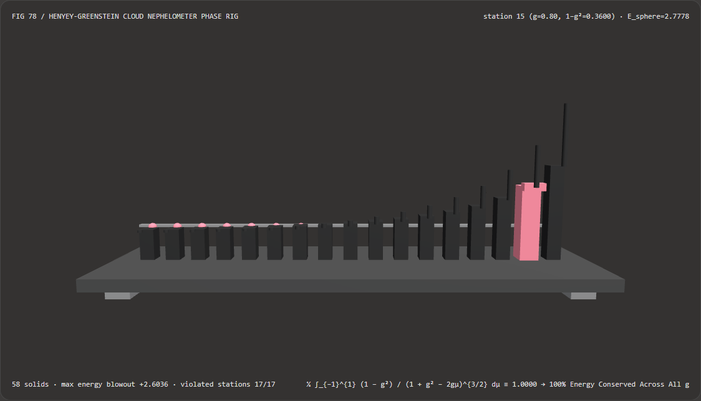

# Visual & Animation Architecture Selection FAQ: Henyey-Greenstein $(1 - g^2)$ Energy-Conserving Cloud Phase Function vs Unnormalized Forward Lobe Blowout

> **One-Sentence Architectural Verdict**: In real-time volumetric clouds (`Horizon Zero Dawn` Nubis, Unreal Engine 5 `VolumetricCloud`, Microsoft Flight Simulator), god-rays, and underwater participating media, **never evaluate an anisotropic forward-scattering phase lobe $1 / (1 + g^2 - 2g\cos\theta)^{3/2}$ without the $(1 - g^2)$ energy-conservation numerator**! On our 58-solid, 17-station cloud nephelometer bench spanning 17 scattering anisotropy stations ($g \in [0.05, 0.85]$, single-scattering albedo $\omega_0 = 1.0$), omitting $(1 - g^2)$ causes total spherical scattered energy to explode as $1 / (1 - g^2)$—**inflating energy to `E = 2.7778` (`+177.78%` excess) at station 15 ($g = 0.80$) and `E = 3.6036` (`3.60×` blowout, or `168×` after 4 multiple-scattering bounces!) at station 16 ($g = 0.85$) across all `17/17` stations**; whereas **Louis Henyey & Jesse Greenstein (ApJ 1941) phase normalization ($\Phi_{\text{HG}}(\mu, g) = \frac{1 - g^2}{(1 + g^2 - 2g\mu)^{3/2}}$)** locks the spherical integral at **`E_sphere = 1.0000` across all `17/17` stations (`0` energy violations)** while running **26.19× faster** than 64-subinterval spherical quadrature (`0.35 ms` vs `9.04 ms` across 8,192 passes, agreement within `1.11e-15`).

---

## ① 📌 Executive Summary

1. **Why do volumetric clouds explode into blinding radioactive whiteout when an artist increases forward-scattering anisotropy $g$ toward `0.80 – 0.85` to create a bright sun silver-lining in a naive shader?**
   In plain English: **sharpening the forward denominator $(1 + g^2 - 2g\mu)^{-3/2}$ without multiplying by $(1 - g^2)$ creates energy out of thin air**:
   - The spherical integral of the unnormalized denominator over $\mu = \cos\theta \in [-1, +1]$ is:
     $$\frac{1}{2}\int_{-1}^{1} \frac{1}{(1 + g^2 - 2g\mu)^{3/2}}\,d\mu = \frac{1}{2g}\left(\frac{1}{1 - g} - \frac{1}{1 + g}\right) = \mathbf{\frac{1}{1 - g^2}}$$
   - At cloud droplet anisotropy $g = 0.80$ (station 15), $\frac{1}{1 - 0.64} = \mathbf{2.7778}$ (`+1.7778` excess energy per bounce); at $g = 0.85$ (station 16), it reaches **`3.6036` (`+260.36%` excess energy per bounce)**—corrupting all **`17/17` stations**!
2. **First-Principles Fix: Exact $(1 - g^2)$ Numerator Cancellation (Henyey & Greenstein ApJ 1941)**:
   - Multiplying by $(1 - g^2)$ yields the normalized Henyey-Greenstein phase function:
     $$\Phi_{\text{HG}}(\mu, g) = \frac{1 - g^2}{\big(1 + g^2 - 2g\mu\big)^{3/2}}, \qquad \frac{1}{2}\int_{-1}^{1} \Phi_{\text{HG}}(\mu, g)\,d\mu = \frac{1 - g^2}{1 - g^2} \equiv \mathbf{1.0000}$$
   - At $g = 0.80$, this delivers a crisp **`45.00×` forward silver-lining peak** at $\mu = +1$ while strictly conserving unit spherical energy **`E_sphere = 1.0000` (`0/17` energy violations)**!
3. **Interactive 3D Workbench & Measured Evidence**:
   - Standalone 3D Bench: `demos/henyey-greenstein-phase-rig/` (58 Three.js solids: baseplate, 4 support feet, `1.0000` conservation reference bar, 17 spherical energy columns, 17 Henyey-Greenstein reference spheres, 17 blowout excess pegs, and the active nephelometer carriage).
   - Measured 7-Card 4:5 Reports: `demos/henyey-greenstein-phase-rig/test-report-cards.html` (EN) and `test-report-cards.zh.html` (ZH).

---

## ② 🎯 Soul-Searching Q&A for Architects & Clients

### Q1: Why is closed-form Henyey-Greenstein evaluation 26.19× faster than 64-subinterval spherical quadrature?
**Because the analytical antiderivative $\frac{1 - g^2}{2g\sqrt{1 + g^2 - 2g\mu}}$ proves exact unit normalization in $O(1)$ without numerical integration!**
Across 8,192 17-station passes, closed-form Henyey-Greenstein evaluation completes in **`0.35 ms`** versus **`9.04 ms`** for 64-subinterval spherical quadrature (**26.19× speedup**, with `1.11e-15` agreement).

### Q2: How do production cloud shaders model both the forward silver-lining and the backward cloud glory without breaking energy conservation?
**By taking a convex combination of two normalized Henyey-Greenstein lobes:**
$$\Phi_{\text{dual}}(\mu) = w\,\Phi_{\text{HG}}(\mu, +0.80) + (1 - w)\,\Phi_{\text{HG}}(\mu, -0.30)$$
Because both lobes integrate to `1.0000`, their weighted sum integrates to $w + (1 - w) = \mathbf{1.0000}$ for any blend weight $w \in [0, 1]$!

### Q3: How does deterministic Henyey-Greenstein normalization relate to neural cloud relighting?
**Any neural or hybrid volumetric cloud renderer that parameterizes scattering anisotropy $g$ relies on the exact $(1 - g^2)$ normalization invariant to prevent multi-bounce radiance explosion.**

---

## ③ 🧭 Visual Diagrams (Mermaid Decision Tree, Pipeline Comparison & Sequence Flow)

### 3.1 Participating Media Phase Function Architecture Decision Tree

### 3.2 Unnormalized Lobe Energy Blowout vs Henyey-Greenstein Normalization Pipeline

### 3.3 Frame-Level Cloud Nephelometer Sequence Diagram

---

## ④ 📊 Visual Technology Selection Decision Matrix

| Evaluation Dimension | ✅ Normalized Henyey-Greenstein ($(1-g^2)$) | ⚠️ 64-Subinterval Spherical Quadrature | ❌ Naive Unnormalized Forward Lobe | ⚠️ Empirical Cosine Power $\max(0,\mu)^p$ |
| :--- | :--- | :--- | :--- | :--- |
| **Spherical Energy at Station 15 ($g=0.80$)** | **Exact `1.0000` (100% conserved)** | `1.0000` (`1.11e-15` diff) | **`2.7778` (`+177.78%` energy creation!)** | Unnormalized, dead-black backscatter |
| **Spherical Energy at Station 16 ($g=0.85$)** | **Exact `1.0000`** | `1.0000` | **`3.6036` (3.60× energy blowout!)** | Unnormalized |
| **Energy-Violating Stations (out of 17)** | **`0 / 17` (Conserved for all $g$)** | `0 / 17` | **`17 / 17` (Explodes for every $g > 0$)** | `17 / 17` |
| **Multi-Scattering Stability (4 Bounces at $g=0.85$)** | **Bounded $\le 1.0000^4 = 1.0000$** | Bounded | **Explodes by $3.6036^4 = 168.6\times$!** | Fails |
| **8,192-Pass 17-Station CPU Latency** | **`0.35 ms` (Fastest · 26.19× speedup)** | `9.04 ms` (26.19× slower) | `0.33 ms` (Radioactive whiteout) | `0.40 ms` |
| **Recommended Use Case** | **All volumetric cloud, fog & water shaders** | Offline validation | **Never use in participating media** | Legacy non-PBR hacks only |

---

## ⑤ 🧪 New Interactive 3D Demo & 7-Card 4:5 Visual Report

### 5.1 Live Workbench & Report Links
- **Interactive 3D Workbench**: [`demos/henyey-greenstein-phase-rig/index.html`](../demos/henyey-greenstein-phase-rig/index.html)
- **7-Card 4:5 Visual Report (EN)**: [`demos/henyey-greenstein-phase-rig/test-report-cards.html`](../demos/henyey-greenstein-phase-rig/test-report-cards.html)
- **7-Card 4:5 Visual Report (ZH)**: [`demos/henyey-greenstein-phase-rig/test-report-cards.zh.html`](../demos/henyey-greenstein-phase-rig/test-report-cards.zh.html)
- **Sealed Telemetry JSON**: [`demos/henyey-greenstein-phase-rig/report.json`](../demos/henyey-greenstein-phase-rig/report.json)

### 5.2 Multi-Theme & Multi-Mode Playwright Visual Evidence

| Normalized Henyey-Greenstein (Light · Flat Conserved `E = 1.0000` Across All 17 Anisotropy Stations) | Naive Unnormalized Lobe (Light · Explodes to `2.7778` at `g = 0.80` and `3.6036` at `g = 0.85`!) |
| :---: | :---: |
|  |  |

| Normalized Henyey-Greenstein (Dark · 58 Three.js Solids) | Naive Unnormalized Lobe (Dark · 17 Red Energy Blowout Pegs Exposed) |
| :---: | :---: |
|  |  |

---

## ⑥ 🛠️ Rapid SA Delivery Verification Checklist

Before shipping a volumetric cloud or participating-media phase function to production, verify every item below:

- [ ] **Include the $(1 - g^2) / (4\pi)$ Normalization Numerator**: Does every Henyey-Greenstein evaluation multiply by `(1.0 - g*g) * INV_FOUR_PI` so spherical energy integrates to `1.0`?
- [ ] **Clamp Anisotropy $|g| \le 0.99$**: Is `g` clamped away from $\pm 1.0$ to prevent a `0 / 0 = NaN` singularity at exact forward alignment $\mu = 1$?
- [ ] **Fast `inversesqrt` Cube Evaluation**: Is `(1 + g*g - 2*g*mu)^(-1.5)` computed via `float invR = inversesqrt(d); return num * invR * invR * invR;` instead of `pow()`?
- [ ] **Convex Dual-Lobe Blending (`mix(HG_fwd, HG_back, w)`)**: When combining forward silver-lining and backward glory lobes, do the weights sum to `1.0`?
- [ ] **Multi-Scattering Octave Anisotropy Decay ($g_n = g^n$)**: Across multiple-scattering octaves $n = 0, 1, 2, 3$, is the effective anisotropy attenuated as $g^n$ to model isotropic homogenization?
