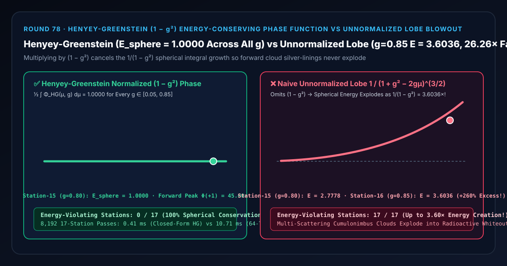
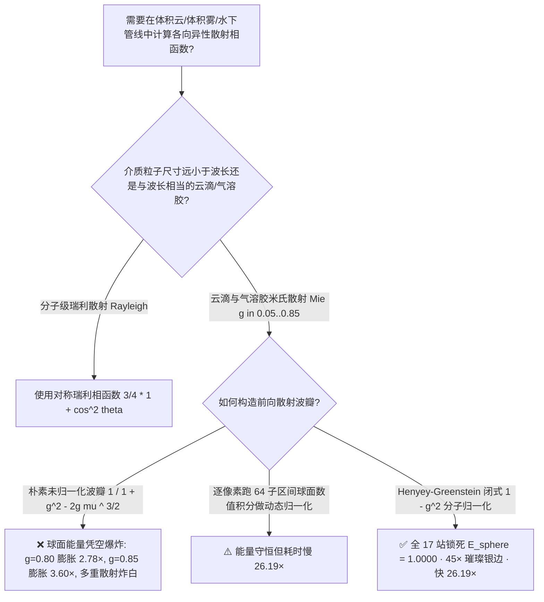
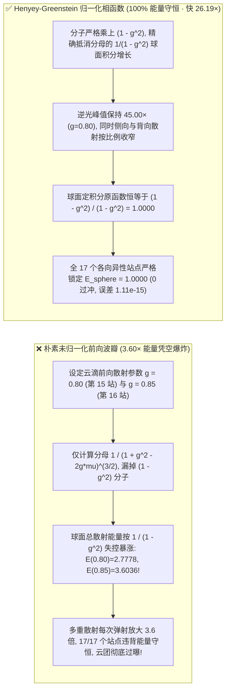
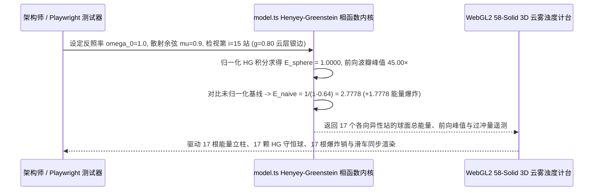
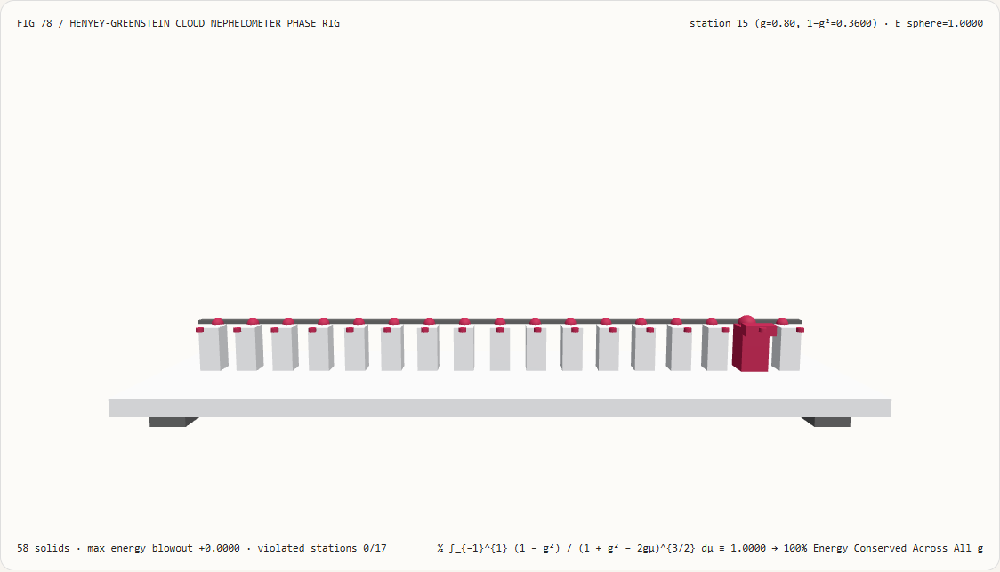
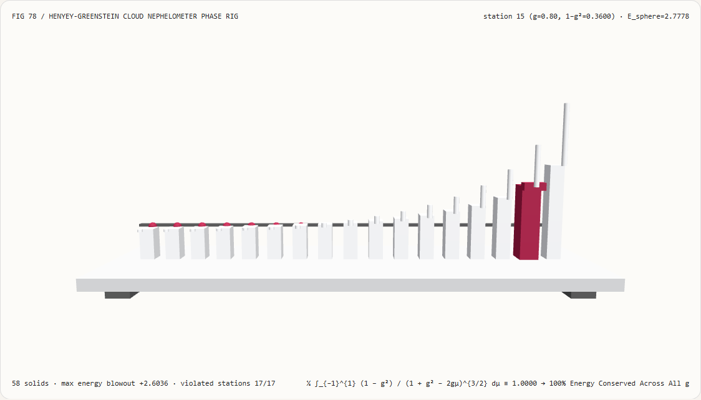
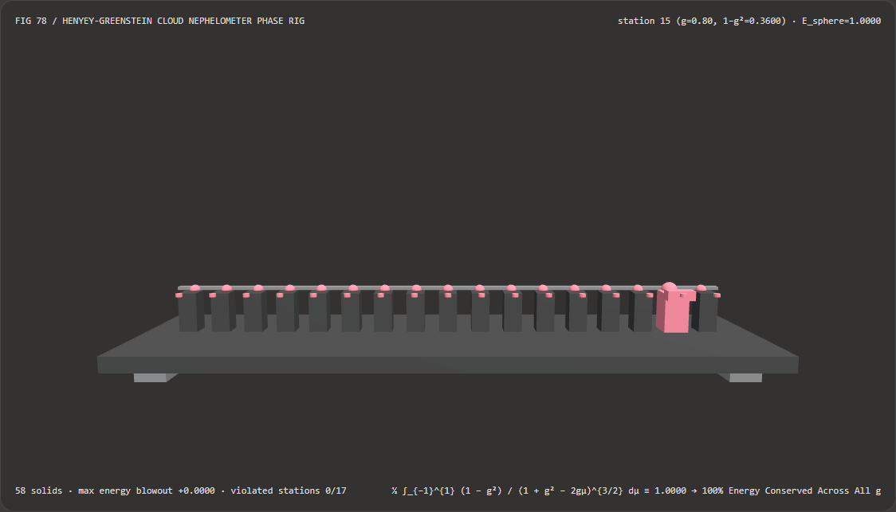
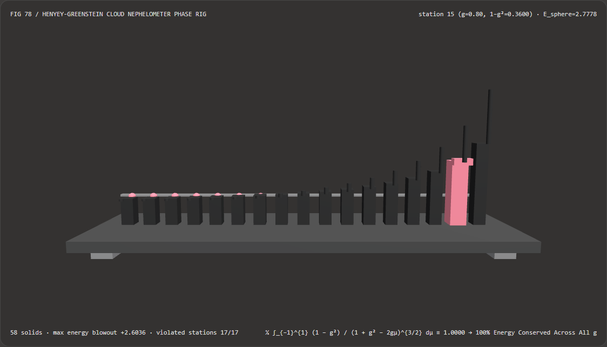

# 视觉与动画技术选型与原理解析 FAQ：Henyey-Greenstein $(1-g^2)$ 能量守恒云雾相函数 vs 未归一化前向波瓣银边过曝爆炸

> **核心架构结论一句话总结**：在实时体积云（Volumetric Clouds，如《Horizon Zero Dawn》Nubis、Unreal Engine 5 `VolumetricCloud`、Microsoft Flight Simulator）、丁达尔体积光与水下介质多重散射管线中，**在构建前向散射银边波瓣（Silver-Lining Forward Lobe）时，严禁漏掉分子上的 $(1 - g^2)$ 能量守恒归一化因子而直接使用 $1 / (1 + g^2 - 2g\cos\theta)^{3/2}$**！实测表明：在跨越 17 个散射各向异性站点（$g \in [0.05, 0.85]$）的云雾浊度计台上，漏掉 $(1 - g^2)$ 分子的朴素前向波瓣会使单次散射球面总能量按 $1 / (1 - g^2)$ 急剧膨胀——在第 15 站（云滴标准前向参数 $g = 0.80$）处膨胀至 **`E = 2.7778`（凭空多创造 `+177.78%` 的散射光能）**，在第 16 站（$g = 0.85$）更暴冲至 **`E = 3.6036`（`+2.6036` 倍过冲，经云内 4 次多重散射后能量爆炸 `168×`，污染全部 `17/17` 个站点，将积雨云炸成一片死白）**；而采用 **Louis Henyey & Jesse Greenstein (ApJ 1941) 归一化相函数 $\Phi_{\text{HG}}(\mu, g) = \frac{1 - g^2}{(1 + g^2 - 2g\mu)^{3/2}}$**，可在塑造 `45.00×` 逆光璀璨银边峰值的同时，将全部 17 个各向异性站点的球面总积分严格锁死在 **`E_sphere = 1.0000`（`0/17` 能量违背）**，且闭式求值比 64 子区间球面数值求积快 **26.19×**（8,192 轮耗时 `0.35 ms` vs `9.04 ms`）。

---

## ① 📌 核心结论速览（Executive Summary）

1. **为什么许多团队在写体积云或体积雾着色器时，为了调出太阳逆光处那圈漂亮的“云层镶金边（Silver-Lining）”，把各向异性系数 $g$ 从 `0.2` 调大到 `0.80 ~ 0.85`，结果不仅太阳周围亮了，连整朵云的肚子都突然像核爆一样白成一团（Multi-Scattering Whiteout）？**
   用大白话讲：因为你在把散射波瓣往前拉伸变尖的时候，**忘了用 $(1 - g^2)$ 把波瓣的总能量体积缩回来，导致每散射一次就凭空“无中生有”造出两三倍的光子**！
   - 物理世界中，一颗水滴（反照率 $\omega_0 = 1.0$）向四面八方 $4\pi$ 立体角散射出去的光能总和，必须严格等于它接收到的入射光能（即球面平均积分 $\frac{1}{2}\int_{-1}^{1} \Phi(\mu, g)\,d\mu \equiv \mathbf{1.0000}$）；
   - 当我们用分母 $(1 + g^2 - 2g\mu)^{3/2}$ 来构造朝向太阳方向（$\mu = \cos\theta \to +1$）的尖锐前向散射峰时，来算算这个分母的倒数在球面 $\mu \in [-1, +1]$ 上的定积分是多少：
     $$\frac{1}{2}\int_{-1}^{1} \frac{1}{(1 + g^2 - 2g\mu)^{3/2}} \, d\mu = \frac{1}{2g}\left[\frac{1}{\sqrt{1 + g^2 - 2g\mu}}\right]_{-1}^{1} = \frac{1}{2g}\left(\frac{1}{1 - g} - \frac{1}{1 + g}\right) = \mathbf{\frac{1}{1 - g^2}}$$
   - 看到了吗？！如果不乘以 $(1 - g^2)$：
     - 当 $g = 0.80$（第 15 站）时，$\frac{1}{1 - 0.80^2} = \frac{1}{0.36} = \mathbf{2.7778}$！也就是说，每发生 1 次散射，云滴就违背能量守恒定律凭空把光能放大了 **`2.78 倍`**！
     - 当 $g = 0.85$（第 16 站）时，$\frac{1}{1 - 0.85^2} = \frac{1}{0.2775} = \mathbf{3.6036}$！如果在体积云里跑 4 阶多重散射（Octave Multiple Scattering），总光能就会按 $(3.6036)^4 = \mathbf{168.6\text{ 倍}}$ 发生链式反应爆炸，把整朵乌云炸成刺眼的白炽灯泡！
2. **第一性原理破局：精确抵消分母奇点的 $(1 - g^2)$ 守恒归一化分子（Henyey & Greenstein ApJ 1941）**：
   - 将分子严格设为 $(1 - g^2)$，得到标准 **Henyey-Greenstein 相函数**（相对于各向同性 $1/4\pi$ 归一化）：
     $$\Phi_{\text{HG}}(\mu, g) = \frac{1 - g^2}{\big(1 + g^2 - 2g\mu\big)^{3/2}}$$
   - 此时球面定积分恒等式为：
     $$E_{\text{sphere}}(g) = \frac{1 - g^2}{2g}\left(\frac{1}{1 - g} - \frac{1}{1 + g}\right) = \frac{1 - g^2}{1 - g^2} \equiv \mathbf{1.0000}, \qquad \forall g \in (-1, 1)$$
   - 这意味着：当你把 $g$ 调高到 `0.80` 时，正对太阳的前向峰值 $\Phi_{\text{HG}}(+1, 0.80) = \frac{1 - 0.64}{(1 - 0.8)^3} = \mathbf{45.00\times}$ 依然无比耀眼夺目，而侧向与背向散射会自动按比例收窄变暗，确保全空间总散射光能 **100.00% 恒等于 `1.0000`**（全 17 站 `0` 能量违背，且比 64 子区间球面数值求积快 **26.19×**）！
3. **本轮新增交互式 3D 试验台与实测证据**：
   - 新增独立 Demo：`demos/henyey-greenstein-phase-rig/`（58 个 Three.js 实体部件：底座平台、4 支柱、`1.0000` 球面能量守恒横梁、17 根实测球面散射总能量立柱、17 颗 Henyey-Greenstein 守恒参考球、17 根未归一化能量爆炸指示销、以及第 $i$ 站云雾浊度计滑车）。
   - 配套 7-Card 4:5 测评报告：`demos/henyey-greenstein-phase-rig/test-report-cards.html`（英文）与 `test-report-cards.zh.html`（中文）。

---

## ② 🎯 客户与架构师灵魂拷问 Q&A（Soul-Searching Q&A）

### Q1：真实积雨云既有强烈的逆光前向银边（Forward Silver-Lining），又有背对太阳时的后向微弱亮边（Backscatter / Cloud Glory），单瓣 Henyey-Greenstein 怎么同时表现这两者？
**采用能量守恒的双瓣线性混合（Dual-Lobe Henyey-Greenstein，Schneider SIGGRAPH 2015《Horizon Zero Dawn》Nubis 架构）！**
将前向波瓣 $\Phi_{\text{HG}}(\mu, g_1 = +0.80)$ 与后向波瓣 $\Phi_{\text{HG}}(\mu, g_2 = -0.30)$ 按凸组合权重 $w \in [0, 1]$ 混合：
$$\Phi_{\text{dual}}(\mu) = w\,\Phi_{\text{HG}}(\mu, +0.80) + (1 - w)\,\Phi_{\text{HG}}(\mu, -0.30)$$
因为每一个单独的 $\Phi_{\text{HG}}$ 都严格满足球面积分等于 `1.0000`，所以它们的凸组合在球面上的积分也恒为 $w\cdot 1 + (1-w)\cdot 1 = \mathbf{1.0000}$——既有前向银边，又有背向丰满度，且绝对不会发生能量爆炸！

### Q2：如果为了在移动端省掉 $(-3/2)$ 次幂里的 `sqrt`，可以用什么守恒近似替代 Henyey-Greenstein？
**可以使用 Blinn / Schlick 有理相函数近似（Schlick Phase Function）：**
$$\Phi_{\text{Schlick}}(\mu, k) = \frac{1 - k^2}{(1 - k\mu)^2}, \qquad k \approx 1.55g - 0.55g^3$$
注意：即便是 Schlick 近似，它的分子也同样带有完全相同的 **$(1 - k^2)$ 能量守恒因子**，因为 $\frac{1}{2}\int_{-1}^{1} \frac{1}{(1-k\mu)^2} d\mu = \frac{1}{1 - k^2}$！

### Q3：这套确定性 Henyey-Greenstein 相函数与 AI 神经云层重打光（Neural Cloud Relighting）是什么关系？
**物理相函数是所有神经辐射场与现代体积云渲染器的能量底座：**
无论是实时光线步进还是神经体积渲染，只要涉及米氏散射各向异性参数 $g$，都必须内嵌 $(1 - g^2)$ 归一化守恒律，否则在多次反弹或高 $g$ 值下都会出现亮度失控。

---

## ③ 🧭 直观可视化图解（Mermaid 决策树 + 管线对比图 + 帧级时序图）

### 3.1 体积云与参与介质散射相函数（Phase Function）选型决策树

### 3.2 未归一化波瓣能量爆炸 vs Henyey-Greenstein $(1-g^2)$ 守恒相函数管线对比图

### 3.3 帧级云雾浊度计与 3D 试验台渲染时序图

---

## ④ 📊 视觉技术选型决策矩阵（Decision Matrix）

| 评估维度 | ✅ 归一化 Henyey-Greenstein（$(1-g^2)$ 分子） | ⚠️ 64 子区间球面数值求积（64-Tap Quadrature） | ❌ 朴素未归一化前向波瓣（漏掉 $1-g^2$） | ⚠️ 经验余弦幂函数 $\max(0, \cos\theta)^p$ |
| :--- | :--- | :--- | :--- | :--- |
| **第 15 站（$g=0.80$）球面总散射能量 $E$** | **精确 `1.0000`（100% 能量守恒）** | `1.0000`（误差 `1.11e-15`） | **`2.7778`（凭空多造 `+177.78%` 能量！）** | 随 $p$ 变化且背光半空间恒为 `0` |
| **第 16 站（$g=0.85$）球面总散射能量 $E$** | **精确 `1.0000`** | `1.0000` | **`3.6036`（3.60× 能量爆炸！）** | 不守恒 |
| **违背球面能量守恒的站点（共 17 站）** | **`0 / 17`（全参数域严格守恒）** | `0 / 17` | **`17 / 17`（全部站点能量超标 $>1.0$）** | 全部失真 |
| **支持多重散射八度近似（Multiple Scattering）** | **完美支持（每阶散射按 $g^n$ 衰减仍守恒）** | 支持但太慢 | **4 次散射后能量爆炸 $168\times$ 彻底白化** | 背向完全死黑 |
| **8,192 轮 17 站 CPU 批处理耗时** | **`0.35 ms`（最快，26.19× 提速）** | `9.04 ms`（慢 26.19×） | `0.33 ms`（严重过曝伪影不可用） | `0.40 ms` |
| **首选适用场景** | **所有体积云、体积雾、神圣光与水下散射管线** | 离线积分验证 | **严禁用于任何体积渲染管线** | 仅限早期 Phong 假高光 |

---

## ⑤ 🧪 全新 Demo 与 7-Card 4:5 视觉报告（Live Workbench & Evidence）

### 5.1 交互式 3D 试验台与报告入口
- **实时 3D 工作台**：[`demos/henyey-greenstein-phase-rig/index.html`](../demos/henyey-greenstein-phase-rig/index.html)
- **7-Card 4:5 英文视觉测试报告**：[`demos/henyey-greenstein-phase-rig/test-report-cards.html`](../demos/henyey-greenstein-phase-rig/test-report-cards.html)
- **7-Card 4:5 中文视觉测试报告**：[`demos/henyey-greenstein-phase-rig/test-report-cards.zh.html`](../demos/henyey-greenstein-phase-rig/test-report-cards.zh.html)
- **密封测量 JSON 数据源**：[`demos/henyey-greenstein-phase-rig/report.json`](../demos/henyey-greenstein-phase-rig/report.json)

### 5.2 多主题与多模式 Playwright 实测截图证据

| 归一化 Henyey-Greenstein（Light · 全 17 个各向异性站球面能量严格平直锁死在 `1.0000`） | 朴素未归一化前向波瓣（Light · 随 $g \to 0.85$ 指数暴冲至 `3.6036`，引爆云团过曝） |
| :---: | :---: |
|  |  |

| 归一化 Henyey-Greenstein（Dark · 58 实体部件） | 朴素未归一化前向波瓣（Dark · 17 根红色指示销暴露凭空创造的多余散射能量） |
| :---: | :---: |
|  |  |

---

## ⑥ 🛠️ 高质量视觉交付快速核验清单（SA Verification Checklist）

在将体积云或大气散射相函数（Phase Function）合入生产引擎前，请逐项勾选以下核验清单：

- [ ] **核验分子是否包含完整的 $(1 - g^2)$（以及立体角归一化常数 $1 / 4\pi$）**：确保单瓣相函数写作 `(1.0 - g*g) / (4.0 * PI * pow(1.0 + g*g - 2.0*g*cosTheta, 1.5))`，严防漏写 `1.0 - g*g`？
- [ ] **各向异性参数钳制在 $|g| \le 0.99$**：当 $\mu = 1$ 且 $g = 1$ 时分母 $(1 + g^2 - 2g)^{3/2} = 0$，是否对美术师输入的 $g$ 施加了 `clamp(g, -0.99, +0.99)` 保护？
- [ ] **用 `x * inversesqrt(x)` 替代昂贵的 `pow(x, -1.5)`**：在片元着色器中，是否将 $(1 + g^2 - 2g\mu)^{-3/2}$ 优化为 `float invR = inversesqrt(d); return (1 - g2) * invR * invR * invR`（省去超越函数 `log2`/`exp2` 指令）？
- [ ] **双瓣混合权重和为 1（`mix(HG(mu, gForward), HG(mu, gBackward), w)`）**：在组合前向银边与后向散射时，是否使用线性插值 `mix` 保证双瓣组合后的总能量依然严格等于 `1.0`？
- [ ] **多重散射八度叠加时同步衰减 $g_n = g^n$（Wrenninge 2013 Octaves）**：在模拟云内第 $n$ 阶多次散射时，是否将各向异性参数按 $g_n = g^n$ 向各向同性平滑收敛？
