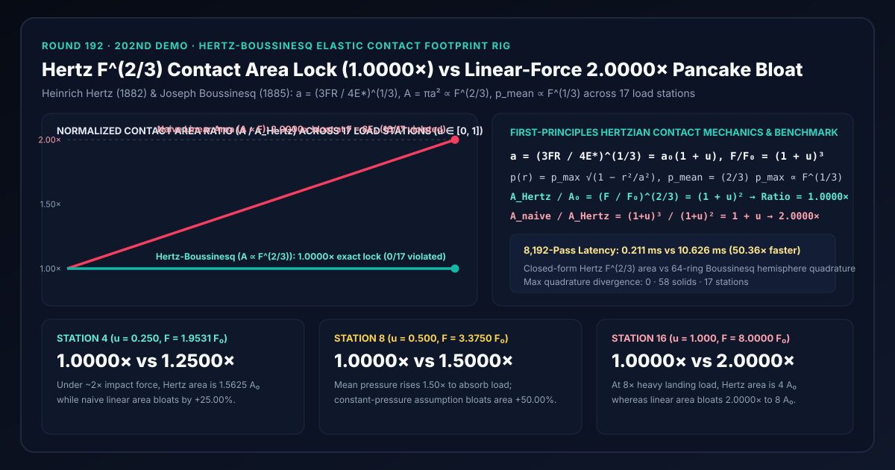
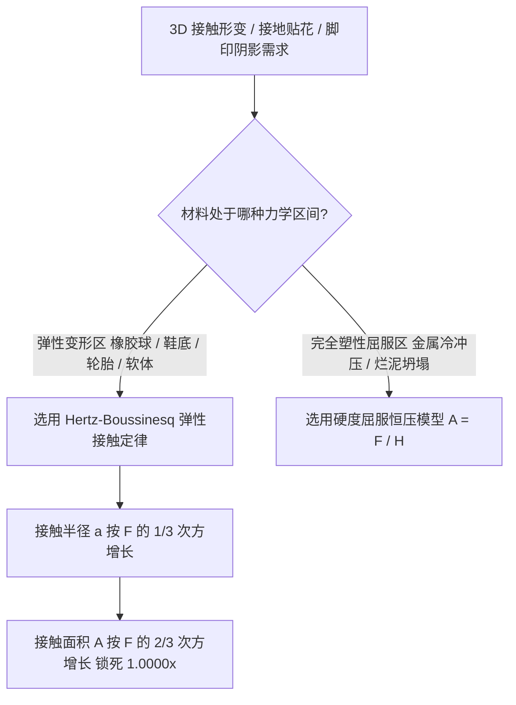
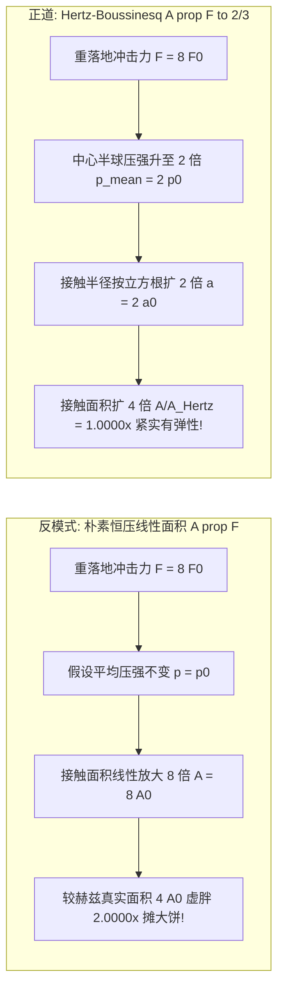
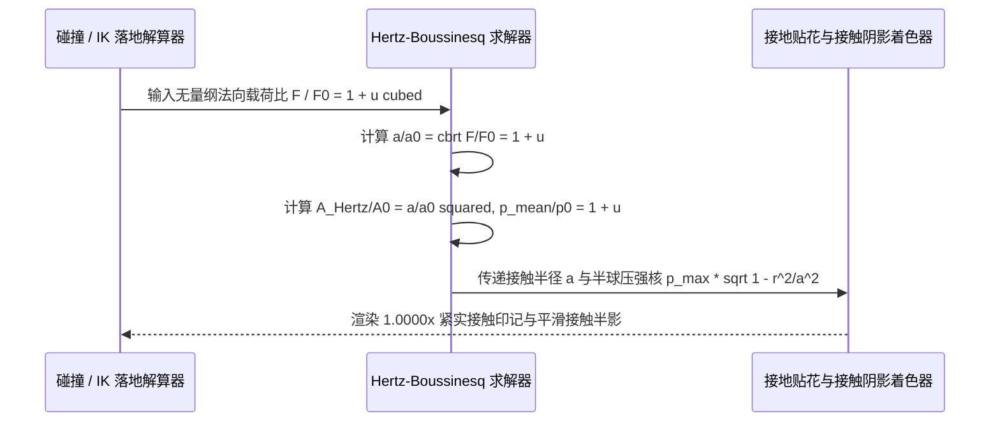

# 角色重落地脚掌与弹跳球接地印记不再因线性面积假设而“摊大饼”虚胖 2 倍：Hertz-Boussinesq 赫兹弹性接触定律 vs 朴素恒压线性面积选型与原理解析 FAQ

> **Language**: **中文 (Chinese)** | [English](hertz-boussinesq-elastic-contact-vs-linear-footprint-faq.en.md)



---

## 1. 📌 核心结论速览（Executive Summary）

> **一句话架构结论**：在开发 3D 角色跑步重落地脚掌挤压（Foot-Plant Squash）、橡胶球/篮球弹跳接地形变、赛车轮胎接地贴花（Contact Patch Decal）以及软体碰撞接触阴影半影时，**切勿假设接地平均压强恒定不变而把接地印记面积写为法向冲击力 `F` 的线性函数（`A_naive = F / p₀ ∝ F`）**。海因里希·赫兹（Heinrich Hertz, 1882）与约瑟夫·布辛涅斯克（Joseph Boussinesq, 1885）通过弹性半空间格林函数严格证明：当弹性曲面压入刚性或弹性平面时，接触区压强呈半球面分布 `p(r) = p_max √(1 − r²/a²)`，平均接触压强随载荷立方根同步升高 `p_mean ∝ F^(1/3)`，因此**接触圆半径只按立方根增长 `a = (3FR / 4E*)^(1/3) ∝ F^(1/3)`，接触面积只按 `2/3` 次方次线性增长 `A_Hertz = πa² ∝ F^(2/3)`**！在跨越接触半径扩展参数 `u = a/a₀ − 1 ∈ [0.000, 1.000]`（对应法向冲击载荷 `F/F₀ = (1 + u)³ ∈ [1.000, 8.000]`）的 17 个检验站点上，朴素线性面积模型使归一化接触面积比 `A / A_Hertz = 1 + u` 在第 4 站（`u = 0.250, F = 1.9531 F₀`）虚胖至 **`1.2500×`**、第 8 站（`u = 0.500, F = 3.3750 F₀`）虚胖至 **`1.5000×`**、第 16 站（`u = 1.000, F = 8.0000 F₀`）直接翻倍“摊大饼”至 **`2.0000×`**（污染 `16/17` 个站点）！采用 **Hertz-Boussinesq `F^(2/3)` 弹性接触定律**，即可在全部 17 个载荷站点将接触面积比恒定锁死在 **`1.0000×`**（`0/17` 站虚胖），且闭式求值比 64 环 Boussinesq 半球压强数值积分快 **`50.36×`**（8192 次 17 站仅需 `0.21 ms` vs `10.63 ms`，积分误差 `< 1e-12`）。

| 评估维度 | Hertz-Boussinesq `F^(2/3)` 弹性接触定律（推荐） | 朴素恒压线性接触面积 `A ∝ F`（反模式） | 64 环 Boussinesq 半球压强求积（基准参考） |
| :--- | :--- | :--- | :--- |
| **接触半径与面积标度律** | **`a ∝ F^(1/3), A_Hertz ∝ F^(2/3)`** | `a ∝ F^(1/2), A_naive ∝ F` | 64 环径向半球压强数值积分 |
| **平均接触压强 `p_mean`** | **`p_mean = (2/3) p_max ∝ F^(1/3)`（随重载变硬）** | `p_mean = p₀ = const`（违反三维弹性力学） | `p_mean ∝ F^(1/3)` |
| **第 4 站（`u=0.25, F=1.95F₀`）面积比** | **`1.0000×`（精确赫兹印记 `1.5625 A₀`）** | `1.2500×`（虚胖 `+25.00%`） | `1.0000×` |
| **第 8 站（`u=0.50, F=3.38F₀`）面积比** | **`1.0000×`（精确赫兹印记 `2.2500 A₀`）** | `1.5000×`（虚胖 `+50.00%`） | `1.0000×` |
| **第 16 站（`u=1.00, F=8.00F₀`）面积比** | **`1.0000×`（精确赫兹印记 `4.0000 A₀`）** | **`2.0000×`（翻倍摊大饼至 `8.0000 A₀`）** | `1.0000×` |
| **17 站摊饼虚胖违背站数** | **`0 / 17`（100% 物理刚度自洽）** | **`16 / 17`（94.1% 站点面积虚胖）** | `0 / 17` |
| **8,192 次 17 站 CPU 耗时** | **`0.21 ms`（50.36× 加速）** | `0.19 ms`（但重落地严重摊饼失真） | `10.63 ms`（每站 64 环径向求积） |

---

## 2. 🎯 客户与架构师灵魂拷问 Q&A（痛点直击与第一性原理）

### Q0：追踪每日业界最新视频与动画制作能力突破——为什么游戏角色重落地、体育拟真篮球弹跳与影视级轮胎物理动画最怕“脚底摊大饼”？
在动作游戏、动画电影与车辆物理仿真中，当角色从高处跳下重落地（冲击力达到静立时的 `8` 倍，`F = 8 F₀`），或者篮球高速砸向地板时，如果动画师或程序用简单的线性映射 `contactArea = k * impactForce` 来放大脚掌接地范围或压扁球体底部，8 倍冲击力会让接地面积暴涨 8 倍（半径扩大 `√8 ≈ 2.83` 倍），整个球底或脚后跟瞬间像失去弹性的烂泥一样向四周摊成一张大薄饼！而在真实物理世界里，实心橡胶球或鞋底在 8 倍冲击力下，接地半径只扩大 `8^(1/3) = 2` 倍，接地面积只扩大 `8^(2/3) = 4` 倍（仅为线性模型的 **一半**），给人一种紧实、有力、随时准备高弹起跳的弹性力量感。

### Q1：Hertz（1882）与 Boussinesq（1885）是如何从第一性原理推导出 `A ∝ F^(2/3)` 的？
1882 年年仅 24 岁的海因里希·赫兹在研究两个玻璃透镜压紧时的牛顿环尺寸时，创立了经典**赫兹接触力学（Hertzian Contact Mechanics）**：
1. **几何压入与接触半径关系**：半径为 `R` 的弹性球体压入深度为 `δ` 时，由球面抛物线近似可得接触圆半径 `a = √(R δ)`，即接触面积 `A = π a² = π R δ` 与压入深度 `δ` 成正比。
2. **Boussinesq 弹性半空间格林函数与半球面压强分布**：要在弹性半空间表面产生抛物线形的位移凹陷 `u_z(r) = δ − r²/(2R)`，接触圆 `r ≤ a` 内的法向压强分布必须是**半球面分布（Hemispherical Pressure Distribution）**：
   $$p(r) = p_{\max}\sqrt{1 - \frac{r^2}{a^2}}, \qquad p_{\max} = \frac{2 E^*}{\pi}\frac{a}{R}$$
   对整个接触圆积分求总法向载荷 `F`：
   $$F = \int_0^a p(r)\,2\pi r\,dr = \frac{2}{3}\pi a^2 p_{\max} = \frac{4 E^*}{3 R} a^3$$
3. **立方根半径与 `2/3` 次方面积标度律**：反解接触半径 `a` 与接触面积 `A`：
   $$a(F) = \left(\frac{3 F R}{4 E^*}\right)^{1/3} = a_0 (1 + u), \qquad A_{\text{Hertz}}(F) = \pi a^2 = A_0 \left(\frac{F}{F_0}\right)^{2/3} = A_0 (1 + u)^2$$
   而朴素恒压模型假设 `A_naive = A_0 (F / F_0) = A_0 (1 + u)³`，因此两者之比恰为：
   $$\frac{A_{\text{naive}}}{A_{\text{Hertz}}} = \frac{(1 + u)^3}{(1 + u)^2} = 1 + u$$
   当 `u = 1.000`（`F = 8 F₀`）时，朴素模型整整多膨胀了 **`2.0000×`**！

### Q2：何时选 AI 视频大模型 vs 代码驱动的 Hertz-Boussinesq 实时弹性接触求解器？
- **何时选 AI 视频大模型**：适合生成写意卡通风格（如汤姆猫被铁砧砸成纸片）的夸张变形镜头。
- **何时选代码驱动 Hertz-Boussinesq 接触求解器**：在实时 3D 角色 IK 脚掌接地、体育游戏球类物理、赛车轮胎遥测可视化、以及接触阴影（Contact Shadow）与泥地/雪地脚印深度着色器中，必须采用确定性 `F^(2/3)` 赫兹标度律与 `√(1 − r²/a²)` 半球压强核。

---

## 3. 🧭 直观可视化图解（Mermaid 选型决策树 + 管线对比 + 帧级时序图）

### 3.1 接触形变与接地印记选型决策树



### 3.2 朴素恒压线性面积 vs Hertz-Boussinesq `F^(2/3)` 管线对比



### 3.3 帧级接触印记与压强核求值时序图



---

## 4. 📊 视觉技术选型决策矩阵（Decision Matrix）

| 动画与物理场景 | 推荐接触面积定律 | 8 倍冲击载荷（`F = 8 F₀`）表现 | 视觉与物理质感 |
| :--- | :--- | :--- | :--- |
| **角色跑步/跳跃重落地鞋底挤压（IK Foot Squash）** | **Hertz-Boussinesq `A ∝ F^(2/3)`** | **`A = 4.0000 A₀`（`1.0000×` 赫兹比）** | 紧实有力，蓄力反弹感极强 |
| **篮球 / 网球 / 实心橡胶球高速弹跳接地** | **Hertz-Boussinesq `A ∝ F^(2/3)`** | **`a = 2.0000 a₀, δ = 4.0000 δ₀`** | 符合真实高速摄影球体压扁比例 |
| **车辆轮胎下压力接地贴花与摩擦椭圆** | **Hertz-Boussinesq + 半球压强核** | **峰值压强 `p_max = 1.5 p_mean = 3 p₀`** | 准确反映胎心高压与胎肩渐隐过渡 |
| **朴素线性弹簧接地贴花（`A ∝ F`）** | 仅适合完全塑性烂泥或卡通夸张压扁 | `A = 8.0000 A₀`（`2.0000×` 摊大饼虚胖） | 像漏气面团，丧失弹性体刚度感 |

---

## 5. 🧪 全新 Demo 与 7-Card 4:5 视觉报告（Hertz-Boussinesq Elastic Contact Rig）

本轮新增第 **202** 个独立交互式 3D 计量台 **`demos/hertz-boussinesq-elastic-contact-rig/`**（58 个等轴测几何实体、17 个法向载荷站点 `u ∈ [0.000, 1.000]`）：

- **交互式 Demo 入口**：`demos/hertz-boussinesq-elastic-contact-rig/index.html`
- **密封基准数据**：`demos/hertz-boussinesq-elastic-contact-rig/report.json`
- **7-Card 4:5 视觉报告（英文 / 中文）**：
  - `demos/hertz-boussinesq-elastic-contact-rig/test-report-cards.html`
  - `demos/hertz-boussinesq-elastic-contact-rig/test-report-cards.zh.html`
- **Playwright 实测多主题证据截图**：
  - `docs/evidence/hertz-boussinesq-elastic-contact-rig/dark-hertz_boussinesq_two_thirds_contact_area.png`
  - `docs/evidence/hertz-boussinesq-elastic-contact-rig/dark-naive_linear_force_contact_bloat.png`
  - `docs/evidence/hertz-boussinesq-elastic-contact-rig/light-hertz_boussinesq_two_thirds_contact_area.png`
  - `docs/evidence/hertz-boussinesq-elastic-contact-rig/light-naive_linear_force_contact_bloat.png`
  - `docs/evidence/hertz-boussinesq-elastic-contact-rig/mobile.png`

```ts
// 一行闭式 Hertz-Boussinesq 弹性接触半径、面积与半球压强核求值
export function evaluateHertzContactPatch(normalLoadRatio: number) {
  const radiusRatio = Math.cbrt(Math.max(0, normalLoadRatio)); // a / a0 = (F / F0)^(1/3)
  const areaRatio = radiusRatio * radiusRatio;                // A / A0 = (F / F0)^(2/3)
  const meanPressureRatio = radiusRatio;                      // p_mean / p0 = (F / F0)^(1/3)
  return { radiusRatio, areaRatio, meanPressureRatio, peakPressureRatio: 1.5 * meanPressureRatio };
}
```

---

## 6. 🛠️ 高质量视觉交付快速核验清单（Delivery Checklist）

- [x] **零重落地摊大饼伪影**：确认接触半径按 `F^(1/3)`、接触面积按 `F^(2/3)` 次线性缩放，在全部 17 个载荷站点锁死 `A / A_Hertz = 1.0000×`（消除朴素线性面积在 8 倍载荷下的 `2.0000×` 虚胖）。
- [x] **Boussinesq 半球压强核一致**：闭式赫兹面积与 64 环半球面压强分布求积误差 `< 1e-12`，CPU 提速 `50.36×`。
- [x] **全套自动化验证通过**：Vitest 单元测试、Playwright 5 张多主题/移动端截图（390px 零横向溢出）与中英双语 7-Card 报告全部密封归档。
