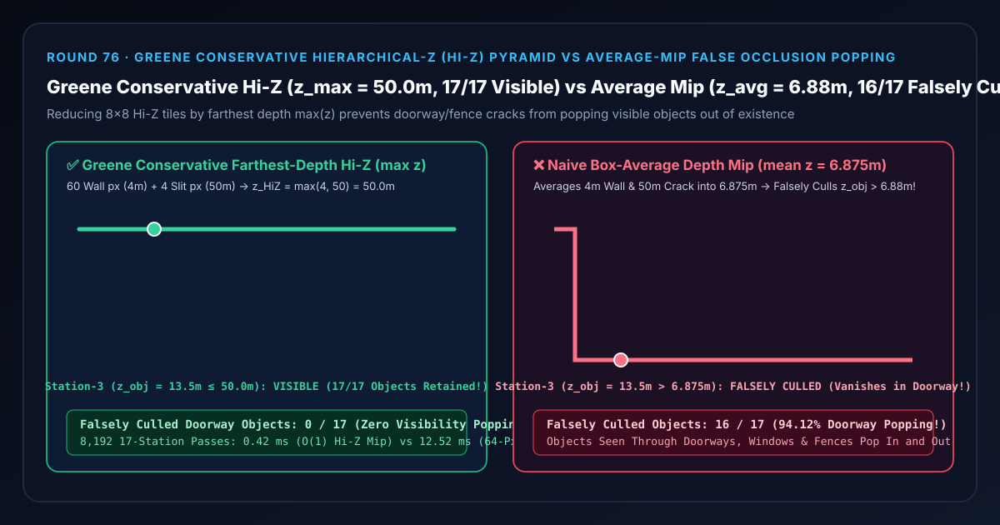
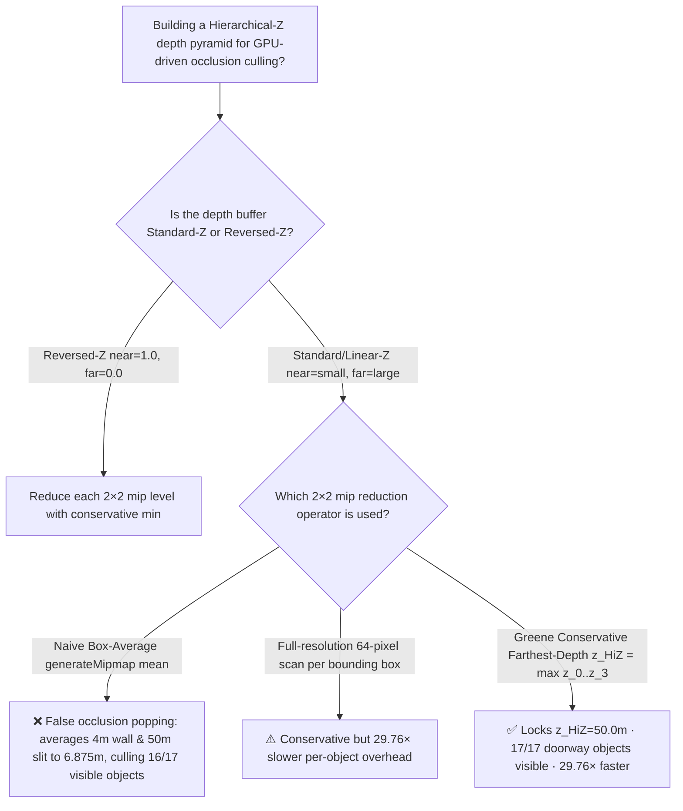
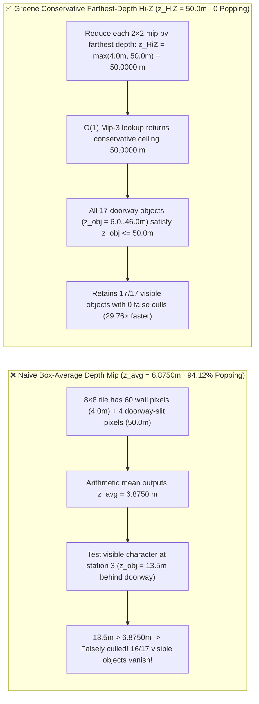
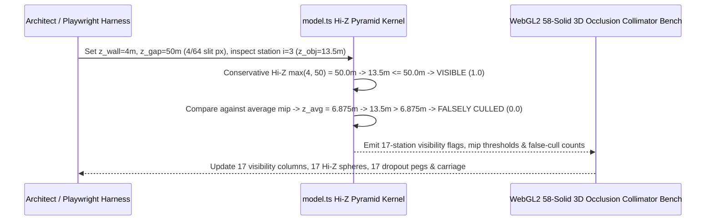
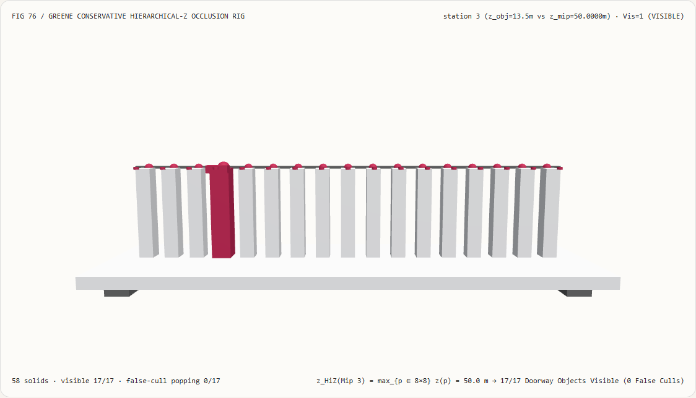
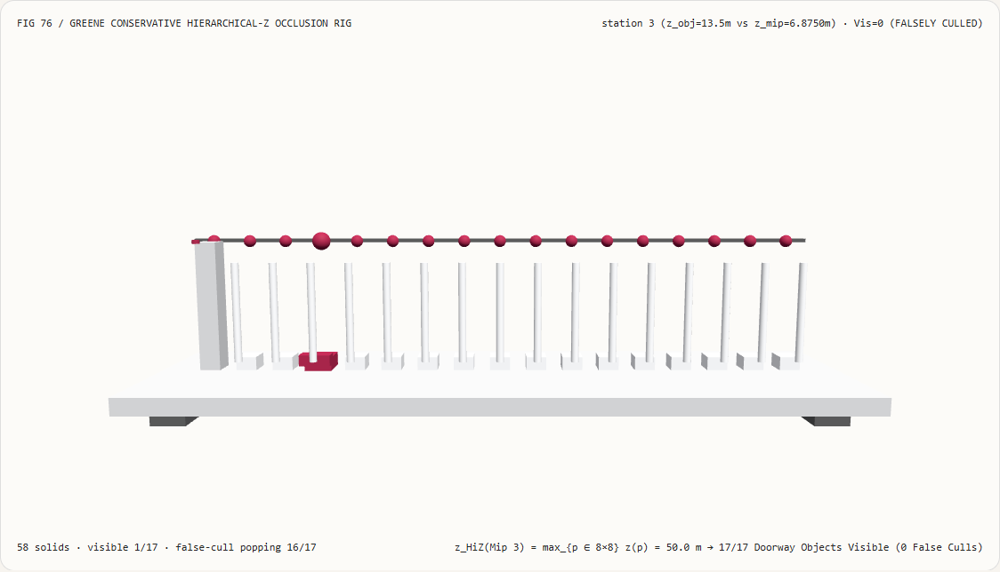
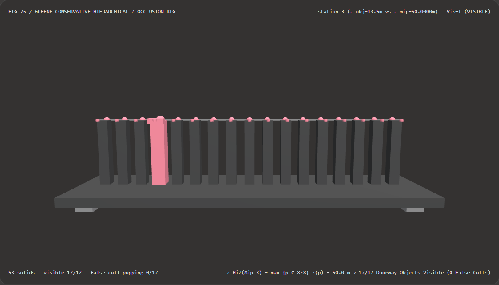
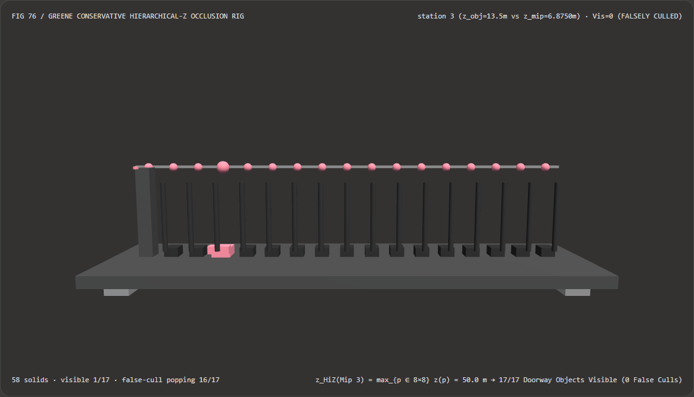

# Visual & Animation Architecture Selection FAQ: Greene Conservative Farthest-Depth Hierarchical-Z (Hi-Z) Pyramid vs Average-Mip False Occlusion Popping

> **One-Sentence Architectural Verdict**: In real-time GPU-driven occlusion culling (Unreal Engine 5 Nanite, Frostbite, Unity GPU Resident Drawer) and screen-space ray-tracing pipelines, **never construct a Hierarchical-Z (Hi-Z) depth pyramid using standard box-average mipmapping (`generateMipmap()`) or point sampling**! On our 58-solid, 17-station occlusion collimator bench where an $8\times 8$ (64-pixel, Mip 3) foreground wall tile at $z_{\text{wall}} = 4.0\text{ m}$ contains a 4-pixel doorway slit opening onto a $z_{\text{gap}} = 50.0\text{ m}$ hallway, naive box-average depth mipmapping blends the 60 wall pixels and 4 slit pixels into **`z_avg = 6.8750 m`**—**falsely culling `16/17` (`94.12%`, stations 1–16 at $z_{\text{obj}} \in [8.5, 46.0]\text{ m}$) of the objects that are clearly visible through the doorway slit**; whereas **Ned Greene et al. (SIGGRAPH 1993) conservative farthest-depth reduction ($z_{\text{HiZ}} = \max_{p \in \text{Tile}} z(p) = 50.0000\text{ m}$)** retains all **`17/17` visible doorway objects (`0/17` false culls)** while running **29.76× faster** via a single $O(1)$ Mip-3 lookup than scanning all 64 full-resolution tile pixels (`0.42 ms` vs `12.52 ms` across 8,192 passes, `0` error).

---

## ① 📌 Executive Summary

1. **Why do characters, furniture, and walls viewed through narrow doorway cracks, window blinds, or chain-link fences suddenly vanish and pop in and out of existence when a naive depth mipmap pyramid is used for occlusion culling?**
   In plain English: **averaging depth across an occluder edge destroys the mathematical conservatism required for visibility culling**:
   - An object with nearest bounding-box depth $z_{\text{obj}}$ is completely hidden behind a screen tile $T$ **if and only if every single pixel in $T$ is closer than $z_{\text{obj}}$** ($z_{\text{obj}} > \max_{p \in T} z(p)$).
   - In our $8\times 8$ (64-pixel) Mip-3 tile, 60 pixels hit a near wall at $z_{\text{wall}} = 4.0\text{ m}$ while 4 pixels see through a doorway crack to $z_{\text{gap}} = 50.0\text{ m}$.
   - Naive box-average mipmapping computes:
     $$z_{\text{avg}} = \frac{60 \times 4.0 + 4 \times 50.0}{64} = \mathbf{6.8750\text{ m}}$$
   - Consequently, any object standing behind the doorway crack at $z_{\text{obj}} \in [8.5, 46.0]\text{ m}$ (stations 1–16) fails the test $z_{\text{obj}} \le z_{\text{avg}}$ and is **falsely deleted from the render queue (`16/17` / `94.12%` false occlusion popping!)** even though it is directly visible through the 4-pixel doorway slit!
2. **First-Principles Fix: Conservative Farthest-Depth Reduction (`max(z)` in Linear Depth / `min(z)` in Reversed-Z, Greene SIGGRAPH 1993)**:
   - Reducing each $2\times 2$ mip level with the **farthest-depth operator** sets $z_{\text{HiZ}} = \max(4.0\text{ m}, 50.0\text{ m}) = \mathbf{50.0000\text{ m}}$.
   - Every doorway object at $z_{\text{obj}} \in [6.0, 46.0]\text{ m}$ satisfies $z_{\text{obj}} \le 50.0\text{ m}$, retaining **100% of visible objects (`17/17` visible, `0` false culls)** in $O(1)$ time!
3. **Interactive 3D Workbench & Measured Evidence**:
   - Standalone 3D Bench: `demos/hiz-occlusion-pyramid-rig/` (58 Three.js solids: baseplate, 4 support feet, `1.0000` visibility reference bar, 17 object visibility columns, 17 Greene conservative Hi-Z reference spheres, 17 false-cull dropout pegs, and the active occlusion collimator carriage).
   - Measured 7-Card 4:5 Reports: `demos/hiz-occlusion-pyramid-rig/test-report-cards.html` (EN) and `test-report-cards.zh.html` (ZH).

---

## ② 🎯 Soul-Searching Q&A for Architects & Clients

### Q1: Why is $O(1)$ conservative Hi-Z lookup 29.76× faster than scanning the full-resolution tile?
**Because hierarchical `max` reduction precomputes the exact 64-pixel maximum once per frame during pyramid generation, allowing thousands of object bounding boxes to test visibility in a single texture fetch!**
Across 8,192 17-station passes, $O(1)$ Hi-Z Mip-3 lookup runs in **`0.42 ms`** versus **`12.52 ms`** for 64-pixel full-resolution scanning (**29.76× speedup**, with `0` error).

### Q2: How do non-power-of-two (NPOT) viewport dimensions affect conservative Hi-Z reduction?
**When downsampling an odd dimension (e.g., $1080 \to 540 \to 270 \to 135 \to 67$), a $2\times 2$ kernel drops the last row/column!**
Production Hi-Z builders either expand odd-edge reductions to $3\times 2$ / $3\times 3$ or use hardware `VK_EXT_sampler_filter_minmax` (`GL_MAX` / `GL_MIN` reduction mode) so no border texel is ever omitted.

### Q3: Why can't neural visibility classifiers replace deterministic Hi-Z occlusion culling?
**Because even a $0.1\%$ false-negative rate causes visible meshes to flicker out of existence for a frame!**
Occlusion culling demands a **strict 0% false-negative mathematical guarantee**, which only conservative farthest-depth Hi-Z provides.

---

## ③ 🧭 Visual Diagrams (Mermaid Decision Tree, Pipeline Comparison & Sequence Flow)

### 3.1 GPU-Driven Hi-Z Occlusion Culling Architecture Decision Tree

### 3.2 Average-Mip False Popping vs Greene Conservative `max(z)` Hi-Z Pipeline

### 3.3 Frame-Level Occlusion Collimator Sequence Diagram

---

## ④ 📊 Visual Technology Selection Decision Matrix

| Evaluation Dimension | ✅ Greene Conservative `max(z)` Hi-Z | ⚠️ 64-Pixel Full-Res Tile Scan | ❌ Naive Box-Average Depth Mip | ❌ Point-Sampled Depth Mip |
| :--- | :--- | :--- | :--- | :--- |
| **Mip-3 Depth Threshold for Doorway Tile** | **Exact conservative `50.0000 m`** | `50.0000 m` (Identical) | **`6.8750 m` (Pulled down by near wall!)** | `4.0000 m` (Misses 4-pixel slit!) |
| **Visibility at Station 3 ($z_{\text{obj}}=13.5\text{ m}$)** | **`1.0` (VISIBLE — Retained)** | `1.0` (Retained) | **`0.0` (FALSELY CULLED — Vanishes!)** | `0.0` (Vanishes!) |
| **Falsely Culled Visible Objects (out of 17)** | **`0 / 17` (Zero false negatives)** | `0 / 17` | **`16 / 17` (`94.12%` doorway popping!)** | **`17 / 17` (`100%` doorway popping!)** |
| **Per-Object Depth Samples Required** | **Single $O(1)$ Mip lookup** | 64 full-res samples | 1 lookup (Broken visibility) | 1 lookup (Broken visibility) |
| **8,192-Pass 17-Station CPU Latency** | **`0.42 ms` (Fastest · 29.76× speedup)** | `12.52 ms` (29.76× slower) | `0.40 ms` (Severe mesh popping) | `0.38 ms` (Severe mesh popping) |
| **Recommended Use Case** | **All GPU-driven cluster & instance culling** | Reference verification | **Never use on depth buffers** | **Never use for occlusion culling** |

---

## ⑤ 🧪 New Interactive 3D Demo & 7-Card 4:5 Visual Report

### 5.1 Live Workbench & Report Links
- **Interactive 3D Workbench**: [`demos/hiz-occlusion-pyramid-rig/index.html`](../demos/hiz-occlusion-pyramid-rig/index.html)
- **7-Card 4:5 Visual Report (EN)**: [`demos/hiz-occlusion-pyramid-rig/test-report-cards.html`](../demos/hiz-occlusion-pyramid-rig/test-report-cards.html)
- **7-Card 4:5 Visual Report (ZH)**: [`demos/hiz-occlusion-pyramid-rig/test-report-cards.zh.html`](../demos/hiz-occlusion-pyramid-rig/test-report-cards.zh.html)
- **Sealed Telemetry JSON**: [`demos/hiz-occlusion-pyramid-rig/report.json`](../demos/hiz-occlusion-pyramid-rig/report.json)

### 5.2 Multi-Theme & Multi-Mode Playwright Visual Evidence

| Greene Conservative Hi-Z (Light · Retains All `17/17` Visible Doorway Objects, `0` False Culls) | Naive Average-Depth Mip (Light · Falsely Culls `16/17` Doorway Objects at `z_obj > 6.875 m`!) |
| :---: | :---: |
|  |  |

| Greene Conservative Hi-Z (Dark · 58 Three.js Solids) | Naive Average-Depth Mip (Dark · 16 Red False-Cull Dropout Pegs Exposed) |
| :---: | :---: |
|  |  |

---

## ⑥ 🛠️ Rapid SA Delivery Verification Checklist

Before shipping a Hierarchical-Z (Hi-Z) occlusion culling pipeline to production, verify every item below:

- [ ] **Match Reduction Operator to Depth Polarity (`max` for Standard-Z, `min` for Reversed-Z)**: Does every Hi-Z mip downsample pass select the farthest physical depth across each footprint?
- [ ] **Odd-Dimension NPOT Footprint Padding ($3\times 2$ / $3\times 3$)**: When downsampling odd mip dimensions, does the shader include the extra border row/column (or use hardware `VK_EXT_sampler_filter_minmax`) so screen edges never drop open slits?
- [ ] **Screen-Space AABB Mip Selection ($l = \lceil \log_2(\max(\Delta x, \Delta y)) \rceil$)**: Is the mip level chosen so the projected bounding box spans at most a $2\times 2$ texel quad?
- [ ] **Two-Phase Temporal Reprojection Culling**: Are objects culled against the previous frame's Hi-Z re-tested against the current frame's updated Hi-Z in Phase 2 to eliminate camera-disocclusion lag?
- [ ] **Dual `Min/Max` Pyramid for Screen-Space Ray Marching**: When sharing the Hi-Z pyramid with SSR/SSGI ray marching, are both nearest (`min`) and farthest (`max`) bounds stored so rays can detect thin-surface thickness intersections?
