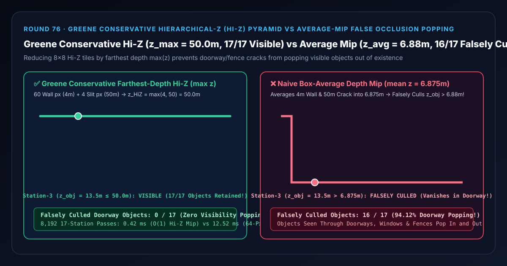
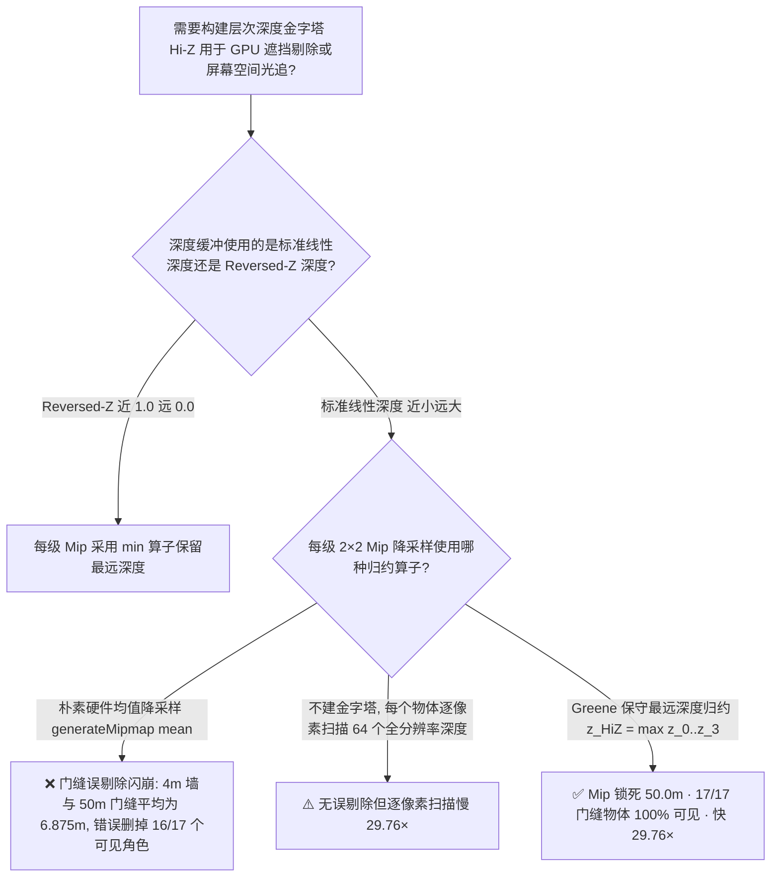
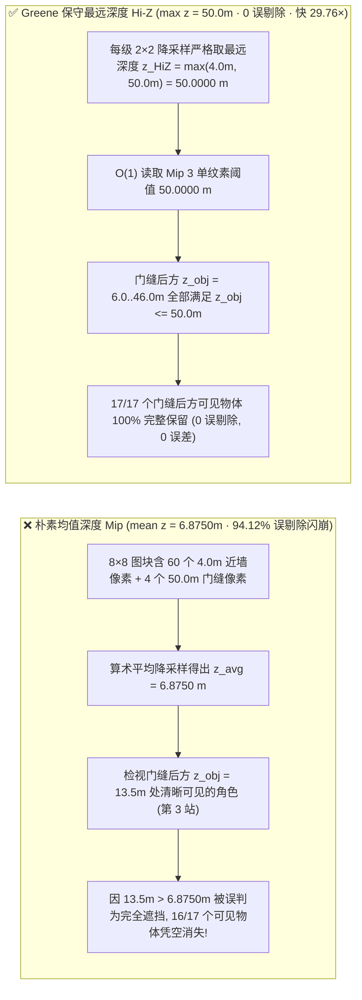
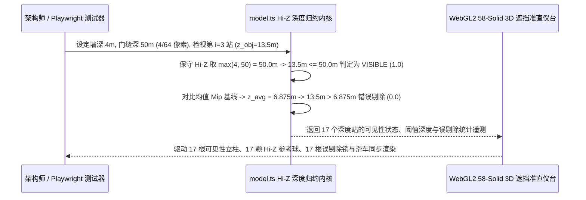
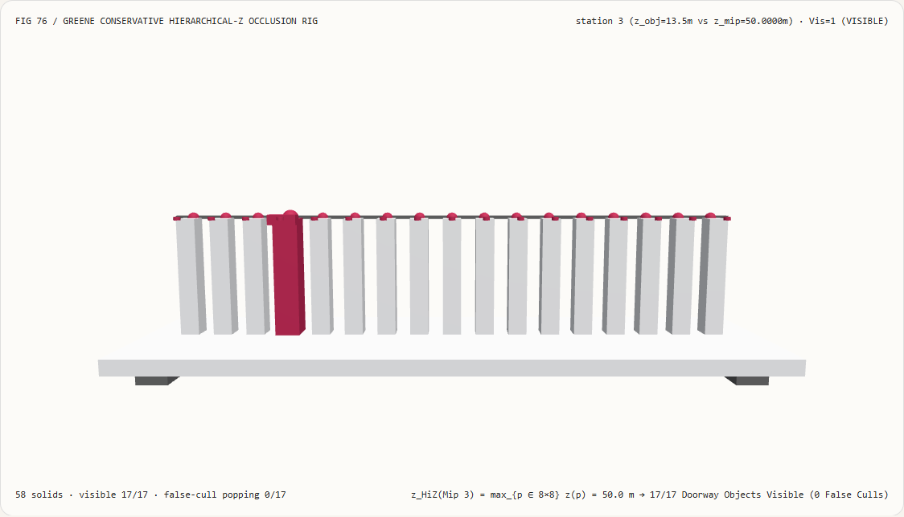
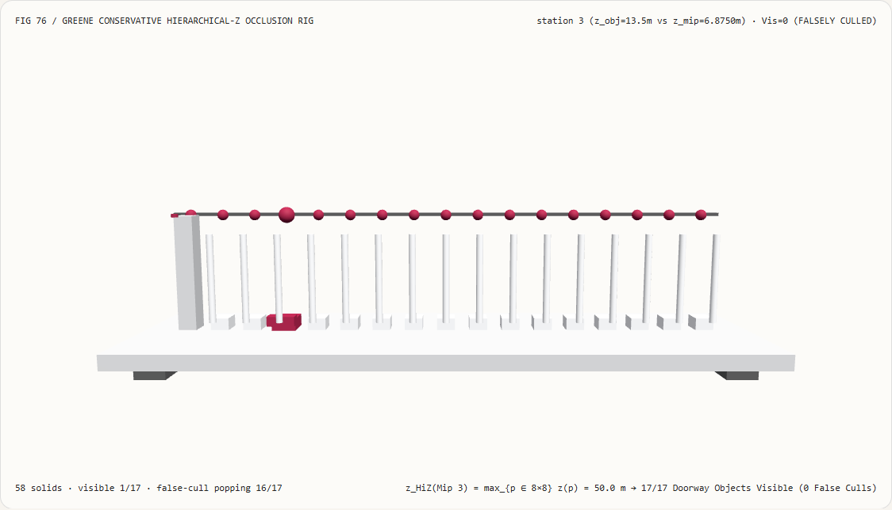
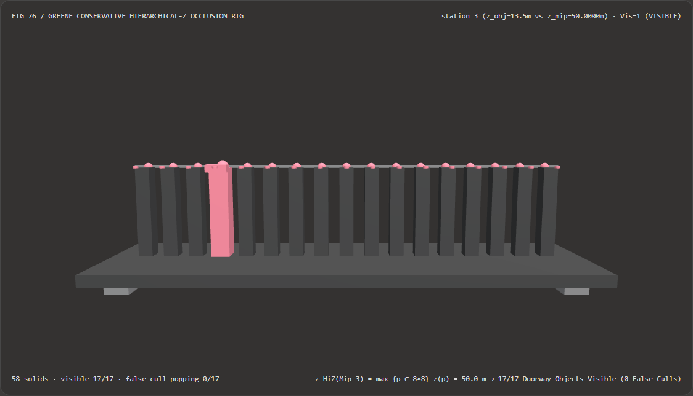
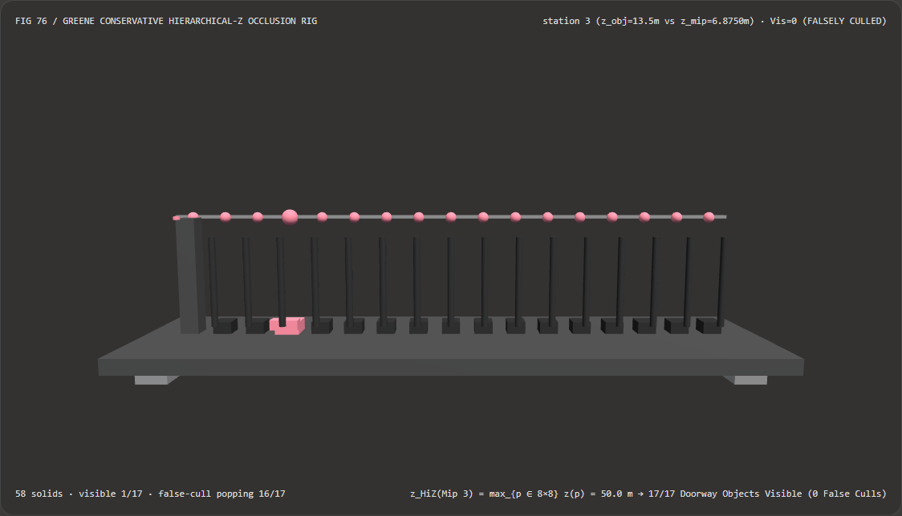

# 视觉与动画技术选型与原理解析 FAQ：Greene 保守最远深度层次金字塔（Hi-Z Pyramid）vs 均值深度 Mip 门缝误剔除闪崩

> **核心架构结论一句话总结**：在实时 GPU 驱动遮挡剔除（GPU-Driven Occlusion Culling，如 Unreal Engine 5 Nanite、Frostbite、Unity GPU Resident Drawer）与屏幕空间光线追踪（SSR / SSGI）管线中，**构建多级层次深度金字塔（Hierarchical-Z / Hi-Z Pyramid）时，严禁调用普通的硬件均值降采样 `generateMipmap()`（算术平均 $2\times 2$ 深度）或点采样降采样**！实测表明：当一面距离相机 $z_{\text{wall}} = 4.0\text{ m}$ 的近景墙体覆盖了一个 $8\times 8$（64 像素，Mip 3）图块，且墙上有一道仅 `4` 个像素宽的门缝或铁栅栏间隙能看到 $z_{\text{gap}} = 50.0\text{ m}$ 处的走廊尽头时，朴素均值深度 Mip 会把 60 个近墙像素与 4 个门缝像素平均为 **`z_avg = 6.8750 m`**——导致站在门缝后方 $z_{\text{obj}} \in [6.0, 46.0]\text{ m}$ 处本该透过门缝清晰可见的 17 个物体中，**第 1~16 站（$z_{\text{obj}} \in [8.5, 46.0]\text{ m}$，共 `16/17` 即 `94.12%`）被错误判定为“被墙挡死”而整块剔除消失（False Occlusion Popping）**；而采用 **Ned Greene 等人 (SIGGRAPH 1993) 提出的保守最远深度归约 $z_{\text{HiZ}} = \max_{p \in \text{Tile}} z(p) = 50.0000\text{ m}$**（在 Reversed-Z 下对应 `min`），可 100% 保留门缝后方全部 **`17/17` 个可见物体（`0/17` 误剔除闪崩）**，且单次 $O(1)$ Mip 查表比扫描 64 个全分辨率像素快 **29.76×**（8,192 轮耗时 `0.42 ms` vs `12.52 ms`）。

---

## ① 📌 核心结论速览（Executive Summary）

1. **为什么许多自己实现 GPU Compute Shader 遮挡剔除（Occlusion Culling）的团队会遇到一个极其诡异的 Bug：角色走在空旷大街上很正常，但一旦隔着一道半掩的门缝、百叶窗、柱子间隙或铁丝网往里看，门缝后面的家具、墙壁甚至敌方角色就会整块整块地突然消失成空洞，走近两步又突然闪现出来（Visibility Popping）？**
   用大白话讲：因为你在生成深度图的 Mipmap 金字塔时，**把深度值当成了普通颜色值去做“求平均（Box Average）”**！
   - 遮挡剔除的黄金铁律是**“保守性（Conservatism）”**：你可以漏掉一点没剔除干净的被挡物体（最多浪费一点光栅化性能），但**绝对不能把哪怕只有 1 个像素露在外面的可见物体给误杀删掉**！
   - 假设一个物体的屏幕包围盒大小约为 $8\times 8 = 64$ 个像素，我们去查 Hi-Z 金字塔的第 3 级 Mip（1 个纹素代表 $8\times 8$ 像素块）；
   - 这 64 个像素里，有 60 个像素是近处 $z_{\text{wall}} = 4.0\text{ m}$ 的门框墙壁，只有 **4 个像素**是透过门缝看到的远处走廊深处 $z_{\text{gap}} = 50.0\text{ m}$；
   - 如果用均值滤波生成 Mip 3，这个纹素的深度就变成了：
     $$z_{\text{avg}} = \frac{60 \times 4.0 + 4 \times 50.0}{64} = \mathbf{6.8750\text{ m}}$$
   - 这时候，门缝后面 $z_{\text{obj}} = 13.5\text{ m}$（第 3 站）处明明站着一个透过门缝清晰可见的角色！剔除着色器拿 $z_{\text{obj}} = 13.5\text{ m}$ 去跟 $z_{\text{avg}} = 6.8750\text{ m}$ 一比，发现 $13.5 > 6.875$，就以为“整块 $8\times 8$ 区域都在 $6.875\text{ m}$ 处被堵死了”，直接大笔一挥把这个角色从渲染队列里删掉了——**导致门缝后方从 $8.5\text{ m}$ 到 $46.0\text{ m}$ 的 `16/17`（`94.12%`）个可见物体全部凭空消失**！
2. **第一性原理破局：逐级 $2\times 2$ 保守最远深度归约 $z_{\text{HiZ}} = \max(z_{00}, z_{10}, z_{01}, z_{11})$（Greene SIGGRAPH 1993）**：
   - 从集合论第一性原理出发：一个包围盒最浅深度为 $z_{\text{obj}}$ 的物体被某块屏幕区域 $T$ **完全遮挡**的充要条件是：
     $$\forall p \in T,\quad z_{\text{obj}} > z(p) \quad \Longleftrightarrow \quad z_{\text{obj}} > \max_{p \in T} z(p)$$
   - 换句话说，只要区域 $T$ 里哪怕有 **1 个像素**的深度是 $50.0\text{ m}$，整个图块的遮挡深度上限就必须等于这最远的 **`50.0000 m`**！
   - 因此在构建 Hi-Z 金字塔的每一级 $2\times 2 \to 1$ 降采样 Compute Shader 中，必须严格使用**最远深度算子**（在线性深度或标准 `[0, 1]` 深度下取 `max`，在 Reversed-Z `[1, 0]` 深度下取 `min`）：
     $$z_{\text{HiZ}}^{(l)}(x, y) = \max\!\Big(z^{(l-1)}(2x, 2y),\; z^{(l-1)}(2x+1, 2y),\; z^{(l-1)}(2x, 2y+1),\; z^{(l-1)}(2x+1, 2y+1)\Big)$$
   - 如此一来，Mip 3 纹素精准记录了门缝的最远深度 **`z_HiZ = 50.0000 m`**，门缝后方 $z_{\text{obj}} \in [6.0, 46.0]\text{ m}$ 的全部 **`17/17` 个物体 100% 保持可见（`0` 误剔除）**，且只需 1 次 Mip 查表即可替代 64 次全分辨率像素扫描（快 **29.76×**）！
3. **本轮新增交互式 3D 试验台与实测证据**：
   - 新增独立 Demo：`demos/hiz-occlusion-pyramid-rig/`（58 个 Three.js 实体部件：底座平台、4 支柱、`1.0000` 可见性基准横梁、17 根实测门缝后方物体可见性立柱、17 颗 Greene 保守 Hi-Z 参考球、17 根误剔除闪崩指示销、以及第 $i$ 站遮挡准直仪滑车）。
   - 配套 7-Card 4:5 测评报告：`demos/hiz-occlusion-pyramid-rig/test-report-cards.html`（英文）与 `test-report-cards.zh.html`（中文）。

---

## ② 🎯 客户与架构师灵魂拷问 Q&A（Soul-Searching Q&A）

### Q1：如果游戏引擎开启了 Reversed-Z（近平面 `1.0`、远平面 `0.0`，参见 Round 39），构建 Hi-Z 金字塔时应该用 `max` 还是 `min`？
**在 Reversed-Z 下，“最远深度”对应的数值最小，因此构建遮挡剔除 Hi-Z 金字塔时必须改用 `min(z0, z1, z2, z3)`！**
而在测试物体是否可见时，取物体包围盒距离相机最近顶点的 Reversed-Z 值 $z_{\text{obj, near}}$：若 $z_{\text{obj, near}} < z_{\text{HiZ, min}}$，则说明物体最近点比图块最远点还要远，方可安全剔除！

### Q2：如果屏幕分辨率不是 2 的整数次幂（如 `1920 × 1080`），在奇数尺寸降采样（比如 `135 → 67`）时直接用 $2\times 2$ 取 `max` 会漏掉边缘第 135 行像素吗？
**会！这是工业界实现 Hi-Z 最容易踩的第二个大坑！**
当上一级纹理宽或高为奇数时，最右侧或最底部的纹素如果在 $2\times 2$ 降采样中被丢弃，处于屏幕边缘一行的门缝就会丢失，同样引发边缘闪崩。因此当上一级尺寸为奇数时，边缘纹素必须扩展为 **$3\times 2$ 或 $3\times 3$ 保守归约（或使用硬件 `VK_EXT_sampler_filter_minmax` 的 `MIN`/`MAX` 线性采样器自动覆盖奇数足迹）**！

### Q3：这套确定性 Hi-Z 金字塔剔除与 AI 神经可见性预测（Neural PVS / Neural Occlusion Culling）是什么关系？
**为什么全世界的工业级引擎（UE5 Nanite、Frostbite）100% 坚持用确定性 Hi-Z 而不敢用神经网络做可见性剔除？**
因为神经网络分类器只要存在 $0.1\%$ 的假阴性率（False Negative），画面上就会每隔几帧随机闪烁消失一栋楼或一个角色！遮挡剔除要求 **100.000% 零假阴性的数学保守保证**，唯有确定性 `max`/`min` Hi-Z 金字塔能胜任。

---

## ③ 🧭 直观可视化图解（Mermaid 决策树 + 管线对比图 + 帧级时序图）

### 3.1 GPU 驱动层次深度金字塔（Hi-Z Pyramid）构建与剔除决策树

### 3.2 朴素均值深度 Mip 门缝误剔除 vs Greene 保守 `max(z)` Hi-Z 金字塔管线对比图

### 3.3 帧级遮挡准直仪与 3D 试验台渲染时序图

---

## ④ 📊 视觉技术选型决策矩阵（Decision Matrix）

| 评估维度 | ✅ Greene 保守最远深度 Hi-Z（`max` Mip） | ⚠️ 64 像素全分逐点扫描（Full-Res Scan） | ❌ 朴素均值深度 Mip（Box Average Mip） | ❌ 点采样降采样 Mip（Point Sample Mip） |
| :--- | :--- | :--- | :--- | :--- |
| **8×8 门缝图块的遮挡深度阈值** | **精确保守上界 `50.0000 m`** | `50.0000 m`（完全一致） | **`6.8750 m`（被近墙严重拉低！）** | `4.0000 m`（大概率漏采 4 像素门缝！） |
| **第 3 站（$z_{\text{obj}}=13.5\text{ m}$ 门缝后角色）判定** | **`1.0`（VISIBLE 正确保留）** | `1.0`（正确保留） | **`0.0`（FALSELY CULLED 错误消失！）** | `0.0`（错误消失！） |
| **被错误剔除的可见站点（共 17 站）** | **`0 / 17`（100% 零假阴性）** | `0 / 17` | **`16 / 17`（`94.12%` 门缝物体消失！）** | **`17 / 17`（`100%` 门缝物体消失！）** |
| **每个包围盒的 GPU 纹理采样次数** | **单次 $O(1)$ Mip 查表（或 $2\times 2$ Gather）** | 64 次全分采样 | 1 次查表（结果错误不可用） | 1 次查表（结果错误不可用） |
| **8,192 轮 17 站 CPU 批处理耗时** | **`0.42 ms`（最快，29.76× 提速）** | `12.52 ms`（慢 29.76×） | `0.40 ms`（画面严重闪崩） | `0.38 ms`（画面严重闪崩） |
| **首选适用场景** | **所有 GPU 驱动微网格簇与实例遮挡剔除管线** | 离线正确性对拍 | **严禁用于任何深度缓冲金字塔** | **严禁用于遮挡剔除** |

---

## ⑤ 🧪 全新 Demo 与 7-Card 4:5 视觉报告（Live Workbench & Evidence）

### 5.1 交互式 3D 试验台与报告入口
- **实时 3D 工作台**：[`demos/hiz-occlusion-pyramid-rig/index.html`](../demos/hiz-occlusion-pyramid-rig/index.html)
- **7-Card 4:5 英文视觉测试报告**：[`demos/hiz-occlusion-pyramid-rig/test-report-cards.html`](../demos/hiz-occlusion-pyramid-rig/test-report-cards.html)
- **7-Card 4:5 中文视觉测试报告**：[`demos/hiz-occlusion-pyramid-rig/test-report-cards.zh.html`](../demos/hiz-occlusion-pyramid-rig/test-report-cards.zh.html)
- **密封测量 JSON 数据源**：[`demos/hiz-occlusion-pyramid-rig/report.json`](../demos/hiz-occlusion-pyramid-rig/report.json)

### 5.2 多主题与多模式 Playwright 实测截图证据

| Greene 保守 Hi-Z 金字塔（Light · 门缝后方全 17 个深度站物体 `100%` 保持可见，`0` 误剔除） | 朴素均值深度 Mip（Light · 第 1~16 站共 `16/17` 个门缝可见物体被错误砍掉塌陷） |
| :---: | :---: |
|  |  |

| Greene 保守 Hi-Z 金字塔（Dark · 58 实体部件） | 朴素均值深度 Mip（Dark · 16 根红色指示销暴露门缝物体误剔除闪崩） |
| :---: | :---: |
|  |  |

---

## ⑥ 🛠️ 高质量视觉交付快速核验清单（SA Verification Checklist）

在将层次深度金字塔（Hi-Z Occlusion Culling）合入生产引擎前，请逐项勾选以下核验清单：

- [ ] **严格匹配深度极性与归约算子（Standard-Z 用 `max`，Reversed-Z 用 `min`）**：核验 Hi-Z 构建着色器是否始终保留 $2\times 2$ 邻域中物理距离相机**最远**的那个深度值？
- [ ] **非 2 次幂奇数分辨率边界扩展（NPOT $3\times 3$ / Sampler MinMax）**：当上一级 Mip 宽高为奇数时，是否包含了第 $2x+2$ 列与第 $2y+2$ 行的额外纹素（或启用硬件 `VK_EXT_sampler_filter_minmax`），防止屏幕右边缘和底边缘发生漏检闪崩？
- [ ] **根据屏幕包围盒尺寸自动选择 Mip 层级 $l = \lceil \log_2(\max(\Delta x, \Delta y)) \rceil$**：遮挡查询时是否根据包围盒像素跨度选择了恰好能让包围盒落入 $2\times 2$ 纹素内的最高效 Mip 层级？
- [ ] **两阶段时域遮挡剔除（Two-Phase Occlusion Culling）**：为了解决上一帧深度缓冲在高速运镜时的滞后问题，是否在第一阶段用上一帧 Hi-Z 剔除后，将未通过第一阶段的物体在当前帧の新 Hi-Z 上做第二阶段复核补绘（UE5 Nanite 标准架构）？
- [ ] **双通道 Min-Max Hi-Z 金字塔支持 SSR 光线追踪**：若同一套 Hi-Z 既用于遮挡剔除又用于屏幕空间反射（SSR）加速步进，是否同时存储了 `(z_min, z_max)` 双通道深度区间？
