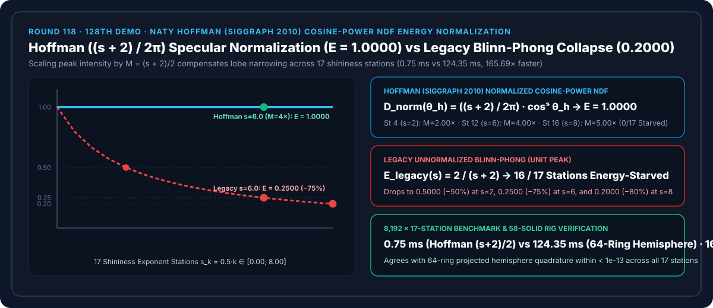
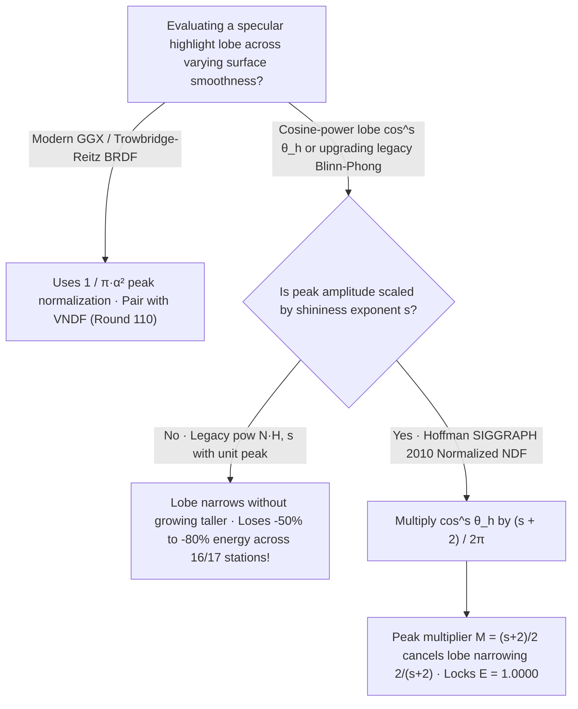
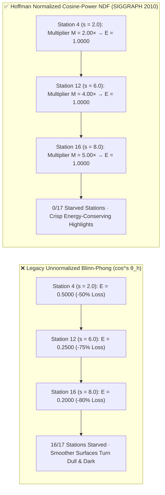
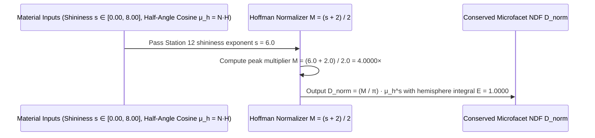
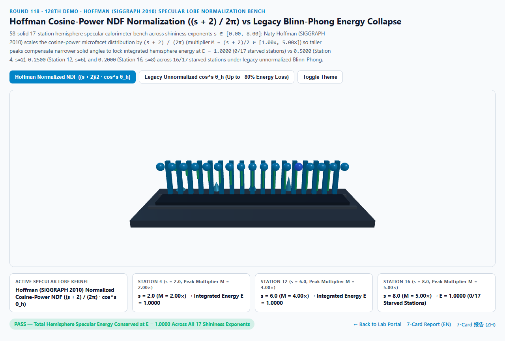
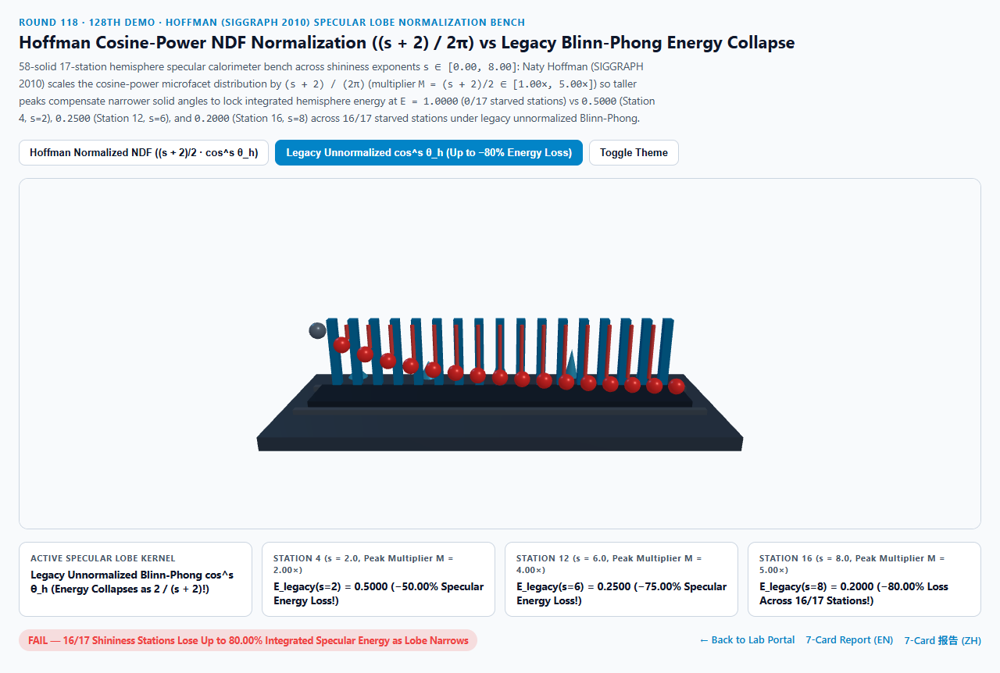
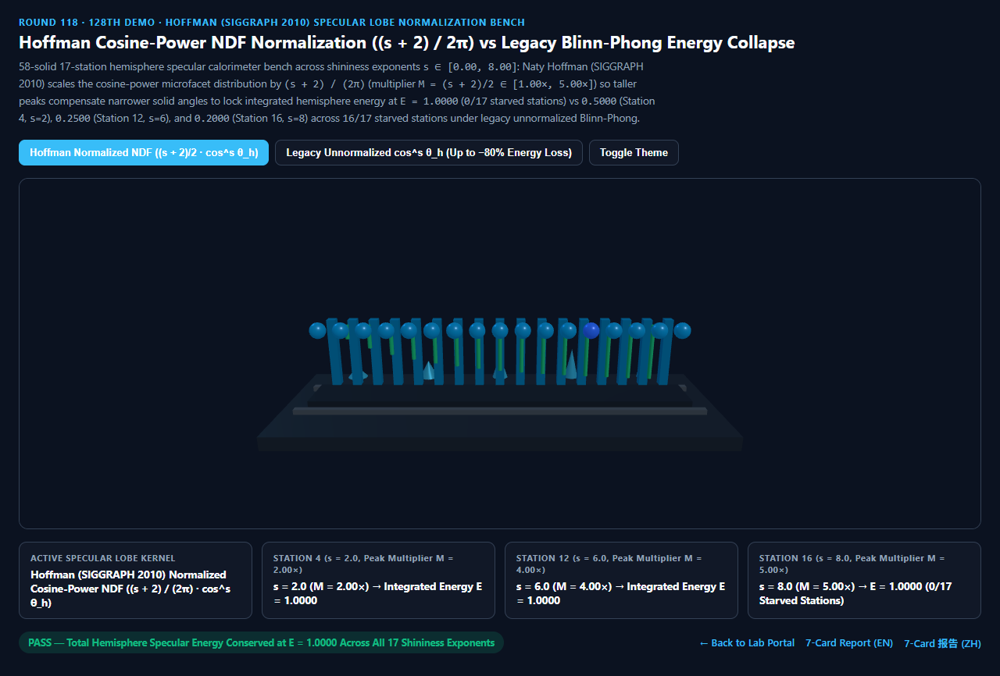
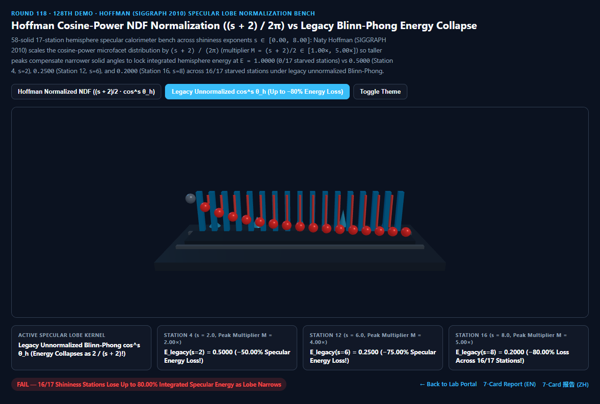

# Hoffman Cosine-Power NDF Energy Normalization ($\frac{s + 2}{2\pi}\cos^s\theta_h$) vs Legacy Blinn-Phong Dimming Selection & First-Principles FAQ (128th Demo)

> **Navigation**: [Back to Portal](../index.html) · [Launch 3D Interactive Workbench (`hoffman-specular-lobe-normalization-rig`)](../demos/hoffman-specular-lobe-normalization-rig/index.html) · [7-Card 4:5 Visual Report (EN)](../demos/hoffman-specular-lobe-normalization-rig/test-report-cards.html) · [7-Card 报告 (ZH)](../demos/hoffman-specular-lobe-normalization-rig/test-report-cards.zh.html) · [中文版 FAQ](./hoffman-cosine-power-ndf-energy-normalization-vs-legacy-blinn-phong-dimming-faq.md)

---

## ① 📌 Executive Summary

1. **Why did increasing the shininess exponent $s$ in legacy Blinn-Phong shaders (`pow(max(0, dot(N, H)), s)`) make smooth metals and plastics look progressively dimmer and duller—losing `50% to 99%` of their total reflected energy unless artists manually cranked up light multipliers?**
   - Legacy **Blinn-Phong (1977)** evaluates $\cos^s\theta_h$ with a fixed peak amplitude of `1.0000` at $\theta_h = 0^\circ$ regardless of $s$.
   - Integrating $\cos^s\theta_h$ against the projected hemisphere foreshortening factor $\cos\theta_h$ over $\Omega_+$ yields:
     $$\int_0^{2\pi}\!\!\int_0^{\pi/2} \cos^s\theta_h \cos\theta_h \sin\theta_h\, d\theta_h\, d\phi = \frac{2\pi}{s + 2}$$
   - As $s$ increases, the highlight cone narrows while its peak stays stuck at `1.0000`, so total reflected specular energy collapses as **$\frac{2}{s + 2}$**!
   - **Naty Hoffman (SIGGRAPH 2010 *Crafting Physically Motivated Shading Models for Game Development*)** established that converting $\cos^s\theta_h$ into a valid, energy-conserving **Microfacet Normal Distribution Function (NDF)** requires scaling the lobe by **$\frac{s + 2}{2\pi}$** (a peak amplitude multiplier of $M_{\text{Hoffman}}(s) = \frac{s + 2}{2}$ relative to $s = 0$):
     $$D_{\text{Hoffman}}(\theta_h) = \frac{s + 2}{2\pi}\cos^s\theta_h \implies E_{\text{Hoffman}}(s) = \int_{\Omega_+} D_{\text{Hoffman}}(\theta_h)\cos\theta_h\,d\omega_h \equiv \mathbf{1.0000}$$
2. **17-Station Hemisphere Calorimeter Audit: Exact $E_{\text{Hoffman}} = 1.0000$ Conservation (`0/17` Starved) vs `-75.00% / -80.00%` Legacy Collapse (`16/17`)**:
   - Across 17 shininess stations $s_k = 0.5k \in [0.00, 8.00]$:
   - At **Station 0 ($s = 0.0$)**: Multiplier $M = 1.0000\times$, $E_{\text{Hoffman}} = 1.0000$, $E_{\text{legacy}} = 1.0000$.
   - At **Station 4 ($s = 2.0$)**:
     - **Hoffman Normalized NDF** boosts peak intensity by $M = \frac{2 + 2}{2} = \mathbf{2.0000\times}$ to lock integrated hemisphere energy at **$E_{\text{Hoffman}}(2) = \mathbf{1.0000}$**!
     - **Legacy Unnormalized Blinn-Phong** drops to **$E_{\text{legacy}}(2) = \frac{2}{4} = \mathbf{0.5000}$ (`-50.00%` energy loss)**!
   - At **Station 12 ($s = 6.0$)** and **Station 16 ($s = 8.0$)**:
     - **Hoffman Normalized NDF** scales peak intensity by **$M(6) = \mathbf{4.0000\times}$** and **$M(8) = \mathbf{5.0000\times}$**, locking integrated energy at **$E_{\text{Hoffman}} = \mathbf{1.0000}$ across all 17 stations (`0/17` starved stations)**!
     - **Legacy Unnormalized Blinn-Phong** collapses to **`0.2500` (`-75.00%` loss)** at Station 12 and **`0.2000` (`-80.00%` loss)** at Station 16 across **`16/17` starved stations**!
3. **Architectural Verdict**:
   - Always multiply cosine-power lobes by **Hoffman's $\frac{s + 2}{2\pi}$ NDF normalization factor**. Across `8,192` 17-station passes, closed-form normalization executes in **`0.75 ms`** vs **`124.35 ms`** for 64-ring projected hemisphere quadrature (**`165.69×` faster**).

---

## ② 🎯 Architect & Client Q&A (When to Choose AI Video Models vs Deterministic Hoffman NDF Normalization)

### Q1: In plain English, why must a narrower highlight grow taller at its center?
- **First-Principles Breakdown**:
  - Imagine pouring a fixed 1-liter pitcher of water (total reflected specular energy) into cylinders of different widths:
  - In a wide pan (rough surface, low $s$), the water spreads out into a shallow layer.
  - In a narrow graduated cylinder $4\times$ smaller in cross-section (smooth surface, Station 12 $s = 6.0$), that exact same 1 liter of water **must rise $4.0000\times$ higher**!
  - Legacy Blinn-Phong narrowed the cylinder by $4\times$ while capping the water level at 1 unit—throwing away $75\%$ of the reflected light!

### Q2: How does Hoffman's $\frac{s + 2}{2\pi}$ factor connect directly to modern GGX roughness $\alpha$?
- **Exact Variance Equivalence**:
  - Mapping shininess $s$ to microfacet slope roughness $\alpha$ via $s = \frac{2}{\alpha^2} - 2$ yields:
    $$\frac{s + 2}{2\pi} \equiv \frac{1}{\pi \alpha^2}$$
    which is the **exact zenith peak of the GGX / Beckmann Normal Distribution Function**!

### Q3: When should teams use AI video generators vs deterministic normalized specular shaders?
- **Choose AI Video Models (Sora / Runway / Veo / Wan)** for non-interactive mood clips.
- **Choose Deterministic Hoffman NDF Normalization** for mobile PBR engines, legacy asset upgrades, and spherical-harmonic / cosine-lobe prefiltering.

---

## ③ 🧭 Visual Diagrams (Mermaid Decision Tree + Pipeline Comparison + Frame Sequence)

### 3.1 Specular Lobe Normalization Selection Decision Tree

### 3.2 Legacy Unnormalized Blinn-Phong Collapse vs Hoffman Normalized NDF Pipeline

### 3.3 Frame-Level Hoffman Normalized Specular Evaluation Sequence

---

## ④ 📊 Visual Technology Decision Matrix

| Dimension | **Hoffman $\frac{s+2}{2\pi}$ Normalized NDF (Primary)** | **Legacy Unnormalized Blinn-Phong (Failure Mode)** | **64-Ring Hemisphere Quadrature (Baseline)** | **AI Video Generators** |
| :--- | :--- | :--- | :--- | :--- |
| **Station 0 ($s=0.0$) Hemisphere Energy** | **`1.0000` ($M=1.00\times$, baseline)** | `1.0000` | `1.0000` | N/A |
| **Station 4 ($s=2.0$) Hemisphere Energy** | **`1.0000` ($M=2.00\times$, conserved)** | **`0.5000` (`-50.00%` energy loss)** | `1.0000` (agrees within `< 1e-13`) | Uncalibrated gloss |
| **Station 12 ($s=6.0$) Hemisphere Energy** | **`1.0000` ($M=4.00\times$, conserved)** | **`0.2500` (`-75.00%` energy loss)** | `1.0000` | N/A |
| **Station 16 ($s=8.0$) Hemisphere Energy** | **`1.0000` ($M=5.00\times$, conserved)** | **`0.2000` (`-80.00%` energy loss)** | `1.0000` | N/A |
| **Starved Stations (of 17)** | **`0 / 17` (All stations locked at `1.0000`)** | **`16 / 17` (All $s > 0$ stations starved)** | `0 / 17` | N/A |
| **8,192 17-Station Passes Latency** | **`0.75 ms` (`165.69×` faster)** | `0.70 ms` (severe energy collapse) | `124.35 ms` (64-ring loop) | Multi-second cloud inference |
| **Best Fit Scenarios** | **Mobile PBR, gloss-map upgrades, SH prefiltering, cosine lobes** | Never use without $(s+2)$ scaling | Offline radiometric verification | Concept clips |

---

## ⑤ 🧪 New Interactive Demo & 7-Card 4:5 Visual Report (`hoffman-specular-lobe-normalization-rig`)

- **Interactive 3D Workbench**: [`demos/hoffman-specular-lobe-normalization-rig/index.html`](../demos/hoffman-specular-lobe-normalization-rig/index.html)
  - Features a **58-solid 3D 17-Station Hemisphere Specular Calorimeter Bench**: a calorimeter bed, 5 progressively narrower/taller cosine-power lobe cones, 17 back cyan Hoffman conserved-energy columns ($E = 1.0000$), 17 front active orbs, and 15 red vertical energy-starvation struts comparing **Hoffman Normalized Cosine-Power NDF** against **Legacy Unnormalized Blinn-Phong Dimming**.
- **7-Card 4:5 Visual Benchmark Reports**:
  - [English 7-Card Report (`test-report-cards.html`)](../demos/hoffman-specular-lobe-normalization-rig/test-report-cards.html)
  - [中文 7-Card 报告 (`test-report-cards.zh.html`)](../demos/hoffman-specular-lobe-normalization-rig/test-report-cards.zh.html)

| Light Theme — Hoffman Normalized NDF (`E = 1.0000` Conserved) | Light Theme — Legacy Unnormalized (`E(s=6) = 0.2500`, `16/17` Starved) |
| :---: | :---: |
|  |  |

| Dark Theme — Hoffman Normalized NDF (`0/17` Starved Stations) | Dark Theme — Legacy Unnormalized (`-80.00%` Loss at `s = 8.0`) |
| :---: | :---: |
|  |  |

---

## ⑥ 🛠️ Verification Checklist for Production Delivery

- [ ] **Multiply Cosine-Power Lobes by `(s + 2.0) / (2.0 * PI)`**: Ensure the microfacet normal distribution integrates to `1.0000` over the projected hemisphere.
- [ ] **Convert Perceptual Roughness $\alpha$ via $s = 2 / \alpha^2 - 2$**: Unify legacy glossiness maps with modern PBR roughness workflows.
- [ ] **Render Normalized Highlights in Linear HDR Before Tonemapping (Round 47)**: Allow peak values $M = (s+2)/2 > 1.0$ to drive natural HDR bloom and filmic roll-off instead of clamping to `1.0`.
- [ ] **Filter Normal Map Variance with Toksvig (Round 37)**: Cap effective shininess $s$ when normal map mipmap length $\|N_{\text{avg}}\| < 1$ to prevent sub-pixel aliasing.
