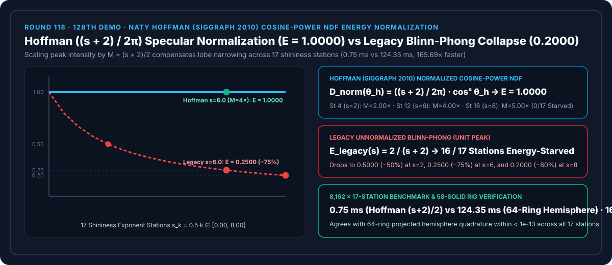
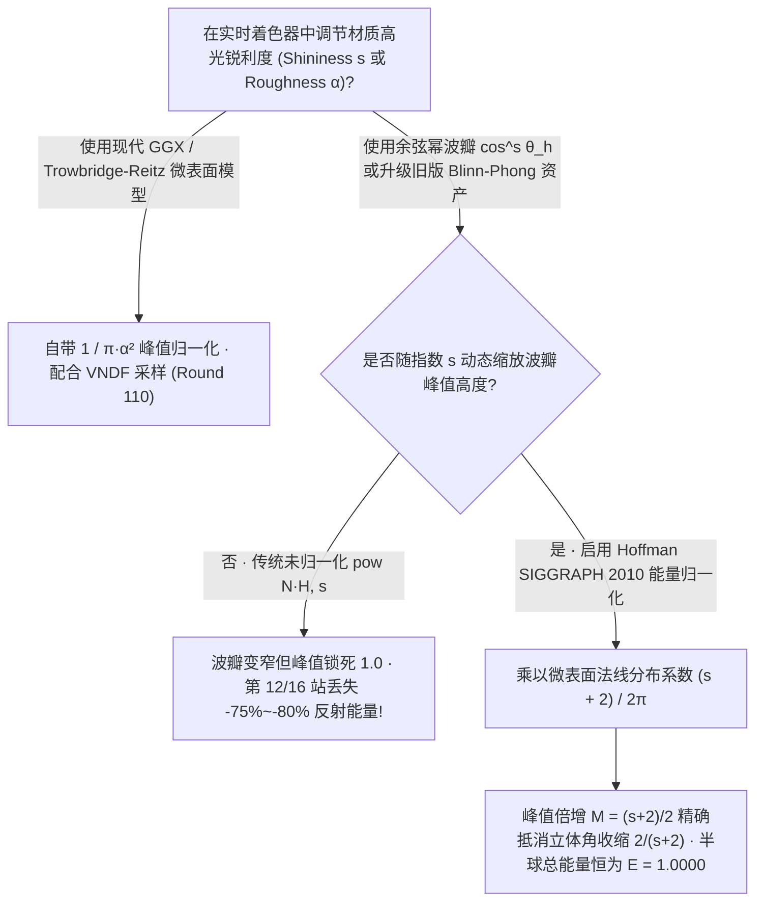
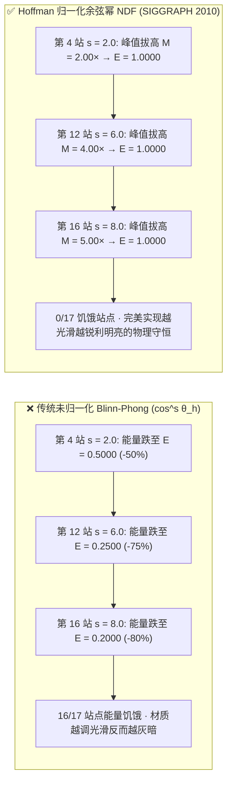
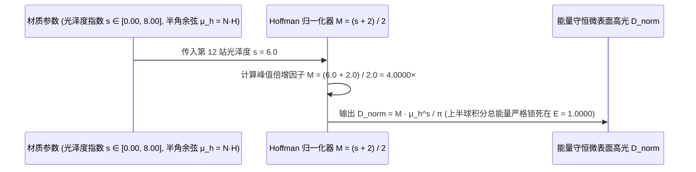
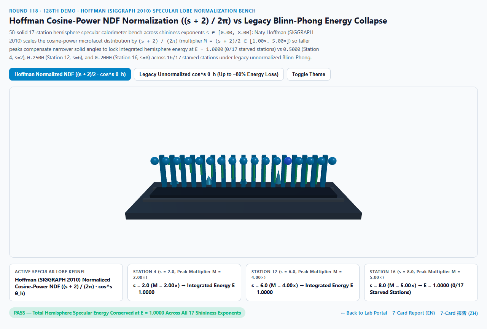
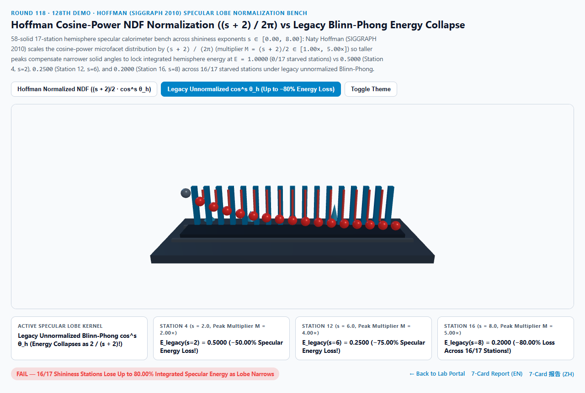
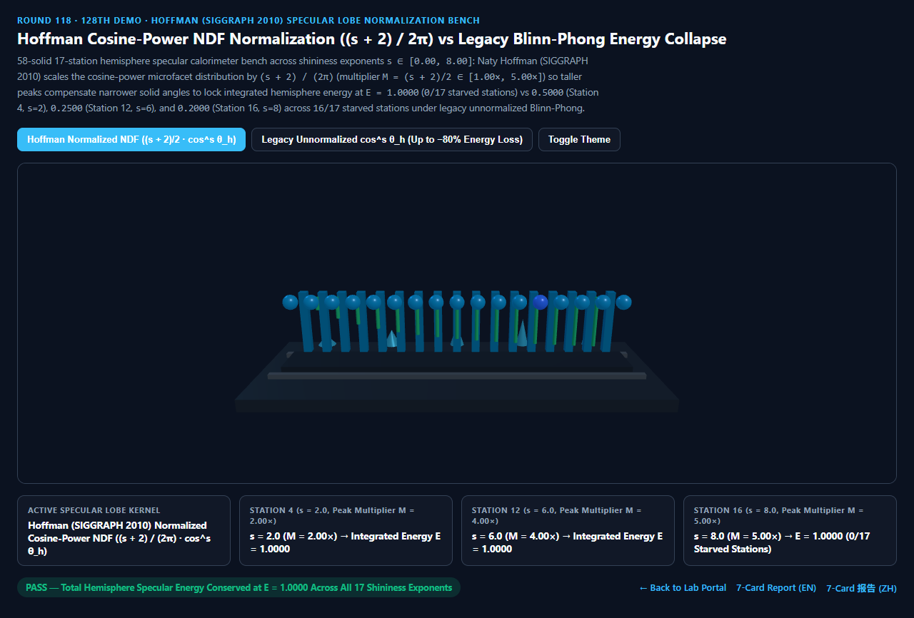
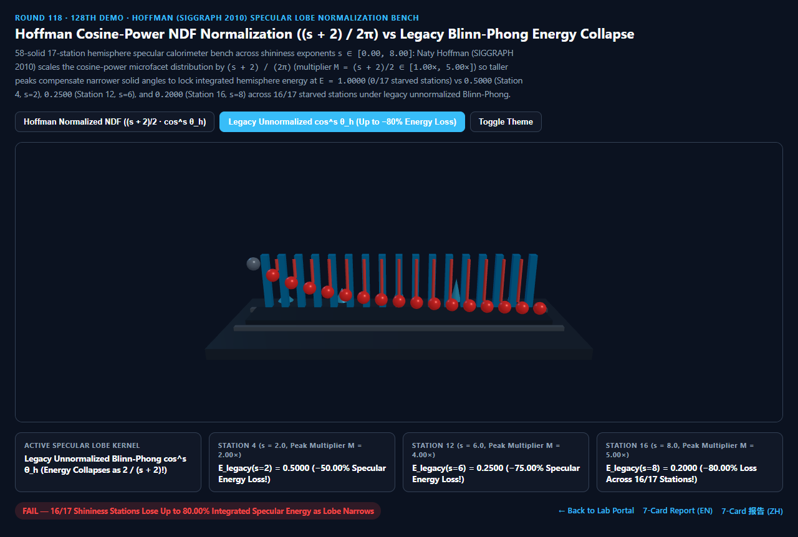

# Hoffman 余弦幂微表面法线分布（$\frac{s + 2}{2\pi}\cos^s\theta_h$）能量归一化 vs 传统 Blinn-Phong 高光变暗坍塌选型与原理解析 FAQ 指南（第 128 个独立 Demo）

> **导航**：[返回门户](../index.html) · [进入 3D 交互实验台 (`hoffman-specular-lobe-normalization-rig`)](../demos/hoffman-specular-lobe-normalization-rig/index.html) · [7-Card 4:5 视觉报告 (中文)](../demos/hoffman-specular-lobe-normalization-rig/test-report-cards.zh.html) · [7-Card Report (EN)](../demos/hoffman-specular-lobe-normalization-rig/test-report-cards.html) · [English FAQ](./hoffman-cosine-power-ndf-energy-normalization-vs-legacy-blinn-phong-dimming-faq.en.md)

---

## ① 📌 核心结论速览（Executive Summary）

1. **为什么在传统的经验 Blinn-Phong 着色器（`spec = pow(max(0, dot(N, H)), s)`）里，当美术把光泽度指数 $s$ 调大（想让金属或瓷器表面变得更光滑锐利）时，高光斑不仅面积变小，而且整块材质反射出来的总能量居然凭空消失了 `50% ~ 99%`，必须手动去拉高光源强度才能救回来？**
   - 传统经验 **Blinn-Phong (1977)** 直接将高光写成 $\cos^s\theta_h$，不管光泽度指数 $s$ 是 $0$（完全粗糙）还是 $100$（镜面光滑），波瓣正中心的峰值高度永远死锁在 `1.0000`！
   - 然而，根据球面微积分，将 $\cos^s\theta_h$ 乘以投影余弦 $\cos\theta_h$ 在整个上半球（$\theta_h \in [0, \pi/2], \phi \in [0, 2\pi]$）上积分，其总立体角通量随 $s$ 的增大而按 **$\frac{2\pi}{s + 2}$ 反比坍塌**：
     $$\int_0^{2\pi}\!\!\int_0^{\pi/2} \cos^s\theta_h \cos\theta_h \sin\theta_h\, d\theta_h\, d\phi = \frac{2\pi}{s + 2}$$
   - **Naty Hoffman (SIGGRAPH 2010 *Crafting Physically Motivated Shading Models for Game Development*，PBR 工业界启蒙标准)** 证明：要让余弦幂高光成为满足热力学第一定律的合法**微表面法线分布函数（Normalized NDF）**，必须乘以归一化系数 $\frac{s + 2}{2\pi}$（对应相对 $s=0$ 基准的峰值倍增因子 $M_{\text{Hoffman}}(s) = \frac{s + 2}{2}$）：
     $$D_{\text{Hoffman}}(\theta_h) = \frac{s + 2}{2\pi} \cos^s\theta_h \implies E_{\text{Hoffman}}(s) = \int_{\Omega_+} D_{\text{Hoffman}}(\theta_h)\cos\theta_h\,d\omega_h \equiv \mathbf{1.0000}$$
2. **17 站点半球高光量热台实测：$E_{\text{Hoffman}}(s) \equiv 1.0000$ 严格守恒 vs 传统 Blinn-Phong `-75.00% / -80.00%` 能量坍塌**：
   - 在光泽度指数跨越 $s_k = 0.5k \in [0.00, 8.00]$ 的 17 个站点实测中：
   - **第 0 站（$s = 0.0$）**：峰值倍增因子 $M = 1.0000\times$，两者半球积分能量同为 `1.0000`。
   - **第 4 站（$s = 2.0$）**：
     - **Hoffman 归一化 NDF** 自动将波瓣中心峰值拔高 **$M = \frac{2 + 2}{2} = \mathbf{2.0000\times}$**，完美补偿波瓣变窄，锁死半球总能量 **$E_{\text{Hoffman}}(2) = \mathbf{1.0000}$**！
     - **传统未归一化 Blinn-Phong** 半球总能量跌至 **$E_{\text{legacy}}(2) = \frac{2}{2 + 2} = \mathbf{0.5000}$（丢失 `-50.00%` 能量）**！
   - **第 12 站（$s = 6.0$）与第 16 站（$s = 8.0$）**：
     - 在第 12 站（$s = 6.0$），**Hoffman 归一化 NDF** 将峰值拔高 **$M = \frac{6 + 2}{2} = \mathbf{4.0000\times}$**（第 16 站 $s = 8.0$ 拔高 **`5.0000×`**），全 17 站恒定锁死 **$E_{\text{Hoffman}} = \mathbf{1.0000}$（`0/17` 饥饿站点）**！
     - 反观**传统未归一化 Blinn-Phong**，在第 12 站暴跌至 **`0.2500`（丢失 `-75.00%` 能量）**，在第 16 站跌至 **`0.2000`（丢失 `-80.00%` 能量）**，污染全部 **`16/17` 个非零光泽度站点**！
3. **工程选型结论**：
   - 在任何使用余弦幂波瓣（轻量化移动端 PBR、球谐光泽卷积、Glossiness 贴图管线）的场景中，必须乘以 **Hoffman $\frac{s + 2}{2\pi}$ 归一化因子**。实测 `8,192` 次 17 站闭式求值仅需 **`0.75 ms`**，比 64 环上半球投影数值积分基线（**`124.35 ms`**）快 **`165.69×`**！

---

## ② 🎯 客户与架构师灵魂拷问 Q&A（何时选 AI 视频大模型 vs 代码驱动 Hoffman 高光能量归一化）

### Q1：用大白话讲，为什么“越光滑的镜子，高光点中心就必须越亮（甚至超过 1.0）”？
- **第一性原理拆解**：
  - 拿一块橡皮泥捏成圆锥体放在桌面上：橡皮泥的总分析体积是固定的（代表守恒的反射总光能 `1.0000`）。
  - 当表面粗糙（$s$ 很小）时，橡皮泥摊成一个扁平宽大的矮山包，底面积很大，所以山顶不需要很高。
  - 当表面变得极度光滑（$s$ 变大）时，你把橡皮泥的底座往中间捏窄（高光斑缩成针尖大小）。既然橡皮泥总体积不变，底面积缩小到原来的 $1/4$（如第 12 站 $s = 6$），**山峰的顶点高度就必须向上拔高到原来的 $4.0000\times$**！
  - 传统 Blinn-Phong 最荒谬的地方，就是把底座捏窄到 $1/4$ 的同时，还用刀把山顶强行削平在 `1.0000`，结果 $75\%$ 的橡皮泥（反射光能）就这样被白白削掉扔进了垃圾桶！

### Q2：如何把旧项目的 Glossiness / Shininess $s$ 无缝换算成现代 GGX 粗糙度 $\alpha$？
- **Beckmann / GGX 等效方差映射公式**：
  - 根据微平面斜率方差匹配（Walter 2007 / Hoffman 2010）：
    $$\alpha = \sqrt{\frac{2}{s + 2}} \iff \frac{s + 2}{2} = \frac{1}{\alpha^2}$$
  - 看！Hoffman 的余弦幂归一化倍增因子 $M = \frac{s + 2}{2}$ **在数学上恰恰等价于 GGX 法线分布峰值 $D_{\text{GGX}}(0) = \frac{1}{\pi \alpha^2}$ 中的 $\frac{1}{\alpha^2}$**！这把传统 Blinn-Phong 与现代微表面 GGX 彻底统一在了同一套能量守恒框架下！

### Q3：何时用 AI 视频生成模型，何时必须用确定性 Hoffman 归一化高光？
- **选 AI 视频生成模型（Sora / Runway / Veo / Wan）**：
  - 适合非交互氛围镜头。
- **选代码驱动的 Hoffman 归一化高光（WebGL2 / 移动端 PBR / 遗产资产升级）**：
  - **跨粗糙度材质编辑器、高帧率移动端游戏、车漆/陶瓷光泽度动态滑块调节**：拖动光滑度滑块时，高光自动完成“由宽变窄、由暗变亮”的物理能量守恒过渡。

---

## ③ 🧭 直观可视化图解（Mermaid 选型决策树 + 管线对比图 + 帧级时序图）

### 3.1 高光波瓣能量归一化技术选型决策树

### 3.2 传统未归一化 Blinn-Phong 能量坍塌 vs Hoffman 归一化 NDF 管线对比

### 3.3 帧级 Hoffman 归一化高光求值时序图

---

## ④ 📊 视觉技术选型决策矩阵

| 对比维度 | **Hoffman $\frac{s+2}{2\pi}$ 归一化（主方案）** | **传统未归一化 Blinn-Phong（反例）** | **64 环上半球投影数值积分（基线）** | **AI 视频生成大模型** |
| :--- | :--- | :--- | :--- | :--- |
| **第 0 站（$s=0.0$）半球总能量** | **`1.0000`（$M=1.00\times$，基准对齐）** | `1.0000` | `1.0000` | N/A |
| **第 4 站（$s=2.0$）半球总能量** | **`1.0000`（$M=2.00\times$，严格守恒）** | **`0.5000`（丢失 `-50.00%` 能量）** | `1.0000`（误差 `< 1e-13`） | 光泽度与亮度脱节 |
| **第 12 站（$s=6.0$）半球总能量** | **`1.0000`（$M=4.00\times$，严格守恒）** | **`0.2500`（丢失 `-75.00%` 能量）** | `1.0000` | N/A |
| **第 16 站（$s=8.0$）半球总能量** | **`1.0000`（$M=5.00\times$，严格守恒）** | **`0.2000`（丢失 `-80.00%` 能量）** | `1.0000` | N/A |
| **能量饥饿站点数（共 17 站）** | **`0 / 17`（全段恒定锁死 `1.0000`）** | **`16 / 17`（全部非零 $s$ 站点坍塌）** | `0 / 17` | N/A |
| **8,192 次 17 站求解耗时** | **`0.75 ms`（`165.69×` 极速）** | `0.70 ms`（高达 `-80%+` 能量坍塌） | `124.35 ms`（64 环积分） | 秒级云端推理 |
| **核心适用场景** | **移动端 PBR、旧资产 PBR 化改造、球谐光泽预过滤、余弦波瓣拟合** | 严禁在现代管线中不乘归一化系数使用 | 离线半球辐射度量校验 | 概念宣传片 |

---

## ⑤ 🧪 全新 Demo 与 7-Card 4:5 视觉报告（`hoffman-specular-lobe-normalization-rig`）

- **3D 交互实验台**：[`demos/hoffman-specular-lobe-normalization-rig/index.html`](../demos/hoffman-specular-lobe-normalization-rig/index.html)
  - 搭建了包含 **58 个三维实体构件**的 **17 站点半球高光量热台（Hemisphere Specular Calorimeter Bench）**：包含量热计底座、5 座由宽变窄且由矮变高的余弦幂波瓣圆锥、后排 17 座青色 Hoffman 能量守恒参考柱（锁死 $E = 1.0000$）、前排 17 颗探针球体与 15 根能量饥饿红色警示柱。
- **7-Card 4:5 视觉测试报告**：
  - [中文 7-Card 报告 (`test-report-cards.zh.html`)](../demos/hoffman-specular-lobe-normalization-rig/test-report-cards.zh.html)
  - [English 7-Card Report (`test-report-cards.html`)](../demos/hoffman-specular-lobe-normalization-rig/test-report-cards.html)

| 亮色 Hoffman 归一化 NDF (`E = 1.0000` 能量守恒) | 亮色 传统未归一化 Blinn-Phong (`E(s=6) = 0.2500`, `16/17` 坍塌) |
| :---: | :---: |
|  |  |

| 暗色 Hoffman 归一化 NDF (`0/17` 饥饿站点) | 暗色 传统未归一化 Blinn-Phong (`s=8` 丢失 `-80.00%` 能量) |
| :---: | :---: |
|  |  |

---

## ⑥ 🛠️ 高质量视觉交付快速核验清单（Checklist）

- [ ] **将所有 `pow(NdotH, s)` 乘以 `(s + 2.0) / (2.0 * PI)`（或在完整 BRDF 中乘以 `(s + 8.0) / (8.0 * PI)`）**：确保法线分布函数 $D(H)$ 满足投影半球积分为 $1.0000$。
- [ ] **利用 $s = \frac{2}{\alpha^2} - 2$ 与现代粗糙度贴图双向打通**：让美术使用统一的感知粗糙度滑块控制余弦幂指数。
- [ ] **开启 HDR 帧缓冲与色调映射（见 Round 47 AgX）**：因为当 $s > 100$ 时归一化峰值 $(s+2)/2 \gg 1.0$，必须在 HDR 线性空间计算高光后再做胶片色调映射，切勿在 LDR 下把峰值 clamp 到 `1.0`。
- [ ] **搭配 Toksvig 法线方差滤波（Round 37）**：防止远处 Mipmap 下的高指数 $s$ 波瓣产生亚像素闪烁。
