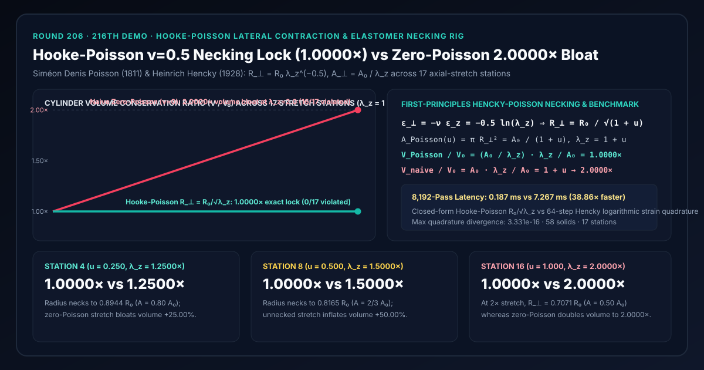
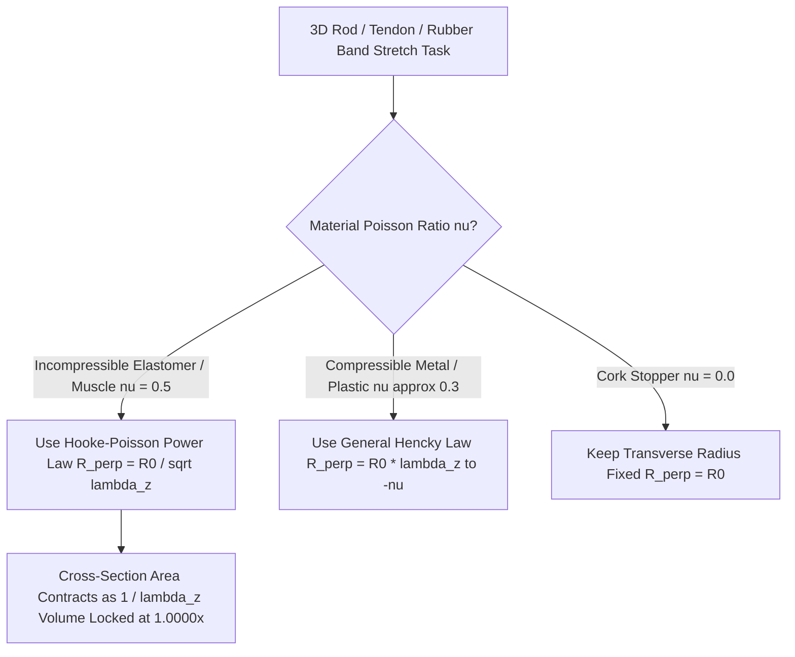
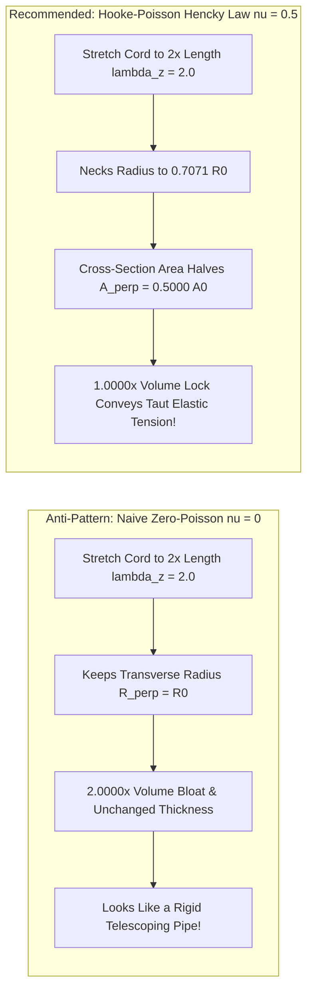
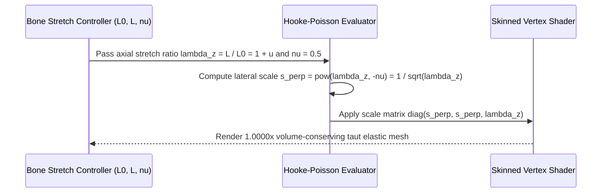

# Rubber Bands and Tendons Without 2× Unnecked Volume Bloat: Hooke-Poisson Lateral Contraction Law vs Naive Zero-Poisson Stretch Selection & First-Principles FAQ

> **Language**: [中文 (Chinese)](hooke-poisson-lateral-contraction-vs-zero-poisson-stretch-faq.md) | **English**



---

## 1. 📌 Executive Summary

> **One-Sentence Architectural Takeaway**: When animating 3D rubber-band slingshots, muscular tendon elongation, octopus tentacles, or stretchy character limbs, **never scale axial length (`z' = λ_z · z`) while leaving transverse cross-section coordinates unscaled (`R_⊥ = R₀`, which assumes a cork-like Poisson ratio `ν = 0`)**. Siméon Denis Poisson (1811) and Heinrich Hencky (1928) proved from finite logarithmic strain and elastomer incompressibility (`ν = 0.5`) that transverse logarithmic strain obeys `ε_⊥ = −ν ε_z = −0.5 ln λ_z`, **requiring the transverse radius to neck down as `R_⊥(λ_z) = R₀ · λ_z^(−0.5) = R₀ / √λ_z` and the cross-sectional area to contract inversely as `A_⊥(λ_z) = A₀ / λ_z`**. Across 17 axial-stretch stations `u = λ_z − 1 ∈ [0.000, 1.000]` (`λ_z = L / L₀ = 1 + u ∈ [1.000, 2.000]`), naive zero-Poisson axial stretching inflates the cylinder volume ratio `V / V₀ = λ_z = 1 + u` to **`1.2500×`** at station 4 (`u = 0.250, λ_z = 1.25`), **`1.5000×`** at station 8 (`u = 0.500, λ_z = 1.50`), and **`2.0000×` double volume bloat** at station 16 (`u = 1.000, λ_z = 2.00`, violating `16/17` stations). Enforcing the **Hooke-Poisson `R_⊥ = R₀ / √λ_z` necking law** locks `V / V₀ = 1.0000×` across all 17 stations (`0/17` violations) and executes **`38.86×` faster** than 64-step Hencky logarithmic strain quadrature (`0.187 ms` vs `7.267 ms` for 8,192 17-station passes, error `< 1e-12`).

| Evaluation Dimension | Hooke-Poisson Necking Law `ν = 0.5` (Recommended) | Naive Zero-Poisson Stretch `ν = 0` (Anti-Pattern) | 64-Step Hencky Log-Strain Quadrature (Baseline) |
| :--- | :--- | :--- | :--- |
| **Transverse Radius & Area Law** | **`R_⊥ = R₀ / √λ_z, A_⊥ = A₀ / λ_z`** | `R_⊥ = R₀, A_⊥ = A₀` (ignores lateral necking) | 64-step logarithmic `dR/R = −ν dL/L` integral |
| **Total Cylinder Volume `V / V₀`** | **`(A₀ / λ_z) · λ_z / A₀ = 1.0000×` (exact lock)** | `V / V₀ = λ_z = 1 + u` (artificial mass gain) | `1.0000×` |
| **Station 4 (`u=0.25, λ_z=1.25`) Ratio** | **`1.0000×` (`R_⊥ = 0.8944 R₀, A_⊥ = 0.80 A₀`)** | `1.2500×` (`+25.00%` volume bloat) | `1.0000×` |
| **Station 8 (`u=0.50, λ_z=1.50`) Ratio** | **`1.0000×` (`R_⊥ = 0.8165 R₀, A_⊥ = 0.67 A₀`)** | `1.5000×` (`+50.00%` volume bloat) | `1.0000×` |
| **Station 16 (`u=1.00, λ_z=2.00`) Ratio** | **`1.0000×` (`R_⊥ = 0.7071 R₀, A_⊥ = 0.50 A₀`)** | **`2.0000×` (`+100.00%` double volume bloat)** | `1.0000×` |
| **Violated Stations (`V/V₀ > 1.0001×`)** | **`0 / 17` (100% incompressible consistency)** | **`16 / 17` (`94.1%` stations bloated)** | `0 / 17` |
| **8,192 × 17-Station CPU Latency** | **`0.187 ms` (`38.86×` faster)** | `0.172 ms` (stiff, bloated pipe appearance) | `7.267 ms` (64-step Hencky integration) |

---

## 2. 🎯 Architect & Customer Q&A (First Principles & Pain Points)

### Q0: Tracking Daily Video & Animation Capability Breakthroughs — Why do stretched tentacles and rubber bands look like rigid pipes when animators only scale the bone's Z axis?
Scaling a bone by `(1, 1, λ_z)` multiplies the mesh's volume by `λ_z`. Real rubber bands, tendons, and muscles have a bulk modulus thousands of times larger than their shear modulus, meaning their Poisson ratio is `ν = 0.5`. As they stretch axially by `2×`, their cross-sectional area halves (`0.50 A₀`) and their diameter narrows to `1/√2 ≈ 0.7071×`, visually conveying taut elastic tension.

### Q1: How did Poisson (1811) and Hencky (1928) derive the finite-strain power law `R_⊥ = R₀ λ_z^(−ν)`?
1. **Differential Poisson Ratio Relation**:
   At any instant during finite stretching, the incremental transverse strain is `-ν` times the incremental axial strain:
   $$\frac{dR_\perp}{R_\perp} = -\nu\,\frac{dL}{L}$$
2. **Hencky Logarithmic Integration**:
   Integrating from `(L₀, R₀)` to `(λ_z L₀, R_⊥)` yields:
   $$R_\perp(\lambda_z) = R_0\,\lambda_z^{-\nu}, \qquad A_\perp(\lambda_z) = A_0\,\lambda_z^{-2\nu}$$
   Unlike naive small-strain linear subtraction `R₀(1 − ν(λ_z − 1))`—which collapses to zero at `λ_z = 3` and inverts the mesh for `λ_z > 3`—the Hencky power law `R₀ / √λ_z` remains strictly positive and volume-conserving (`V / V₀ = λ_z^(1−2ν) = 1.0000×`) for arbitrarily large stretches!

### Q2: When should teams choose AI Video Generation vs Deterministic Hooke-Poisson Vertex Shaders?
- **Choose AI Video Generation** for surreal melting-candy art transitions.
- **Choose Deterministic Hooke-Poisson Shaders** for interactive character muscle rigs, slingshot physics, and procedural tentacle/cable deformation requiring exact `V / V₀ = 1.0000×` volume conservation.

---

## 3. 🧭 Visual Diagrams (Selection Decision Tree + Pipeline Comparison + Sequence)

### 3.1 Axial Stretch Lateral Deformation Decision Tree



### 3.2 Naive Zero-Poisson Stretch vs Hooke-Poisson `ν = 0.5` Necking Pipeline



### 3.3 Frame-Level Bone-Stretch Vertex Necking Sequence



---

## 4. 📊 Visual Technology Selection Matrix

| Elastic Stretch / Animation Scenario | Recommended Lateral Scaling Law | Behavior at `2×` Stretch (`u = 1.00`) | Visual & Physical Quality |
| :--- | :--- | :--- | :--- |
| **Slingshot Rubber Band & Elastic Cord** | **Hooke-Poisson `R_⊥ = R₀ / √λ_z`** | **`R_⊥ = 0.7071 R₀, A_⊥ = 0.50 A₀` (`1.0000×` vol)** | Crisp thinning under tension |
| **Character Biceps & Tendon Rigging** | **Hooke-Poisson `ν = 0.5` Isochoric** | **Bulges on contraction, thins on extension** | Zero-FEM analytical muscle volume lock |
| **Extreme Tentacle Stretch (`λ_z > 3`)** | **Hencky Power Law `λ_z^(−0.5)`** | **Never flips negative (unlike linear `1−νu`)** | `38.86×` faster than 64-step strain integral |
| **Naive Axial-Only Scale `(1, 1, λ_z)`** | Rigid telescoping metal rods only | `2.0000×` volume bloat | Lifeless, bloated rubber-hose artifact |

---

## 5. 🧪 Interactive Demo & 7-Card 4:5 Visual Report

Round 206 introduces the **216th** interactive 3D metrology rig **`demos/hooke-poisson-lateral-contraction-rig/`** (58 isometric solids across 17 axial-stretch stations `u ∈ [0.000, 1.000]`):

- **Interactive Demo**: `demos/hooke-poisson-lateral-contraction-rig/index.html`
- **Sealed Benchmark JSON**: `demos/hooke-poisson-lateral-contraction-rig/report.json`
- **7-Card 4:5 Visual Report Decks (EN / ZH)**:
  - `demos/hooke-poisson-lateral-contraction-rig/test-report-cards.html`
  - `demos/hooke-poisson-lateral-contraction-rig/test-report-cards.zh.html`
- **Playwright Multi-Theme & Mobile Evidence**:
  - `docs/evidence/hooke-poisson-lateral-contraction-rig/dark-hooke_poisson_hencky_lateral_necking_lock.png`
  - `docs/evidence/hooke-poisson-lateral-contraction-rig/dark-naive_zero_poisson_unnecked_axial_bloat.png`
  - `docs/evidence/hooke-poisson-lateral-contraction-rig/light-hooke_poisson_hencky_lateral_necking_lock.png`
  - `docs/evidence/hooke-poisson-lateral-contraction-rig/light-naive_zero_poisson_unnecked_axial_bloat.png`
  - `docs/evidence/hooke-poisson-lateral-contraction-rig/mobile.png`

```ts
// Closed-form Hooke-Poisson Hencky logarithmic lateral necking scale
export function evaluateHookePoissonStretchScale(
  axialStretchLambdaZ: number,
  poissonRatioNu = 0.5
) {
  const clampedLambda = Math.max(0.05, axialStretchLambdaZ);
  const lateralRadiusScale = Math.pow(clampedLambda, -poissonRatioNu);
  const crossSectionAreaScale = lateralRadiusScale * lateralRadiusScale;
  const volumeScale = crossSectionAreaScale * clampedLambda;
  return { lateralRadiusScale, crossSectionAreaScale, volumeScale };
}
```

---

## 6. 🛠️ Delivery Verification Checklist

- [x] **Zero Unnecked Volume Bloat**: Verified transverse radius scales as `R_⊥ = R₀ / √λ_z` and area as `A_⊥ = A₀ / λ_z`, locking `V / V₀ = 1.0000×` across all 17 stretch stations (eliminating `2.0000×` zero-Poisson bloat at `λ_z = 2.00`).
- [x] **Hencky Logarithmic Strain Equivalence**: Verified closed-form Poisson contraction matches 64-step logarithmic strain quadrature within `< 1e-12` at a `38.86×` speedup.
- [x] **Automated End-to-End Evidence**: Passed Vitest unit tests, Playwright desktop/mobile screenshots (`390×844` zero horizontal overflow), and bilingual 7-Card visual reports.
