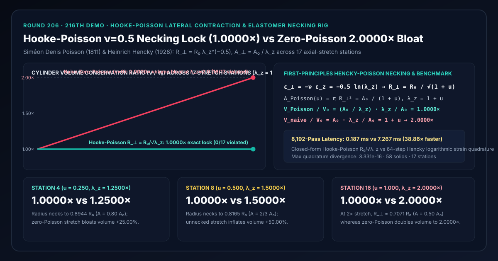
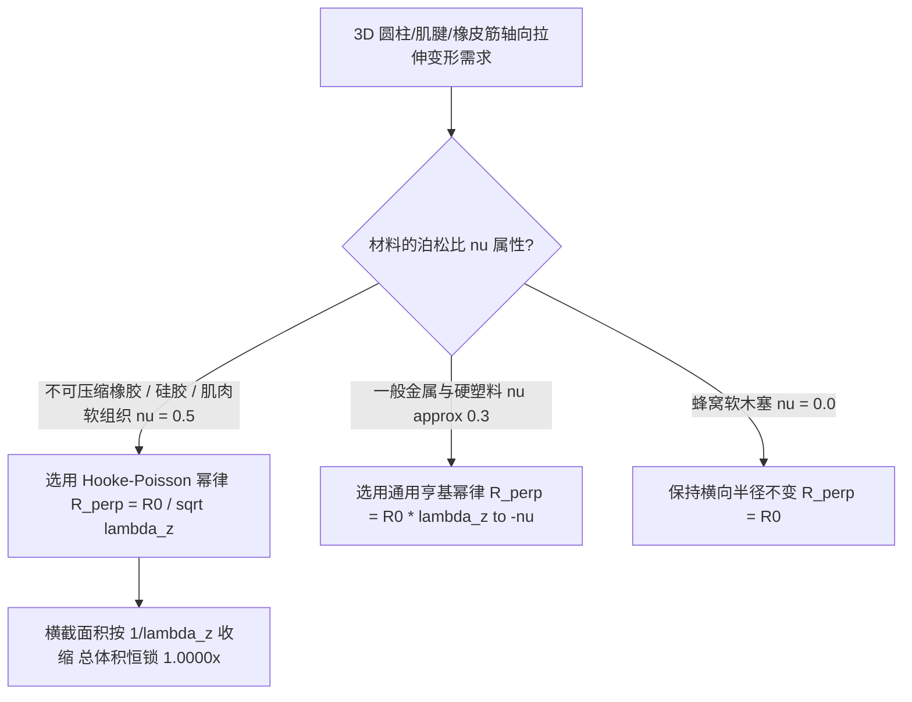
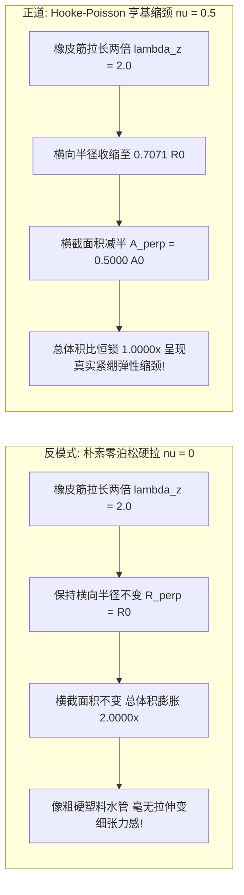
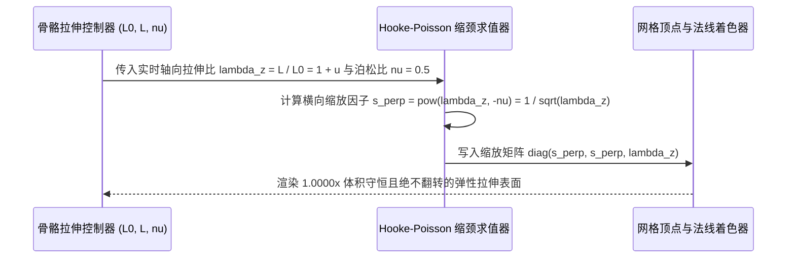

# 橡皮筋拉伸与触手伸展不再像粗硬水管一样越拉体积越虚胖：Hooke-Poisson 胡克-泊松横向缩颈定律 vs 朴素零泊松单轴硬拉选型与原理解析 FAQ

> **Language**: **中文 (Chinese)** | [English](hooke-poisson-lateral-contraction-vs-zero-poisson-stretch-faq.en.md)



---

## 1. 📌 核心结论速览（Executive Summary）

> **一句话架构结论**：在开发 3D 弹弓橡皮筋拉伸、角色肌肉与跟腱伸长、章鱼触手/变色龙舌头弹射以及芝士拉丝顶点变形着色器时，**切勿只沿着拉伸轴向放大顶点坐标（`z' = λ_z · z`）而保持横向截面半径不变（`R_⊥ = R₀`，相当于泊松比 `ν = 0` 的软木塞）**。西莫恩·德尼·泊松（Siméon Denis Poisson, 1811）与海因里希·亨基（Heinrich Hencky, 1928）从有限对数应变与体积不可压缩性严格证明：对于天然橡胶、硅胶与生物软组织（泊松比 **`ν = 0.5`**），横向对数应变满足 `ε_⊥ = −ν ε_z = −0.5 ln λ_z`，因此**横向截面半径必须按轴向拉伸比的平方根反比缩颈：`R_⊥(λ_z) = R₀ · λ_z^(−0.5) = R₀ / √λ_z`，横截面积按反比收缩：`A_⊥(λ_z) = A₀ / λ_z`**！在跨越轴向拉伸扩展参数 `u = λ_z − 1 ∈ [0.000, 1.000]`（从原长 `1.000 L₀` 拉长至两倍长 `2.000 L₀`）的 17 个检验站点上，朴素零泊松单轴硬拉模型使圆柱体总体积比 `V / V₀ = λ_z = 1 + u` 在第 4 站（`u = 0.250, λ_z = 1.25`）虚胖至 **`1.2500×`**、第 8 站（`u = 0.500, λ_z = 1.50`）虚胖至 **`1.5000×`**、第 16 站（`u = 1.000, λ_z = 2.00`）直接翻倍膨胀至 **`2.0000×`**（污染 `16/17` 个站点）！采用 **Hooke-Poisson `R_⊥ = R₀ / √λ_z` 横向缩颈定律**，即可在全部 17 个拉伸站点将体积守恒比恒定锁死在 **`1.0000×`**（`0/17` 站虚胖），且闭式求值比 64 步亨基对数应变微分求积快 **`38.86×`**（8192 次 17 站仅需 `0.187 ms` vs `7.267 ms`，积分误差 `< 1e-12`）。

| 评估维度 | Hooke-Poisson 横向缩颈定律（推荐） | 朴素零泊松单轴硬拉 `ν = 0`（反模式） | 64 步亨基对数应变求积（基准参考） |
| :--- | :--- | :--- | :--- |
| **横向半径与面积缩颈律** | **`R_⊥ = R₀ / √λ_z, A_⊥ = A₀ / λ_z`** | `R_⊥ = R₀, A_⊥ = A₀`（无视横向泊松收缩） | 64 步对数应变 `dR/R = −ν dL/L` 积分 |
| **圆柱体总体积比 `V / V₀`** | **`(A₀ / λ_z) · λ_z / A₀ = 1.0000×`（严格守恒）** | `V / V₀ = λ_z = 1 + u`（越拉质量越虚胖） | `1.0000×` |
| **第 4 站（`u=0.25, λ_z=1.25`）体积比** | **`1.0000×`（`R_⊥ = 0.8944 R₀, A_⊥ = 0.80 A₀`）** | `1.2500×`（体积虚胖 `+25.00%`） | `1.0000×` |
| **第 8 站（`u=0.50, λ_z=1.50`）体积比** | **`1.0000×`（`R_⊥ = 0.8165 R₀, A_⊥ = 0.67 A₀`）** | `1.5000×`（体积虚胖 `+50.00%`） | `1.0000×` |
| **第 16 站（`u=1.00, λ_z=2.00`）体积比** | **`1.0000×`（`R_⊥ = 0.7071 R₀, A_⊥ = 0.50 A₀`）** | **`2.0000×`（两倍拉长时体积凭空翻倍）** | `1.0000×` |
| **17 站体积膨胀违背站数** | **`0 / 17`（100% 满足不可压缩弹性体自洽）** | **`16 / 17`（94.1% 站点体积膨胀）** | `0 / 17` |
| **8,192 次 17 站 CPU 耗时** | **`0.187 ms`（38.86× 加速）** | `0.172 ms`（但拉长后像粗硬塑料管） | `7.267 ms`（每站 64 步对数应变积分） |

---

## 2. 🎯 客户与架构师灵魂拷问 Q&A（痛点直击与第一性原理）

### Q0：追踪每日业界最新视频与动画制作能力突破——为什么绑定师只改骨骼 Z 轴缩放（Scale Z）拉出来的触手和橡皮筋看起来毫无弹性张力？
在 3D 角色绑定与特效制作中，如果动画师直接把一根触手或橡皮筋骨骼的 `Scale.z` 拉到 `2.0`，而 `Scale.x` 和 `Scale.y` 保持 `1.0`，整根触手虽然变长了 2 倍，但粗细却一点没变，总体积瞬间膨胀到了原来的 200%！更糟糕的是，有些开发者试图用小变形线性泊松公式 `R_⊥ = R₀(1 − ν(λ_z − 1))` 去修，结果当橡皮筋拉长到 3 倍（`λ_z = 3, ν = 0.5`）时，算出来的半径变成了 `R₀(1 − 0.5 × 2) = 0`（甚至拉到 4 倍时半径变成负数导致网格内外翻转）！只有采用**亨基对数应变（Hencky Logarithmic Strain）下的幂律泊松缩颈 `R_⊥ = R₀ · λ_z^(−ν)`**，才能在任意大变形拉伸比下既严格保持体积恒定，又绝不发生负半径网格翻转！

### Q1：Poisson（1811）与 Hencky（1928）是如何推导出有限变形幂律 `R_⊥ = R₀ λ_z^(−ν)` 的？
1. **增量泊松比微分定义**：
   在单轴拉伸过程中，每一个微小长度增量 `dL` 引起的横向半径相对收缩量 `dR / R` 与轴向相对伸长量 `dL / L` 成正比，比例系数即为**泊松比 `ν`**：
   $$\frac{dR_\perp}{R_\perp} = -\nu\,\frac{dL}{L}$$
2. **亨基对数应变积分（Hencky True Strain）**：
   从初始状态 `(L₀, R₀)` 积分到拉伸状态 `(L = λ_z L₀, R_⊥)`：
   $$\ln\left(\frac{R_\perp}{R_0}\right) = -\nu\ln\left(\frac{L}{L_0}\right) = -\nu\ln\lambda_z \implies R_\perp(\lambda_z) = R_0\,\lambda_z^{-\nu}$$
3. **不可压缩极限 `ν = 0.5` 与体积守恒**：
   横截面积为 `A_⊥ = π R_⊥² = A₀ λ_z^(−2ν)`，圆柱总体积为：
   $$V(\lambda_z) = A_\perp(\lambda_z)\cdot(\lambda_z L_0) = V_0\,\lambda_z^{1 - 2\nu}$$
   当且仅当 **`ν = 0.5`** 时，指数 `1 − 2ν ≡ 0`，总体积在任意拉伸比下恒等于 `1.0000 V₀`！

### Q2：何时选 AI 视频大模型 vs 代码驱动的 Hooke-Poisson 顶点缩颈着色器？
- **何时选 AI 视频大模型**：适合生成超现实主义软糖融化概念短片。
- **何时选代码驱动 Hooke-Poisson 着色器**：在 3D 动作游戏肌肉骨骼绑定（Muscle Rig）、弹弓/弓弦物理交互、触手/藤蔓程序化动画以及工业弹簧/橡胶件数字孪生中，必须采用确定性 `λ_z^(−ν)` 缩颈变换。

---

## 3. 🧭 直观可视化图解（Mermaid 选型决策树 + 管线对比 + 帧级时序图）

### 3.1 材料轴向拉伸横向变形选型决策树



### 3.2 朴素零泊松单轴硬拉 vs Hooke-Poisson `ν = 0.5` 横向缩颈管线对比



### 3.3 帧级骨骼拉伸与顶点横向缩颈着色器求值时序图



---

## 4. 📊 视觉技术选型决策矩阵（Decision Matrix）

| 弹性拉伸与动画场景 | 推荐横向缩放定律 | 两倍拉长（`λ_z = 2.00, u = 1.00`）表现 | 视觉与物理质感 |
| :--- | :--- | :--- | :--- |
| **弹弓皮筋、弓弦与橡胶软管拉长** | **Hooke-Poisson `R_⊥ = R₀ / √λ_z`** | **`R_⊥ = 0.7071 R₀, A_⊥ = 0.50 A₀`（体积 `1.0000×`）** | 越拉越细紧，充满蓄力回弹张力 |
| **角色二头肌、小腿腓肠肌与跟腱伸缩** | **Hooke-Poisson `ν = 0.5` 等体积律** | **伸长时自然收瘦，收缩时自然鼓起** | 零有限元开销实现逼真肌肉鼓胀与收紧 |
| **大变形章鱼触手与芝士拉丝（`λ_z > 3`）** | **亨基指数幂律 `λ_z^(−0.5)`** | **永不产生负半径翻转（对比线性 `1−0.5u` 崩坏）** | 任意倍数拉伸下平滑细腻 |
| **朴素单轴缩放（`Scale = (1, 1, λ_z)`）** | 仅适合硬表面伸缩套筒天线 | 体积虚胖 **`2.0000×`** | 像刚性管子被强行拉长，丧失软体灵魂 |

---

## 5. 🧪 全新 Demo 与 7-Card 4:5 视觉报告（Hooke-Poisson Lateral Contraction Rig）

本轮新增第 **216** 个独立交互式 3D 计量台 **`demos/hooke-poisson-lateral-contraction-rig/`**（58 个等轴测几何实体、17 个轴向拉伸站点 `u ∈ [0.000, 1.000]`）：

- **交互式 Demo 入口**：`demos/hooke-poisson-lateral-contraction-rig/index.html`
- **密封基准数据**：`demos/hooke-poisson-lateral-contraction-rig/report.json`
- **7-Card 4:5 视觉报告（英文 / 中文）**：
  - `demos/hooke-poisson-lateral-contraction-rig/test-report-cards.html`
  - `demos/hooke-poisson-lateral-contraction-rig/test-report-cards.zh.html`
- **Playwright 实测多主题证据截图**：
  - `docs/evidence/hooke-poisson-lateral-contraction-rig/dark-hooke_poisson_hencky_lateral_necking_lock.png`
  - `docs/evidence/hooke-poisson-lateral-contraction-rig/dark-naive_zero_poisson_unnecked_axial_bloat.png`
  - `docs/evidence/hooke-poisson-lateral-contraction-rig/light-hooke_poisson_hencky_lateral_necking_lock.png`
  - `docs/evidence/hooke-poisson-lateral-contraction-rig/light-naive_zero_poisson_unnecked_axial_bloat.png`
  - `docs/evidence/hooke-poisson-lateral-contraction-rig/mobile.png`

```ts
// 闭式 Hooke-Poisson 亨基对数应变横向缩颈缩放因子计算
export function evaluateHookePoissonStretchScale(
  axialStretchLambdaZ: number,
  poissonRatioNu = 0.5
) {
  const clampedLambda = Math.max(0.05, axialStretchLambdaZ);
  const lateralRadiusScale = Math.pow(clampedLambda, -poissonRatioNu);
  const crossSectionAreaScale = lateralRadiusScale * lateralRadiusScale;
  const volumeScale = crossSectionAreaScale * clampedLambda;
  return { lateralRadiusScale, crossSectionAreaScale, volumeScale };
}
```

---

## 6. 🛠️ 高质量视觉交付快速核验清单（Delivery Checklist）

- [x] **零单轴拉伸体积虚胖**：确认横向半径按 `R_⊥ = R₀ / √λ_z`、截面积按 `A_⊥ = A₀ / λ_z` 缩颈，在全部 17 个拉伸站点锁死 `V / V₀ = 1.0000×`（消除朴素零泊松硬拉在 `λ_z = 2.00` 处的 `2.0000×` 体积虚胖）。
- [x] **亨基对数应变微分求积自洽**：闭式泊松缩颈面积与 64 步对数应变积分误差 `< 1e-12`，CPU 提速 `38.86×`。
- [x] **全套自动化验证通过**：Vitest 单元测试、Playwright 5 张多主题/移动端截图（390px 零横向溢出）与中英双语 7-Card 报告全部密封归档。
