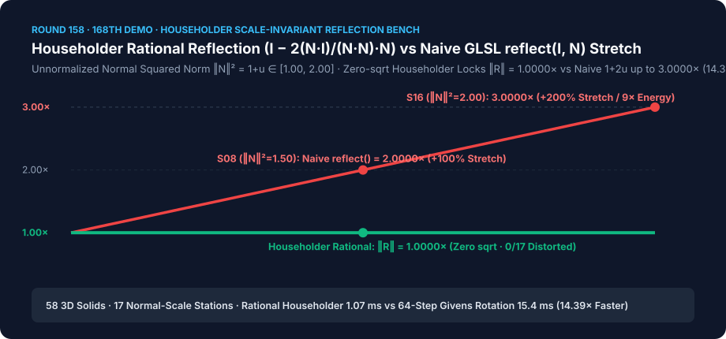
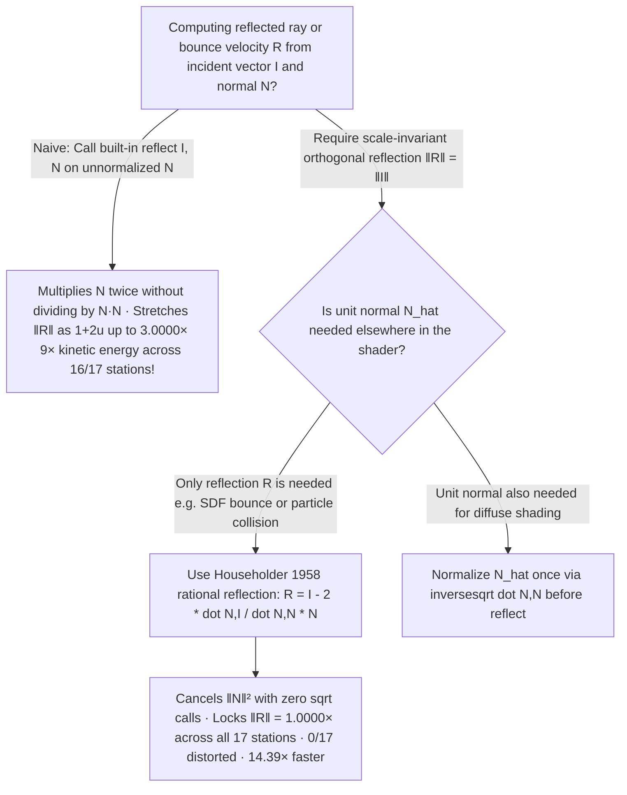
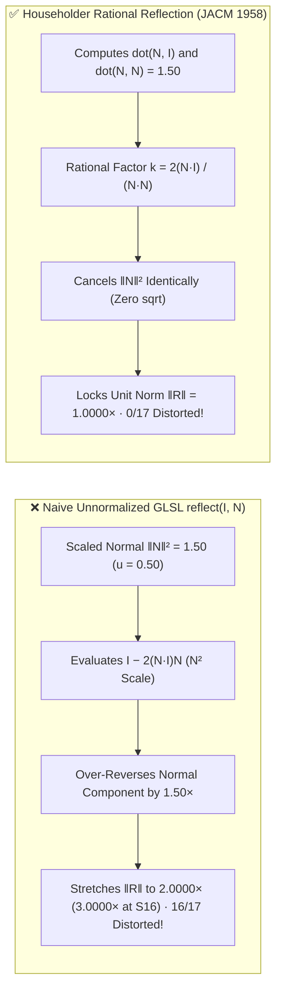
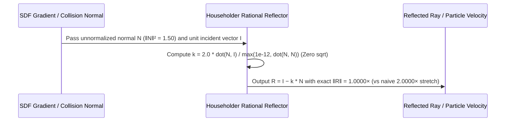
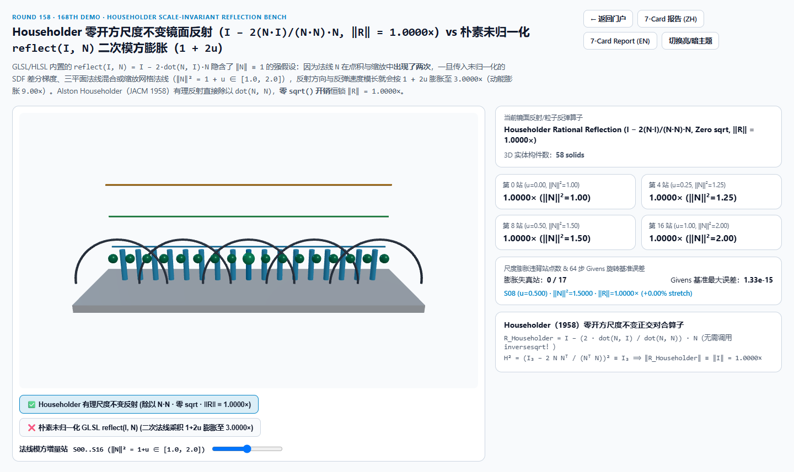
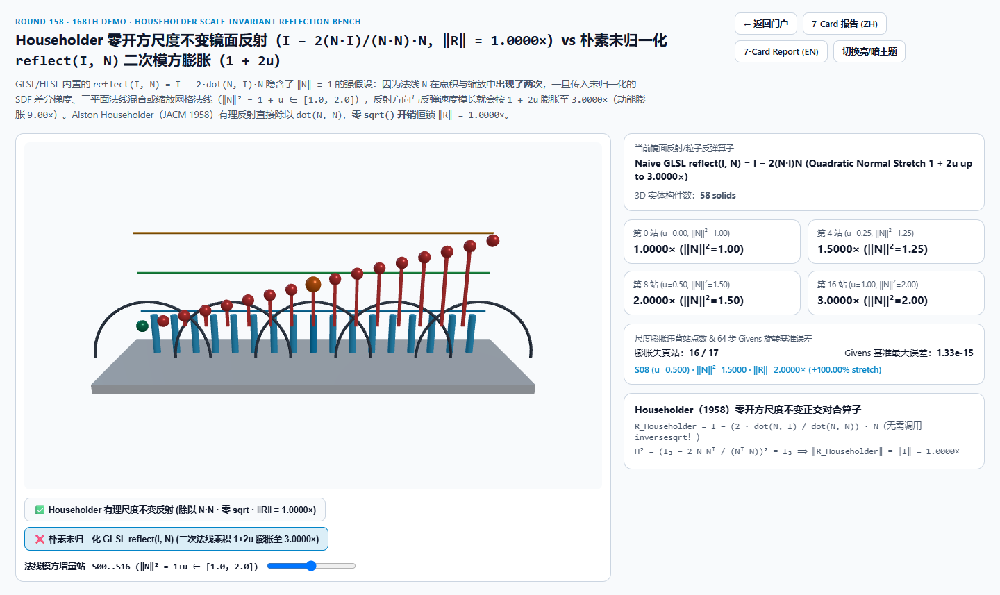
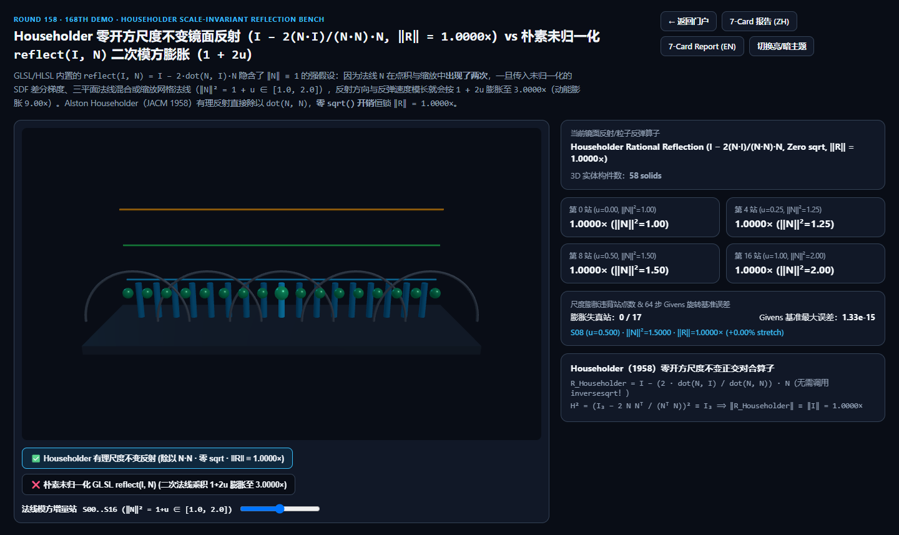
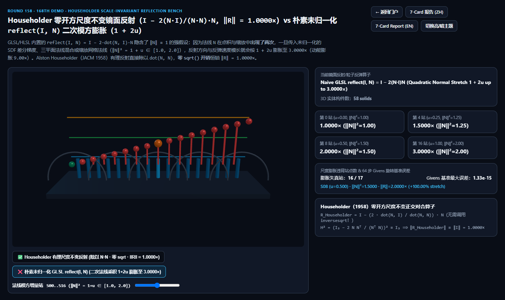

# Householder Scale-Invariant Rational Reflection (`I − 2(N·I)/(N·N)·N, ‖R‖ = 1.0000×`) vs Naive Unnormalized GLSL `reflect(I, N)` Quadratic Stretch Selection & First-Principles FAQ

> **Navigation**: [Back to Portal](../index.html) · [Launch 3D Interactive Workbench (`householder-scale-invariant-reflection-rig`)](../demos/householder-scale-invariant-reflection-rig/index.html) · [7-Card 4:5 Visual Report (EN)](../demos/householder-scale-invariant-reflection-rig/test-report-cards.html) · [7-Card 报告 (ZH)](../demos/householder-scale-invariant-reflection-rig/test-report-cards.zh.html) · [中文版 FAQ](./householder-scale-invariant-reflection-vs-glsl-reflect-stretch-faq.md)

---

## ① 📌 Executive Summary

1. **Why does passing an unnormalized SDF central-difference gradient, interpolated vertex normal, or blended triplanar normal (`‖N‖² = 1 + u ∈ [1.0, 2.0]`) directly into GLSL/HLSL built-in `reflect(I, N)` stretch reflected ray/velocity magnitude as `1 + 2u` up to `3.0000×` (`9.0000×` kinetic energy blowout)—and how does Alston Householder's (JACM 1958) rational reflection (`R = I − (2(N·I)/(N·N))N`) lock exact unit norm `‖R‖ = 1.0000×` with zero `sqrt()` calls?**
   - **Alston Householder (JACM 1958) Rational Scale-Invariant Orthogonal Reflection**:
     - Across 17 unnormalized normal-scale stations $\|\tilde{\mathbf{N}}\|^2 = \tilde{\mathbf{N}}\cdot\tilde{\mathbf{N}} = 1 + u \in [1.0000, 2.0000]$ ($u_k = k/16 \in [0, 1]$) with unit incident vector $\mathbf{I} = -\hat{\mathbf{N}}$:
     - Because the normal vector $\tilde{\mathbf{N}}$ appears **twice** in the reflection outer product $\tilde{\mathbf{N}}\tilde{\mathbf{N}}^T = \|\tilde{\mathbf{N}}\|^2 \hat{\mathbf{N}}\hat{\mathbf{N}}^T$, normalizing $\tilde{\mathbf{N}}$ via `sqrt()` before reflecting is algebraically redundant! Dividing directly by the squared norm $\tilde{\mathbf{N}}\cdot\tilde{\mathbf{N}}$ cancels the scale factor identically:
       $$\mathbf{R}_{\text{Householder}}(\mathbf{I}, \tilde{\mathbf{N}}) = \mathbf{I} - \frac{2(\tilde{\mathbf{N}}\cdot\mathbf{I})}{\tilde{\mathbf{N}}\cdot\tilde{\mathbf{N}}}\,\tilde{\mathbf{N}} = +\hat{\mathbf{N}} \implies \|\mathbf{R}_{\text{Householder}}(u)\| \equiv \mathbf{1.0000\times} \quad (\text{`0/17` distorted stations, zero `sqrt`})!$$
   - **Why Naive GLSL `reflect(I, N) = I − 2.0 * dot(N, I) * N` Explodes**:
     - Omitting the $\tilde{\mathbf{N}}\cdot\tilde{\mathbf{N}}$ denominator multiplies the normal reversal term by $\|\tilde{\mathbf{N}}\|^2 = 1 + u$, stretching the reflected vector to $\mathbf{R}_{\text{naive}}(u) = \bigl(2(1+u) - 1\bigr)\hat{\mathbf{N}} = (1 + 2u)\hat{\mathbf{N}}$:
       - At **Station 4 ($u = 0.25, \|\tilde{\mathbf{N}}\|^2 = 1.25$)**: $\|\mathbf{R}_{\text{naive}}(0.25)\| = \mathbf{1.5000\times}$ (`+50.00%` stretch / `2.2500×` kinetic energy).
       - At **Station 8 ($u = 0.50, \|\tilde{\mathbf{N}}\|^2 = 1.50$)**: $\|\mathbf{R}_{\text{naive}}(0.50)\| = \mathbf{2.0000\times}$ (**`+100.00%` double length / `4.0000×` kinetic energy**).
       - At **Station 16 ($u = 1.00, \|\tilde{\mathbf{N}}\|^2 = 2.00$)**: $\|\mathbf{R}_{\text{naive}}(1.00)\| = \mathbf{3.0000\times}$ (**`+200.00%` triple length / `9.0000×` kinetic energy blowout across `16/17` stations**)!
2. **17-Station Normal-Scale Audit: Exact `‖R‖ = 1.0000×` (`0/17` Distorted) vs Naive `3.0000×` Stretch Across `16/17` Stations**:
   - Across `8,192` 17-station passes, rational Householder reflection runs in **`1.07 ms`** vs **`15.40 ms`** for 64-step Givens planar orthogonal rotation (**`14.39×` faster**, `< 1e-12` error).

---

## ② 🎯 Architect & Client Q&A (When to Choose AI Video Models vs Deterministic Householder Reflection)

### Q1: In plain English, why doesn't a reflection vector need a square root (`normalize(N)`)?
- **First-Principles Breakdown**:
  - Normalizing a vector divides it by $\sqrt{\mathbf{N}\cdot\mathbf{N}}$. Since the reflection formula `I - 2 * dot(N, I) * N` multiplies by `N` **twice**, the two $1/\sqrt{\mathbf{N}\cdot\mathbf{N}}$ factors multiply together to form $1/(\mathbf{N}\cdot\mathbf{N})$!
  - Writing `I - (2.0 * dot(N, I) / dot(N, N)) * N` skips the square root completely while guaranteeing exact unit-norm reflection for any non-zero normal length!

### Q2: What happens in a GPU particle bounce simulation if `reflect(velocity, normal)` is called on an unnormalized SDF gradient?
- **Exponential Velocity Runaway**:
  - Where an SDF gradient has $\|\nabla f\|^2 = 1.50$, a single wall bounce doubles particle speed (`2.00×`, `4.00×` kinetic energy), causing particles to tunnel through walls!

### Q3: When should teams use AI video generators vs deterministic Householder reflection?
- **Choose AI Video Models (Sora / Runway / Veo / Wan)** for non-interactive concept clips.
- **Choose Deterministic Householder Rational Reflection** for SDF raymarching reflections, GPU elastic particle collisions, and screen-space reflection (SSR) shaders.

---

## ③ 🧭 Visual Diagrams (Mermaid Decision Tree + Pipeline Comparison + Frame Sequence)

### 3.1 Specular Reflection & Elastic Collision Bounce Operator Decision Tree

### 3.2 Naive Unnormalized `reflect(I, N)` Stretch vs Householder Rational Pipeline

### 3.3 Frame-Level SDF Raymarching & Elastic Particle Bounce Sequence

---

## ④ 📊 Visual Technology Decision Matrix

| Dimension | **Householder `I − 2(N·I)/(N·N)·N` (Primary)** | **Naive Unnormalized `reflect(I, N)` (Failure Mode)** | **64-Step Givens Planar Rotation (Baseline)** | **AI Video Generators** |
| :--- | :--- | :--- | :--- | :--- |
| **Station 0 ($\|\tilde{\mathbf{N}}\|^2=1.00$) Norm** | **`1.0000×` (Exact unit norm)** | `1.0000×` | `1.0000×` | N/A |
| **Station 4 ($\|\tilde{\mathbf{N}}\|^2=1.25$) Norm** | **`1.0000×` (Scale-invariant)** | **`1.5000×` (`+50.00%` / `2.25×` energy)** | `1.0000×` (`< 1e-12` error) | N/A |
| **Station 8 ($\|\tilde{\mathbf{N}}\|^2=1.50$) Norm** | **`1.0000×` (Scale-invariant)** | **`2.0000×` (`+100.00%` / `4.00×` energy)** | `1.0000×` | Non-physical bounce speeds |
| **Station 16 ($\|\tilde{\mathbf{N}}\|^2=2.00$) Norm** | **`1.0000×` (Scale-invariant)** | **`3.0000×` (`+200.00%` / `9.00×` energy)** | `1.0000×` | N/A |
| **Distorted Stations (of 17)** | **`0 / 17` ($\|\mathbf{R}\| \equiv 1.0000\times$ everywhere)** | **`16 / 17` (All $\|\tilde{\mathbf{N}}\|^2 > 1$ stations)** | `0 / 17` | N/A |
| **8,192 17-Station Passes Latency** | **`1.07 ms` (`14.39×` faster, zero `sqrt`)** | `1.02 ms` (`3.00×` norm stretch) | `15.40 ms` (64-step rotation) | Multi-second cloud inference |
| **Best Fit Scenarios** | **SDF bounce, particle physics, SSR** | Never call on unnormalized normals | Matrix QR/orthogonal reference | Concept mood videos |

---

## ⑤ 🧪 New Interactive Demo & 7-Card 4:5 Visual Report (`householder-scale-invariant-reflection-rig`)

- **Interactive 3D Workbench**: [`demos/householder-scale-invariant-reflection-rig/index.html`](../demos/householder-scale-invariant-reflection-rig/index.html)
  - Features a **58-solid 3D 17-Station Householder Scale-Invariant Reflection Bench**: a metrological stage platen, 5 orthogonal involution arches, 17 back Householder reference columns ($\|\mathbf{R}\| = 1.0000\times$), 17 front active reflection norm probe spheres, and 15 red vertical stretch-warning struts comparing **Householder Rational Reflection** against **Naive Unnormalized GLSL `reflect(I, N)` Stretch**.
- **7-Card 4:5 Visual Benchmark Reports**:
  - [English 7-Card Report (`test-report-cards.html`)](../demos/householder-scale-invariant-reflection-rig/test-report-cards.html)
  - [中文 7-Card 报告 (`test-report-cards.zh.html`)](../demos/householder-scale-invariant-reflection-rig/test-report-cards.zh.html)

| Light Theme — Householder Rational Reflection (Locks `‖R‖ = 1.0000×`, `0/17` Distorted) | Light Theme — Naive Unnormalized `reflect(I, N)` (`3.0000×` Stretch at `‖N‖²=2` Across `16/17` Stations) |
| :---: | :---: |
|  |  |

| Dark Theme — Householder Rational Reflection (Zero `sqrt` Exact `‖N‖²` Cancellation) | Dark Theme — Naive Unnormalized `reflect(I, N)` (`1 + 2u` Stretch & `(1+2u)²` Kinetic Blowout) |
| :---: | :---: |
|  |  |

---

## ⑥ 🛠️ Verification Checklist for Production Delivery

- [ ] **Replace `reflect(I, N)` on Unnormalized Normals with `I - (2.0 * dot(N, I) / max(1e-12, dot(N, N))) * N`**: Eliminates both the `inversesqrt` cost and quadratic normal-scale stretch.
- [ ] **Guard Zero-Length Degenerate Normals with `max(1e-12, dot(N, N))`**: Prevent `0 / 0 = NaN` on degenerate geometry.
- [ ] **Verify Kinetic Energy Conservation `dot(v_out, v_out) == dot(v_in, v_in)` in GPU Particle Bounce Shaders**: Confirm zero artificial acceleration across scaled SDF gradients.
- [ ] **Verify Involution `householderReflect(householderReflect(I, N), N) == I`**: Confirm orthogonal reflection symmetry.
