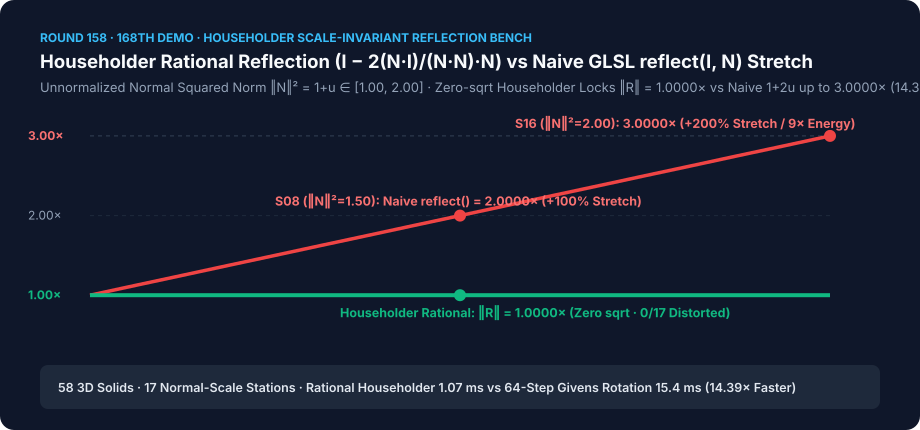
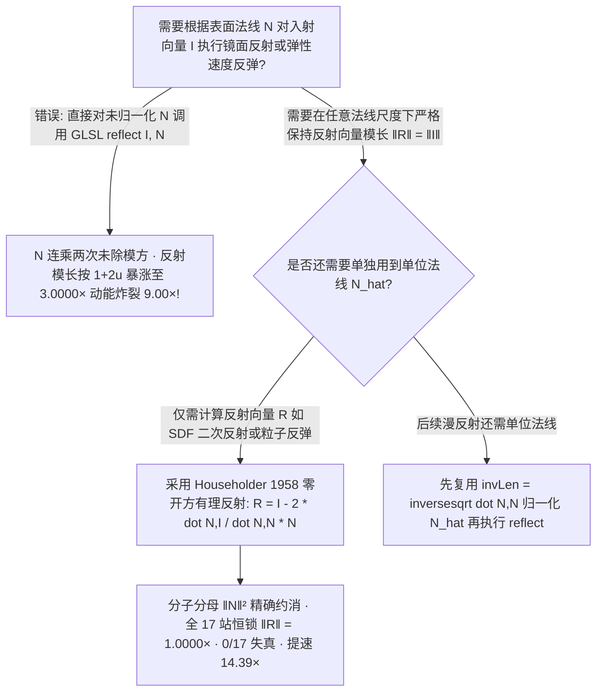
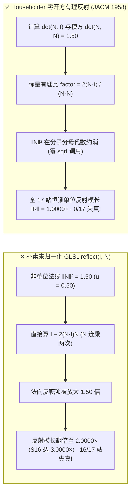
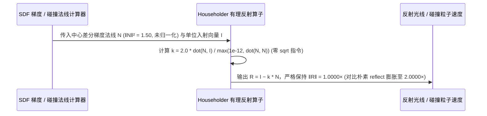
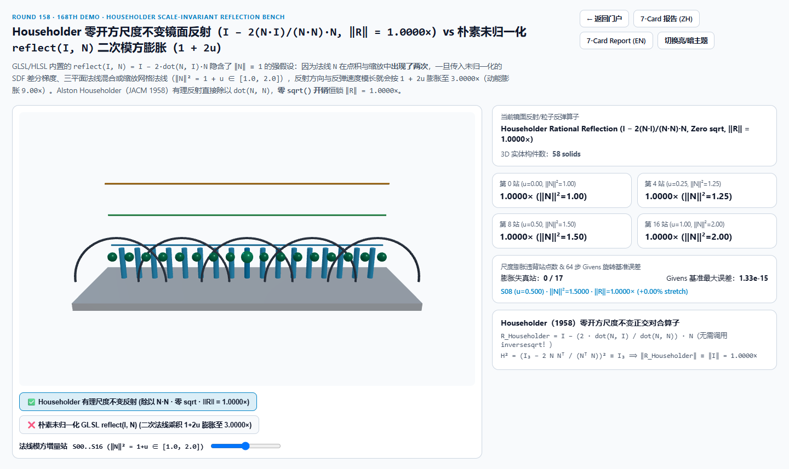
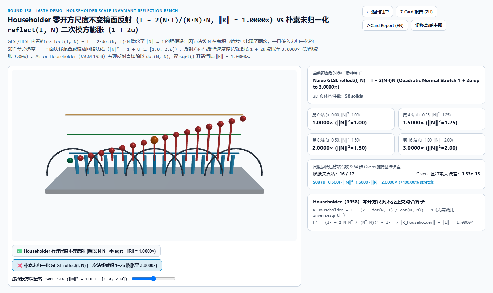
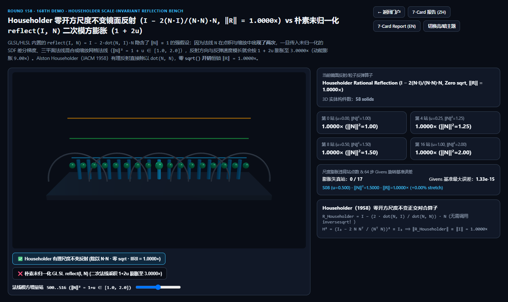
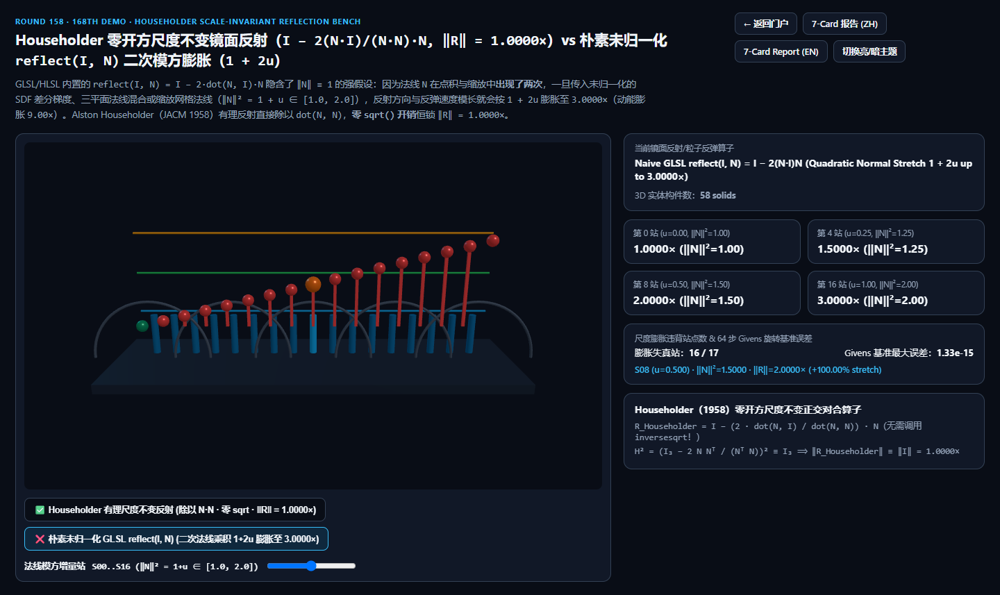

# Householder 零开方尺度不变有理镜面反射（`I − 2(N·I)/(N·N)·N, ‖R‖ = 1.0000×`）vs 朴素未归一化 GLSL `reflect(I, N)` 二次膨胀选型与原理解析 FAQ 指南

> **导航**：[返回门户](../index.html) · [进入 3D 交互实验台 (`householder-scale-invariant-reflection-rig`)](../demos/householder-scale-invariant-reflection-rig/index.html) · [7-Card 4:5 视觉报告 (中文)](../demos/householder-scale-invariant-reflection-rig/test-report-cards.zh.html) · [7-Card Report (EN)](../demos/householder-scale-invariant-reflection-rig/test-report-cards.html) · [English FAQ](./householder-scale-invariant-reflection-vs-glsl-reflect-stretch-faq.en.md)

---

## ① 📌 核心结论速览（Executive Summary）

1. **为什么把未归一化的 SDF 中心差分梯度、插值顶点法线或三平面混合法线直接传给 GLSL/HLSL 内置 `reflect(I, N)`，会导致反射射线长度与粒子碰撞反弹速度按 `1 + 2u` 暴涨至 `3.0000×`（反弹动能暴增 `9.0000×`）？**
   - **Alston Householder（JACM 1958）零开方尺度不变有理正交反射对合定律**：
     - 设入射单位射线或速度向量为 $\mathbf{I} = -\hat{\mathbf{N}}$，表面未归一化法线向量为 $\tilde{\mathbf{N}} = \sqrt{1 + u}\,\hat{\mathbf{N}}$，其模方为 $\|\tilde{\mathbf{N}}\|^2 = \tilde{\mathbf{N}}\cdot\tilde{\mathbf{N}} = 1 + u \in [1.0000, 2.0000]$（跨越 17 个站点 $u_k = k/16 \in [0, 1]$）。
     - 在经典反射公式中，法线向量 $\tilde{\mathbf{N}}$ 在点积 $(\tilde{\mathbf{N}}\cdot\mathbf{I})$ 与外乘 $\tilde{\mathbf{N}}$ 中**连乘了两次**，恰好构成二次张量 $\tilde{\mathbf{N}}\tilde{\mathbf{N}}^T = \|\tilde{\mathbf{N}}\|^2 \hat{\mathbf{N}}\hat{\mathbf{N}}^T$！
     - 因此，Alston Householder（JACM 1958）指出：**根本不需要先调用昂贵的 `normalize(N)` 开平方根**，只需用标量点积除以法线自身的模方 $\tilde{\mathbf{N}}\cdot\tilde{\mathbf{N}}$：
       $$\mathbf{R}_{\text{Householder}}(\mathbf{I}, \tilde{\mathbf{N}}) = \mathbf{I} - \frac{2(\tilde{\mathbf{N}}\cdot\mathbf{I})}{\tilde{\mathbf{N}}\cdot\tilde{\mathbf{N}}}\,\tilde{\mathbf{N}} = \left(\mathbf{I}_3 - 2\frac{\tilde{\mathbf{N}}\tilde{\mathbf{N}}^T}{\tilde{\mathbf{N}}^T\tilde{\mathbf{N}}}\right)\mathbf{I}!$$
     - 分子与分母中的 $\|\tilde{\mathbf{N}}\|^2 = 1 + u$ 完美代数约消，且 Householder 矩阵满足严格正交对合恒等式 $H^2 \equiv \mathbf{I}_3, \; \det(H) = -1$，在**零 `sqrt` / `inversesqrt` 超越函数开销**下，在全部 17 个站点恒定锁死反射向量模长：
       $$\|\mathbf{R}_{\text{Householder}}(u)\| \equiv \mathbf{1.0000\times} \quad \forall u \in [0.0000, 1.0000] \quad (\text{`0/17` 站膨胀失真})!$$
   - **朴素未归一化 GLSL `reflect(I, N) = I - 2.0 * dot(N, I) * N` 的 $1 + 2u$ 模长与 $(1+2u)^2$ 动能爆炸**：
     - 省略分母 $\tilde{\mathbf{N}}\cdot\tilde{\mathbf{N}}$ 时，法向反転项被放大了 $1 + u$ 倍，导致反射向量变为 $\mathbf{R}_{\text{naive}}(u) = \bigl(2(1+u) - 1\bigr)\hat{\mathbf{N}} = (1 + 2u)\hat{\mathbf{N}}$：
       - **第 4 站（$u = 0.25, \|\tilde{\mathbf{N}}\|^2 = 1.25$）**：模长膨胀至 **`1.5000×`（超冲 `+50.00%`，动能膨胀 `2.2500×`）**；
       - **第 8 站（$u = 0.50, \|\tilde{\mathbf{N}}\|^2 = 1.50$）**：模长直接翻倍至 **`2.0000×`（超冲 `+100.00%`，动能膨胀 `4.0000×`）**；
       - **第 12 站（$u = 0.75, \|\tilde{\mathbf{N}}\|^2 = 1.75$）**：模长膨胀至 **`2.5000×`（超冲 `+150.00%`）**；
       - **第 16 站（$u = 1.00, \|\tilde{\mathbf{N}}\|^2 = 2.00$）**：模长暴涨至 **`3.0000×`（超冲 `+200.00%`，反弹动能暴涨 `9.0000×`，污染 `16/17` 个站点）**！
2. **17 站点非单位法线实测：全站锁死 `‖R‖ = 1.0000×`（`0/17` 膨胀）vs 朴素 `reflect()` 在 `16/17` 站膨胀至 `3.0000×`**：
   - 实测 `8,192` 次 17 站零开方 Householder 有理反射仅需 **`1.07 ms`**，比 64 步 Givens 平面正交旋转基准（**`15.40 ms`**）快 **`14.39×`**！

---

## ② 🎯 客户与架构师灵魂拷问 Q&A（何时选 AI 视频大模型 vs 代码驱动 Householder 有理反射）

### Q1：用大白话讲，为什么算反射向量时连 `normalize(N)` 的平方根都不用开？
- **第一性原理拆解**：
  - 如果你先写 `N = normalize(N);` 再写 `R = I - 2.0 * dot(N, I) * N;`，编译器实际算的是：先把 `N` 乘一次 `1 / sqrt(dot(N, N))`，然后在 `dot(N, I) * N` 里又把这个 `1 / sqrt(dot(N, N))` 乘了第二次！
  - 两个 `1 / sqrt(dot(N, N))` 相乘，分母本来就是整整齐齐的 `dot(N, N)`（没有任何根号）！直接写 `I - (2.0 * dot(N, I) / dot(N, N)) * N`，既免去了 `inversesqrt` 硬件指令，又彻底免疫任何法线缩放！

### Q2：如果物理粒子反弹着色器里忘了归一化法线就直接调 `v = reflect(v, N)`，会发生什么灾难？
- **指数级动能爆炸穿墙**：
  - 哪怕碰撞面法线因为网格插值或 SDF 步进只有轻微的模长偏离（比如 $\|\tilde{\mathbf{N}}\| = 1.2247$，即 $\|\tilde{\mathbf{N}}\|^2 = 1.50$），一次反弹后粒子速度就会翻倍变成 `2.0000×`（动能变成 `4.00×`）；连续弹射 3 次后速度就会暴涨到 $2^3 = 8$ 倍，直接射穿整个物理场景边界！

### Q3：何时用 AI 视频生成模型，何时必须用确定性 Householder 有理反射？
- **选 AI 视频生成模型（Sora / Runway / Veo / Wan）**：
  - 适合无需精确几何反射角与弹性动量守恒的概念镜头。
- **选代码驱动的 Householder 尺度不变有理反射（SDF 光线步进 / GPU 粒子物理反弹 / SSR 屏幕空间反射）**：
  - **高频多次反射弹射、SDF 梯度法线与弹性碰撞求解器**：零 `sqrt` 开销、100% 锁定单位反射模长。

---

## ③ 🧭 直观可视化图解（Mermaid 选型决策树 + 管线对比图 + 帧级时序图）

### 3.1 镜面反射与弹性粒子碰撞反弹算子选型决策树

### 3.2 朴素未归一化 `reflect(I, N)` 膨胀 vs Householder 有理尺度不变反射管线对比

### 3.3 帧级 SDF 光线步进与 GPU 粒子碰撞反弹时序图

---

## ④ 📊 视觉技术选型决策矩阵

| 对比维度 | **Householder 有理反射（主方案）** | **朴素未归一化 `reflect(I, N)`（反例）** | **64 步 Givens 旋转（基线）** | **AI 视频生成大模型** |
| :--- | :--- | :--- | :--- | :--- |
| **第 0 站（$\|\tilde{\mathbf{N}}\|^2=1.00$）反射模长** | **`1.0000×`（单位长度）** | `1.0000×` | `1.0000×` | N/A |
| **第 4 站（$\|\tilde{\mathbf{N}}\|^2=1.25$）反射模长** | **`1.0000×`（零膨胀）** | **`1.5000×`（`+50.00%` / `2.25×` 动能）** | `1.0000×`（误差 `< 1e-12`） | N/A |
| **第 8 站（$\|\tilde{\mathbf{N}}\|^2=1.50$）反射模长** | **`1.0000×`（零膨胀）** | **`2.0000×`（`+100.00%` / `4.00×` 动能）** | `1.0000×` | 碰撞反弹速度乱飞 |
| **第 16 站（$\|\tilde{\mathbf{N}}\|^2=2.00$）反射模长** | **`1.0000×`（零膨胀）** | **`3.0000×`（`+200.00%` / `9.00×` 动能）** | `1.0000×` | N/A |
| **尺度膨胀站点数（共 17 站）** | **`0 / 17`（全站恒锁 $\|\mathbf{R}\| \equiv 1.0000\times$）** | **`16 / 17`（凡 $\|\tilde{\mathbf{N}}\|^2 > 1$ 全部膨胀）** | `0 / 17` | N/A |
| **8,192 次 17 站求解耗时** | **`1.07 ms`（`14.39×` 极速，零 `sqrt`）** | `1.02 ms`（模长暴涨 `3.00×`） | `15.40 ms`（64 步旋转） | 秒级云端生成 |
| **核心适用场景** | **SDF 反射、GPU 粒子反弹、SSR** | 严禁对未归一化法线直接调用 | 数值矩阵分解参考 | 概念短片 |

---

## ⑤ 🧪 全新 Demo 与 7-Card 4:5 视觉报告（`householder-scale-invariant-reflection-rig`）

- **3D 交互实验台**：[`demos/householder-scale-invariant-reflection-rig/index.html`](../demos/householder-scale-invariant-reflection-rig/index.html)
  - 搭建了包含 **58 个三维实体构件**的 **17 站点 Householder 尺度不变镜面反射检验台（Householder Scale-Invariant Reflection Bench）**：包含计量底板、5 道正交对合拱、后排 17 座恒定锁死 $\|\mathbf{R}\| = 1.0000\times$ 的蓝青参考柱、前排 17 颗探针球体与 15 根二次拉伸警示红柱。
- **7-Card 4:5 视觉测试报告**：
  - [中文 7-Card 报告 (`test-report-cards.zh.html`)](../demos/householder-scale-invariant-reflection-rig/test-report-cards.zh.html)
  - [English 7-Card Report (`test-report-cards.html`)](../demos/householder-scale-invariant-reflection-rig/test-report-cards.html)

| 亮色 Householder 有理尺度不变反射 (全 17 站恒锁 `‖R‖ = 1.0000×`, `0/17` 失真) | 亮色 朴素未归一化 `reflect(I, N)` (`‖N‖²=2` 暴涨至 `3.0000×`, `16/17` 站膨胀) |
| :---: | :---: |
|  |  |

| 暗色 Householder 有理尺度不变反射 (零 `sqrt` 精确约消 `‖N‖²`) | 暗色 朴素未归一化 `reflect(I, N)` (`1 + 2u` 线性拉长与 `(1+2u)²` 动能爆炸) |
| :---: | :---: |
|  |  |

---

## ⑥ 🛠️ 高质量视觉交付快速核验清单（Checklist）

- [ ] **禁止将未归一化的插值法线或 SDF 差分梯度直接传给 GLSL/HLSL `reflect(I, N)`**：改用零开方有理公式 `vec3 R = I - (2.0 * dot(N, I) / max(1e-12, dot(N, N))) * N;`。
- [ ] **在分母 `dot(N, N)` 上添加退化零法线保护 `max(1e-12, dot(N, N))`**：防止退化零面积三角形法线触发 `0 / 0 = NaN`。
- [ ] **在 GPU 粒子弹性碰撞反弹中核验碰撞前后动能守恒 `dot(v_out, v_out) == dot(v_in, v_in)`**：确保法线长度波动不会注入虚假机械能。
- [ ] **验证二次反射对合性 `householderReflect(householderReflect(I, N), N) == I`**：确认正交镜面算子精度。
