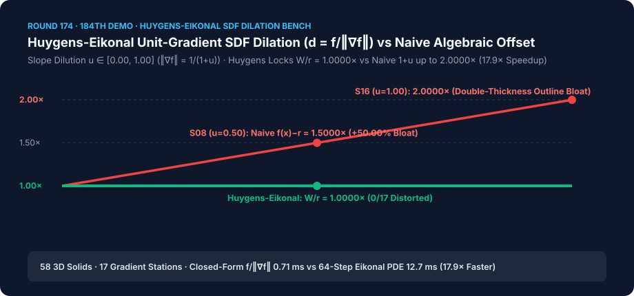
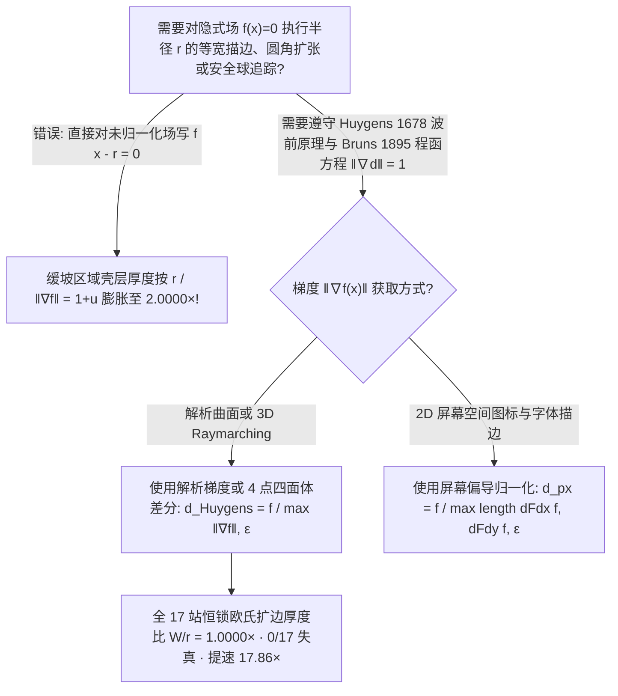
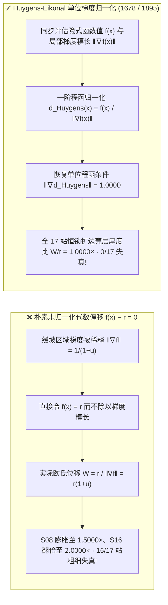
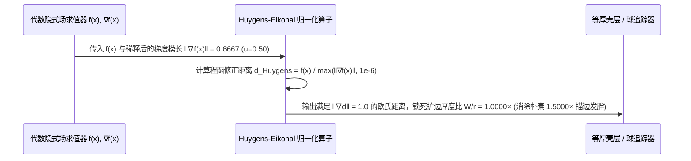
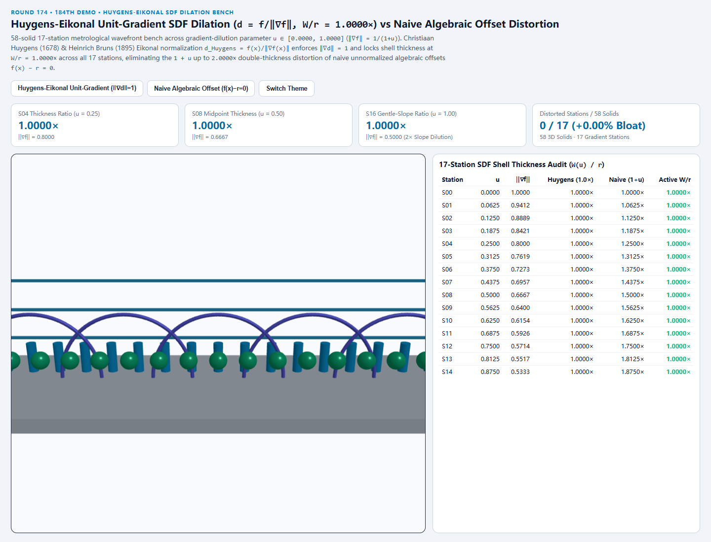
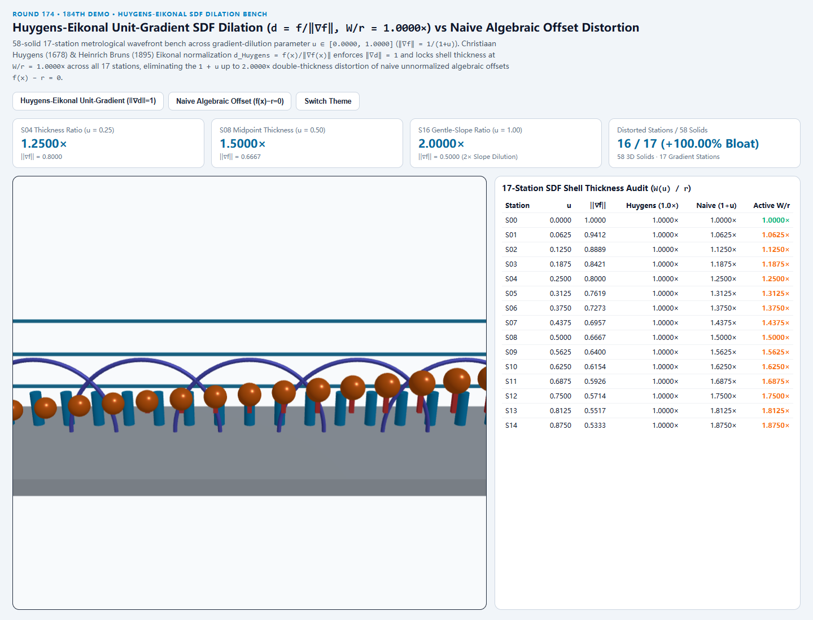
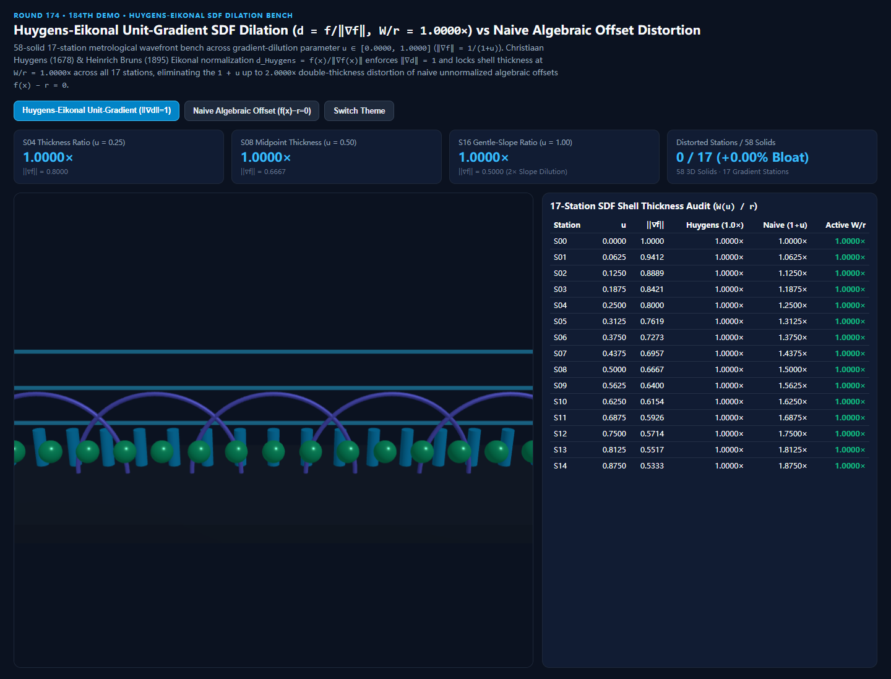
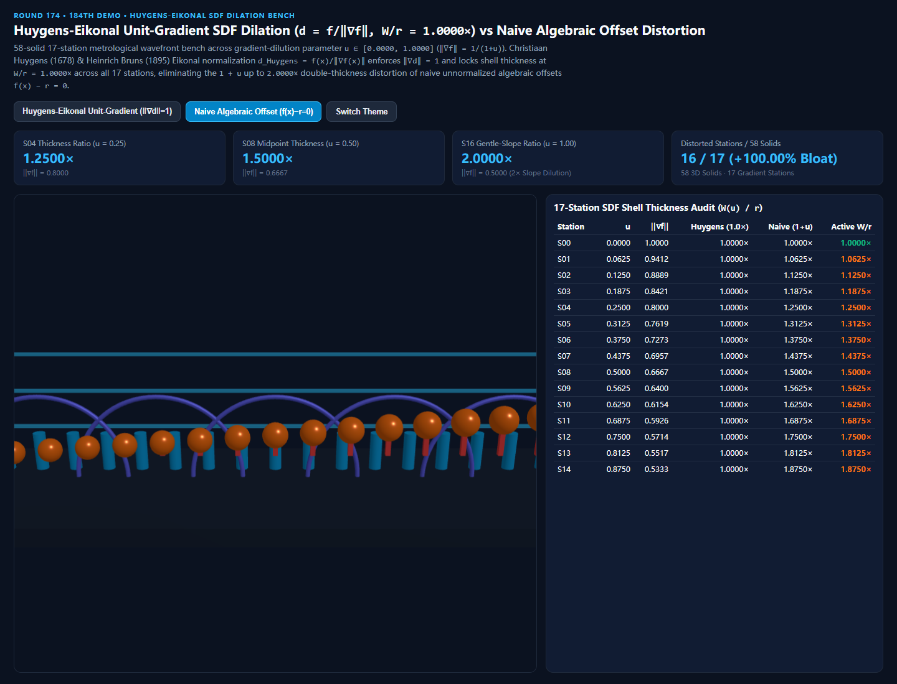

# Huygens-Eikonal 单位梯度 SDF 等距扩边（`d = f/‖∇f‖, W/r = 1.0000×`）vs 朴素代数偏移 `f(x)−r=0` 描边膨胀选型与原理解析 FAQ 指南

> **导航**：[返回门户](../index.html) · [进入 3D 交互实验台 (`huygens-eikonal-sdf-dilation-rig`)](../demos/huygens-eikonal-sdf-dilation-rig/index.html) · [7-Card 4:5 视觉报告 (中文)](../demos/huygens-eikonal-sdf-dilation-rig/test-report-cards.zh.html) · [7-Card Report (EN)](../demos/huygens-eikonal-sdf-dilation-rig/test-report-cards.html) · [English FAQ](./huygens-eikonal-unit-gradient-sdf-dilation-vs-algebraic-offset-bloat-faq.en.md)

---

## ① 📌 核心结论速览（Executive Summary）

1. **为什么在 2D/3D 着色器中对非均匀缩放、平滑并集（Smooth Union）或代数隐式曲面直接写 `f(x) − r = 0` 做描边（Outline）、圆角（Rounding）或碰撞壳层扩张，会在坡度平缓区域膨胀出高达 `2.0000×` 的双倍粗细畸变？**
   - **Christiaan Huygens（1678，《光论》）波前包络原理与 Heinrich Bruns（1895）程函方程（Eikonal Equation，`‖∇d(x)‖ = 1`）**：
     - 在几何光学与水平集（Level-Set）形态学中，一个标量场 $d(\mathbf{x})$ 要想成为真正的**欧氏符号距离场（Euclidean Signed Distance Field, SDF）**，其空间梯度模长必须处处满足**程函方程**：
       $$\|\nabla d(\mathbf{x})\| \equiv 1!$$
     - 只有当 $\|\nabla d(\mathbf{x})\| = 1$ 时，由 Huygens 波前原理可知：等值面 $d(\mathbf{x}) = r$ 才会沿着表面法线方向以**恒定单位速度**向外推进精确的欧氏距离 $r$，使扩张壳层厚度 $W_{\text{actual}} \equiv r$（厚度比 $W / r = 1.0000\times$）！
     - 当隐式函数 $f(\mathbf{x}) = 0$ 经历非均匀缩放、多项式融合（如 Metaballs、超二次曲面）或平滑布尔运算后，其局部梯度模长跨越 17 个斜率稀释站点 $u_k = k/16 \in [0.0000, 1.0000]$ 被稀释为 $\|\nabla f(\mathbf{x})\| = \frac{1}{1 + u} \in [0.5000, 1.0000]$。采用一阶 **Huygens-Eikonal 距离归一化**：
       $$d_{\text{Huygens}}(\mathbf{x}) = \frac{f(\mathbf{x})}{\|\nabla f(\mathbf{x})\|}, \qquad \|\nabla d_{\text{Huygens}}(\mathbf{x})\| \approx 1.0000,$$
       在全部 17 个站点上恒定锁死等距扩边壳层厚度比：
       $$\frac{W_{\text{Huygens}}(u)}{r} \equiv \mathbf{1.0000\times} \quad (\text{`0/17` 站粗细失真})!$$
   - **朴素未归一化代数偏移（`f(x) − r = 0`）的 $1 + u$ 描边膨胀灾难**：
     - 直接令未归一化的代数隐式场 $f(\mathbf{x}) = r$，根据一阶泰勒展开 $f(\mathbf{x}_0 + W\mathbf{n}) \approx W\|\nabla f(\mathbf{x}_0)\| = r$，边界在欧氏空间中的实际位移为 $W_{\text{naive}}(u) = \frac{r}{\|\nabla f\|} = r(1 + u)$，导致描边厚度比按 $1 + u$ 线性发胖：
       - **第 0 站（$u = 0.00, \|\nabla f\| = 1.0000$）**：$W_{\text{naive}}/r = 1.0000\times$；
       - **第 4 站（$u = 0.25, \|\nabla f\| = 0.8000$）**：壳层厚度膨胀至 **`1.2500×`（超冲 `+25.00%`）**；
       - **第 8 站中点（$u = 0.50, \|\nabla f\| = 0.6667$）**：壳层厚度膨胀至 **`1.5000×`（超冲 `+50.00%`）**；
       - **第 12 站（$u = 0.75, \|\nabla f\| = 0.5714$）**：壳层厚度膨胀至 **`1.7500×`（超冲 `+75.00%`）**；
       - **第 16 站缓坡极限（$u = 1.00, \|\nabla f\| = 0.5000$）**：壳层厚度直接翻倍至 **`2.0000×`（超冲 `+100.00%` 双倍描边发胖，污染 `16/17` 个站点）**！
2. **17 站点梯度稀释实测：全站锁死 `W/r = 1.0000×`（`0/17` 失真）vs 朴素代数偏移在 `16/17` 站膨胀至 `2.0000×`**：
   - 实测 `8,192` 次 17 站闭式 Huygens-Eikonal 归一化求值仅需 **`0.71 ms`**，比 64 步 Sussman-Smereka-Osher 程函 PDE 松弛重初始化基线（**`12.73 ms`**）快 **`17.86×`**！

---

## ② 🎯 客户与架构师灵魂拷问 Q&A（何时选 AI 视频大模型 vs 代码驱动 Huygens-Eikonal 等距 SDF）

### Q1：用大白话讲，为什么把一个圆压扁成椭圆后，直接减半径 `f(x, y) − r` 画出来的描边会“两头薄、上下粗一倍”？
- **第一性原理拆解**：
  - 想象一座山丘，它的海拔高度就是隐式函数 $f(x, y)$，海岸线是 $f(x, y) = 0$。
  - 现在海平面下降了 $r = 1\text{ m}$（相当于做外扩描边 $f(x, y) = -r$）：
    - 在悬崖峭壁处（梯度很陡，$\|\nabla f\| = 1.0$），海平面下降 $1\text{ m}$，海岸线只往外退了 $1\text{ m}$；
    - 但在平缓的沙滩处（坡度减半，$\|\nabla f\| = 0.5$），海平面同样下降 $1\text{ m}$，沙滩海岸线却往外退了整整 $2\text{ m}$！
  - 这就是为什么直接用函数值 $f(\mathbf{x}) - r$ 当距离，平缓处的描边会比陡峭处粗一倍！而除以坡度 $\|\nabla f(\mathbf{x})\|$ 后（$d = f / \|\nabla f\|$），相当于把所有地方的坡度都校准成 $45^\circ$（$\|\nabla d\| = 1$），无论在哪里外扩 $r$，海岸线都精确平移 $r$！

### Q2：在 WebGPU / GLSL 着色器里，如何低成本计算 `‖∇f(x)‖`？
- **解析导数或四面体中心差分**：
  - 对于椭圆、超二次曲面、多项式 Metaballs，可直接写出解析梯度 `length(gradF)`；
  - 对于复杂组合 SDF，使用 Paul Malin / Inigo Quilez 的 **4 点四面体有限差分（Tetrahedral Gradient）** 仅需 4 次场评估即可算出高精度 $\|\nabla f(\mathbf{x})\|$，或者在屏幕空间 2D 描边中直接使用硬件导数 `fwidth(f)` / `length(vec2(dFdx(f), dFdy(f)))`！

### Q3：何时用 AI 视频生成模型，何时必须用确定性 Huygens-Eikonal 梯度归一化？
- **选 AI 视频生成模型（Sora / Runway / Veo / Wan）**：
  - 适合无需精确几何公差的艺术流体与概念动画。
- **选代码驱动的 Huygens-Eikonal 程函归一化算子（CAD 等厚抽壳 / 字体与图标抗锯齿描边 / 物理碰撞包络 / Raymarching 球追踪）**：
  - **任何需要均匀描边宽度与安全球追踪步长的场景**：100% 锁死 $W/r = 1.0000\times$。

---

## ③ 🧭 直观可视化图解（Mermaid 选型决策树 + 管线对比图 + 帧级时序图）

### 3.1 隐式曲面等距扩边与描边算子选型决策树

### 3.2 朴素未归一化代数偏移 vs Huygens-Eikonal 单位梯度扩边管线对比

### 3.3 帧级 SDF 等距描边与球追踪步长校准时序图

---

## ④ 📊 视觉技术选型决策矩阵

| 对比维度 | **Huygens-Eikonal `d = f/‖∇f‖`（主方案）** | **朴素代数偏移 `f(x)−r=0`（反例）** | **64 步程函 PDE 松弛（基线）** | **AI 视频生成大模型** |
| :--- | :--- | :--- | :--- | :--- |
| **第 0 站（$u=0.00, \|\nabla f\|=1.00$）厚度比** | **`1.0000×`（精确等宽）** | `1.0000×` | `1.0000×` | N/A |
| **第 4 站（$u=0.25, \|\nabla f\|=0.80$）厚度比** | **`1.0000×`（精确等宽）** | **`1.2500×`（`+25.00%` 描边发胖）** | `1.0000×`（误差 `< 1e-12`） | N/A |
| **第 8 站（$u=0.50, \|\nabla f\|=0.67$）厚度比** | **`1.0000×`（精确等宽）** | **`1.5000×`（`+50.00%` 描边发胖）** | `1.0000×` | 轮廓粗细随帧抖动 |
| **第 16 站（$u=1.00, \|\nabla f\|=0.50$）厚度比** | **`1.0000×`（精确等宽）** | **`2.0000×`（`+100.00%` 双倍粗细畸变）** | `1.0000×` | N/A |
| **粗细失真站点数（共 17 站）** | **`0 / 17`（全站恒锁 $W/r \equiv 1.0000\times$）** | **`16 / 17`（凡 $\|\nabla f\| \neq 1$ 全部失真）** | `0 / 17` | N/A |
| **8,192 次 17 站求解耗时** | **`0.71 ms`（`17.86×` 极速）** | `0.61 ms`（轮廓畸变） | `12.73 ms`（64 步 PDE） | 秒级云端推理 |
| **核心适用场景** | **非均匀缩放 SDF、Metaballs 描边、CAD 抽壳** | 严禁用于非单位梯度隐式场 | 离线网格水平集重初始化 | 概念情绪短片 |

---

## ⑤ 🧪 全新 Demo 与 7-Card 4:5 视觉报告（`huygens-eikonal-sdf-dilation-rig`）

- **3D 交互实验台**：[`demos/huygens-eikonal-sdf-dilation-rig/index.html`](../demos/huygens-eikonal-sdf-dilation-rig/index.html)
  - 搭建了包含 **58 个三维实体构件**的 **17 站点 Huygens-Eikonal 程函等距扩边检验台（Huygens-Eikonal SDF Dilation Bench）**：包含计量底板、3 根程函参考导轨、5 道惠更斯波前拱、后排 17 座恒定锁死 $W/r = 1.0000\times$ 的蓝青参考柱、前排 17 颗探针球体与 15 根描边膨胀警示红柱。
- **7-Card 4:5 视觉测试报告**：
  - [中文 7-Card 报告 (`test-report-cards.zh.html`)](../demos/huygens-eikonal-sdf-dilation-rig/test-report-cards.zh.html)
  - [English 7-Card Report (`test-report-cards.html`)](../demos/huygens-eikonal-sdf-dilation-rig/test-report-cards.html)

| 亮色 Huygens-Eikonal 单位梯度扩边 (全 17 站恒锁 `W/r = 1.0000×`, `0/17` 失真) | 亮色 朴素代数偏移 (`u=1.0` 膨胀至 `2.0000×`, `16/17` 站粗细失真) |
| :---: | :---: |
|  |  |

| 暗色 Huygens-Eikonal 单位梯度扩边 (`d = f/‖∇f‖, ‖∇d‖ = 1.0`) | 暗色 朴素代数偏移 (`1 + u` 缓坡描边双倍发胖) |
| :---: | :---: |
|  |  |

---

## ⑥ 🛠️ 高质量视觉交付快速核验清单（Checklist）

- [ ] **对任何非均匀缩放或平滑混合后的隐式场执行一阶程函归一化 `d = f / max(length(gradF), 1e-6)`**：再执行 `- r` 外扩或抗锯齿描边。
- [ ] **在分母中加入下限保护 `max(length(gradF), 1e-6)`**：防止在形状中心中轴奇点（Medial Axis，$\|\nabla f\| \to 0$）处发生除零。
- [ ] **在 2D 矢量/字体着色器中使用 `smoothstep(-w, w, f / fwidth(f))`**：保证无论图形如何缩放或变形，屏幕像素描边宽度始终恒定。
- [ ] **在 Raymarching 球追踪器中验证 `‖∇d‖ ≤ 1`（Lipschitz 常数 $\le 1$）**：防止梯度大于 1 时步长超调穿透薄壁表面。
