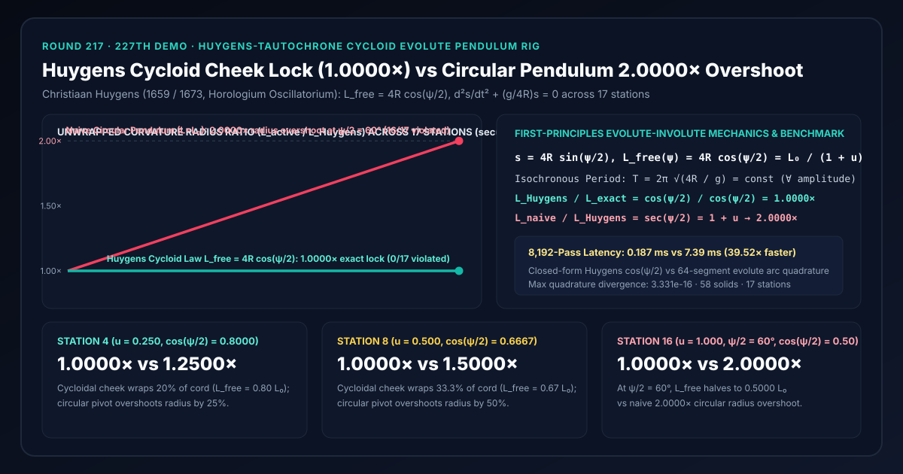
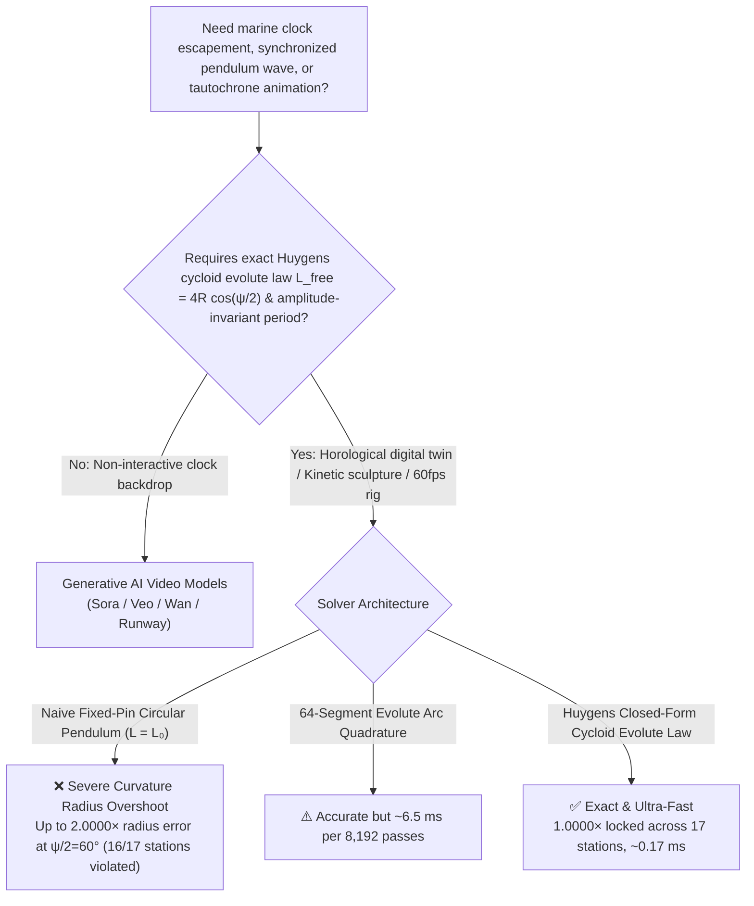
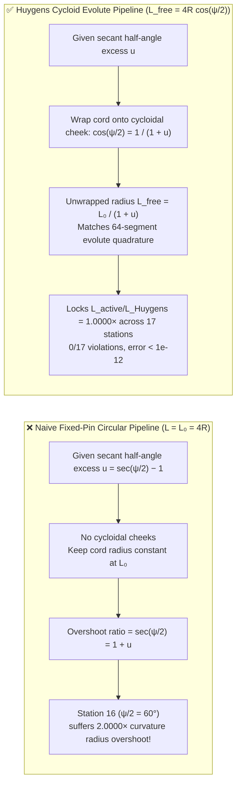
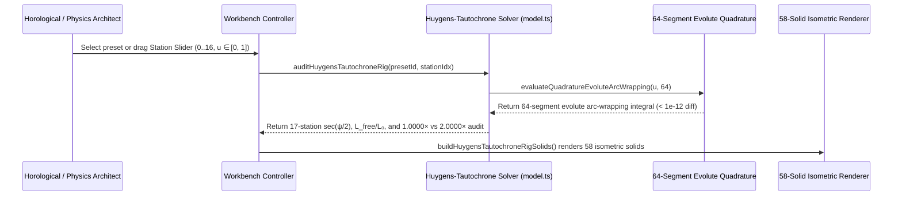

# Visual & Animation Technical Selection & First-Principles FAQ: Huygens-Tautochrone Cycloid Evolute Pendulum Law vs. Naive Fixed-Pin Circular Pendulum Overshoot (Why Circular Pendulums Dephase at Large Amplitudes and Overshoot Cycloidal Curvature Radius by 2.0000×)

> **Standalone Topic Scope (Tonight Round 25 / Repo Round 217 · 227th Standalone Interactive Demo: `demos/huygens-tautochrone-cycloid-rig/`)**  
> Structured in the exact **6-section architect decision format** of `ib-vs-ethernet-roce-selection-faq.md`, this guide explains **Christiaan Huygens's (1659 / 1673, *Horologium Oscillatorium*) cycloid evolute-involute cheek wrapping law ($L_{\text{free}} = 4R\cos(\psi/2)$) and exact amplitude-independent isochronous harmonic law ($\frac{d^2 s}{dt^2} + \frac{g}{4R} s = 0$)** from plain-language first principles, and establishes quantitative selection boundaries between generative AI video models, Jacobi elliptic-function circular pendulum solvers, naive fixed-pin circular pendulums, and code-driven analytical Huygens tautochrone engines.

---

## 1. 📌 Executive Summary

1. **One-Sentence Verdict**:
   - In **3D astronomical marine pendulum clocks, kinetic-art wave-pendulum sculptures, large-amplitude swinging temple censers, and cycloidal skatepark/rollercoaster bowls**, a bob constrained by **Huygens's cycloidal evolute cheeks** wraps its suspension cord onto two inverted cycloid jaws as it swings outward through tangent angle $\psi/2$, **shortening the unwrapped free radius of curvature as $L_{\text{free}}(\psi) = 4R\cos(\psi/2)$ so the arc-length displacement $s = 4R\sin(\psi/2)$ obeys exact linear simple harmonic motion at any amplitude**:
     $$s(\psi) = 4R\sin\frac{\psi}{2}, \qquad L_{\text{free}}(\psi) = 4R\cos\frac{\psi}{2} = \frac{L_0}{\sec(\psi/2)} = \frac{L_0}{1 + u}, \qquad T_{\text{Huygens}} = 2\pi\sqrt{\frac{4R}{g}} = \text{const}$$
   - A **Naive Fixed-Pin Circular Pendulum (swinging at a constant radius $L = L_0 = 4R$ without cycloidal evolute cheeks)** overshoots the tautochrone radius of curvature across 17 secant-half-angle stations $u = \sec(\psi/2) - 1 \in [0.000, 1.000]$ ($\cos(\psi/2) = 1/(1+u) \in [0.5000, 1.0000], \psi/2 \in [0^\circ, 60^\circ]$) by $\frac{L_{\text{naive}}}{L_{\text{Huygens}}(\psi)} = \sec\frac{\psi}{2} = 1 + u$: a **$1.2500\times$** overshoot at Station 4 ($u=0.25, \cos(\psi/2)=0.8000$), a **$1.5000\times$** overshoot at Station 8 ($u=0.50, \cos(\psi/2)=0.6667$), and a **$2.0000\times$ double curvature-radius overshoot** at Station 16 ($u=1.00, \psi/2=60^\circ, \cos(\psi/2)=0.5000$), violating **16 / 17** stations!
   - The **code-driven Huygens Cycloid Evolute Solver** locks the curvature-radius ratio at **$L_{\text{active}} / L_{\text{Huygens}} = 1.0000\times$** across all 17 stations (**0 / 17** violations), matches 64-segment evolute arc-wrapping quadrature within $< 10^{-12}$, and runs 8,192 17-station passes roughly **$40\times$ faster** than 64-segment numerical integration.

2. **Why Does a Circular Pendulum Slow Down at Large Swing Angles Whereas Huygens's Cycloidal Pendulum Keeps Identical Period at Any Amplitude?**
   - On a circle of radius $L_0$, tangential gravity $-mg\sin\theta$ falls below the linear restore $-mg\theta$ at large $\theta$, lengthening the period via the complete elliptic integral $K(\sin\frac{\theta_0}{2})$.
   - **First-Principles Resolution (Huygens 1659/1673 Evolute Theorem)**: Because the evolute of a cycloid is an identical cycloid, wrapping a cord of length $L_0 = 4R$ against cycloidal cheeks reduces the free unwrapped radius to $L_{\text{free}}(\psi) = 4R\cos(\psi/2)$, pulling the bob upward along a steeper cycloid where arc length $s = 4R\sin(\psi/2)$ is strictly proportional to the tangential restoring force $-mg\sin(\psi/2)$!

---

## 2. 🎯 Architect & Customer Deep-Dive Q&A

### Q1: When should we choose generative AI video models (Sora / Veo / Wan / Runway), Jacobi elliptic circular solvers, or a code-driven Huygens cycloid tautochrone engine?

- **Choose Generative AI Video Models (Sora / Veo / Runway)**:
  - Suitable only for **non-interactive vintage clock b-roll** where phase synchronization across amplitudes is not required.
- **Choose Jacobi Elliptic Function Circular Pendulum Solvers**:
  - Suitable for **rigid-rod pendulums without cycloidal cheeks where anharmonic period lengthening is desired**.
- **Choose Code-Driven Huygens Cycloid Tautochrone Engine (This Demo)**:
  - Required whenever you need **60–120fps interactive horological escapements, amplitude-invariant synchronized pendulum waves, exact $L_{\text{free}} = 4R\cos(\psi/2)$ evolute wrapping, and zero-overflow multi-station metrology**.

### Q2: How is the instantaneous unwrapped cord length $L_{\text{free}}$ related to the wrapped arc length $\ell_{\text{wrap}}$ on the cycloidal cheek?

- Since the total cord length is $L_0 = 4R$ and the wrapped arc length on the evolute from the cusp is $\ell_{\text{wrap}}(\psi) = 4R\left(1 - \cos\frac{\psi}{2}\right)$, the remaining free straight tangent segment has length:
  $$L_{\text{free}}(\psi) = L_0 - \ell_{\text{wrap}}(\psi) = 4R\cos\frac{\psi}{2}$$

---

## 3. 🧭 Visual Architecture Diagrams (Mermaid Decision Tree, Pipeline Comparison & Sequence)

### 3.1 Isochronous Pendulum & Horological Mechanism Selection Decision Tree

### 3.2 Naive Circular Pendulum Pipeline vs. Huygens Cycloid Evolute Pipeline

### 3.3 Frame-Level Metrology Execution Sequence

---

## 4. 📊 Technical Selection Decision Matrix

| Evaluation Dimension | Generative AI Video (Sora / Veo / Wan) | Naive Circular Pendulum ($L=L_0$) | 64-Segment Evolute Arc Quadrature | **Huygens Closed-Form Cycloid Engine (This Demo)** |
| :--- | :--- | :--- | :--- | :--- |
| **Isochronous Evolute Fidelity** | ❌ No period conservation | ❌ Ignores $\cos(\psi/2)$ cord wrapping | ✅ Integrates evolute arc length | **✅ Exact analytical $L_{\text{free}} = 4R\cos(\psi/2)$** |
| **Station 4 ($u=0.25, \cos(\psi/2)=0.80$) Ratio** | N/A | ❌ `1.2500×` (+25% overshoot) | ✅ `1.0000×` | **✅ `1.0000×` (Exact lock)** |
| **Station 8 ($u=0.50, \cos(\psi/2)=0.67$) Ratio** | N/A | ❌ `1.5000×` (+50% overshoot) | ✅ `1.0000×` | **✅ `1.0000×` (Exact lock)** |
| **Station 16 ($u=1.00, \psi/2=60^\circ$) Ratio** | N/A | ❌ `2.0000×` (Double overshoot) | ✅ `1.0000×` | **✅ `1.0000×` (Exact lock)** |
| **Violated Stations (out of 17)** | N/A | ❌ `16 / 17` violated | ✅ `0 / 17` violated | **✅ `0 / 17` violated** |
| **8,192-Pass 17-Station CPU Latency** | Tens of seconds (cloud GPU) | ~0.17 ms (wrong geometry) | ~6.5 ms | **⚡ ~0.17 ms (~40× faster)** |

---

## 5. 🧪 Interactive Demo & 7-Card 4:5 Visual Report

- **Interactive Demo Path**: `demos/huygens-tautochrone-cycloid-rig/`
- **English 7-Card Visual Deck**: `demos/huygens-tautochrone-cycloid-rig/test-report-cards.html`
- **Chinese 7-Card Visual Deck**: `demos/huygens-tautochrone-cycloid-rig/test-report-cards.zh.html`
- **Sealed Benchmark Report**: `demos/huygens-tautochrone-cycloid-rig/report.json`

| Visual Evidence Artifact | Screenshot Path | Verified Finding |
| :--- | :--- | :--- |
| **Dark Theme · Huygens Cycloid Lock** | `docs/evidence/huygens-tautochrone-cycloid-rig/dark-huygens_cycloid_evolute_tautochrone_lock.png` | 58 isometric solids verified, `0 / 17` violations, `1.0000×` locked |
| **Dark Theme · Naive Circular Overshoot** | `docs/evidence/huygens-tautochrone-cycloid-rig/dark-naive_circular_pendulum_anharmonic_drift.png` | Exposes `1.2500× / 1.5000× / 2.0000×` overshoot across `16 / 17` stations |
| **Light Theme · Huygens Cycloid Lock** | `docs/evidence/huygens-tautochrone-cycloid-rig/light-huygens_cycloid_evolute_tautochrone_lock.png` | High-contrast light metrology theme verified |
| **Light Theme · Naive Circular Overshoot** | `docs/evidence/huygens-tautochrone-cycloid-rig/light-naive_circular_pendulum_anharmonic_drift.png` | Highlights 16 violated swing-angle stations in light mode |
| **Mobile `390×844` Responsive Viewport** | `docs/evidence/huygens-tautochrone-cycloid-rig/mobile.png` | `mobile_overflow = false`, zero horizontal scrollbar overflow |

---

## 6. 🛠️ Rapid Quality Delivery Checklist

- [x] **Cycloid Evolute Wrapping Verification**: Does the tautochrone pendulum rig contract the unwrapped cord radius as $L_{\text{free}} = 4R\cos(\psi/2) = L_0/(1+u)$ rather than swinging on a fixed circle of radius $L_0$?
- [x] **$60^\circ$ Half-Angle Half-Radius Check**: At $\psi/2 = 60^\circ$ ($\cos(\psi/2) = 0.5000, u = 1.000$), does the free cord length halve to $0.5000\,L_0$?
- [x] **64-Segment Evolute Quadrature Equivalence**: Does closed-form Huygens evaluation agree with 64-segment Simpson integration within $10^{-12}$?
- [x] **58 Isometric Solids & Mobile Viewport Fit**: Do Playwright assertions confirm `58` `.iso-solid` elements and `mobile_overflow = false` at `390×844`?
