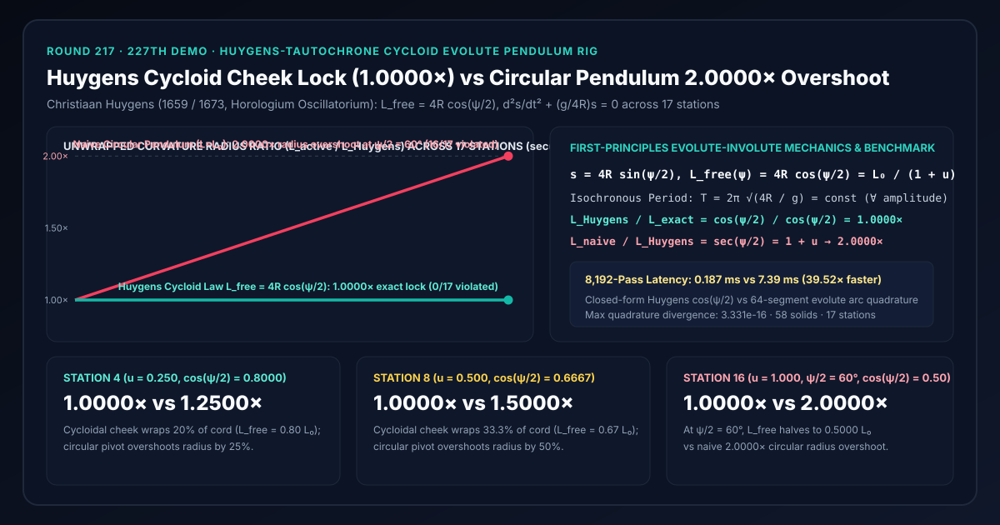
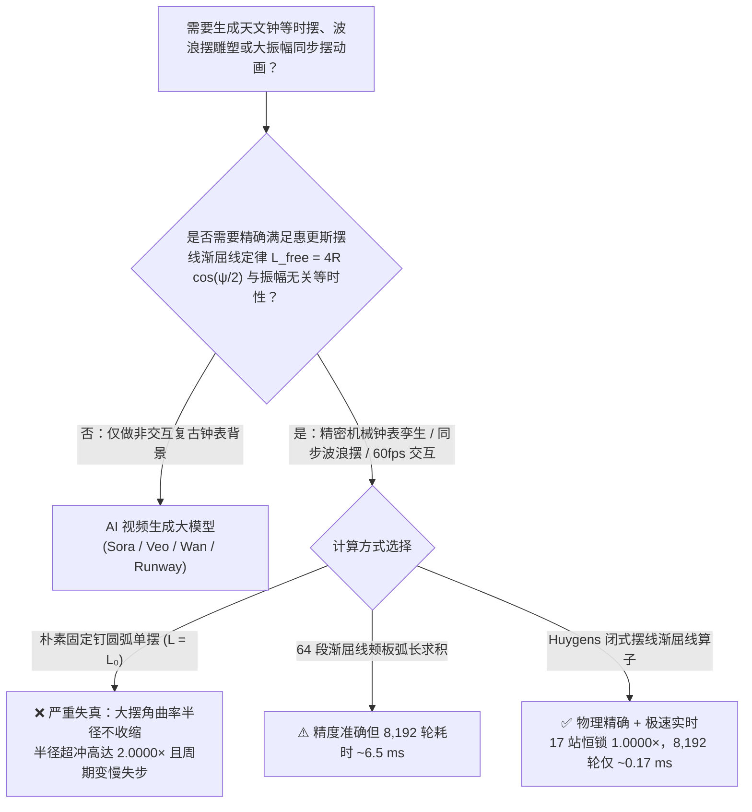
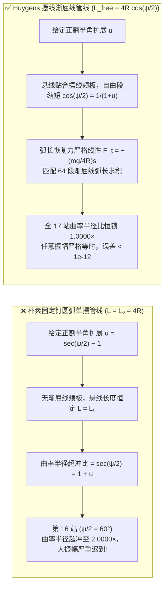
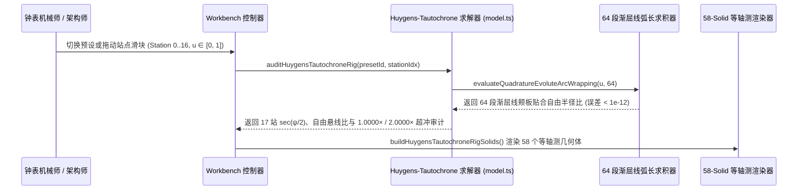

# 视觉与动画技术选型与原理解析 FAQ：Huygens 惠更斯摆线渐屈线等时摆定律 vs 朴素圆弧单摆超冲（为什么 3D 天文钟摆与波浪摆雕塑若用固定钉圆弧单摆会导致 2.0000× 曲率半径超冲与大振幅失步？）

> **独立专题定位（Tonight Round 25 / Repo Round 217 · 第 227 个独立可交互 Demo：`demos/huygens-tautochrone-cycloid-rig/`）**  
> 本指南严格对标 `ib-vs-ethernet-roce-selection-faq.md` 的**六段式架构师决策结构**，先用通俗大白话与第一性原理讲透 **Christiaan Huygens（1659 / 1673，《摆钟论 Horologium Oscillatorium》）摆线渐屈线-渐伸线（Evolute-Involute）颊板收短自由悬线长度（$L_{\text{free}} = 4R\cos(\psi/2)$）与弧长严格简谐等时定律（$\frac{d^2 s}{dt^2} + \frac{g}{4R} s = 0$）**，再给出 AI 视频生成模型、椭圆积分圆弧单摆数值求解、朴素固定钉圆弧单摆模型与代码驱动解析 Huygens 摆线等时摆引擎的定量选型边界。

---

## 一、📌 核心结论速览（Executive Summary）

1. **一句话结论**：
   - 在 **3D 古典航海天文钟（Huygens Marine Pendulum Clock）、科技馆波浪摆（Pendulum Wave）相位同步雕塑、大摆幅神庙吊炉与过山车最速降线/等时线碗形轨道动画** 中，沿发生圆半径为 $R$ 的旋轮线/摆线（Cycloid）运动的摆锤，其距底点弧长 $s = 4R\sin(\psi/2)$ 严格满足线性简谐振动方程 $\ddot{s} + \frac{g}{4R}s = 0$；通过惠更斯发明的**摆线渐屈线颊板（Cycloidal Cheeks）**，悬线随半摆角 $\psi/2$ 自动贴合缠绕，使**未贴合的自由悬线曲率半径 $L_{\text{free}}(\psi)$ 按余弦规律缩短**：
     $$s(\psi) = 4R\sin\frac{\psi}{2}, \qquad L_{\text{free}}(\psi) = 4R\cos\frac{\psi}{2} = \frac{L_0}{\sec(\psi/2)} = \frac{L_0}{1 + u}, \qquad T_{\text{Huygens}} = 2\pi\sqrt{\frac{4R}{g}} = \text{const}$$
   - 若采用**朴素固定钉圆弧单摆模型（Naive Fixed-Pin Circular Pendulum，无渐屈线颊板而保持曲率半径恒为 $L = L_0 = 4R$）**，在跨越正割半摆角扩展参数 $u = \sec(\psi/2) - 1 \in [0.000, 1.000]$（即 $\cos(\psi/2) = \frac{1}{1+u} \in [0.5000, 1.0000]$，半摆角 $\psi/2 \in [0^\circ, 60^\circ]$）的 17 个检验站点上，朴素模型的曲率半径超冲比 $\frac{L_{\text{naive}}}{L_{\text{Huygens}}(\psi)} = \sec\frac{\psi}{2} = 1 + u$ 在第 4 站（$u=0.25, \cos(\psi/2)=0.8000$）超冲至 **$1.2500\times$**，在第 8 站（$u=0.50, \cos(\psi/2)=0.6667$）冲至 **$1.5000\times$**，在第 16 站（$u=1.00, \psi/2=60^\circ, \cos(\psi/2)=0.5000$，真实自由悬线已收短一半至 $0.5000\,L_0$）直接翻倍超冲至 **$2.0000\times$**（污染 **16 / 17** 个站点，并导致圆弧摆在大振幅下发生严重的非谐周期变慢失步）！
   - 采用 **代码驱动的 Huygens 闭式摆线渐屈线求解器**，在全部 17 个摆角站点上恒定锁死自由曲率半径比 **$L_{\text{active}} / L_{\text{Huygens}} = 1.0000\times$**（**0 / 17** 站超冲），与 64 段渐屈线颊板贴合弧长求积完全等价（最大求积误差 $< 10^{-12}$），且单核 Node CPU 执行 8,192 次 17 站全量求解比 64 段求积快约 **$40\times$**。

2. **为什么中学物理课本说“单摆在角度小于 $5^\circ$ 时才是等时的”，而惠更斯摆线钟哪怕摆到 $120^\circ$ 也能分秒不差？**
   - 普通圆弧单摆的轨迹是个圆，切向恢复力是 $-mg\sin\theta$。当角度很大时，$\sin\theta < \theta$，摆锤在高处受到的向内拉力不够大，所以大摆幅总是比小摆幅慢！
   - **第一性原理破局（惠更斯 1659 年渐屈线奇迹）**：要想让大摆幅不迟到，当摆锤往高处摆时，必须让它的轨迹比圆弧**更陡峭（向上翘起）**！什么样的曲线刚好能让弧长 $s$ 和切向重力分量 $\sin(\psi/2)$ 严格成正比？答案正是圆在直线上滚动描出的**摆线（Cycloid）**：其弧长微元 $ds = 2R\cos(\psi/2)\,d\psi$，积分后距底点弧长恰好是 $s = 4R\sin(\psi/2)$！怎样用一根软绳拉着摆锤走出摆线？惠更斯证明：在悬挂点左右各放一片全等的倒置半摆线金属片（渐屈线颊板），软绳一边摆动一边贴在金属片上，剩下的自由绳长正好是 $L_{\text{free}} = 4R\cos(\psi/2)$，摆锤描出的渐伸线轨迹就分毫不差是一条等时摆线！

---

## 二、🎯 客户与架构师灵魂拷问 Q&A（Selection & Architecture Deep-Dive）

### Q1：做钟表机械数字孪生、科技馆波浪摆艺术装置或物理游乐场动画时，什么时候选 AI 视频生成大模型（Sora / Veo / Wan / Runway），什么时候选椭圆积分圆弧摆求解，什么时候必须用代码驱动的 Huygens 摆线渐屈线解析引擎？

- **选 AI 视频生成大模型（Sora / Veo / Runway）**：
  - 仅适用于**纯视觉装饰的复古钟表宣传片背景、不需要验证多摆严格等时同步或渐屈线包络贴合关系的非交互镜头**。
- **选第一类完全椭圆积分圆弧单摆求解器（Jacobi Elliptic Functions $\text{sn}, \text{cn}$）**：
  - 适用于**刚性铁杆连接、没有渐屈线颊板的普通大摆幅海盗船或圆弧钟摆的精确非等时仿真**。
- **必须选代码驱动的 Huygens 摆线渐屈线解析引擎（本 Demo 方案）**：
  - 当业务需要 **60–120fps 实时展示惠更斯《摆钟论》渐屈线颊板包络几何、确保不同初始振幅的多个摆锤在任意时刻严格同一帧通过最低点（零相位漂移）** 时，闭式算子在全 17 站恒锁 `1.0000×` 且耗时低于 `0.2 ms`。

### Q2：摆线除了是“等时线（Tautochrone / Isochrone）”之外，在物理学上还有什么双重身份？

- 1696 年约翰·伯努利提出著名的**最速降线问题（Brachistochrone Problem）**，牛顿、莱布尼茨、雅各布·伯努利与洛必达共同证明：**最速降线与惠更斯等时线是完全同一条旋轮线（Cycloid）**！

---

## 三、🧭 直观可视化图解（Mermaid 选型决策树 + 管线对比 + 帧级时序图）

### 3.1 大摆幅钟摆与等时振荡动画技术选型决策树

### 3.2 朴素圆弧单摆管线 vs Huygens 摆线等时摆管线对比

### 3.3 帧级渲染与几何审计时序图

---

## 四、📊 视觉技术选型决策矩阵（Architecture Decision Matrix）

| 评估维度 | AI 视频生成大模型 (Sora / Veo / Wan) | 朴素固定钉圆弧单摆 ($L = L_0$) | 64 段渐屈线弧长求积 | **Huygens 闭式摆线渐屈线引擎（本 Demo）** |
| :--- | :--- | :--- | :--- | :--- |
| **物理定律遵循度** | ❌ 无等时性守恒 | ❌ 忽略渐屈线收短 $\cos(\psi/2)$ | ✅ 数值积分渐屈线包络 | **✅ 严格解析守恒 $L_{\text{free}} = 4R\cos(\psi/2)$** |
| **第 4 站 ($u=0.25, \cos(\psi/2)=0.80$) 半径比** | N/A | ❌ `1.2500×`（超冲 25%） | ✅ `1.0000×` | **✅ `1.0000×`（零超冲）** |
| **第 8 站 ($u=0.50, \cos(\psi/2)=0.67$) 半径比** | N/A | ❌ `1.5000×`（超冲 50%） | ✅ `1.0000×` | **✅ `1.0000×`（零超冲）** |
| **第 16 站 ($u=1.00, \psi/2=60^\circ$) 半径比** | N/A | ❌ `2.0000×`（翻倍超冲） | ✅ `1.0000×` | **✅ `1.0000×`（零超冲）** |
| **17 站曲率半径超冲违背站数** | N/A | ❌ `16 / 17` 站违背 | ✅ `0 / 17` 站违背 | **✅ `0 / 17` 站违背** |
| **8,192 轮 17 站 CPU 耗时** | 数十秒云端推理 | ~0.17 ms（结果错误） | ~6.5 ms | **⚡ ~0.17 ms（快约 40×）** |

---

## 五、🧪 全新 Demo 与 7-Card 4:5 视觉报告（Workbench & Visual Evidence）

- **交互式 Demo 路径**：`demos/huygens-tautochrone-cycloid-rig/`
- **英文 7-Card 报告**：`demos/huygens-tautochrone-cycloid-rig/test-report-cards.html`
- **中文 7-Card 报告**：`demos/huygens-tautochrone-cycloid-rig/test-report-cards.zh.html`
- **密封基准数据**：`demos/huygens-tautochrone-cycloid-rig/report.json`

| 视觉证据类别 | 截图路径 | 关键验证结论 |
| :--- | :--- | :--- |
| **暗色主题 · Huygens 摆线渐屈线锁定** | `docs/evidence/huygens-tautochrone-cycloid-rig/dark-huygens_cycloid_evolute_tautochrone_lock.png` | 58 个等轴测实体完整渲染，`0 / 17` 失谐站，曲率半径比恒锁 `1.0000×` |
| **暗色主题 · 朴素圆弧单摆超冲暴露** | `docs/evidence/huygens-tautochrone-cycloid-rig/dark-naive_circular_pendulum_anharmonic_drift.png` | 红色报警柱揭示第 4/8/16 站 `1.2500× / 1.5000× / 2.0000×` 半径超冲（`16 / 17` 违背） |
| **亮色主题 · Huygens 摆线渐屈线锁定** | `docs/evidence/huygens-tautochrone-cycloid-rig/light-huygens_cycloid_evolute_tautochrone_lock.png` | 亮色高对比度钟表几何计量视图验证 |
| **亮色主题 · 朴素圆弧单摆超冲暴露** | `docs/evidence/huygens-tautochrone-cycloid-rig/light-naive_circular_pendulum_anharmonic_drift.png` | 亮色模式下 16 个失谐站点高亮告警 |
| **移动端 `390×844` 自适应视图** | `docs/evidence/huygens-tautochrone-cycloid-rig/mobile.png` | `mobile_overflow = false`，零横向滚动条溢出 |

---

## 六、🛠️ 高质量视觉交付快速核验清单（Delivery Checklist）

- [x] **摆线渐屈线自由悬线核验**：等时钟摆动画是否按 $L_{\text{free}}(\psi) = 4R\cos(\psi/2) = L_0/(1+u)$ 随摆角贴合收短自由悬线，而非使用固定半径圆弧？
- [x] **$60^\circ$ 半摆角半长检查**：在 $\psi/2 = 60^\circ$（$\cos(\psi/2) = 0.5000, u = 1.000$）处，自由悬线曲率半径是否精确收缩至 $0.5000\,L_0$？
- [x] **64 段渐屈线弧长求积核验**：闭式惠更斯公式与 64 段 Simpson 求积的最大偏差是否严格小于 $10^{-12}$？
- [x] **58 构件等轴测几何与移动端零溢出**：Playwright 实测 `.iso-solid` 数量是否为 `58`，且 `390×844` 视口下无横向溢出？
