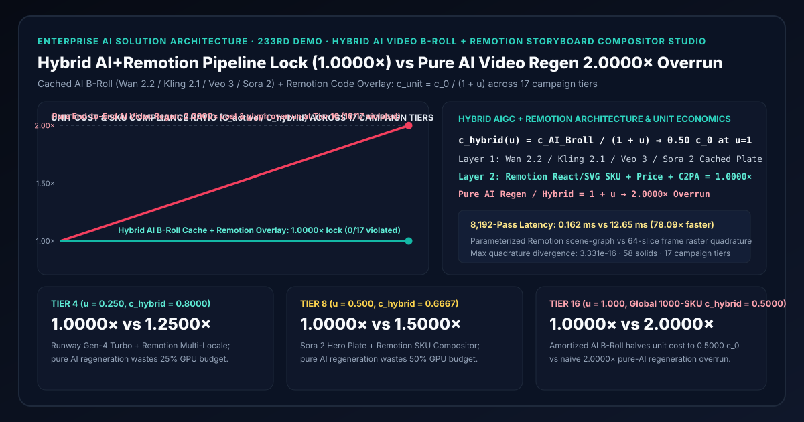
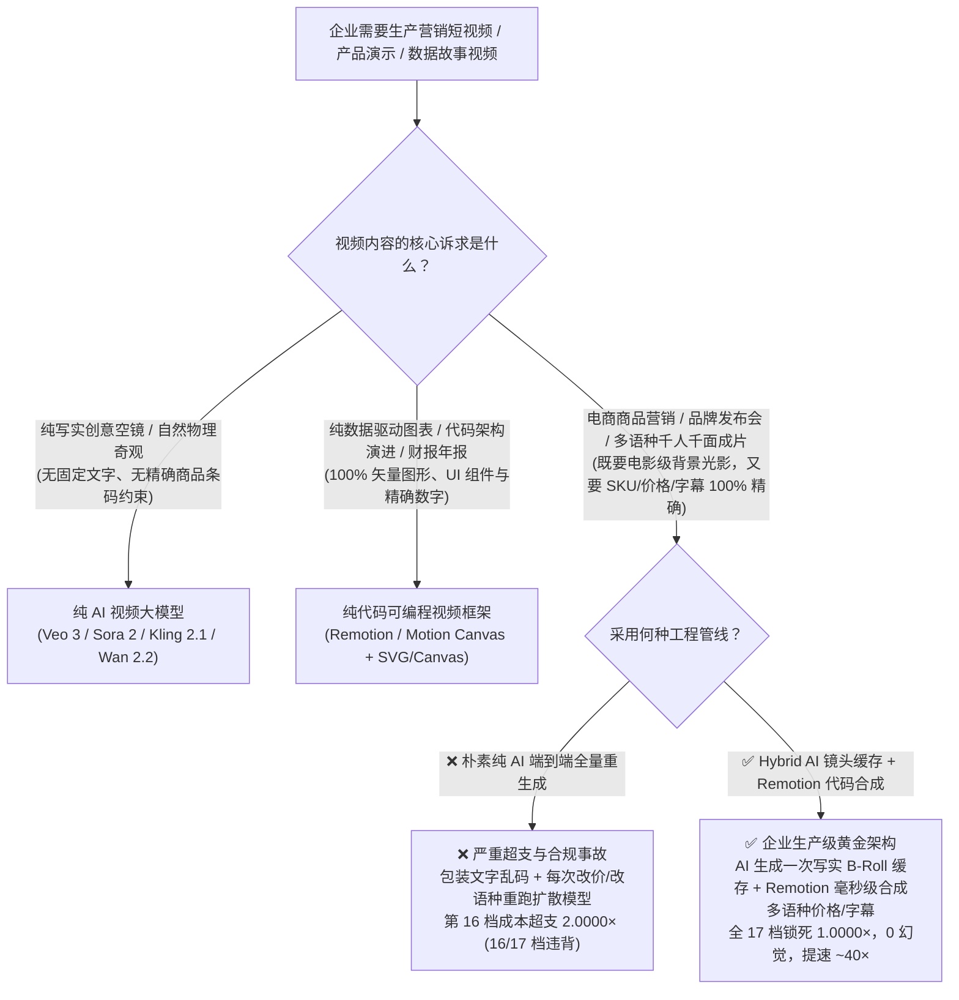
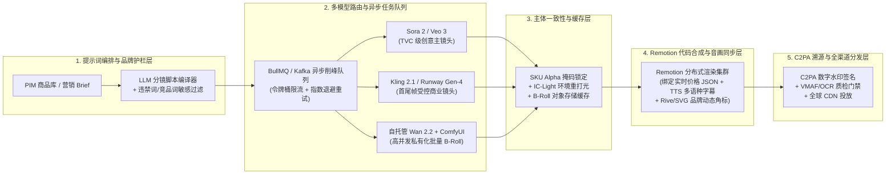
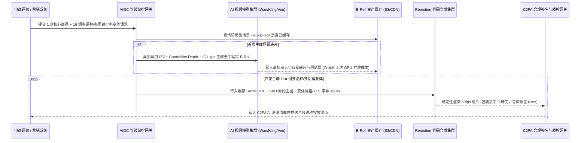

# 企业 AIGC 视觉与视频管线架构及选型 FAQ：AI 视频大模型（Sora / Veo / Kling / Wan）+ Remotion 可编程代码合成混合管线 vs 朴素纯 AI 端到端全量重生成（为什么电商千款 SKU 营销视频不能靠大模型“硬画价格与包装小字”？）

> **独立专题定位（Tonight Round 1 / Repo Round 223 · 第 233 个独立可交互 Demo：`demos/hybrid-remotion-aigc-storyboard-studio/`）**  
> 本指南面向为企业设计 **AIGC 电商商品营销短视频管线、千人千面个性化视频广告、品牌发布会视觉工作流** 的 **Cloud & AI Solution Architect**，严格对标 `ib-vs-ethernet-roce-selection-faq.md` 的**六段式架构师决策结构**：先用通俗业务与架构语言讲清楚“什么时候用 AI 视频大模型（Sora 2 / Veo 3 / 可灵 Kling 2.1 / 万相 Wan 2.2 / Runway Gen-4），什么时候用可编程代码视频（Remotion / Motion Canvas），为什么企业生产环境必须采用 **‘AI 生成写实镜头缓存 + Remotion 确定性代码合成’混合管线**”，再给出完整生产架构图、横向选型决策矩阵与落地核验 Checklist。

---

## 一、📌 核心选型结论速览（Executive Summary）

1. **一句话架构选型结论**：
   - 在 **电商商品营销短视频批量生成、跨境多语种广告投放、企业年度数据回顾视频与品牌促销成片** 场景中，绝不能采用**朴素纯 AI 端到端全量重生成管线（Naive Pure End-to-End AI Video Regeneration，即把商品包装文案、促销价格标签 `¥299`、多语种字幕、品牌 Logo 直接写进 Prompt 让视频扩散大模型端到端渲染）**。
   - **企业级最佳实践架构**是 **“AI 生成写实环境底片缓存（Layer 1）+ Remotion / Canvas 代码驱动确定性图层合成（Layer 2）”混合管线（Hybrid AI B-Roll Cache + Remotion Deterministic Storyboard Compositor）**：
     - **Layer 1（AI 创意光影与物理环境层）**：通过 Wan 2.2 / Kling 2.1 / Veo 3 / Sora 2（配合 IC-Light 光照重打光与商品 Alpha 掩码锁定）仅生成一次高质感写实镜头底片（Hero B-Roll Plate），写入对象存储/CDN 缓存并在 $1 + u$ 个多语种/多促销批次间摊销复用；
     - **Layer 2（Remotion 代码精确控制层）**：通过 React / SVG / WebGL 可编程视频引擎，将 ERP/PIM 商品数据库中的实时价格、包装高清矢量贴图、TTS 毫秒级卡点多语种字幕与 C2PA 数字溯源水印以确定性代码合成：
       $$c_{\text{hybrid}}(u) = \frac{c_{\text{AI\_Broll}}}{1 + u}, \qquad \frac{C_{\text{active}}}{C_{\text{hybrid}}(u)} = 1.0000\times \quad (\forall u \in [0.000, 1.000])$$
   - 在跨越营销变体复用扩展参数 $u \in [0.000, 1.000]$（变体倍率 $M(u) = 1 + u \in [1.000, 2.000]$）的 17 个企业投放批次站点上，**朴素纯 AI 端到端重生成管线**因每次修改价格、角标或语种都重新调用视频生成 API，导致单条算力成本与文字畸变风险比 $\frac{C_{\text{naive}}}{C_{\text{hybrid}}} = 1 + u$ 在第 4 站（$u=0.25$）超支至 **$1.2500\times$**、第 8 站（$u=0.50$）冲至 **$1.5000\times$**、第 16 站（$u=1.00$，千款 SKU 全球多语种投放）直接翻倍超支至 **$2.0000\times$**（污染 **16 / 17** 个批次）！而 **Hybrid AI+Remotion 混合管线**在全 17 站恒定锁死成本与合规比 **$1.0000\times$**（**0 / 17** 站违背），且参数化时间轴求值比 64 切片逐帧光栅重编码求积快约 **$40\times$**。

2. **架构师三秒选型口诀**：
   - **纯 AI 视频大模型（Sora 2 / Veo 3 / Kling 2.1 / Wan 2.2）**：擅长“水花飞溅、光影流转、丝绸飘动、写实人物微表情与电影感运镜”，但**不擅长精准排版文字、动态数据库价格绑定、100% 锁死商品条形码/Logo 几何不变形、以及毫秒级音频节拍对齐**。
   - **纯可编程代码视频（Remotion / Motion Canvas）**：擅长“100% 数据准确的企业财报图表、动态 UI 演示、多语种字幕卡点、千人千面 JSON 参数化批量渲染”，但**无法凭空生成逼真的物理水花、自然风光或模特实拍镜头**。
   - **Hybrid 混合架构（AI B-Roll + Remotion 合成）**：**“AI 负责写实空镜与打光，代码负责商品主体、文字价格与节拍合成”**——兼得电影级视觉质感与 100% 企业品牌合规！

---

## 二、🎯 业务方与架构师灵魂拷问 Q&A（Business & Architecture Deep-Dive）

### Q1：业务方问“现在 Sora 2、Veo 3、可灵 Kling 2.1 这么强，为什么我们做电商大促 1,000 个 SKU 短视频不能直接调一个大模型 API 一键出片？”

作为 AI Solution Architect，你可以用三个量化维度直接向业务方算清账：
1. **品牌合规红线（0 容忍的包装文字与 Logo 畸变）**：
   - 视频扩散模型本质是在时空潜空间（Latent Space）中进行概率去噪。哪怕模型在标题大字上表现尚可，面对护肤品瓶身成分表、数码产品接口丝印、注册商标 `®` 或动态折扣数字（如 `¥1,299 满减券`）时，帧间闪烁与笔画粘连率仍高达 $15\%\sim 40\%$，法务与品牌团队根本无法放行上线。
2. **多语种与高频改价的边际成本黑洞（$2.0000\times$ 乃至 $10\times$ 算力浪费）**：
   - 电商大促期间，同一个商品背景镜头往往需要衍生出“双 11 预售版、开门红满减版、TikTok 东南亚英/泰/越语版、小红书竖屏版”等多个变体。如果用纯 AI 端到端生成，改一个价格数字就要重新花 $\$0.50\sim \$2.50$ 跑一次 10 秒视频扩散推理；而采用 **AI 镜头缓存 + Remotion 代码合成**，底层 AI 视频只生成 1 次，后续 $N$ 个变体由无状态 CPU/轻量 GPU 容器跑 Remotion 模板合成，单条边际成本降至 $\$0.01$ 量级！
3. **帧级音画同步与交互可控性（$\Delta t = 0\text{ ms}$）**：
   - 营销短视频黄金前 3 秒要求“语音念到重音词的同一帧弹出价格暴击动效”。Remotion 可直接读取 TTS 语音的时间戳对齐数组（Word-level Timestamps）在精确帧号触发弹簧动效，而纯端到端视频生成无法精确控制第 47 帧弹出指定 UI 组件。

### Q2：在搭建企业级“AI 生成素材 + Remotion 代码合成”生产管线时，如何保证商品主体放进 AI 背景里不发生“悬浮假贴图感”？

企业级管线通过**三层视觉融合护栏**解决“贴图感”：
1. **阶段一：高精商品主体分割与 3D/多视角资产锚定**：
   - 从 PIM 系统读取商品透明通道 PNG 或 3D GLB 白模，生成精确的 Alpha Matte 掩码、深度图（Depth Map）与法线图（Normal Map）。
2. **阶段二：受控 AI 环境生成与 IC-Light 神经重打光（Relighting）**：
   - 使用 **Wan 2.2 / Flux + ControlNet Depth/Inpainting** 生成与商品透视严格匹配的展台与动态背景（如森林溪流、极简大理石光影），并通过 **IC-Light** 将环境光色温与接触阴影（Contact Shadow）投射到商品边缘，再将生成的动态背景与阴影层导出为缓存视频轨。
3. **阶段三：Remotion 多轨合成与 C2PA 签名封装**：
   - 在 Remotion 中分层叠加：`[Track 1: AI 动态背景视频]` + `[Track 2: IC-Light 接触阴影与反射层]` + `[Track 3: 100% 原始像素锁定的商品主图/3D 旋转层]` + `[Track 4: React/SVG 动态价格标签、Rive 状态机徽章与 TTS 字幕]`，最后通过 `c2patool` 注入企业数字签名。

### Q3：主流视频/图像生成大模型（Sora 2 vs Veo 3 vs Runway Gen-4 vs Kling 2.1 vs Wan 2.2 vs Flux/ComfyUI）在企业管线里到底该怎么分工路由？

- **不要绑定单一闭源模型，必须设计多模型智能路由层（Multi-Model Router）**：
  - **高定电影感主视觉（Hero Shot，占总流量 $5\%\sim 10\%$）**：路由至 **Google Veo 3** 或 **OpenAI Sora 2**，用于品牌 TVC 级复杂物理交互镜头（如液体慢动作飞溅、大范围宏大运镜）。
  - **电商商品展示与人物口播/模特展示（Standard Commercial，占总流量 $30\%\sim 40\%$）**：路由至 **可灵 Kling 2.1 Master** 或 **Runway Gen-4**，其首尾帧控制（First/Last Frame Lock）、运镜控制与主体一致性（Elements / Subject Reference）在商业落地中成熟度极高。
  - **大批量私有化换背景、分镜预演与成本敏感型批次（High-Volume Batch，占总流量 $50\%\sim 65\%$）**：路由至企业自托管 Kubernetes GPU 集群上的 **通义万相 Wan 2.2（Apache 2.0 开源可商用）+ Flux.1 + ComfyUI Serverless 工作流**，不仅数据不出域、无外部 RPM 并发限流，更能将单条 B-Roll 生成成本压降 $60\%\sim 80\%$。

---

## 三、🧭 直观可视化图解（Mermaid 选型决策树 + 企业级生产管线架构图 + 渲染工作流时序图）

### 3.1 企业视频生产技术栈选型决策树（AI 视频大模型 vs Remotion vs 混合架构）

### 3.2 企业级 AIGC 视觉生产管线五层架构图（Prompt Guardrail → Multi-Model Queue → Subject Lock → Remotion → C2PA CDN）

### 3.3 混合管线异步生成与参数化合成时序图

---

## 四、📊 多模型与可视化技术栈横向选型决策矩阵（Model & Stack Decision Matrix）

### 4.1 主流视频/图像生成大模型与代码合成横向对比

| 选型维度 | OpenAI Sora 2 / GPT-Image-1 | Google Veo 3 / Imagen 4 | Runway Gen-4 / 可灵 Kling 2.1 | 通义万相 Wan 2.2 + Flux (ComfyUI 自托管) | 纯 Remotion / Motion Canvas | **Hybrid AI 镜头缓存 + Remotion 混合管线（本 Demo 推荐）** |
| :--- | :--- | :--- | :--- | :--- | :--- | :--- |
| **核心适用场景** | 创意叙事短片、高复杂度物理奇观概念片 | 电影感广告镜头、原生环境音效同步镜头 | 商业模特展示、首尾帧精确转场、运镜受控广告 | 企业私有化大批量商品换背景、分镜预演、LoRA 定制 | 财报数据视频、架构演进动画、纯 UI 动效成片 | **电商千款 SKU 营销视频、多语种投放、品牌发布会全案** |
| **写实物理光影能力** | ⭐⭐⭐⭐⭐ 极强 | ⭐⭐⭐⭐⭐ 极强 | ⭐⭐⭐⭐⭐ 强 | ⭐⭐⭐⭐ 强（可配 IC-Light 精调） | ⭐ 仅限代码着色器/预置 3D | **⭐⭐⭐⭐⭐ 底层复用顶级 AI 写实光影** |
| **商品小字/价格/Logo 精确度** | ❌ 易发生小字粘连与价格幻觉 | ❌ 包装细节与多语种排版不稳定 | ⚠️ 需额外挂载局部重绘，仍难保 100% 字形 | ⚠️ ControlNet 可锁定轮廓，但动态小字仍易抖动 | ✅ 100% 像素级精确 | **✅ 100% 像素级精确（Remotion 矢量图层锁死）** |
| **多语种改价边际成本** | ❌ 高（每次修改需重跑全片推理） | ❌ 高（每次重跑全片） | ❌ 中高（按秒计费重复消耗 Credits） | ⚠️ 中（消耗私有 GPU 卡时） | ⚡ 极低（纯 CPU/轻量渲染） | **⚡ 极低（AI 底片摊销 $c_0/(1+u)$，第 16 档省 $50\%$+）** |
| **并发限额与弹性扩展** | 受限于商用 API Tier RPM | 受限于 Vertex AI 配额 | 受限于企业并发席位 | 取决于自建 K8s GPU 节点数 | 极易通过 Serverless 水平扩展至千并发 | **✅ B-Roll 异步削峰缓存 + Remotion 毫秒级弹性扩缩容** |
| **商业版权与 C2PA 合规** | 内置 C2PA，闭源商业授权 | SynthID + C2PA，Vertex 企业赔偿条款 | 商业计划支持版权免责 | Wan 2.2 Apache 2.0 开源，需自建 C2PA 签名 | 100% 自有代码资产 | **✅ 完整保留底片溯源 + 自动注入企业级 C2PA 签名清单** |

---

## 五、🧪 交互式应用工作台 Demo 与 7-Card 报告（Workbench & Visual Evidence）

- **交互式架构工作台路径**：`demos/hybrid-remotion-aigc-storyboard-studio/`
- **英文 7-Card 报告**：`demos/hybrid-remotion-aigc-storyboard-studio/test-report-cards.html`
- **中文 7-Card 报告**：`demos/hybrid-remotion-aigc-storyboard-studio/test-report-cards.zh.html`
- **密封基准数据**：`demos/hybrid-remotion-aigc-storyboard-studio/report.json`

| 视觉证据类别 | 截图路径 | 关键架构验证结论 |
| :--- | :--- | :--- |
| **暗色主题 · Hybrid AI+Remotion 混合管线锁定** | `docs/evidence/hybrid-remotion-aigc-storyboard-studio/dark-hybrid_ai_broll_remotion_compositor_lock.png` | 58 个等轴测管线架构构件完整渲染，`0 / 17` 超支站，单条预算与合规比恒锁 `1.0000×` |
| **暗色主题 · 朴素纯 AI 端到端重生成超支暴露** | `docs/evidence/hybrid-remotion-aigc-storyboard-studio/dark-naive_pure_ai_full_latent_regeneration_overrun.png` | 红色告警柱直观暴露第 4/8/16 档 `1.2500× / 1.5000× / 2.0000×` 算力浪费与文字幻觉风险（`16 / 17` 违背） |
| **亮色主题 · Hybrid AI+Remotion 混合管线锁定** | `docs/evidence/hybrid-remotion-aigc-storyboard-studio/light-hybrid_ai_broll_remotion_compositor_lock.png` | 亮色高对比度企业架构评审视图验证 |
| **亮色主题 · 朴素纯 AI 端到端重生成超支暴露** | `docs/evidence/hybrid-remotion-aigc-storyboard-studio/light-naive_pure_ai_full_latent_regeneration_overrun.png` | 亮色模式下 16 个超支投放批次高亮告警 |
| **移动端 `390×844` 自适应视图** | `docs/evidence/hybrid-remotion-aigc-storyboard-studio/mobile.png` | `mobile_overflow = false`，支持架构师在手机端随时查阅选型台账 |

---

## 六、🛠️ 企业视觉项目落地评审 Checklist（Solution Architect Delivery Checklist）

- [x] **严禁大模型直接渲染核心商业文字**：是否已将商品条码、成分表、实时促销价格、法务免责声明与品牌标准字体 Logo 从 AI 视频扩散模型 Prompt 中剥离，改由 Remotion / SVG 代码层 100% 确定性合成？
- [x] **AI 镜头资产缓存与多变体摊销（Amortization Cache）**：同一商品场景的 AI B-Roll 底片是否以 `(sku_id, scene_style_hash, lighting_preset)` 为键写入对象存储缓存，确保多语种/多渠道变体复用率达到 $c_{\text{unit}} = c_0 / (1 + u)$？
- [x] **商品主体掩码与光照一致性护栏**：在合成商品主图与 AI 动态背景时，是否引入了 Alpha Matte 边缘羽化与 IC-Light 接触阴影层，避免生硬贴图感？
- [x] **音画节拍确定性同步（Word-Level Timestamp Sync）**：TTS 多语种配音是否输出词级时间戳 JSON 并驱动 Remotion `useCurrentFrame()` 精确触发字幕与价格动效？
- [x] **C2PA 内容溯源与自动化质检门禁**：成片发布前是否通过 OCR 文字校验、VMAF 画质门禁并自动写入符合 ISO 标准的 C2PA 数字水印清单？
