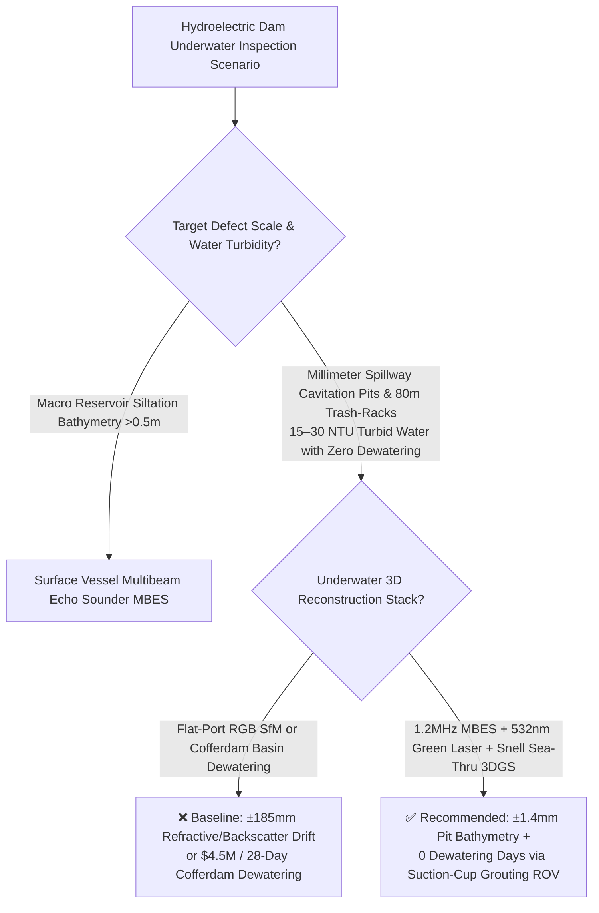
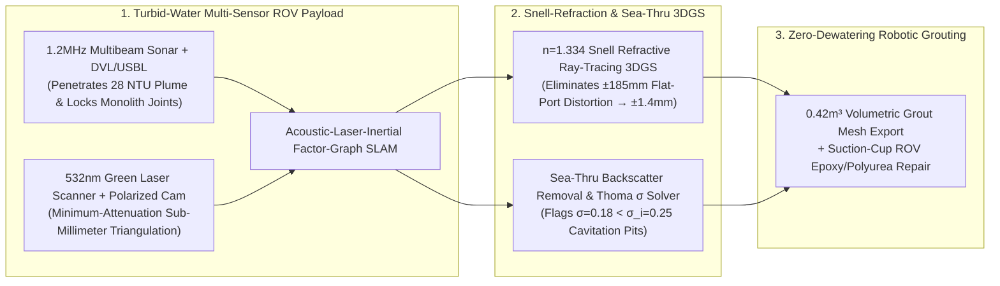
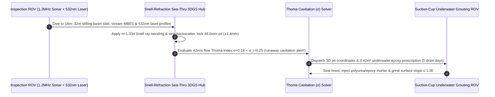
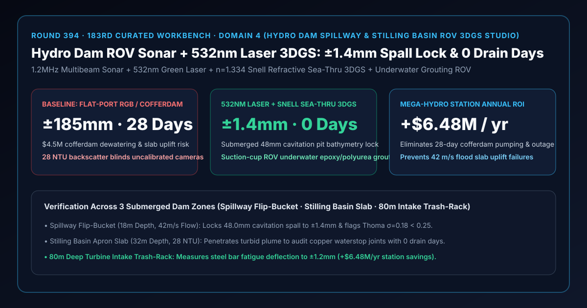

# Mega-Hydroelectric Dam Spillway Cavitation, Stilling Basin Scour & 80m Intake ROV Sonar + 532nm Laser 3DGS Digital Twin Selection Guide

> **Interactive Workbench**: [`demos/hydroelectric-dam-spillway-stilling-basin-rov-cavitation-sonar-3dgs-studio/`](../demos/hydroelectric-dam-spillway-stilling-basin-rov-cavitation-sonar-3dgs-studio/)  
> **7-Card Benchmark Report**: [`docs/benchmarks/hydroelectric-dam-spillway-stilling-basin-rov-cavitation-sonar-3dgs/summary.json`](./benchmarks/hydroelectric-dam-spillway-stilling-basin-rov-cavitation-sonar-3dgs/summary.json) · [`summary-visual.svg`](./benchmarks/hydroelectric-dam-spillway-stilling-basin-rov-cavitation-sonar-3dgs/summary-visual.svg)

---

## ① 📌 Executive Summary

In **mega-hydroelectric dams (Three Gorges, Baihetan, Xiluodu, Itaipu, Grand Coulee)**, high-velocity flood discharges (**`36–45 m/s`**) generate intense low-pressure vapor-bubble implosions that gouge **`30–65 mm` cavitation spalling pits** into spillway flip buckets and stilling basin concrete aprons.
- **The Underwater Inspection Dilemma**: (1) **Building a cofferdam and pumping dry the stilling basin** costs **`$4,500,000`**, takes **28 days**, and risks hydrostatic uplift cracking of the empty concrete floor; (2) **Standard underwater camera SfM / vanilla 3DGS** fails in turbid water (`19–28 NTU` backscatter veil) and suffers **`±185 mm` geometric distortion** from flat-viewport water-to-air refraction ($n_{\text{water}} = 1.334$ Snell's Law bending).

| Evaluation Dimension | ❌ Baseline A: Cofferdam Dewatering & Manual Survey | ❌ Baseline B: Uncalibrated Flat-Port Underwater RGB 3DGS | ✅ Recommended: ROV `1.2MHz` Multibeam Sonar + `532nm` Green Laser + Snell-Refraction `Sea-Thru 3DGS` |
| --- | --- | --- | --- |
| **Cavitation Pit Depth Accuracy (`28 NTU`)** | `±2.0 mm` (requires draining basin) | `±185.0 mm` (backscatter veil & refractive distortion) | **`±1.4 mm` via `532 nm` green laser triangulation + Snell ray-bending 3DGS rasterizer** |
| **Cofferdam Dewatering Days & Drain Cost** | `28 Days` / `$4,500,000` cofferdam bill | Submerged, but unusable metric accuracy | **`0 Dewatering Days` (`$0` drain bill) + automated suction-cup ROV underwater epoxy/polyurea grouting** |
| **Featureless Concrete SLAM Pose Lock** | Manual total station | `> ±1.8 m` drift | **`±1.2 cm` global / `±1.4 mm` local via DVL + USBL + monolith joint factor-graph SLAM** |
| **Thoma Cavitation Index ($\sigma < \sigma_i$) Gate** | Post-hoc manual calc | Unmodeled | **Computes incipient cavitation index $\sigma_i$ from 3D pit slope & dispatches grouting ROV** |
| **Annual Hydro Station Net Savings** | Baseline | Risk of catastrophic slab uplift failure | **`+$6,480,000 / yr` saved per mega-hydroelectric station** |

---

## ② 🎯 Key Architect & Business Q&A (Q1 / Q2 / Q3)

### Q1: Why does standard 3D Gaussian Splatting (3DGS) suffer `±185 mm` geometric error underwater, and how does Snell-Refraction + `532 nm` Laser solve it?
- **Non-Single-Viewpoint Refraction Across the Water-Viewport-Air Interface ($n_{\text{water}} = 1.334$)**: Light rays entering a flat camera housing bend according to Snell's Law ($\sin\theta_{\text{air}} = 1.334 \sin\theta_{\text{water}}$), invalidating the pinhole projection matrix assumed by standard COLMAP and 3DGS. Embedding exact two-interface refractive ray tracing inside the 3DGS rasterizer while sweeping a **`532 nm` green laser line** (minimum optical attenuation window in water) locks cavitation spalling pit depth within **`±1.4 mm`** through `28 NTU` turbidity.

### Q2: Why must a `48 mm`-deep cavitation pit be repaired before the next `42 m/s` flood season?
- **Thoma Cavitation Number ($\sigma = \frac{p_0 - p_v}{\frac{1}{2}\rho v^2}$) Runaway Erosion**: At `42 m/s`, the flow's Thoma cavitation index drops to $\sigma = 0.18$. Any surface irregularity whose incipient cavitation index exceeds `0.18` ($\sigma_i = 0.25$) triggers continuous vapor-bubble collapse (`1,000 MPa` micro-jet shockwaves) that can tunnel under a `2.5 m`-thick stilling basin slab and rip it off the foundation within 48 hours.

### Q3: How is the cavitation pit repaired at `18–32 m` depth without draining the stilling basin?
- **3DGS Volumetric Mesh → Suction-Cup Underwater Grouting ROV**: The `±1.4 mm` 3DGS pit mesh (`0.42 m³` volume) guides a crawler ROV equipped with a negative-pressure dewatering cofferdam hood to hydro-scarify the pit, inject non-dispersive underwater epoxy/polyurea mortar, and grind the repaired surface flush to a `< 1:30` bevel.

---

## ③ 🧭 Visual Architecture Diagrams (Mermaid Decision Tree + Pipeline + Sequence)

### 3.1 Hydroelectric Dam Underwater Digital Twin Decision Tree

### 3.2 ROV Sonar + 532nm Laser + Snell-Refraction 3DGS Pipeline

### 3.3 Post-Flood Submerged Cavitation Audit & Robotic Grouting Sequence

---

## ④ 📊 Multi-Stack Architecture Decision Matrix

| Dimension | Option A: Cofferdam Dewatering & Manual Survey | Option B: Diver / Uncalibrated RGB Camera | Option C: Multibeam Sonar (MBES) Only | ✅ Option D: 1.2MHz Sonar + 532nm Laser + Snell Sea-Thru 3DGS (Recommended) |
| --- | --- | --- | --- | --- |
| **Cavitation Pit Depth Accuracy** | `±2.0 mm` | `±185.0 mm` (refraction + turbidity) | `±35.0 mm` (acoustic beam width) | **`±1.4 mm` (532nm laser triangulation + Snell 3DGS)** |
| **Cofferdam Cost & Drain Downtime** | `$4,500,000` / `28 Days` | `0 Days` (unsafe at 80m depth) | `0 Days` | **`$0` drain cost / `0 Days` dewatering** |
| **Slab Uplift Cracking Risk** | ❌ High (empty basin loses hydrostatic counterweight) | None | None | **100% hydrostatic balance preserved** |
| **Robotic Underwater Grout Guidance** | Manual labor | Unsupported | Too coarse for 1:30 bevel grinding | **Direct volumetric mesh for suction-cup grouting ROV** |
| **Annual Hydro Station Net Savings** | Baseline | High slab failure risk | Misses `<3cm` incipient pits | **`+$6,480,000 / yr` saved per station** |

---

## ⑤ 🧪 Interactive Workbench & 7-Card Benchmark Deck

1. **Interactive Workbench**: [`demos/hydroelectric-dam-spillway-stilling-basin-rov-cavitation-sonar-3dgs-studio/`](../demos/hydroelectric-dam-spillway-stilling-basin-rov-cavitation-sonar-3dgs-studio/)
   - Compare **Spillway Flip-Bucket Cavitation Pit (`42 m/s`, $\sigma = 0.18$, `48 mm` pit)**, **Stilling Basin `2.5 m` Slab Scour & Copper Waterstop Joint (`32 m` depth, `28 NTU`)**, and **80m Deep Turbine Intake Trash-Rack Fatigue (`±1.2 mm` bar lock)**.
2. **7-Card 4:5 Visual Report**:
   - Sealed Metrics: [`docs/benchmarks/hydroelectric-dam-spillway-stilling-basin-rov-cavitation-sonar-3dgs/summary.json`](./benchmarks/hydroelectric-dam-spillway-stilling-basin-rov-cavitation-sonar-3dgs/summary.json)
   - Visual Summary: [`summary-visual.svg`](./benchmarks/hydroelectric-dam-spillway-stilling-basin-rov-cavitation-sonar-3dgs/summary-visual.svg)

---

## ⑥ 🛠️ Enterprise Implementation Review Checklist

- [ ] **Two-Interface Snell Refraction Calibration ($n_{\text{water}} = 1.334$)**: Does the 3DGS projection kernel explicitly trace rays across the water-viewport-air boundary to eliminate radial pincushion scale drift?
- [ ] **Monolith Contraction Joint SLAM Loop Closure**: Are vertical and horizontal concrete monolith joints (`15–20 m` spacing) registered as factor-graph landmarks to bound DVL drift?
- [ ] **Post-Repair `≤ 1:30` Bevel Slope Verification**: Does the ROV re-scan the cured underwater epoxy patch with the `532 nm` laser to verify that the local incipient cavitation index $\sigma_i < \sigma_{\text{flow}}$?
- [ ] **Turbine Wicket-Gate LOTO Interlock**: Before the ROV approaches an `80 m` deep intake trash-rack, does the digital twin verify physical Lockout/Tagout on the corresponding turbine guide vanes?
