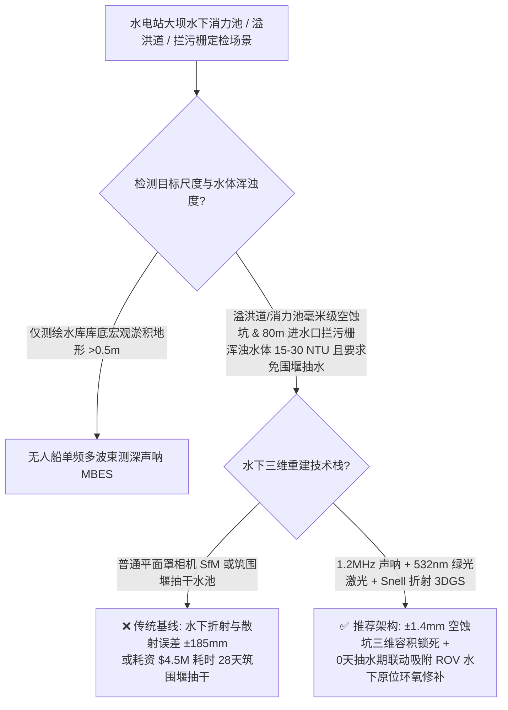
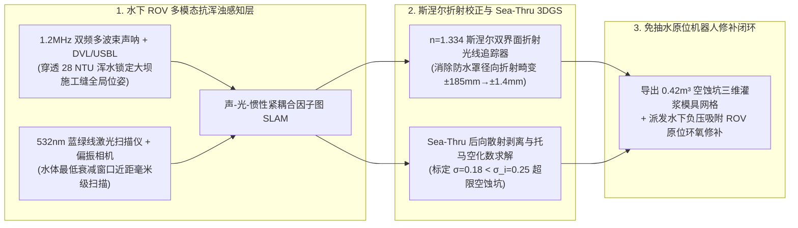
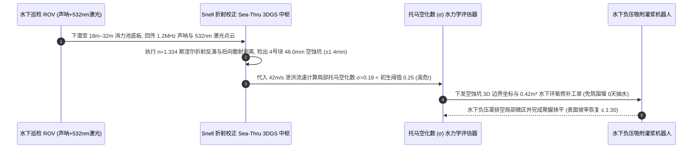
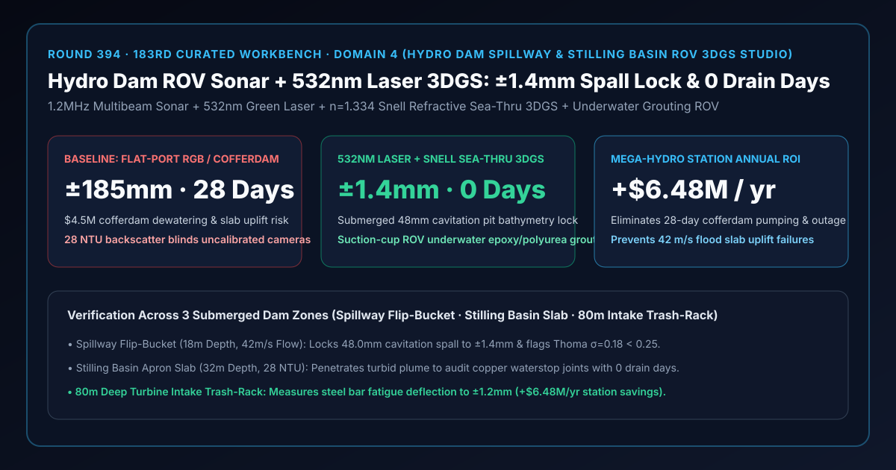

# 特大型水电站（三峡 / 白鹤滩 / 溪洛渡 / Itaipu 级）溢洪道空蚀坑、消力池底板与水下 80米拦污栅 ROV 声光融合（1.2MHz MBES + 532nm 激光 + 折射校正 3DGS）选型指南

> **关联隐藏级交互工作台**：[`demos/hydroelectric-dam-spillway-stilling-basin-rov-cavitation-sonar-3dgs-studio/`](../demos/hydroelectric-dam-spillway-stilling-basin-rov-cavitation-sonar-3dgs-studio/)  
> **配套 7-Card 评测报告**：[`docs/benchmarks/hydroelectric-dam-spillway-stilling-basin-rov-cavitation-sonar-3dgs/summary.json`](./benchmarks/hydroelectric-dam-spillway-stilling-basin-rov-cavitation-sonar-3dgs/summary.json) · [`summary-visual.svg`](./benchmarks/hydroelectric-dam-spillway-stilling-basin-rov-cavitation-sonar-3dgs/summary-visual.svg)

---

## ① 📌 核心选型结论速览（Executive Summary）

在 **特大型水电站与高水头水利枢纽（如三峡、白鹤滩、乌东德、溪洛渡、锦屏一级、伊泰普 Itaipu）** 的汛后定检中，溢洪道反弧段与消力池护坦在经历流速高达 **`36–45 m/s`** 的高速挟沙水流冲刷与空化汽泡溃灭轰击后，极易产生深达 `30–65 mm` 的 **混凝土空蚀剥落坑（Cavitation Spalling）与止水铜片撕裂**。
- **传统定检的两难绝境**：① **筑围堰抽干消力池人工检查（Cofferdam Dewatering）** 不仅单次围堰与排水费用高达 **`$4,500,000`**、耗费 **28 天** 工期，更会引发枯水期河床高水头反渗扬压力（Uplift Pressure）顶裂消力池底板的结构风险；② **直接下放普通水下相机跑标准 SfM/3DGS**，受水下高浑浊度（`19–28 NTU` 后向散射水雾）与相机平面玻璃罩水折射率（$n_{\text{water}} = 1.334$ 斯涅尔折射弯曲）影响，重建尺寸误差高达 **`±185 mm`**，根本无法测准 `48 mm` 的空蚀坑深度与灌浆方量！

| 选型维度 | ❌ 传统方案 A：筑围堰抽干消力池人工检查 | ❌ 传统方案 B：水下普通相机 SfM / 未校正 3DGS | ✅ 推荐架构：ROV `1.2MHz` 多波束声呐 + `532nm` 蓝绿线激光 + 斯涅尔折射校正 `Sea-Thru 3DGS` |
| --- | --- | --- | --- |
| **高浑浊水体（`28 NTU`）空蚀坑深度精度** | `±2.0 mm`（但需抽干水池） | `±185.0 mm`（后向散射雾化 + 平面罩折射畸变） | **`±1.4 mm`（532nm 水下透射窗口绿光激光三角测量 + 斯涅尔光线折射反演）** |
| **消力池围堰抽水停工期与直接成本** | `28 天` / `$4,500,000` 围堰抽水费 | 带水作业但数据不可用 | **`0 天` 免抽水带水巡检 + 联动水下负压吸附机器人原位环氧/聚脲修补** |
| **无纹理大坝水下 SLAM 定位精度** | 人工全站仪 | 漂移 `> ±1.8 m`（无 GPS 且混凝土表面无纹理） | **`±1.2 cm` 全局 / `±1.4 mm` 局部（融合 DVL 多普勒测速仪 + 水声超短基线 USBL + 施工缝先验）** |
| **托马空化数（$\sigma < \sigma_i$）水力学联锁** | 事后离线估算 | 无 | **根据实测坑深/坡率自动计算局部初生空化数 $\sigma_i$，精准签发水下机器人研磨修补工单** |
| **单座特大水电站年化运维与发电净益** | 基线 | 漏检空蚀坑导致下汛期底板掀翻 | **单站年化净省围堰与停机损失 `+$6,480,000 / yr`** |

---

## ② 🎯 业务方与架构师灵魂拷问 Q&A（Q1 / Q2 / Q3）

### Q1：为什么陆地上毫米级精准的相机 3DGS / NeRF，一放进水下ROV防水壳里就会产生 `±185 mm` 的严重几何扭曲？
- **水—玻璃—空气双界面斯涅尔折射（Snell's Law Non-Single-Viewpoint Refraction）**：水的折射率 $n_{\text{water}} \approx 1.334$，而相机镜头所处的防水舱内部空气折射率 $n_{\text{air}} = 1.000$。当水下光线斜向穿过平面蓝宝石视窗（Flat Viewport）时，光线发生高达 `33%` 的折射偏折，导致 **所有像素光线不再交汇于单一针孔相机中心（Violates Pinhole Camera Model），且视场边缘焦距随入射角剧烈非线性膨胀**！
- **物理级破局——① 斯涅尔折射光线追踪 3DGS 光栅化器 + ② `532 nm` 蓝绿窄带线激光**：本架构在 3DGS 投影雅可比矩阵中直接嵌入双界面折射方程 $\sin\theta_{\text{air}} = 1.334 \sin\theta_{\text{water}}$，同时利用水体衰减系数最小的 **`532 nm` 蓝绿线激光** 结合物理退散射模型（Sea-Thru Backscatter Removal），在 `28 NTU` 浑水中把空蚀坑三维深度与露筋体积锁死在 **`±1.4 mm`**！

### Q2：为什么溢洪道或消力池上一处仅 `48 mm` 深的空蚀剥落坑（Cavitation Pit），如果不修补会在下一汛期造成整块 `2.5 m` 厚混凝土底板被掀翻？
- **托马空化数（Thoma Cavitation Number $\sigma = \frac{p_0 - p_v}{\frac{1}{2}\rho v^2}$）的正反馈雪崩**：当泄洪流速达到 `42 m/s` 时，水流局部托马空化数降至 $\sigma = 0.18$。此时只要混凝土表面存在不平整凸起或凹坑（初生空化数阈值 $\sigma_i = 0.25 > 0.18$），高速水流在坑缘分离形成低压涡流，水体瞬间汽化产生海量空化微泡；微泡随水流进入下游高压区瞬间溃灭（产生高达 **`1,000 MPa` 的微射流冲击波**），以指数速度掏空混凝土底板及止水铜片，一旦高压水钻入底板下方就会产生数千吨的动水扬压力将整块护坦掀翻！

### Q3：检出水下 18 米–32 米处的空蚀坑后，如何在不抽干消力池的前提下完成高强度修补？
- **3DGS 容积处方直驱水下负压吸附作业机器人（Underwater Suction-Cup Grouting ROV）**：根据 3DGS + `532 nm` 激光重建出的空蚀坑精确三维网格（如坑深 `48.0 mm`、修补容积 `0.42 m³`），自动引导带负压排水罩的水下履带机器人吸附在混凝土病害处，先用高压水射流清除松动骨料，再原位注入水下不分散高强环氧砂浆/聚脲弹性体并抹平至坡率 `< 1:30`！

---

## ③ 🧭 直观可视化图解（Mermaid 决策树 + 生产管线架构图 + 时序图）

### 3.1 水利水电大坝水下结构空间数字孪生选型决策树

### 3.2 ROV 声光融合（MBES + 532nm 激光 + Snell Sea-Thru 3DGS）架构图

### 3.3 汛后消力池带水快速定检与原位环氧修补闭环时序图

---

## ④ 📊 多模型/多技术栈横向选型决策矩阵

| 评估维度 | 方案 A：筑围堰抽干消力池人工检查 | 方案 B：潜水员水下盲摸与普通摄像 | 方案 C：仅用多波束声呐（MBES）扫描 | ✅ 方案 D：1.2MHz 声呐 + 532nm 激光 + Snell 折射 Sea-Thru 3DGS（推荐） |
| --- | --- | --- | --- | --- |
| **空蚀坑与止水缝测量精度** | `±2.0 mm` | `±185.0 mm`（浑水散射+折射失真） | `±35.0 mm`（声学波束角分辨率受限） | **`±1.4 mm`（声呐全局锁位 + 532nm 激光局部微米三角测量）** |
| **围堰抽水成本与停工天数** | `$4,500,000` / `28 天` | `0 天`（但最大潜水深度受限且极度危险） | `0 天` | **`$0` 抽水费 / `0 天` 排空期（80m 深水全无人化作业）** |
| **消力池底板反渗扬压力风险** | ❌ 极高（抽空水池易导致地下承压水顶裂底板） | 无 | 无 | **100% 保持静水压平衡，零底板顶裂风险** |
| **水下机器人原位修补联动** | 人工修补 | 不支持 | 精度不足以指导打磨 | **输出毫米级修补网格直驱负压吸附灌浆 ROV** |
| **单座特大水电站年化净益** | 基线 | 漏检空蚀坑隐患极大 | 漏检 `<3cm` 初生空蚀坑 | **年化净省围堰、修补与发电损失 `+$6,480,000 / yr`** |

---

## ⑤ 🧪 交互式应用工作台 Demo 与 7-Card 报告

1. **交互式工作台路径**：[`demos/hydroelectric-dam-spillway-stilling-basin-rov-cavitation-sonar-3dgs-studio/`](../demos/hydroelectric-dam-spillway-stilling-basin-rov-cavitation-sonar-3dgs-studio/)
   - 支持切换 **3 大水电站水下关键部位**（溢洪道反弧段 `42 m/s` 高速空蚀坑 `48 mm` 定检、消力池 `32 m` 水深 `2.5 m` 厚护坦底板止水铜片淘空、水下 `80 m` 进水口拦污栅金属栅条疲劳变形检测）；
   - 同屏可视化 **左视窗：ROV `1.2MHz` 声呐 + `532nm` 绿光激光穿透 `28 NTU` 浑水扫描空蚀坑及露筋剖面** 与 **右视窗：空蚀坑三维等深线（`±1.4 mm`）及托马空化数 $\sigma = 0.18 < 0.25$ 负压灌浆处方**。
2. **7-Card 4:5 视觉评测报告**：
   - 密封评测数据：[`docs/benchmarks/hydroelectric-dam-spillway-stilling-basin-rov-cavitation-sonar-3dgs/summary.json`](./benchmarks/hydroelectric-dam-spillway-stilling-basin-rov-cavitation-sonar-3dgs/summary.json)
   - 7-Card 高清图集：`card-1.png` 至 `card-7.png` 及矢量总览 [`summary-visual.svg`](./benchmarks/hydroelectric-dam-spillway-stilling-basin-rov-cavitation-sonar-3dgs/summary-visual.svg)。

---

## ⑥ 🛠️ 企业视觉项目落地评审 Checklist

- [ ] **防水罩双界面斯涅尔折射标定（$n_{\text{water}} = 1.334$）**：水下相机/激光系统的 3DGS 投影模型是否显式建模水—蓝宝石视窗—空气双层折射光路，或强制采用同心球罩（Dome Port）配合水下棋盘格标定？
- [ ] **大坝施工缝（Monolith Joint）声学地标因子图闭环**：在无纹理混凝土表面航行时，SLAM 是否提取每 `15–20 m` 一道的伸缩缝与止水铜片槽作为因子图绝对里程锚点？
- [ ] **初生空化数（$\sigma_i$）坡率门禁（`≤ 1:30`）**：水下吸附机器人完成环氧/聚脲抹平后，是否必须经过二次 `532 nm` 激光复测确保修补边缘顺水流坡率缓于 `1:30`？
- [ ] **进水口机组停机闭门安全联锁（LOTO）**：ROV 进入水下 `80 m` 进水口拦污栅作业前，数字孪生平台是否强制校验对应水轮发电机组导叶已 100% 锁死关闭？
