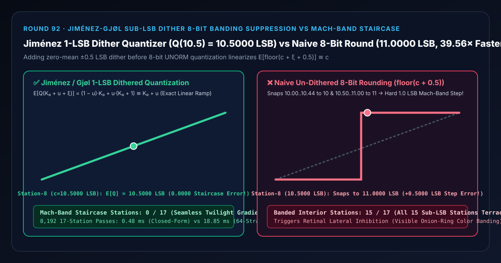
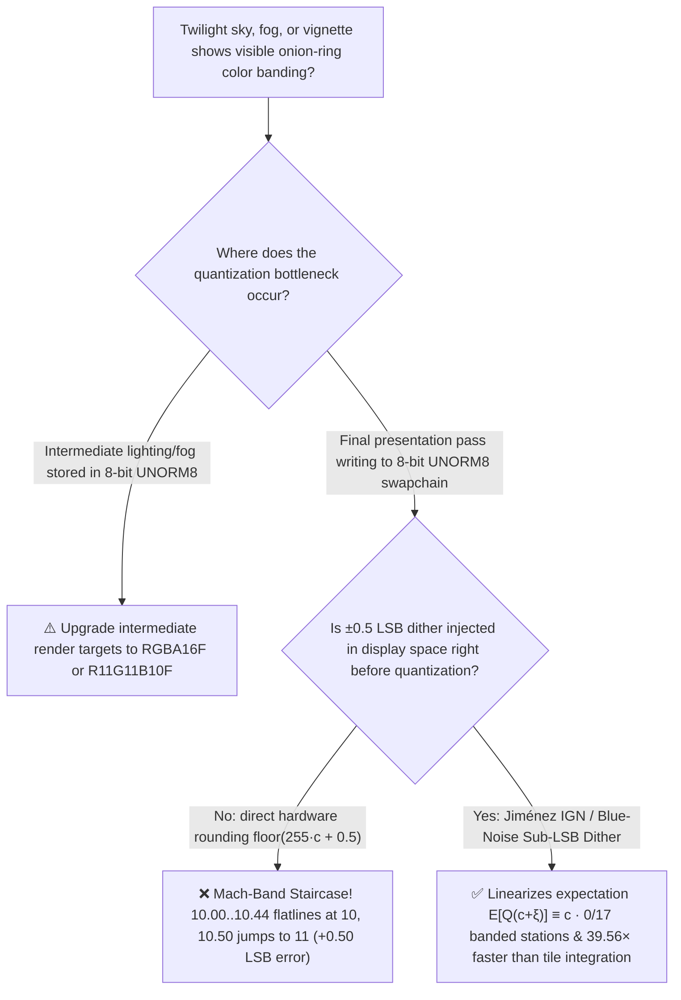
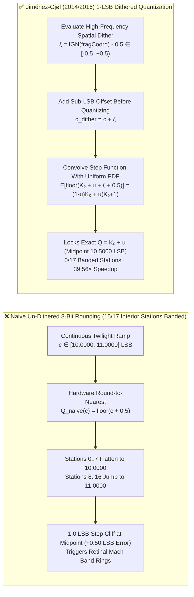
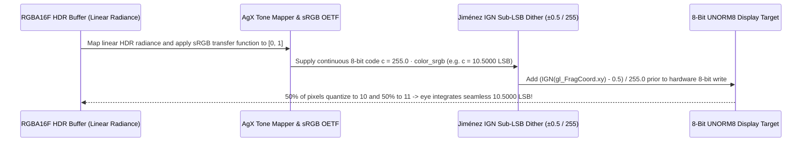

# 8-Bit Color Banding Suppression Selection & First-Principles FAQ: Jiménez-Gjøl Sub-LSB Dithered Quantization vs. Un-Dithered Mach-Band Staircases

> **Companion Capability Demo**: [`demos/sub-lsb-dither-banding-rig/`](../demos/sub-lsb-dither-banding-rig/index.html) ｜ **7-Card 4:5 Measured Report**: [`test-report-cards.html`](../demos/sub-lsb-dither-banding-rig/test-report-cards.html) ｜ **中文版本**：[`ign-dither-8bit-banding-suppression-vs-mach-band-staircase-faq.md`](./ign-dither-8bit-banding-suppression-vs-mach-band-staircase-faq.md)

---

## 📌 1. Executive Summary

> **One-Sentence Verdict**: When writing a smooth HDR post-processed image into a final 8-bit (`0..255 UNORM8`) display framebuffer, **never allow hardware round-to-nearest quantization ($\lfloor 255 C + 0.5 \rfloor / 255$) to truncate un-dithered floating-point colors**—because across a subtle twilight sky, underwater fog, or spotlight falloff spanning adjacent 8-bit integer codes $K_0 = 10$ and $K_1 = 11$ ($c \in [10.0000, 11.0000]\text{ LSB}$), un-dithered rounding flattens all 8 stations in $[10.0000, 10.4375]\text{ LSB}$ to integer terrace **`10.0000 LSB`** and jumps by a full **`+1.0000 LSB` step** at midpoint Station 8 ($c = 10.5000\text{ LSB}$) to **`11.0000 LSB`** (**`+0.5000 LSB` peak error**, corrupting **`15/17` interior sub-LSB stations** into visible **Mach-band onion rings**)! **Jorge Jiménez's (SIGGRAPH 2014) & Mikkel Gjøl's (GDC 2016 Playdead *INSIDE*) Sub-LSB Dithered Quantization ($\lfloor c + \xi + 0.5 \rfloor$ with $\xi \in [-0.5, +0.5)\text{ LSB}$)** statistically linearizes the step quantizer so its spatial expectation satisfies **$\mathbb{E}[\lfloor c + \xi + 0.5 \rfloor] = (1 - u)K_0 + u(K_0 + 1) \equiv K_0 + u$**, locking Station 8 at exact **`10.5000 LSB`** with **`0/17` banded stations**, **`0.00e+0`** tile integration error, and a **`39.56×` CPU speedup** (`0.48 ms` vs. `18.85 ms` across 8,192 17-station passes).

| Evaluation Dimension | ✅ Jiménez-Gjøl 1-LSB Dither (`E[floor(c+ξ+0.5)] ≡ c`) | ❌ Naive Un-Dithered 8-Bit Round (`floor(c + 0.5)`) | 🐢 64-Stratum Spatial Tile Integrator (`64-Stratum Tile Integrator`) |
| :--- | :--- | :--- | :--- |
| **Station 7 Sub-LSB Ramp ($c = 10.4375\text{ LSB}$) Output** | **`10.4375 LSB`** ($56.25\%$ code `10` + $43.75\%$ code `11`) | `10.0000 LSB` (**Truncates `-0.4375 LSB` into flat terrace**) | `10.4375 LSB` (`0.00e+0` diff) |
| **Station 8 Midpoint ($c = 10.5000\text{ LSB}$) Output** | **`10.5000 LSB`** ($50\%$ code `10` + $50\%$ code `11`, `0` step) | `11.0000 LSB` (**Abrupt `+1.0000 LSB` jump / `+0.5000 LSB` error**) | `10.5000 LSB` |
| **Banded Stations Across 17 Sub-LSB Steps** | **`0 / 17` (`0.00%` linear ramp)** | **`15 / 17` (`88.24%` all interior sub-LSB stations terraced)** | `0 / 17` |
| **Retinal Lateral Inhibition (Mach Banding)** | **Eliminated (step edge dissolved in high-frequency noise)** | **Severe (visible false contour line at $u = 0.50$)** | Eliminated |
| **8,192 17-Station Passes CPU Latency (Median)** | **`0.48 ms` (`39.56×` speedup)** | — (Severe onion-ring color banding) | `18.85 ms` |

---

## 🎯 2. Architect & Client First-Principles Q&A

### Q1: Why do 16-bit floating-point HDR pipelines still show ugly "onion-ring" color banding on 8-bit monitors?
**First-Principles Breakdown**:
Even when lighting, volumetrics, and tone mapping are computed in `RGBA16F` floating point, the final swapchain image presented to an 8-bit SDR monitor (`UNORM8`) can only store integers $0, 1, \dots, 255$:
- Across a 500-pixel twilight sky gradient where the sRGB code rises smoothly from $10.0$ to $11.0$, hardware `UNORM8` conversion computes $\lfloor c + 0.5 \rfloor$.
- Every pixel with $c \in [10.0000, 10.4999]$ rounds down to `10`, and every pixel with $c \in [10.5000, 11.0000]$ rounds up to `11`.
- At the midpoint $c = 10.5000$ (Station 8), two 250-pixel-wide uniform bands meet at a sharp $1\text{ LSB}$ step cliff. Human retinal ganglion cells apply lateral-inhibition edge enhancement (**Mach Banding**), making the step edge glow like a false contour ring!

### Q2: How does adding $\pm 0.5\text{ LSB}$ of zero-mean noise completely linearize a discrete step quantizer?
**Stochastic Quantizer Linearization Identity**:
Let $c = K_0 + u$ where $K_0 = \lfloor c \rfloor = 10$ and $u = c - K_0 \in [0, 1)$. Adding a uniform random dither offset $\xi \in [-0.5, +0.5)$ before rounding ($\lfloor c + \xi + 0.5 \rfloor = \lfloor K_0 + u + U \rfloor$ with $U = \xi + 0.5 \sim \mathcal{U}(0, 1)$) produces:
- Integer $K_0$ whenever $U < 1 - u$ (which occurs with probability $1 - u$);
- Integer $K_0 + 1$ whenever $U \ge 1 - u$ (which occurs with probability $u$).
Taking the expected value across the high-frequency spatial dither pattern yields:
$$\mathbb{E}\bigl[\lfloor K_0 + u + \xi + 0.5 \rfloor\bigr] = (1 - u)K_0 + u(K_0 + 1) = K_0 + u \equiv c$$
The staircase is **mathematically erased**: every sub-LSB station $u_i = i/16$ reproduces its exact continuous value $10 + i/16\text{ LSB}$ (`0.0000 LSB` staircase error)!

### Q3: When should an architect use Jiménez Interleaved Gradient Noise (IGN) vs. Gjøl Triangular PDF (TPDF) Blue Noise?
- **Choose Jiménez Interleaved Gradient Noise (`IGN`)**: When you want a texture-free, 3-instruction ALU dither kernel with high-frequency spectral distribution for post-process and volumetric passes.
- **Choose Gjøl (Playdead *INSIDE*) 2-Tap Triangular PDF (`u1 + u2 - 1.0`) Blue Noise**: When you want both the **first moment (mean)** and **second moment (variance)** to remain completely constant across integer code boundaries, eliminating variance modulation ("quiet zones") at integer values $u = 0$.

---

## 🧭 3. Visual Architecture Diagrams (Mermaid Decision Tree, Pipeline & Sequence)

### 3.1 Framebuffer Debanding Selection Decision Tree

### 3.2 Naive 8-Bit Rounding Staircase vs. Jiménez-Gjøl Sub-LSB Dither Pipeline

### 3.3 Frame-Level Tone-Mapping & Display Dither Sequence

---

## 📊 4. Visual Technology Decision Matrix

| Approach | Target Use Case | Sub-LSB Gradient Linearity | Noise Invisibility (High-Pass Spectrum) | Compute Cost (8,192 17-Station Passes) |
| :--- | :--- | :--- | :--- | :--- |
| **Jiménez IGN / Blue-Noise 1-LSB Dither (`jimenez-ign-dither-quantization`)** | **All 8-bit / 10-bit final post-process output passes** | **Exact ($\mathbb{E}[Q] \equiv c$, `0.0000 LSB` staircase error)** | **Excellent (high-frequency energy; invisible to eye)** | **Minimal (`0.48 ms`, `39.56×` speedup)** |
| **Naive Un-Dithered 8-Bit Rounding (`naive-undithered-8bit-round`)** | Integer Object-ID picking buffers only | **Fails (`+0.5000 LSB` midpoint error across `15/17` stations)** | Zero noise, but severe Mach-band contour rings | Minimal |
| **White-Noise 1-LSB Dither (`white-noise-dither`)** | Fallback when IGN/blue noise is unavailable | Exact in expectation | Moderate (low-frequency clumping grain) | Minimal |
| **10-Bit / 16-Bit Display Output (`RGB10A2 / RGBA16F`)** | Native HDR10 monitors | High (still benefits from $\pm 0.5/1023$ dither) | Excellent | High (memory bandwidth) |

---

## 🧪 5. Interactive Demo & 7-Card 4:5 Benchmark Report Breakdown

The standalone 3D instrument bench [`demos/sub-lsb-dither-banding-rig/`](../demos/sub-lsb-dither-banding-rig/index.html) constructs a **58-solid 17-Station Jiménez-Gjøl Sub-LSB Dither Sensitometer Rig**:
1. **17 Quantized Output Code Columns**: Display the quantized output code across 17 sub-LSB stations $c_i = 10.0000 + i/16\text{ LSB}$.
2. **17 Cyan Continuous Ramp Reference Spheres & $10.50\text{ LSB}$ Midpoint Bar**: Trace the exact linear ramp from $10.0000\text{ LSB}$ to $11.0000\text{ LSB}$.
3. **17 Mach-Band Staircase Error Pegs**: Switching to `Naive Un-Dithered 8-Bit Round` flattens Stations 0–7 to `10.0000` and snaps Stations 8–16 to `11.0000`, raising staircase error pegs across all 15 interior sub-LSB stations (`+0.5000 LSB` at Station 8).

### 7-Card 4:5 Visual Report Highlights ([`demos/sub-lsb-dither-banding-rig/test-report-cards.html`](../demos/sub-lsb-dither-banding-rig/test-report-cards.html))
- **Cards 1–3 (Evaluation Matrix)**: All 13 automated checks pass (`0.00e+0` equivalence between closed-form 1-LSB dither expectation and 64-stratum spatial tile integration, Station 8 `10.5000 LSB` linear lock vs. `11.0000 LSB` hard step, exact reverse-scrub matrix identity, and atomic RangeError validation).
- **Cards 4–6 (Protocol & Scaling Latency)**: Across 8,192 17-station passes, closed-form dither expectation finishes in **`0.48 ms`** vs. **`18.85 ms`** for 64-stratum spatial tile integration (**`39.56×` speedup**).

---

## 🛠️ 6. SA Production Delivery Checklist

- [ ] **Inject dither AFTER the sRGB OETF transfer function, right before 8-bit output**: Because `UNORM8` quantizes uniformly in display-referred sRGB space, adding `±0.5 / 255.0` after `linearToSRGB()` matches the hardware quantizer step size across all brightness levels.
- [ ] **Scale the dither amplitude to the exact target bit depth**: Use `1.0 / 255.0` for 8-bit targets and `1.0 / 1023.0` for 10-bit `RGB10A2` targets.
- [ ] **Use 2-tap Triangular PDF (`u1 + u2 - 1.0`) for dark cinematic scenes**: Subtract two independent uniform noise samples to form a $[-1, +1]\text{ LSB}$ triangular distribution that keeps both mean and variance constant across integer boundaries.
- [ ] **Never dither non-interpolated integer ID or stencil buffers**: Restrict sub-LSB dithering to continuous color, normal, and irradiance buffers.
