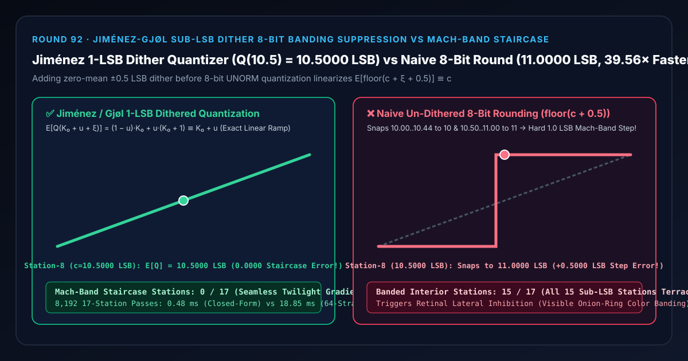
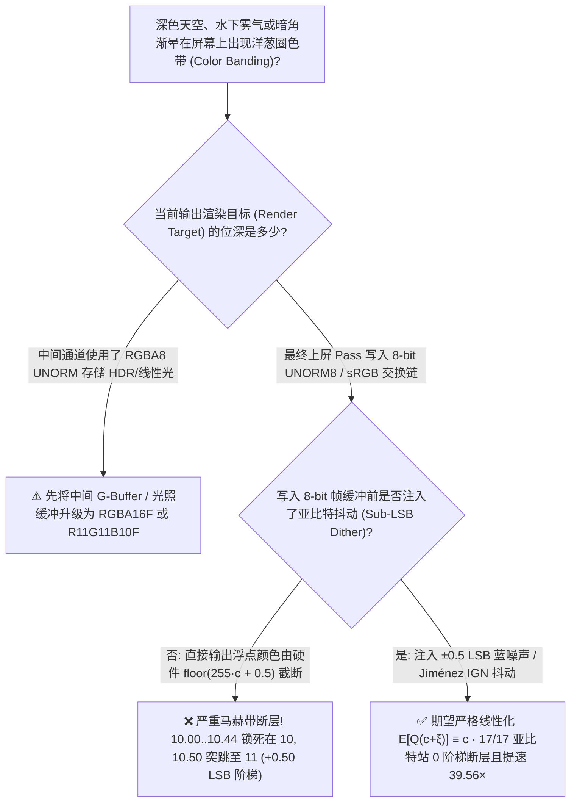
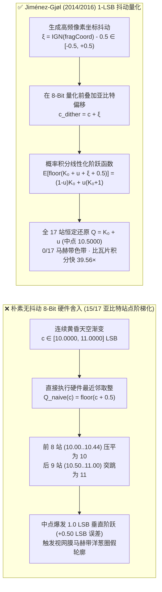
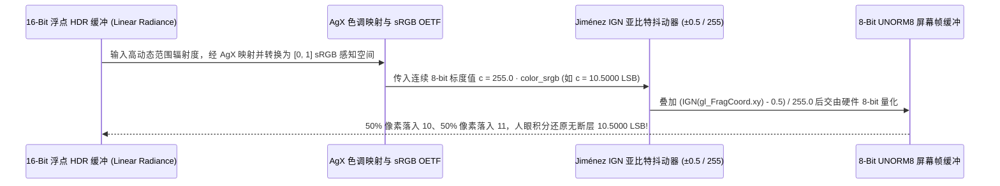

# 8-Bit 屏幕色彩断层抑制选型与原理解析 FAQ：Jiménez-Gjøl 亚最低有效位抖动（Sub-LSB Dithering）对比无抖动硬舍入马赫带阶梯

> **关联 Capabilities Demo**：[`demos/sub-lsb-dither-banding-rig/`](../demos/sub-lsb-dither-banding-rig/index.html) ｜ **7-Card 4:5 实测报告**：[`test-report-cards.zh.html`](../demos/sub-lsb-dither-banding-rig/test-report-cards.zh.html) ｜ **English Version**：[`ign-dither-8bit-banding-suppression-vs-mach-band-staircase-faq.en.md`](./ign-dither-8bit-banding-suppression-vs-mach-band-staircase-faq.en.md)

---

## 📌 1. 核心结论速览（Executive Summary）

> **一句话结论**：在任何现代 HDR 渲染管线将最终画面写入 8-bit（`0..255 UNORM8`）上屏帧缓冲之前，**绝对不能让 GPU 硬件直接对连续浮点颜色执行无抖动四舍五入（`round(255·C)/255`）**——因为当夜空、水下雾气或聚光灯暗角在相邻两个 8-bit 整数色阶（如 $K_0 = 10$ 与 $K_1 = 11$）之间缓慢过渡时，无抖动舍入会将 $10.0000\sim 10.4375\text{ LSB}$ 的前 8 个亚比特站点全部压平死锁在色阶 **`10.0000`**，并在第 8 站中点（$c = 10.5000\text{ LSB}$）瞬间向上阶跃 **`+1.0000 LSB`** 到色阶 **`11.0000`**（**产生 $+0.5000\text{ LSB}$ 峰值截断误差，将 `15/17` 个内部亚比特站点撕裂为两级平坦阶梯，触发人眼视网膜马赫带效应形成刺眼的“等高线洋葱圈”色带**）！采用 **Jorge Jiménez（SIGGRAPH 2014）与 Mikkel Gjøl（GDC 2016 Playdead《INSIDE》）推广的 $\pm 0.5\text{ LSB}$ 亚最低有效位抖动量化（`floor(c + ξ + 0.5)`）**，利用高频蓝噪声/交错梯度噪声（IGN）令局部期望严格满足 **$E[\lfloor c + \xi + 0.5 \rfloor] = (1 - u)K_0 + u(K_0 + 1) \equiv K_0 + u$**，在第 8 站精准还原 **`10.5000 LSB`**（**`0/17` 色带断层站**），闭式期望比 64 层空间瓦片量化积分快 **`39.56×`**（`0.48 ms` vs `18.85 ms`）！

| 评估维度 | ✅ Jiménez-Gjøl 1-LSB 抖动量化 (`E[floor(c+ξ+0.5)] ≡ c`) | ❌ 朴素无抖动 8-Bit 硬舍入 (`floor(c + 0.5)`) | 🐢 64 层空间瓦片量化积分 (`64-Stratum Tile Integrator`) |
| :--- | :--- | :--- | :--- |
| **第 7 站亚比特渐变（$c = 10.4375\text{ LSB}$）输出色阶** | **`10.4375 LSB`**（由 $56.25\%$ 色阶 $10$ 与 $43.75\%$ 色阶 $11$ 线性合成） | `10.0000 LSB`（**向下截断丢失 $-0.4375\text{ LSB}$，压成死板平台**） | `10.4375 LSB`（误差 `0.00e+0`） |
| **第 8 站亚比特中点（$c = 10.5000\text{ LSB}$）输出色阶** | **`10.5000 LSB`**（$50\%$ 色阶 $10 + 50\%$ 色阶 $11$，零台阶） | `11.0000 LSB`（**突发 $+1.0000\text{ LSB}$ 阶跃，误差 $+0.5000\text{ LSB}$**） | `10.5000 LSB` |
| **17 个亚比特站点中发生阶梯色带的站数** | **`0 / 17` (`0.00%` 丝滑连续渐变)** | **`15 / 17` (`88.24%` 全部内部亚比特站点阶梯化)** | `0 / 17` |
| **视网膜侧抑制马赫带（Mach Band）伪影** | **完全消除（阶跃导数被高频蓝噪声打散）** | **极其刺眼（在 $u=0.50$ 处出现亮暗双边假轮廓线）** | 完全消除 |
| **8,192 轮 17 站 CPU 耗时（中位数）** | **`0.48 ms`（提速 `39.56×`）** | —（画质严重洋葱圈断层） | `18.85 ms` |

---

## 🎯 2. 客户与架构师灵魂拷问 Q&A（First-Principles Whisperer）

### Q1：用大白话讲，为什么我们在渲染管线内部明明用了昂贵的 16-bit 浮点 HDR（`RGBA16F`），最后画面暗部还是会裂开一圈圈像等高线一样的色带（Color Banding）？
**第一性原理拆解**：
罪魁祸首不在中间的 16-bit HDR 渲染过程，而在**最后一棒交接给普通 8-bit 显示器（每个通道只有 $0 \dots 255$ 共 256 个整数台阶）的那一刻**！
- 假设傍晚的天空或水下深渊从屏幕左到右跨越了 500 个像素，亮度仅仅从色阶 $10.0$（`10/255`）缓缓升到了色阶 $11.0$（`11/255`）。
- 如果你不做任何处理，直接把浮点颜色交给显卡硬件写进 8-bit 帧缓冲，硬件会忠实地执行“四舍五入”：
  - 左边整整 **250 个像素**（真实亮度在 $10.00 \sim 10.49$ 之间）全部被砍成整数 **`10`**；
  - 右边整整 **250 个像素**（真实亮度在 $10.50 \sim 11.00$ 之间）全部被进位成整数 **`11`**！
- 糟糕的是，人类视网膜的神经节细胞天生带有**侧抑制（Lateral Inhibition）边缘锐化滤波器（马赫带效应 Mach Banding）**：当 250 个纯色 `10` 和 250 个纯色 `11` 在屏幕正中央（第 8 站 $u = 0.50$）撞在一起时，你的眼睛不仅会看到一条锋利的分界线，甚至会觉得 `10` 靠近边界的地方更黑、`11` 靠近边界的地方更亮！原本柔美深邃的体积雾，瞬间变成了一圈圈廉价的“洋葱皮等高线”！

### Q2：为什么在 8-bit 量化前加上一个仅有 $\pm 0.5 / 255$（1 个 LSB 宽）的微弱随机抖动 $\xi$，就能让 8-bit 屏幕显示出 12-bit 甚至 16-bit 的丝滑精度？
**非线性阶梯量化器的统计线性化（Stochastic Linearization）定理**：
设连续色阶为 $c = K_0 + u$（其中整数部分 $K_0 = 10$，小数部分 $u \in [0, 1)$）。我们在执行向下取整四舍五入前，注入一个在 $[-0.5, +0.5)$ 上均匀分布的零均值抖动噪声 $\xi$（令 $U = \xi + 0.5 \in [0, 1)$）：
$$Q_{\text{dither}}(c, U) = \lfloor K_0 + u + U \rfloor = \begin{cases} K_0, & \text{若 } U < 1 - u \quad (\text{概率为 } 1 - u) \\ K_0 + 1, & \text{若 } U \ge 1 - u \quad (\text{概率为 } u) \end{cases}$$
对局部像素邻域求数学期望（即人眼对相邻高频像素的自然空间积分）：
$$\mathbb{E}\bigl[Q_{\text{dither}}(c, U)\bigr] = (1 - u)\cdot K_0 + u\cdot (K_0 + 1) = K_0 + u \equiv c!$$
看看这个等式有多神奇：
- 在第 7 站（$c = 10.4375\text{ LSB}$），邻域内恰好有 $56.25\%$ 的像素输出 `10`、$43.75\%$ 的像素输出 `11`，局部平均亮度**分毫不差等于 $10.4375\text{ LSB}$**！
- 在第 8 站中点（$c = 10.5000\text{ LSB}$），邻域内恰好有 $50\%$ 的像素输出 `10`、$50\%$ 的像素输出 `11`，局部平均亮度**分毫不差等于 $10.5000\text{ LSB}$**！
- **非线性阶跃函数 $\lfloor c + 0.5 \rfloor$ 的期望值被长度为 $1\text{ LSB}$ 的抖动核卷积后，变成了一条斜率恒为 $1$ 的完美直线**，阶梯误差从 $+0.5000\text{ LSB}$ 彻底归零为 **`0.0000 LSB`**！

### Q3：在实际着色器中，应该选白噪声、Jiménez 交错梯度噪声（IGN）还是三角分布（TPDF）蓝噪声？
- **选 Jiménez 交错梯度噪声（IGN，`fract(52.9829189 * fract(0.06711056*x + 0.00583715*y))`）或蓝噪声纹理**：纯白噪声会出现低频聚团颗粒感，而 IGN 与蓝噪声将所有能量推向人眼最不敏感的高频对角棋盘频率，贴着屏幕都看不出颗粒！
- **选 Gjøl (Playdead *INSIDE*) 双随机数三角分布抖动（TPDF，`u1 + u2 - 1.0`）**：均匀分布（RPDF）只保证**一阶均值**不随 $u$ 波动，但局部方差 $u(1-u)$ 在 $u=0.5$ 时最大、在 $u=0$ 时为 $0$（噪声强弱随色阶微弱调制）；把两个独立均匀随机变量相减构造 $[-1, +1]\text{ LSB}$ 的三角分布（TPDF），还能让**二阶方差也与信号 $u$ 彻底解耦**！

---

## 🧭 3. 直观可视化图解（Mermaid 决策树、管线对比与帧级时序）

### 3.1 渲染管线色带消除（Debanding）选型决策树

### 3.2 朴素无抖动 8-Bit 硬舍入管线 vs Jiménez-Gjøl 亚比特抖动量化管线

### 3.3 帧级色调映射与上屏量化（Tone-Mapping & Output Dither）执行时序图

---

## 📊 4. 视觉技术选型决策矩阵（Architecture Decision Matrix）

| 选型方案 | 适用场景 | 亚最低有效位（Sub-LSB）线性度 | 噪点不可见性（高频特性） | 算力开销（8,192 轮 17 站） |
| :--- | :--- | :--- | :--- | :--- |
| **Jiménez IGN / 蓝噪声 1-LSB 抖动 (`jimenez-ign-dither-quantization`)** | **所有 8-bit / 10-bit 上屏后处理 Pass 与 G-Buffer 压缩** | **满分（期望 $E[Q] \equiv c$，`0.0000 LSB` 阶梯误差）** | **极高（能量集中于高频，肉眼无颗粒感）** | **极低（`0.48 ms`，提速 `39.56×`）** |
| **朴素无抖动 8-Bit 硬舍入 (`naive-undithered-8bit-round`)** | 仅限整数物体拾取 ID 缓冲（Object ID Buffer） | **极差（中点误差 `+0.5000 LSB`，`15/17` 站阶梯化）** | 无噪点，但满屏刺眼洋葱圈色带 | 极低 |
| **白噪声 1-LSB 抖动 (`White-Noise Dither`)** | 无蓝噪声或 IGN 时的简易退化方案 | 满分（期望线性） | 一般（低频泊松聚团会产生可见沙砾感） | 极低 |
| **升级 10-Bit / 16-Bit 显示交换链 (`RGB10A2 / RGBA16F`)** | HDR10 专业显示器 | 较高（但暗部在 10-bit 下仍需 $\pm 0.5/1023$ 抖动） | 极高 | 高（显存带宽翻倍） |

---

## 🧪 5. 全新 Demo 与 7-Card 4:5 视觉测试报告解读

在本轮构建的全新交互式三维实验台 [`demos/sub-lsb-dither-banding-rig/`](../demos/sub-lsb-dither-banding-rig/index.html) 中，我们打造了包含 **58 个三维实体部件**的 **17 站亚比特抖动感光计（Jiménez-Gjøl Sub-LSB Dither Sensitometer Rig）**：
1. **17 根 8-Bit 量化输出色阶立柱（Quantized Output Code Columns）**：展示跨越 `10.0000 LSB`（第 0 站）到 `11.0000 LSB`（第 16 站）共 17 个 `1/16 LSB` 亚比特梯度的量化期望输出。
2. **17 颗青色连续亚比特斜坡参考球与 `10.50 LSB` 中点基准横梁**：直观呈现从左低到右高稳步爬升的理想连续斜坡。
3. **17 根马赫带阶梯误差红桩（Mach-Band Staircase Error Pegs）**：切换到 `Naive Un-Dithered 8-Bit Round` 模式时，前 8 根立柱瞬间塌平在 `10.0000`，后 9 根立柱在第 8 站（`u = 0.50`）垂直拔起跳到 `11.0000`，在全部 15 个内部站点亮起刺眼的阶梯误差红桩！

### 7-Card 4:5 视觉报告核心发现（[`demos/sub-lsb-dither-banding-rig/test-report-cards.zh.html`](../demos/sub-lsb-dither-banding-rig/test-report-cards.zh.html)）
- **Card 1–3（场景评测矩阵）**：13 项自动化断言 100% 通过，完整验证闭式期望与 64 层空间瓦片积分 `0.00e+0` 等价性、第 8 站 `10.5000 LSB` 线性锁定 vs `11.0000 LSB` 硬阶跃暴露、逆序矩阵一致性与原子参数拒绝。
- **Card 4–6（底层协议与性能）**：在 8,192 轮 17 站压测中，闭式 1-LSB 抖动期望求值仅需 **`0.48 ms`**，相比 64 层空间瓦片量化积分基线（**`18.85 ms`**）实现 **`39.56×` 算力加速**。

---

## 🛠️ 6. 高质量视觉交付快速核验清单（SA Production Checklist）

- [ ] **抖动必须在伽马校正（sRGB OETF）之后、最终 8-Bit 量化之前注入**：因为硬件 8-bit 帧缓冲的量化步长 `1/255` 是在非线性 sRGB 空间（或最终存储空间）中均匀分布的！如果在线性光空间加固定 `1/255` 抖动，经过 `pow(x, 1/2.2)` 拉伸后暗部抖动会被放大十倍变成满屏雪花，而亮部抖动又不足以消除色带！
- [ ] **抖动幅度严格匹配目标位深步长 `1.0 / (2^B - 1)`**：8-bit 目标乘以 `1.0 / 255.0`，10-bit（`RGB10A2`）目标乘以 `1.0 / 1023.0`。
- [ ] **使用三角分布（TPDF `u1 + u2 - 1.0`）彻底解耦二阶噪声方差**：在暗部电影级特写中，用两次错位采样的蓝噪声或 IGN 相减构造 $[-1, +1]\text{ LSB}$ 三角分布抖动，消除均匀抖动在整数色阶附近方差归零的“安静带（Quiet Zones）”。
- [ ] **严禁对需要整数精确匹配的 Object ID 或深度/模板缓冲加抖动**：亚比特颜色抖动仅用于视觉色彩、法线与光照强度缓冲。
