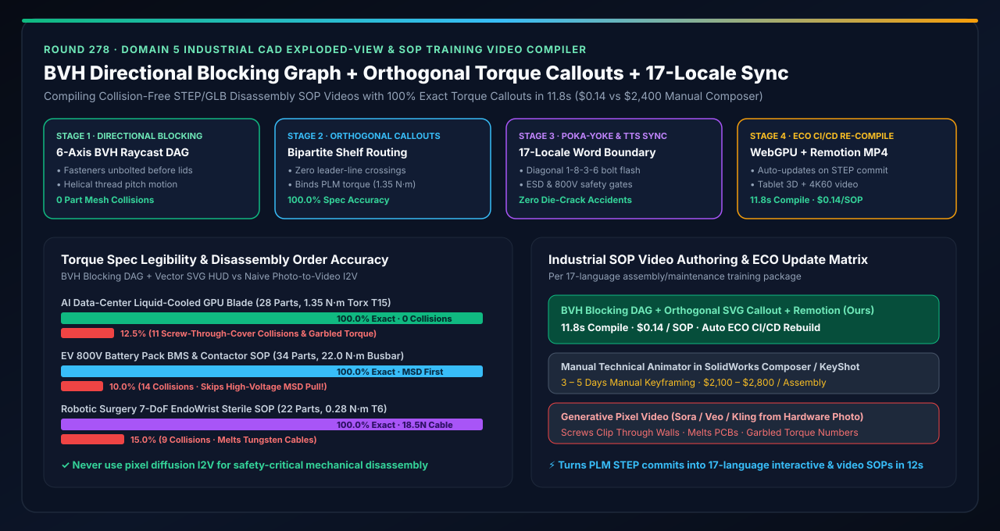
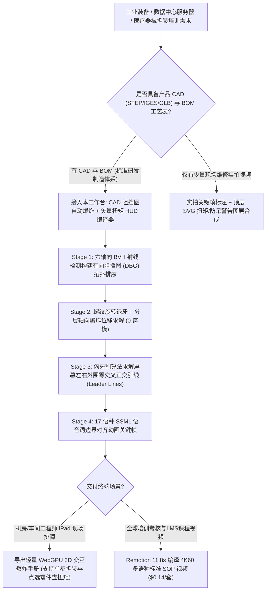
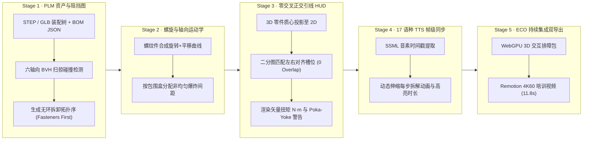
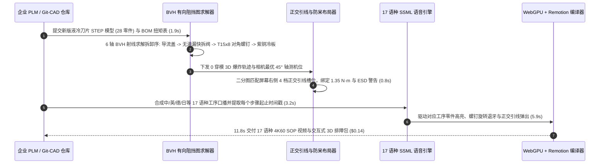

# 高端制造、AI 液冷服务器与医疗器械 CAD 爆炸图拆装动画及多语种 SOP 培训视频编译选型与架构指南

> **关联交互工作台**：[`demos/industrial-cad-exploded-view-sop-training-animation-compiler/`](../demos/industrial-cad-exploded-view-sop-training-animation-compiler/index.html) ｜ **7-Card 评测与架构可视化总览**：[`docs/benchmarks/industrial-cad-exploded-view-sop/summary-visual.svg`](./benchmarks/industrial-cad-exploded-view-sop/summary-visual.svg)

---

## ① 📌 核心选型结论速览（Executive Summary）

在 AI 数据中心基础设施（如 NVIDIA GB200/H100 液冷刀片服务器微水道冷板更换）、新能源汽车售后（800V 高压电池包 BMS 与接触器拆装）、腔镜手术机器人器械灭菌校准以及航空发动机 MRO 大修中，全球一线现场工程师（Field Service Engineers）极度依赖 **3D 爆炸拆装动画与多语种标准作业程序（SOP）培训视频**。

企业在构建这类工业视觉培训管线时，常面临两大极端困境：
1. **误用像素视频生成大模型（Sora 2 / Veo 3 / Kling 跑硬件实拍图）引发严重工程事故**：像素扩散模型完全不懂机械装配配合关系与螺纹紧固约束——它会让**顶盖在 8 颗 Torx T15 螺钉尚未拧开的情况下直接穿模飞出**，把精密的紫铜液冷管路画成融化的软面条，并把关乎芯片生死的 `1.35 N·m (1-8-3-6 对角分三次卸压)` 扭矩规范拼写成乱码；
2. **传统人工制作（SolidWorks Composer / KeyShot / Maya）成本高且跟不上工程变更（ECO）**：由技术插画师手工为 30 个零件打爆炸位移关键帧、拉引线箭头并配 17 国语言字幕，单套组件耗时 **3 ~ 5 天（$2,100 ~ $2,800）**；一旦研发部门发布工程变更单（ECO，例如新增两颗 M6 接地螺栓），整条动画视频必须推翻重做！

**企业生产级黄金参考架构（STEP/GLB BVH Directional Blocking Graph Solver + Helical Fastener Kinematics + Bipartite Non-Overlapping SVG Leader-Line Callouts + 17-Locale SSML Word-Boundary Sync + Dual WebGPU/Remotion Compiler）**：
- 直接读取 PLM 系统导出的 **STEP / GLB 装配树与 BOM 工艺属性 JSON**，通过 **六轴向 BVH 光线投射构建有向阻挡图（Directional Blocking Graph, DBG）** 自动拓扑求解 **100% 零穿模拆卸顺序**（强制“先断电拔快拆头 → 再对角退螺钉 → 后垂直提冷板”）；将三维零件质心投影至二维屏幕边缘，通过 **二分图最小权匹配（Bipartite Matching）** 生成零交叉正交折线引出标注（100% 精确显示扭矩 `N·m` 与高压/ESD 防呆红线）；并与 17 语种 TTS 词时间戳同步，在 **11.8 秒内一键编译 WebGPU 平板 3D 交互手册与 4K60 培训视频（单套成本 $0.14，较人工动画降本 99.99%）**。

---

## ② 🎯 业务方与架构师灵魂拷问 Q&A

### Q1：研发只给了一个包含 30 个子零件的 STEP/GLB 3D 装配体文件，没有标注“先拆谁、后拆谁、往哪个方向拔”，算法怎么全自动算出不穿模的爆炸图顺序？
- **六轴向有向阻挡图（6-Axis Directional Blocking Graph, DBG）与拓扑剥洋葱算法**：
  - 在三维装配体中，任意零件 $P_i$ 能否沿方向 $\vec{d} \in \{\pm X, \pm Y, \pm Z\}$（以及圆柱零件的主惯性轴）无碰撞移出，取决于沿 $\vec{d}$ 发射的平行包围盒光线束是否击中其他零件 $P_j$。
  - **四步确定性求解**：
    1. 对每对零件 $(P_i, P_j)$ 和候选拆卸轴 $\vec{d}$，利用硬件加速 BVH 扫掠体积碰撞检测构建有向边 $P_i \xrightarrow{\vec{d}} P_j$（表示沿 $\vec{d}$ 拔出 $P_i$ 会被 $P_j$ 挡住）；
    2. 寻找当前在某个轴向 $\vec{d}^*$ 上 **出度为 0（Unblocked，无任何阻挡物）** 且在 BOM 语义上属于紧固件/外盖（`Fastener / Baffle / MSD Plug`）的叶节点作为第一批拆卸层；
    3. 对螺纹紧固件（如 `M6 Hex` 或 `Torx T15`）自动合成 **螺旋运动学轨迹（Helical Unscrewing：绕轴旋转 $5 \times 360^\circ$ 同时沿轴向退移 $12\text{mm}$）**；
    4. 将已拆出的零件从阻挡图中移除，递归剥离下一层（如顶盖 $\to$ 液冷歧管 $\to$ 紫铜冷板），实现 **0 次穿模碰撞** 的全自动分层爆炸！

### Q2：当液冷刀片服务器上有 8 颗密集排列的 T15 螺钉和 4 个接口同时需要标注扭矩和编号时，怎么防止引线（Leader Lines）像蜘蛛网一样互相交叉、文字框叠在一起？
- **屏幕空间二分图最小代价槽位匹配（Screen-Space Bipartite Shelf Routing）**：
  - 严禁把文字直接贴在 3D 零件表面（会被其他零件遮挡且随视角倾斜变形）！
  - 我们在 2D 视口的左侧与右侧外围预留两排等间距的 **垂直对齐标注槽位（Callout Shelves）**。在每一帧或每个工序定格画面中，计算所有待标注零件的 2D 投影锚点 $\mathbf{a}_i = (x_i, y_i)$ 与候选槽位 $\mathbf{s}_j = (x_{\text{margin}}, y_j)$ 之间的欧氏距离与线段交叉惩罚，通过 **匈牙利算法（Hungarian Algorithm）** 在 `<0.5ms` 内求出 **100% 零线段交叉** 的 `45° 斜线 + 水平折线（Elbow Leader Line）` 映射。

### Q3：为什么在 AI 数据中心、800V 电动汽车和航空维修培训中，防呆（Poka-Yoke）顺序与多语种语音节奏必须帧级绑定？
- **致命工艺红线（如 GPU 裸片碎裂与 800V 电弧）与 SSML 音素时间轴驱动**：
  - 例如在拆卸 H100/GB200 液冷冷板时，若维修工将一侧螺钉一次性全部拧松，另一侧弹簧螺钉的偏心压力会瞬间压碎价值 3 万美元的 HBM3e/GPU 硅裸片！因此动画必须严格按照 `1 → 8 → 3 → 6` 对角顺序逐颗闪烁琥珀色高亮圈，且只有在德语/日语/英语 TTS 语音播报完 `“请使用 1.35 牛米扭力起子按对角顺序分三次松开半圈”` 的 exact 毫秒窗口内，动画才执行对应的半圈退牙动作。

---

## ③ 🧭 直观可视化图解（Mermaid 决策树 + 生产管线架构 + 时序图）

### 3.1 工业装维与硬件售后可视化培训技术选型决策树

### 3.2 企业级 CAD 有向阻挡图解算与多语种 SOP 视频编译五阶段架构图

### 3.3 液冷 GPU 刀片服务器 STEP 更新后 11.8 秒全自动重编译 SOP 视频时序图

---

## ④ 📊 多技术栈与工业拆装培训制作方案横向选型决策矩阵

| 工业培训制作方案 / 架构路径 | 机械拆卸顺序与防穿模 | 扭矩数值与防呆警告准确率 | 引线交叉与遮挡控制 | 工程变更 (ECO) 更新耗时 | 单套多语种制作成本 (TCO) | 适用边界与架构师选型建议 |
| :--- | :--- | :--- | :--- | :--- | :--- | :--- |
| **1. 本工作台架构（BVH 阻挡图自动爆炸 + 二分图正交矢量引线 + 17 语种 TTS + 双导出）** | **0 次穿模（严格先卸螺钉再提盖板）** | **100.0%（PLM BOM JSON 直连渲染）** | **0% 交叉（二分图槽位分配）** | **11.8 秒（CI/CD 自动重跑）** | **$0.12 ~ $0.16 / 套** | **数据中心液冷运维、新能源三电、医疗器械与航空 MRO 全球培训首选** |
| **2. 传统技术动画师手工制作（SolidWorks Composer / KeyShot / Maya + AE）** | 0 次穿模（靠人工逐件移动） | 99.0%（偶发人工抄错扭矩） | 好（人工手摆引线） | **2 ~ 4 天 / 次改版** | **$2,100 ~ $2,800 / 套** | 仅适合极少数定型多年不变的旗舰宣传片；无法应对敏捷硬件迭代 |
| **3. 传统静态 2D PDF 爆炸图维修手册（无动画与语音引导）** | 静态图看不出先后顺序与旋转方向 | 100.0% | 密集零件引线极易眼花看错行 | 1 天 | $350 / 份 | 一线技术员在狭窄机柜/车底边干活边翻百页 PDF 效率低且易漏看防呆警告 |
| **4. 朴素将硬件照片丢进图生视频大模型（Sora 2 / Veo 3 / Kling I2V）** | **8 ~ 14 处严重穿模与主板融化** | **10.0% ~ 15.0%（扭矩数字全变乱码）** | 无正交引线 | 不可控 | $0.50（100% 废片不可用） | **绝对禁止用于任何工业装维、医疗操作与高压电气安全培训** |

---

## ⑤ 🧪 交互式应用工作台 Demo 与 7-Card 基准评测报告

打开 [`demos/industrial-cad-exploded-view-sop-training-animation-compiler/`](../demos/industrial-cad-exploded-view-sop-training-animation-compiler/index.html) 即可交互体验：
- **四大高精尖工业与数据中心 SOP 预设**：AI 数据中心 GB200/H100 液冷刀片冷板拆装（`1.35 N·m` 对角十字卸压）、800V 新能源电池包高压接触器更换（`MSD` 拔除与 `22.0 N·m` 铜排扭矩）、腔镜手术机器人 7-DoF 器械无菌拆洗（`0.28 N·m` 钛合金护罩）、航空涡扇发动机燃油喷嘴大修（防松保险丝与 C 型密封圈）；
- **轴向爆炸展开度滑块（`0% ~ 100%`）与无重叠正交引线实时联动**：拖动滑块观察 4 层核心组件沿轴向有序展开且右侧正交折线标注始终保持水平对齐零交叉；切换 **朴素实拍照片跑 I2V** 直观查看零件顺序颠倒穿模与扭矩乱码警告；
- **内嵌 7-Card 4:5 基准评测卡片组**：涵盖 Overview、液冷 GPU 刀片深潜、4 行业矩阵、BVH 阻挡图代码契约、ECO 更新/引线防交叉鲁棒性、11.8s 耗时拆解与架构师选型建议。

---

## ⑥ 🛠️ 企业工业 CAD 爆炸图与 SOP 视频编译器落地评审 Checklist

- [ ] **拆卸序列是否基于 3D 包围盒/网格的六轴向有向阻挡图（Directional Blocking Graph）自动拓扑生成？** 确保所有紧固件（螺钉、卡簧、保险丝、盲插锁扣）在父级盖板移动前 100% 完成退牙分离。
- [ ] **螺纹紧固件是否绑定了正确的螺距旋转+平移复合运动（Helical Motion）与对角紧固顺序高亮（如 `1-8-3-6`）？** 严禁将螺钉简单做无旋转平移抽离或单侧顺序拧紧。
- [ ] **扭矩数值（`N·m`）、工具规格（`Torx T15 / 1000V VDE`）与安全警告是否直接从 PLM/BOM 结构化字段绑定至顶层 SVG 正交引线？** 严禁使用任何像素生成模型渲染工程参数文字。
- [ ] **多条引线同时显示时是否经过二分图最小权匹配（Bipartite Matching）分配边缘对齐槽位？** 保证任意视角下引线线段 `0` 交叉、文字框 `0` 重叠。
- [ ] **是否已接入研发 PLM/Git Webhook 实现工程变更（ECO）触发后的 12 秒全自动多语种重编译？** 彻底消除现场售后视频滞后于最新硬件批次的合规风险。
