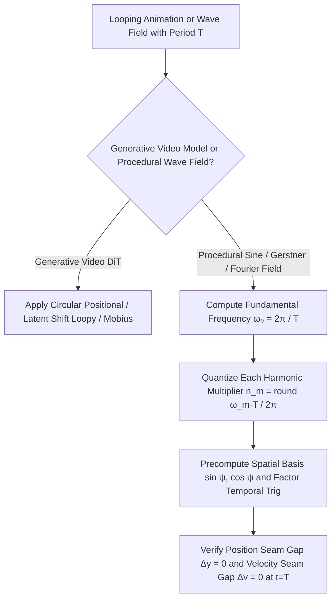
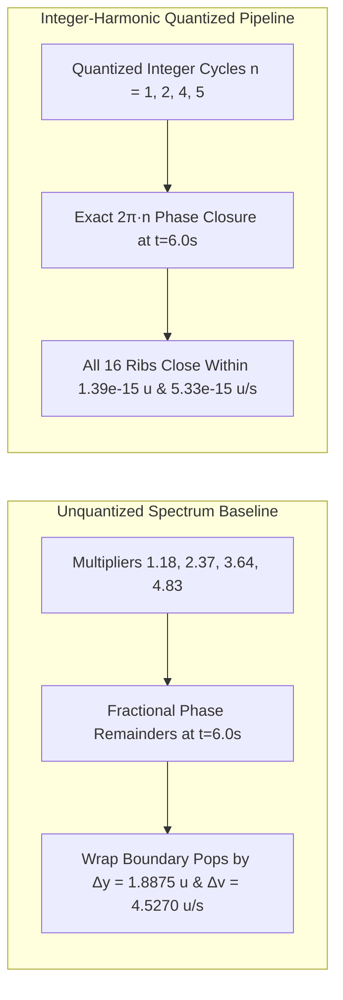
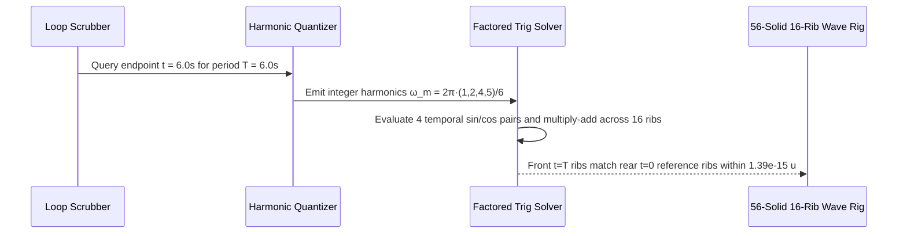

# Seamless looping waves without seam pops: integer-harmonic frequency quantization vs unquantized spectrum drift FAQ

**Understand in 3 minutes why ambient waves and looping videos pop when wrapping from $t=T$ to $t=0$, and reproduce a $C^\infty$ phase-locked 16-rib wave oscillator in 10 minutes.**

[中文](integer-harmonic-loop-faq.md) · [Interactive Demo](https://turbo998.github.io/animation/demos/seamless-loop-oscillator/) · [Measured 7-Card Report](../demos/seamless-loop-oscillator/test-report-cards.html)

## ① 📌 Executive Summary

- **Layering non-integer frequencies over a finite loop period $T$ guarantees a position and velocity discontinuity when wrapping $t = T \to 0$.** Using unquantized frequency multipliers `(1.18, 2.37, 3.64, 4.83)` over `T = 6.0 s` causes the 16 wave ribs to jump by `1.8875` scene units in position and `4.5270 u/s` in velocity at the loop boundary.
- **Quantizing every angular frequency to an integer multiple of the fundamental $\omega_m^* = \frac{2\pi n_m}{T}$ ($n_m \in \mathbb{Z}^+$) achieves exact $C^\infty$ loop closure.** With integer harmonics `n = (1, 2, 4, 5)`, maximum position seam gap across all 16 ribs drops to `1.39e-15` scene units and maximum velocity seam gap drops to `5.33e-15 u/s` (floating-point rounding).
- **Pre-factoring the spatial and temporal trigonometric bases runs `3.59×` faster than per-rib `Math.sin` calls while agreeing within `1.11e-15` scene units.** Across 8192 16-rib frames on Node CPU, the factored basis takes `19.16 ms` median versus `68.78 ms` for direct evaluation.
- **56-solid 16-rib wave oscillator, 13 local acceptance checks.** Scene geometry is `synthetic`; boundary closure and Node CPU timings are `measured`; `Loopy` / `Mobius` video diffusion latent shifting is `not_measured`.

**Daily capability direction check:** ACM TOG 2026 paper *Loopy: Seamless Video Loop Generation via Anchored Looping Shift of Positional Embedding* ([arXiv:2608.23090](https://arxiv.org/abs/2608.23090), submitted 2026-08-24) and *Mobius: Text to Seamless Looping Video Generation via Latent Shift* ([arXiv:2502.20307](https://arxiv.org/abs/2502.20307), submitted 2025-02-27) transform linear temporal representations into closed circles inside video diffusion models to eliminate seam pops. In procedural shaders, vertex waves, and exported WebM loops, the exact algebraic counterpart of turning the timeline into a circle is quantizing every frequency to an integer multiple of $\omega_0 = 2\pi / T$. Verified 2026-11-10; this demo implements deterministic integer-harmonic quantization and factored basis evaluation without running video diffusion models.

## ② 🎯 Architect & Client Q&A

### Q1 When should we choose looping video diffusion models vs deterministic integer-harmonic quantization?

Evaluate looping video diffusion models (`Loopy`, `Mobius`) when generating photorealistic natural phenomena (campfires, waterfalls, clouds) from text prompts.

Use deterministic integer-harmonic quantization $\omega_m^* = \frac{2\pi}{T}\text{round}\left(\frac{\omega_m T}{2\pi}\right)$ whenever authoring **procedural WebGL ocean/flag waves, floating 3D hero props, ambient UI motion, or offline-encoded WebM / GIF loops**—because it guarantees zero boundary pop at any spatial resolution with zero neural inference cost.

### Q2 Under what constraints is integer-harmonic quantization strictly superior to tail cross-fading?

A common workaround for a non-looping animation is cross-fading or linearly blending the last `0.5 s` with the first `0.5 s`.

On oscillating waves or pendulums, linear cross-fading between out-of-phase states cancels wave amplitude (causing the wave to flatten momentarily) or introduces a sharp velocity corner ($C^0$ position continuity with a $C^1$ velocity kink). Integer-harmonic quantization preserves 100% of wave energy on every frame and maintains $C^\infty$ continuity of position, velocity, and acceleration across $t = T \to 0$.

### Q3 How does spatial-temporal trig factoring eliminate both seam pops and per-vertex `Math.sin` overhead?

First, for $y(x, t) = \sum_{m=1}^M A_m \sin(k_m x + \phi_m - \omega_m t)$ to satisfy $y(x, T) = y(x, 0)$ and $\dot{y}(x, T) = \dot{y}(x, 0)$ identically for all $x$, each harmonic must advance by an integer number of full turns over period $T$:

$$\omega_m T = 2\pi \, n_m, \quad n_m \in \mathbb{Z}^+ \implies \omega_m^* = \frac{2\pi \, n_m}{T}$$

Choosing non-arithmetic integers such as $n = (1, 2, 4, 5)$ produces rich, organic multi-wave motion within the cycle while guaranteeing exact closure at $t = T$.

Second, instead of calling `Math.sin` $R \times M = 16 \times 4 = 64$ times per frame, expand $\sin(\psi_{r,m} - \omega_m t)$ using the angle-difference identity with pre-computed spatial constants $\psi_{r,m} = k_m x_r + \phi_m$:

$$\sin(\psi_{r,m} - \omega_m t) = \sin\psi_{r,m} \cos(\omega_m t) - \cos\psi_{r,m} \sin(\omega_m t)$$

Now `Math.cos` and `Math.sin` are called only $M = 4$ times per frame regardless of how many ribs or vertices $R$ are in the mesh!

### Q4 How can I reproduce this in 10 minutes?

1. Run `npm run dev` and open `/demos/seamless-loop-oscillator/`, initialized at the loop endpoint `t = 6.00 s` (rear gray ribs show the `t = 0.00 s` start pose as a stationary reference).
2. In `integer-quantized` mode, verify that all 16 front orange ribs align exactly with the rear `t = 0` reference ribs (`seam Δy = 0.00000 u`, `seam Δv = 0.0000 u/s`).
3. Switch to `unquantized-drift` mode at `t = 6.00 s`: the front ribs diverge sharply from the `t = 0` reference ribs, exposing a `1.8875 u` position pop and `4.527 u/s` velocity jump.
4. Adjust Period $T$ (`2–12 s`), Base amp (`0.2–0.95`), and Decay (`0.4–0.9`); test an invalid period such as `0.5 s` to verify atomic rejection and state retention.
5. Click `Export loop` to download `SEAMLESS_LOOP_SPECTRUM.json` with `frequencies`, `maxPositionSeamGap`, and rib matrices.
6. Run `npx vitest run tests/seamless-loop.test.ts`, then build and run `node scripts/benchmark-seamless-loop.mjs` against a port 4335 preview server.

## ③ 🧭 Visual Diagrams

## ④ 📊 Architect Decision Matrix

| Criterion | Unquantized Frequencies (`unquantized-drift`) | Tail Alpha / Position Cross-Fade | Per-Rib Direct `Math.sin` Calls | Integer Harmonics + Factored Basis (`integer-quantized`) |
| --- | --- | --- | --- | --- |
| Maximum position jump at $t=T \to 0$ | Measured `1.8875` scene units | `0` (but dampens amplitude during blend) | `1.39e-15` scene units | Measured `1.39e-15` scene units (floating-point zero) |
| Maximum velocity jump at $t=T \to 0$ | Measured `4.5270 u/s` | Suffers $C^1$ velocity derivative kink | `5.33e-15 u/s` | Measured `5.33e-15 u/s` ($C^\infty$ smooth wrap) |
| 8192-frame × 16-rib Node CPU median | Fast (broken loop seam) | Requires double evaluation in blend window | `68.78 ms` (64 trig calls/frame) | `19.16 ms` (`3.59×` faster via 4 trig calls/frame) |
| Arbitrary timeline seeking / reversal | Visual jump across $T \to 0$ | Deterministic | Deterministic | Exact forward/reverse world matrix equality |
| Best architectural role | Never use for fixed-duration loops | Last-resort patch for recorded video | Single-point oscillators | Ambient ocean/flag waves & seamless WebM exports |

**Quantitative example:** For period $T = 6.0\text{ s}$ ($\omega_0 = \pi / 3 \approx 1.0472\text{ rad/s}$), unquantized multipliers `(1.18, 2.37, 3.64, 4.83)` leave fractional turn remainders `(0.18, 0.37, 0.64, 0.83)` at $t = 6.0\text{ s}$, producing a `1.8875`-unit position jump and `4.5270 u/s` velocity jump. Quantizing to `n = (1, 2, 4, 5)` drives both boundary gaps below `6e-15`.

## ⑤ 🧪 New Capability Demo & Benchmark Findings (with 7-Card)

[Sealed data](../demos/seamless-loop-oscillator/report.json) records 56 3D solids, 16 articulated wave ribs audited at the $t = T \to 0$ boundary, and solver equivalence between the pre-factored spatial-temporal trigonometric basis and 64 per-rib `Math.sin/cos` calls per frame (`maximum_solver_error = 1.11e-15` scene units, threshold `< 1e-13`).

| Node CPU 16-Rib Wave Frame Queries | Factored Spatial-Temporal Basis Median | Per-Rib Direct Math.sin Median |
| --- | --- | --- |
| 128 | 1.88 ms | 2.30 ms |
| 1024 | 3.39 ms | 8.77 ms |
| 8192 | 19.16 ms | 68.78 ms |

Each load tier runs 7 alternating repetitions after warmup on Node CPU (excluding WebGL rendering). At 8192 wave frames, the factored spatial-temporal basis is `3.59×` faster than per-rib trigonometric calls while eliminating the `1.8875`-unit unquantized boundary pop.

[Measured 7-Card Report (EN)](../demos/seamless-loop-oscillator/test-report-cards.html) · [中文七卡](../demos/seamless-loop-oscillator/test-report-cards.zh.html). Scene geometry is `synthetic`, harmonic seam checks and CPU timings are `measured`, and `Loopy` / `Mobius` video diffusion inference is `not_measured`.

## ⑥ 🛠️ Architect Checklist

- [ ] Define the exact loop period $T$ and fundamental frequency $\omega_0 = 2\pi / T$ before authoring any looping wave or shader.
- [ ] Quantize every harmonic angular frequency to an integer multiple $\omega_m^* = n_m \omega_0$ ($n_m \in \mathbb{Z}^+$).
- [ ] Pick non-arithmetic integer sets (`n = 1, 2, 4, 5`) so motion looks organic inside the cycle while closing exactly at $t = T$.
- [ ] Sample procedural noise along a closed circle $(R\cos\omega_0 t, R\sin\omega_0 t)$ in noise space rather than an open line $v \cdot t$.
- [ ] Assert both position closure $|y(T) - y(0)| < 10^{-13}$ and velocity closure $|\dot{y}(T) - \dot{y}(0)| < 10^{-13}$ in unit tests.
- [ ] Precompute spatial constants $\sin\psi_{r,m}, \cos\psi_{r,m}$ across vertices so runtime loops evaluate only $M$ temporal trig pairs per frame.
- [ ] Validate period, amplitude, and decay bounds and reject invalid inputs (`period = 0.5`) atomically.
- [ ] Verify that forward and reverse timestamp scrubbing produce identical rib world matrices.
- [ ] Distinguish deterministic harmonic quantization from diffusion positional-embedding shifting (`Loopy` / `Mobius`).
- [ ] Label unexecuted video diffusion models, FFT breaking-wave solvers, and cloth collisions explicitly as `not_measured`.

**Primary sources:** [Loopy (arXiv:2608.23090)](https://arxiv.org/abs/2608.23090) (ACM TOG, submitted 2026-08-24) generates seamless video loops via anchored looping shifts of DiT positional embeddings; [Mobius (arXiv:2502.20307)](https://arxiv.org/abs/2502.20307) (submitted 2025-02-27) constructs training-free latent cycles for looping video synthesis. Verified 2026-11-10; this demo is an original deterministic integer-harmonic wave oscillator and does not run video diffusion models.
