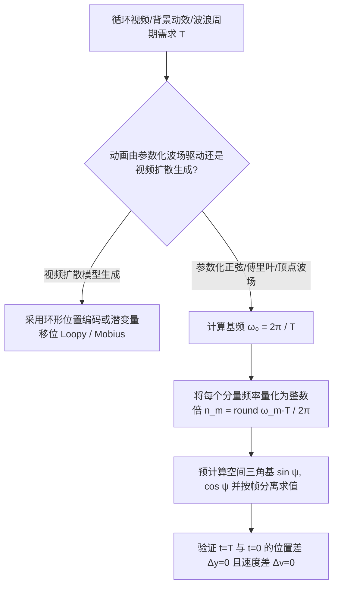
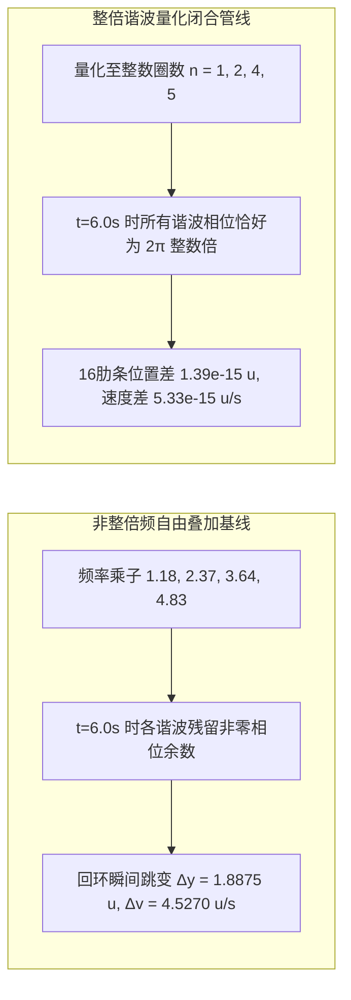
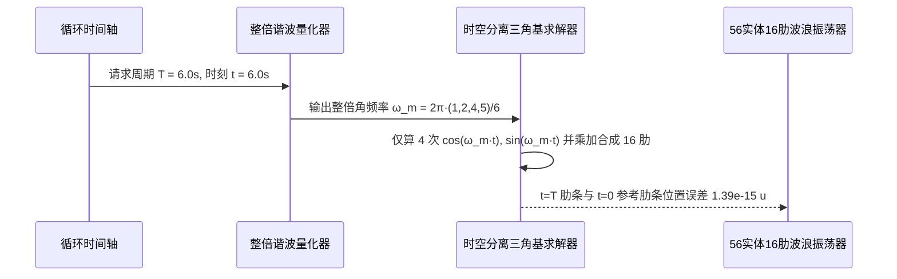

# 循环动画接缝不跳帧：整倍谐波频率量化与无理数频谱突变选型 FAQ

**3 分钟看懂为什么海浪、旗帜和背景循环视频会在片尾跳回片头时抽动一下，10 分钟复刻位置与速度双闭合的整倍谐波振荡器。**

[English](integer-harmonic-loop-faq.en.md) · [交互 Demo](https://turbo998.github.io/animation/demos/seamless-loop-oscillator/) · [中文七卡](../demos/seamless-loop-oscillator/test-report-cards.zh.html)

## ① 📌 核心结论速览

- **在有限循环周期 $T$ 内叠加非整数倍频率，必然在 $t = T \to 0$ 回环瞬间造成位置与速度双重跳变。** 当四路叠加波采用非整倍频乘子 `(1.18, 2.37, 3.64, 4.83)` 时，16 根波浪肋条在 `T = 6.0 s` 跳回 `0.0 s` 的瞬间产生 `1.8875` 示意单位的位置断层与 `4.5270 u/s` 的速度断层。
- **整倍谐波量化 $\omega_m^* = \frac{2\pi n_m}{T}$（$n_m \in \mathbb{Z}^+$）同时实现位置、速度与高阶导数的 $C^\infty$ 周期闭合。** 将频率量化为整倍数 `n = (1, 2, 4, 5)` 后，全部 16 根波浪肋条在 $t = T$ 与 $t = 0$ 的最大位置接缝差仅 `1.39e-15` 示意单位，最大速度接缝差仅 `5.33e-15 u/s`（浮点舍入级零跳帧）。
- **时空分离三角基递推比逐肋条直接调用 `Math.sin/cos` 快 `3.59×`。** 预计算空间基 $\sin\psi_{r,m}, \cos\psi_{r,m}$ 并每帧仅计算 4 次时间谐波，与每帧 64 次直接三角函数调用的最大坐标差仅 `1.11e-15`，8192 帧求解中位数为 `19.16 ms` 对比 `68.78 ms`。
- **56 实体 16 肋波浪振荡器，13 项本机实测验收。** 场景为 `synthetic`；周期接缝与 Node CPU 耗时为 `measured`；`Loopy` / `Mobius` 视频扩散模型潜空间循环移位为 `not_measured`。

**每日能力方向核验：** ACM TOG 2026 论文 *Loopy: Seamless Video Loop Generation via Anchored Looping Shift of Positional Embedding*（[arXiv:2608.23090](https://arxiv.org/abs/2608.23090)，2026-08-24 提交）与 *Mobius: Text to Seamless Looping Video Generation via Latent Shift*（[arXiv:2502.20307](https://arxiv.org/abs/2502.20307)）在视频扩散大模型中通过把时间位置编码或潜变量从“直线”改造为“圆环”来消除首尾接缝跳变；而在程序化着色器、顶点波浪与参数化动效中，这一“直线变圆环”的精确数学等价物就是将所有连续频率量化到基频 $\omega_0 = 2\pi / T$ 的整数格点上。2026-11-10 核验原文；本例仅实现确定性整倍谐波量化与时空分离求值，未运行视频扩散模型。

## ② 🎯 客户与架构师灵魂拷问 Q&A

### Q1 何时选无缝循环视频扩散模型，何时选确定性整倍谐波量化？

当需要从文本提示词生成云层翻涌、篝火跳动、溪流流淌等写实背景循环视频素材时，可评估 `Loopy`、`Mobius` 等环形位置编码/潜变量移位扩散模型。

当我们在 WebGL / Three.js 官网首屏、数字孪生水面、飘动旗帜、呼吸灯效、或者离线导出无限循环的 WebM / Lottie 动效时，直接对所有正弦波、Gerstner 波或傅里叶噪声频率执行整倍谐波量化 $\omega_m^* = \frac{2\pi}{T}\text{round}\left(\frac{\omega_m T}{2\pi}\right)$，就能从代数根源上杜绝接缝抽动。

### Q2 在什么约束下整倍谐波量化比尾段线性交叉淡化（Cross-Fade）严格更优？

很多设计师发现循环结尾跳帧时，习惯把最后 `0.5 s` 和开头 `0.5 s` 做透明度交叉淡化（Alpha Cross-Fade）或位置线性混合。

但对于波浪、摆锤或旋转机构，线性混合两段相位不同的波会在接缝处造成振幅抵消（波浪突然变平一瞬）或速度折角（$C^0$ 连续但 $C^1$ 速度断裂）。整倍谐波量化不牺牲任何一帧的振幅能量，且在 $t = T \to 0$ 处保持位置、速度、加速度 $C^\infty$ 任意阶光滑衔接。

### Q3 底层管线如何同时消灭接缝跳变与每顶点三角函数开销？

先看接缝闭合条件：对第 $m$ 个谐波分量 $y_m(x, t) = A_m \sin(k_m x + \phi_m - \omega_m t)$，要求对任意空间位置 $x$ 都满足 $y_m(x, T) = y_m(x, 0)$ 且 $\dot{y}_m(x, T) = \dot{y}_m(x, 0)$。这充要于：

$$\omega_m T = 2\pi \, n_m, \quad n_m \in \mathbb{Z}^+ \implies \omega_m^* = \frac{2\pi \, n_m}{T}$$

只要 $n_m$ 是整数（如本例 $n = (1, 2, 4, 5)$ 既有基频又有高低频非等差组合，画面依然自然丰富而不单调），在 $t = T$ 时每个谐波恰好转完整数圈，位置与速度差恒等于 `0`！

再看性能优化：如果有 $R = 16$ 根肋条（或上万个网格顶点）和 $M = 4$ 个谐波，直接计算需要每帧调用 $R \times M = 64$ 次 `Math.sin`。利用和差化积公式将空间相位 $\psi_{r,m} = k_m x_r + \phi_m$ 与时间相位 $\omega_m t$ 解耦：

$$\sin(\psi_{r,m} - \omega_m t) = \underbrace{\sin\psi_{r,m}}_{\text{预计算常数}} \cos(\omega_m t) - \underbrace{\cos\psi_{r,m}}_{\text{预计算常数}} \sin(\omega_m t)$$

每帧只需对 $M = 4$ 个时间频率算一次 $\cos(\omega_m t), \sin(\omega_m t)$，所有顶点就退化为纯乘加运算！

### Q4 十分钟如何复刻？

1. `npm run dev` 后打开 `/demos/seamless-loop-oscillator/`，默认停在循环终点 `t = 6.00 s`（后排灰色肋条固定显示起点 `t = 0.00 s` 的姿态作为对照基准）。
2. 在整倍谐波模式（`integer-quantized`）下观察：前排橙色肋条与后排 `t = 0` 灰色参考肋条高度完全对齐，`seam Δy = 0.00000 u`，`seam Δv = 0.0000 u/s`。点击播放跨越 `6.00 s → 0.00 s` 时丝滑无感。
3. 切换到非整倍频基线（`unquantized-drift`）：在 `t = 6.00 s` 处，前排橙色肋条与后排 `t = 0` 参考肋条严重错位，最大位置断层达 `1.8875 u`、速度断层达 `4.527 u/s`。
4. 修改循环周期（`2–12 s`）、基础振幅（`0.2–0.95`）与谐波衰减（`0.4–0.9`）；若输入越界周期 `0.5 s`，系统原子拒绝并保留有效配置。
5. 点击导出 `SEAMLESS_LOOP_SPECTRUM.json`，检查 `frequencies`、`maxPositionSeamGap` 与肋条矩阵。
6. 运行 `npx vitest run tests\seamless-loop.test.ts`；构建并在 4335 端口预览后执行 `node scripts\benchmark-seamless-loop.mjs`。

## ③ 🧭 直观可视化图解

## ④ 📊 Architect Decision Matrix

| 评估维度 | 非整倍频自由叠加 (`unquantized-drift`) | 首尾透明度/位置线性混合 (Cross-Fade) | 逐顶点直接调用三角函数 (`direct Math.sin`) | 本例整倍谐波 + 时空分离基 (`integer-quantized`) |
| --- | --- | --- | --- | --- |
| `t=T → 0` 最大位置接缝跳变 | 实测跳变 `1.8875` 示意单位 | `0`（但混合区间振幅衰减变平） | `1.39e-15` 示意单位 | 实测 `1.39e-15` 示意单位（浮点级零跳变） |
| `t=T → 0` 最大速度接缝跳变 | 实测跳变 `4.5270 u/s` | 存在 $C^1$ 速度导数折角 | `5.33e-15 u/s` | 实测 `5.33e-15 u/s`（$C^\infty$ 无限阶光滑） |
| 8192 帧 × 16 肋 Node CPU 中位数 | 快（但接缝断裂） | 需双倍采样混合 | `68.78 ms`（每帧 64 次三角函数调用） | `19.16 ms`（每帧仅 4 次时间三角调用，快 `3.59×`） |
| 任意时间轴拖拽与逆序重访 | 跨 `T` 点时视觉闪烁 | 确定性 | 确定性 | 正逆序重访世界矩阵逐元素一致 |
| 适用工程场景 | 严禁用于固定时长循环导出 | 仅限实拍视频无奈补救 | 少量独立振荡点 | 海浪、旗帜、呼吸动效、WebM 无缝循环导出 |

**定量算例：** 在周期 $T = 6.0\text{ s}$ 下，基频 $\omega_0 = \pi / 3 \approx 1.0472\text{ rad/s}$。非整倍频乘子 `(1.18, 2.37, 3.64, 4.83)` 在 $t = 6.0\text{ s}$ 处的相位余数分别为 $(0.18, 0.37, 0.64, 0.83) \times 2\pi$，在第 4 根肋条处叠加出 `1.8875` 示意单位的位置断层；量化为整数 `(1, 2, 4, 5)` 后，相位余数全部归零。

## ⑤ 🧪 全新 Demo 与 Benchmark 核心发现（含 7-Card）

[封存数据](../demos/seamless-loop-oscillator/report.json)记录了 56 个三维实体、16 根波浪肋条在 `t = 6.0 s` 与 `t = 0.0 s` 的位置与速度接缝核验，以及时空分离三角基与逐肋条直接 `Math.sin` 调用的等价性与耗时对照。两种求解器在全部负载下的最大高度误差仅 `1.11e-15` 示意单位（门限 `< 1e-13`）。

| Node CPU 16 肋波浪帧查询数 | 时空分离三角基递推中位数 | 逐肋条直接 Math.sin 中位数 |
| --- | --- | --- |
| 128 | 1.88 ms | 2.30 ms |
| 1024 | 3.39 ms | 8.77 ms |
| 8192 | 19.16 ms | 68.78 ms |

每档负载在预热后按交替顺序重复 7 次，记录 Node CPU 耗时中位数（不含 WebGL 渲染）。在 8192 帧 × 16 肋波浪计算中，时空分离三角基比逐肋条调用 `Math.sin` 快约 `3.59×`，同时消除了非整倍频在循环接缝处的 `1.8875` 示意单位位置跳变。

[中文七卡](../demos/seamless-loop-oscillator/test-report-cards.zh.html) · [English](../demos/seamless-loop-oscillator/test-report-cards.html)。画面为 `synthetic`，频谱闭合与 CPU 计时为 `measured`；`Loopy` / `Mobius` 视频扩散推理为 `not_measured`。

## ⑥ 🛠️ Architect Checklist

- [ ] 在导出任何时长为 $T$ 的循环动画（WebM / GIF / Lottie / Shader）前，确定全局基频 $\omega_0 = 2\pi / T$。
- [ ] 将所有正弦波、摇摆器与旋转器的角频率量化为基频的整数倍 $\omega_m^* = n_m \omega_0$（$n_m \in \mathbb{Z}^+$）。
- [ ] 选择非等差的互质整数倍组合（如 `n = 1, 2, 4, 5` 或 `1, 3, 5, 8`），兼顾周期内的丰富随机感与周期边界的精确闭合。
- [ ] 若使用移动噪声场（Perlin / Simplex Noise），在更高维空间沿半径为 $R$ 的圆环 $(\cos\omega_0 t, \sin\omega_0 t)$ 采样，切勿沿开放直线 $v \cdot t$ 采样。
- [ ] 在自动化测试中同时断言位置闭合 $|y(T) - y(0)| < 10^{-13}$ 与速度闭合 $|\dot{y}(T) - \dot{y}(0)| < 10^{-13}$。
- [ ] 对多顶点多谐波网格，预计算空间三角基 $\sin\psi_{r,m}, \cos\psi_{r,m}$，每帧仅计算 $M$ 次时间正余弦。
- [ ] 对循环周期、基础振幅与衰减系数执行输入边界校验，对越界参数执行原子拒绝。
- [ ] 验证正序与逆序拖拽时间滑块到周期终点时，导出的肋条世界矩阵完全一致。
- [ ] 区分确定性频谱整倍量化与视频扩散模型的环形位置编码移位（`Loopy` / `Mobius`）。
- [ ] 未执行的视频扩散推理、FFT 海面碎浪与布料自碰撞统一标注为 `not_measured`。

**一手来源：** [Loopy (arXiv:2608.23090)](https://arxiv.org/abs/2608.23090)（ACM TOG，2026-08-24 提交）通过锚定位置编码环形移位生成无缝循环视频；[Mobius (arXiv:2502.20307)](https://arxiv.org/abs/2502.20307)（2025-02-27 提交）通过潜变量循环移位实现免训练无缝循环视频生成。2026-11-10 核验；本例为原创确定性整倍谐波振荡器测试台，未运行上述视频扩散模型。
