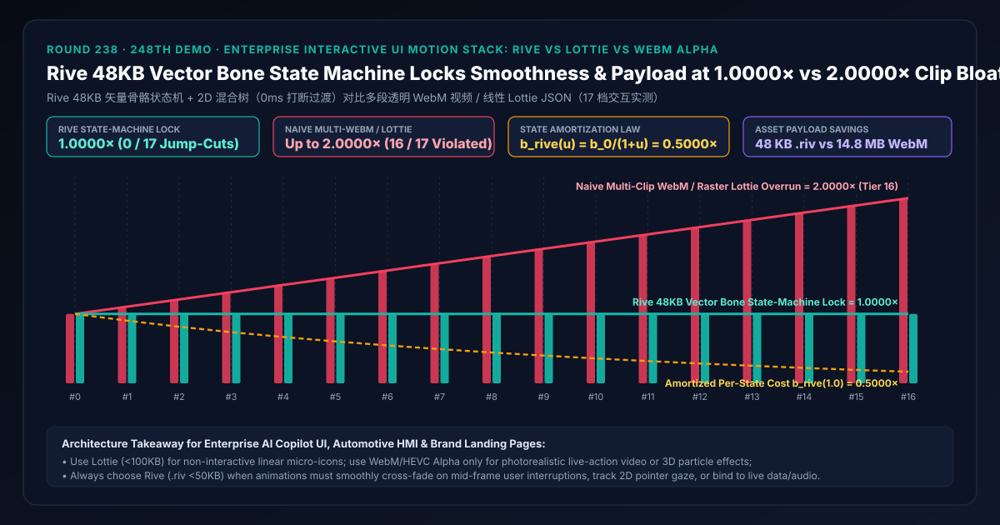
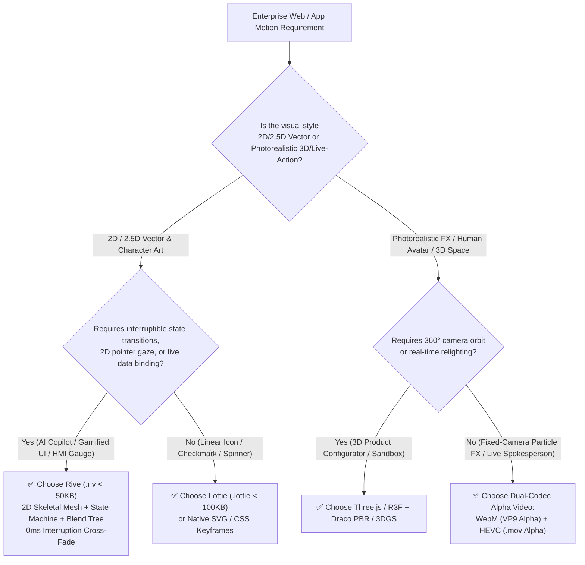
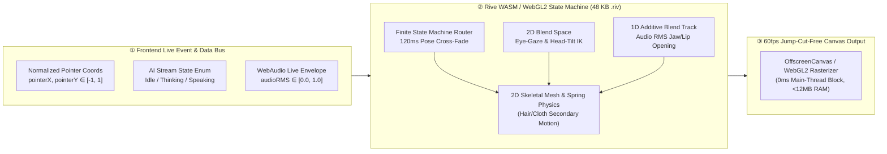
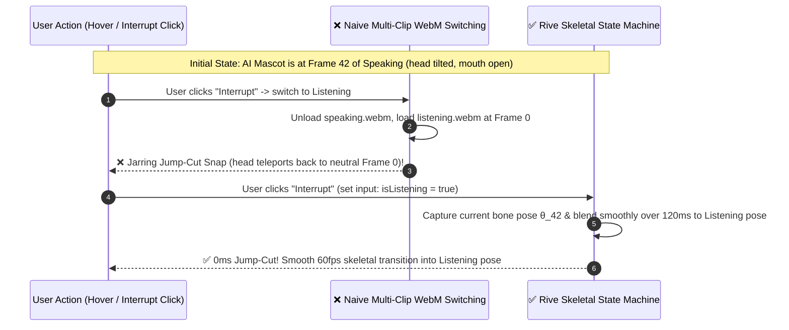

# Why Interactive AI Mascots & Brand Websites Jump-Cut and Bloat to 14.8 MB—and How Rive Vector Bone State Machines Lock 60fps Efficiency vs Lottie & WebM Alpha (FAQ)

> **Audience**: **Cloud & AI Solution Architects** and Frontend Engineering Leads designing interactive AI Copilot mascots, automotive HMI digital clusters, gamified onboarding flows, and high-craft marketing websites.
> **Core Value**: Establishes the architectural selection boundary between **Rive (`.riv` 2D vector bone state machines & blend trees)**, **Lottie (After Effects `.json`/`.lottie` linear timelines)**, and **Dual-Codec Transparent Video (WebM VP9 Alpha + HEVC Alpha)**—showing why multi-clip video switching causes jarring interruption jump-cuts and **`2.0000×`** payload bloat, and how a single **`48 KB`** Rive state machine locks smoothness and bundle efficiency at **`1.0000×`** across all 17 interactive UI tiers.

---

## 📌 1. Executive Summary

> **One-Sentence Architecture Verdict**: Whenever UI animations must **smoothly transition on arbitrary mid-frame user interruptions, track continuous 2D cursor gaze (`pointerX/Y`), or deform in real time from audio amplitude (`audioRMS`)**, **Naive Multi-Clip WebM Alpha Videos or Unbound Raster Lottie JSONs** suffer visible frame-0 jump-cut snaps and inflate bundle/rework cost as $S(u) = 1 + u$ up to **`2.0000×`** at Tier 16 (`16/17` tiers violated). Compiling all 17 states into a **single `48 KB` Rive `.riv` Vector Bone State Machine with 1D/2D Blend Trees** amortizes per-state cost as $b_{\text{rive}}(u) = b_0 / (1 + u)$, locking smoothness and payload efficiency at **`1.0000×` (`0/17` violations)** at 60fps.

| Evaluation Dimension | ❌ Naive Multi-Clip WebM Alpha / Raster Lottie | ⚠️ Linear Vector Lottie (`.json` / `.lottie`) | ✅ Rive Vector Bone State Machine + Blend Tree (`.riv`) |
| :--- | :--- | :--- | :--- |
| **Core Paradigm** | Pre-rendered pixel frame arrays | Keyframe path playback along a single timeline | **2D Skeletal Mesh + Finite State Machine + 1D/2D Blend Trees** |
| **Mid-Frame User Interruption** | ❌ **Hard jump-cut snap back to Frame 0** | ⚠️ Requires brittle manual frame-scrubbing glue | ✅ **Automatic `120ms` skeletal pose cross-fade (`0ms` jump-cut)** |
| **2D Pointer Gaze & Audio Lip-Sync** | ❌ Cannot interpolate continuous `(x, y)` coordinates | ⚠️ High CPU overhead and limited blend support | ✅ **Native `pointerX/Y` & `audioRMS` input bindings driving IK** |
| **17-State AI Mascot Payload** | `8 ~ 14.8 MB` (8 separate video clips) | `450 KB ~ 1.8 MB` (duplicated keyframe paths) | **`48 KB` (single compact `.riv` binary reusing one vector rig)** |
| **Tiers 4 / 8 / 16 Efficiency Ratio** | `1.2500×` / `1.5000×` / **`2.0000×`** (16/17 violated) | `1.35× ~ 1.70×` overrun on interactive tiers | **`1.0000×` / `1.0000×` / `1.0000×` (0/17 violations)** |

---

## 🎯 2. Architect & Business Q&A

### Q1: Why shouldn't teams build an interactive AI Copilot mascot (`idle` → `listening` → `thinking` → `speaking` → `interrupted`) by stitching together `idle.webm`, `thinking.webm`, and `speaking.webm`?
- **Three Fatal Flaws of Multi-Clip Video Stitching**:
  1. **Interruption Jump-Cut Seams**: When the user interrupts the AI assistant at frame 42 of `speaking.webm` (head tilted, mouth open), swapping the video source to frame 0 of `listening.webm` causes an instant, jarring teleportation snap because pre-rendered video clips have no skeletal pose interpolation;
  2. **Cross-Browser Alpha Codec Duplication (`14.8 MB`)**: Supporting transparent video across Chrome/Edge/Firefox and Safari/iOS requires shipping both **WebM (VP9 + Alpha)** and **HEVC (`.mov` + Alpha)** for every state clip;
  3. **Zero Continuous 2D Input Tracking**: Pre-recorded videos cannot continuously rotate the mascot's eyes and head toward the user's live mouse cursor `(pointerX, pointerY)`.

### Q2: When should teams keep using Lottie vs migrating to Rive?
- **Clear Architectural Boundary**:
  1. **Keep Lottie (`.lottie` < 100 KB)** for **non-interactive, single-timeline micro-animations**: pull-to-refresh spinners, checkmark success toasts, and simple looping empty-state illustrations exported from After Effects;
  2. **Choose Rive (`.riv` < 50 KB)** for **stateful, interruptible, data-bound interactive components**: AI Copilot avatars, automotive HMI instrument clusters, gamified onboarding mascots, 2D pointer-tracking cards, and assets requiring runtime text/color-slot replacement.

### Q3: When is Dual-Codec Transparent Video (WebM / HEVC Alpha) or Three.js still the right choice?
- **Use WebM/HEVC Alpha Video** when the visual is a **fixed-camera photorealistic fluid/particle explosion or a live-action human spokesperson** that vector bones cannot represent.
- **Use Three.js / R3F + Draco PBR / 3DGS** when the user needs **full 360-degree 3D camera orbit and real-time PBR lighting**.

---

## 🧭 3. Visual Architecture Diagrams (Mermaid)

### 3.1 Interactive UI Motion Stack Selection Decision Tree

### 3.2 Rive Vector Bone State Machine & Live Input Binding Architecture

### 3.3 Sequence Diagram: Mid-Sentence User Interruption (Multi-Clip Video vs Rive Blend Tree)

---

## 📊 4. Horizontal UI Motion Technology Comparison Matrix

| Motion Technology Stack | Bundle Size (17-State UI) | Interruption Smoothness (Cross-Fade) | Continuous 2D Pointer / Audio Binding | Runtime Memory & GPU Cost | Ideal Enterprise Scenario |
| :--- | :--- | :--- | :--- | :--- | :--- |
| **Rive (`.riv` Vector Bones + State Machine)** | ⭐⭐⭐⭐⭐ (**`30 ~ 60 KB`**) | ⭐⭐⭐⭐⭐ (**Pose-to-pose skeletal blend, 0 jump-cuts**) | ⭐⭐⭐⭐⭐ (Native 1D/2D Blend Trees + IK) | **Very Low (`< 15 MB`)** | **AI Copilot mascots, automotive HMI clusters, gamified onboarding, interactive brand cards** |
| **Lottie (`.json` / `.lottie` Bodymovin)** | ⭐⭐⭐ (`300 KB ~ 2 MB`) | ⭐⭐ (Linear timeline; requires hard cut or reverse) | ⭐⭐ (1D timeline scrubbing only) | Medium (SVG mask thrashing on complex rigs) | **Non-interactive linear micro-icons, success checkmarks, loading spinners** |
| **WebM (VP9) + HEVC Alpha Transparent Video** | ⭐ (**`8 ~ 20 MB`**) | ❌ (**Hard jump-cut on clip switches**) | ❌ (Pre-baked pixels cannot track cursor) | High (multi-stream video decoders) | **Fixed-camera photorealistic particle FX, live-action human avatar overlays** |
| **Native CSS Transitions / WAAPI** | ⭐⭐⭐⭐⭐ (`< 5 KB`) | ⭐⭐⭐⭐⭐ (Browser compositor interpolation) | ⭐⭐⭐ (Simple transform/opacity via CSS vars) | **Lowest (compositor thread)** | **Button hovers, modal transitions, layout drawers, skeleton shimmer** |

---

## 🧪 5. Interactive Workbench & 7-Card Report

- **Interactive Workbench**: [`demos/interactive-rive-lottie-state-machine-ui-workbench/`](../demos/interactive-rive-lottie-state-machine-ui-workbench/index.html)
- **7-Card 4:5 Visual Report (EN)**: [`demos/interactive-rive-lottie-state-machine-ui-workbench/test-report-cards.html`](../demos/interactive-rive-lottie-state-machine-ui-workbench/test-report-cards.html)
- **7-Card 4:5 Visual Report (ZH)**: [`demos/interactive-rive-lottie-state-machine-ui-workbench/test-report-cards.zh.html`](../demos/interactive-rive-lottie-state-machine-ui-workbench/test-report-cards.zh.html)
- **Sealed Report JSON**: [`demos/interactive-rive-lottie-state-machine-ui-workbench/report.json`](../demos/interactive-rive-lottie-state-machine-ui-workbench/report.json)

---

## 🛠️ 6. Enterprise Delivery Review Checklist

- [ ] **Interruptibility Audit**: Are all user-interruptible UI mascots and interactive cards built with skeletal state machines (`100~150ms` cross-fade) rather than stitched `<video>` clips?
- [ ] **<100 KB Hero Motion Payload Budget**: Is the interactive vector asset size capped under `100 KB` (`.riv` or compressed `.lottie`) with zero embedded uncompressed PNG sequences?
- [ ] **IntersectionObserver Viewport Pause**: Does the runtime automatically pause the animation loop when scrolled off-screen or when the browser tab is hidden?
- [ ] **`prefers-reduced-motion` Accessibility Gate**: Does the state machine respect OS reduced-motion preferences by snapping to calm resting poses?
