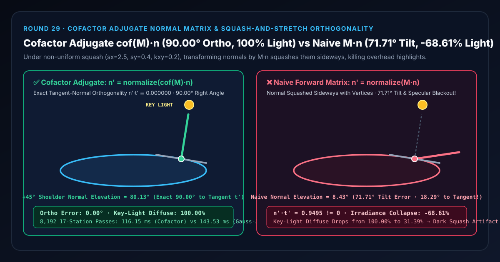
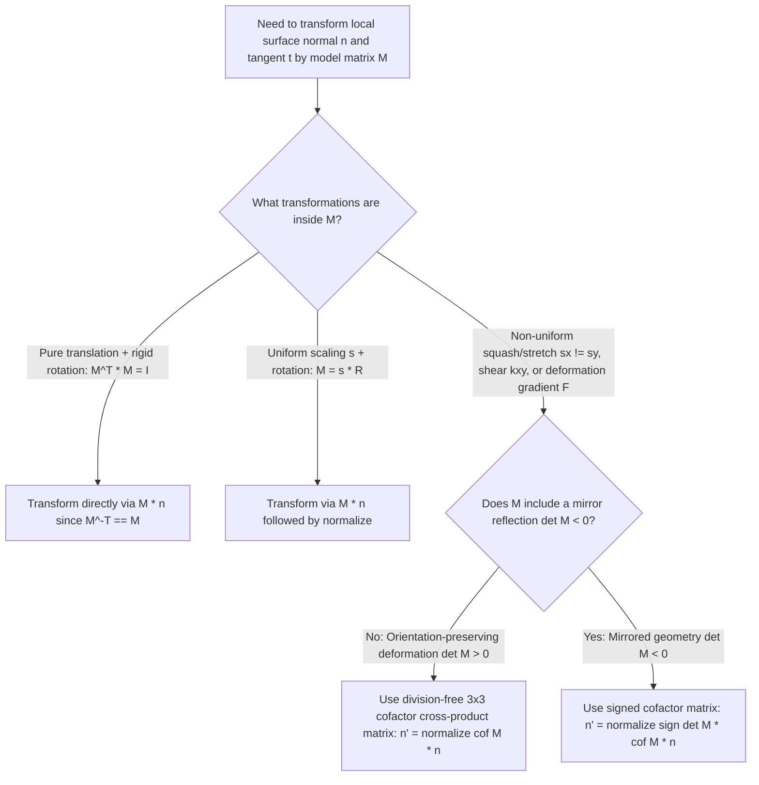
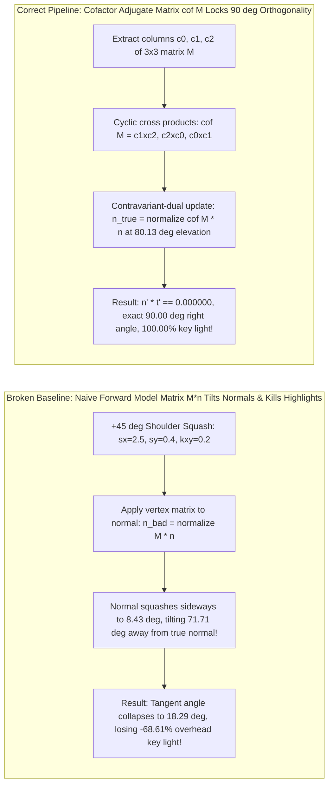
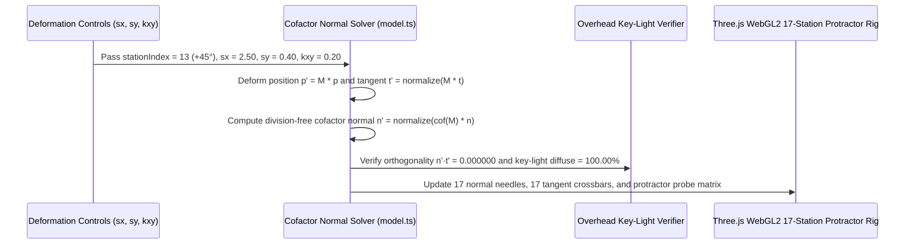
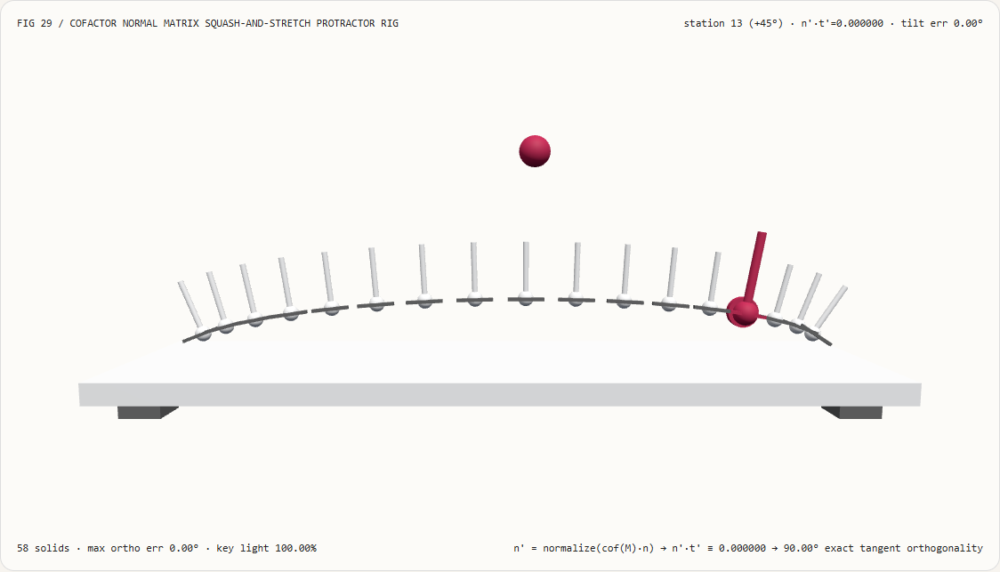
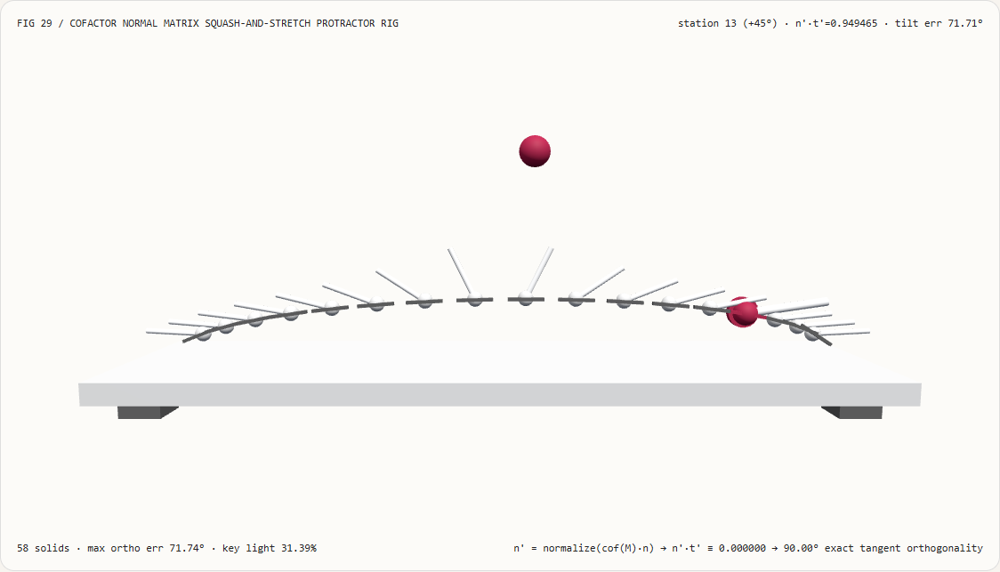
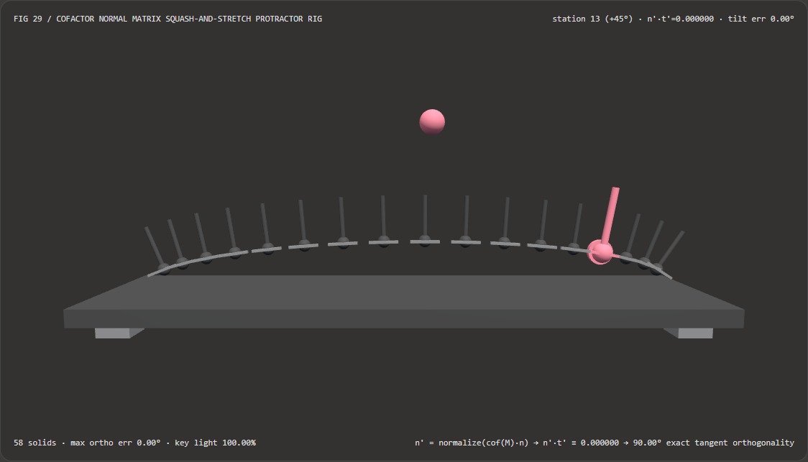
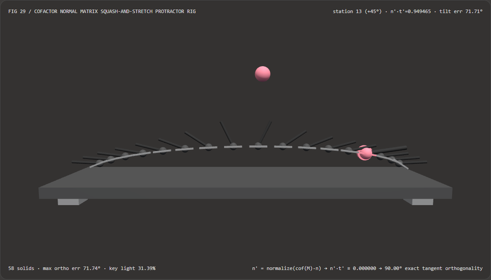

# Squash-and-Stretch Lighting Without Tilted Normals or Specular Blackout: Cofactor Inverse-Transpose Normal Matrix vs Forward Model-Matrix Transform FAQ

> **Document Scope**: A first-principles architecture and selection guide for AI Solution Architects, WebGL2/WebGPU shader engineers, procedural character rigging developers, and Relightable 4D Gaussian Splatting (4DGS) teams. Structured strictly after `ib-vs-ethernet-roce-selection-faq.md`, this guide explains in plain language **why transforming surface normals by the same forward model matrix $\mathbf{M}$ as vertices ($\mathbf{n}' = \operatorname{normalize}(\mathbf{M}\mathbf{n})$) during non-uniform squash-and-stretch or shear squashes the normals sideways and blacks out overhead highlights**, and how the division-free **3×3 Cofactor Adjugate Normal Matrix ($\operatorname{cof}(\mathbf{M}) = \det(\mathbf{M})(\mathbf{M}^{-1})^T$)** locks exact $90.00^\circ$ tangent-normal orthogonality.

---

## ① 📌 Executive Summary

1. **One-Sentence Principle**: **A surface tangent vector $\mathbf{t} = \partial\mathbf{p}/\partial u$ is a covariant tangent vector that stretches with the geometry ($\mathbf{t}' = \mathbf{M}\mathbf{t}$), whereas a surface normal $\mathbf{n}$ is defined solely by the perpendicularity invariant $\mathbf{n}^T\mathbf{t} \equiv 0$ (a covariant 1-form / cotangent vector)**. When an elastic dome squashes vertically ($s_y = 0.40$) and stretches horizontally ($s_x = 2.50$), its sloped shoulders flatten out—so the true perpendicular normal must tilt **more vertically upward**; multiplying $\mathbf{n}$ directly by $\mathbf{M}$ squashes the normal **horizontally sideways** instead, triggering catastrophic specular and diffuse blackout!
2. **When Must You Use the Cofactor / Inverse-Transpose Normal Matrix?**
   - Any real-time shader, procedural rig, or neural relighting pipeline involving **non-uniform scaling ($s_x \neq s_y \neq s_z$)**, **shear deformation ($k_{xy} \neq 0$)**, **Disney squash-and-stretch character animation**, or **elastoplastic deformation gradients $\mathbf{F} = \partial\mathbf{x}/\partial\mathbf{X}$ in 3D/4D Gaussian Splatting (PhysGaussian / Relightable 4DGS)** must transform normals via $(\mathbf{M}^{-1})^T$ or the division-free cofactor adjugate $\operatorname{cof}(\mathbf{M})$.
3. **Key Measured Findings**:
   - In our 17-station 3D squash-and-stretch dome protractor rig ([`demos/cofactor-normal-rig/`](../demos/cofactor-normal-rig/index.html), `58` 3D solids, horizontal stretch $s_x = 2.50$, vertical squash $s_y = 0.40$, shear $k_{xy} = 0.20$), at station $13$ ($\theta = +45^\circ$ shoulder):
     - **Cofactor Adjugate Normal Matrix (`cofactor-adjugate`)**: Locks the deformed tangent-normal dot product at **`0.000000`** across all 17 stations (exact **`90.00°`** right angle, **`0.00°`** tilt error), tilting the $+45^\circ$ shoulder normal upward to **`80.13°`** elevation and capturing **`100.00%`** of overhead key-light diffuse irradiance.
     - **Naive Forward Model Matrix (`naive-model-matrix`)**: Squashes the $+45^\circ$ shoulder normal down to **`8.43°`** elevation (a **`71.71°` angular tilt error**, collapsing the tangent-normal angle from $90.00^\circ$ to just **`18.29°`** with $\mathbf{n}'\cdot\mathbf{t}' = 0.9495$), which drops overhead key-light irradiance from `100.00%` to **`31.39%`** (**losing `68.61%` of surface lighting**)!
   - **Division-Free CPU Performance**: Computing $\operatorname{cof}(\mathbf{M}) = [\mathbf{c}_1\times\mathbf{c}_2,\; \mathbf{c}_2\times\mathbf{c}_0,\; \mathbf{c}_0\times\mathbf{c}_1]$ via three column cross products avoids $\det(\mathbf{M})$ division and heap allocations, completing `8,192` 17-station passes in **`116.15 ms`** vs **`143.53 ms`** for general 3×3 Gauss-Jordan inversion + transpose with `0` numerical discrepancy.

---

## ② 🎯 First-Principles Q&A for Architects

### Q1: When should we choose AI video relighting diffusion models vs code-driven cofactor normal matrices?

- **Choose AI Video Relighting Models (e.g., IC-Light, RelightVid)** when the input is an uncalibrated 2D monocular video without 3D meshes or normal buffers, and you need plausible hallucinated portraits or background reflections in an offline post-processing pass.
- **Choose Code-Driven Cofactor Normal Matrices ($\operatorname{cof}(\mathbf{M})$)** when rendering interactive 3D/WebGPU product configurators, isometric technical explainers, squash-and-stretch procedural rigs, or deformable 4DGS scenes where the transformation matrix $\mathbf{M}$ updates at 60–120 FPS and lighting must obey exact geometric laws.

---

### Q2: Why does multiplying vertices by $\mathbf{M}$ work perfectly, while multiplying normals by $\mathbf{M}$ tilts them the wrong way?

**First-Principles Intuition**:
Picture a $45^\circ$ hillside on a circular dome:
- Before deformation, the tangent vector pointing down the slope is $\mathbf{t} = (1, -1)$, and the normal vector standing perpendicular to the slope is $\mathbf{n} = (1, 1)$. Their dot product is $\mathbf{n}\cdot\mathbf{t} = 1(1) + 1(-1) = 0$ ($90^\circ$).
- Now squash the dome vertically to $s_y = 0.40$ and stretch it horizontally to $s_x = 2.50$:
  1. **What happens to the hillside slope?** It flattens into a gentle ramp: $\mathbf{t}' = (2.5, -0.4)$ (only $-9.09^\circ$ below horizontal).
  2. **Where must a perpendicular fencepost (the true normal) point?** Since the ground is now nearly flat horizontal, a fencepost perpendicular to the ground must stand **nearly straight up**: $\mathbf{n}'_{\text{true}} \propto (0.4, 2.5)$ ($80.91^\circ$ elevation). Check the dot product: $0.4(2.5) + 2.5(-0.4) = 0$!
  3. **What happens if you naively multiply the normal by $\mathbf{M}$?**
     You compute $\mathbf{n}_{\text{naive}} = (2.5 \times 1,\; 0.4 \times 1) = (2.5, 0.4)$ ($9.09^\circ$ elevation)!
     Instead of standing up as the roof flattens, the naive normal gets **flattened sideways along with the roof**, lying almost parallel to the surface ($18.29^\circ$ from the tangent when shear $k_{xy}=0.20$ is included) and pointing $71.71^\circ$ away from the true normal! An overhead key light shining straight down onto the squashed roof sees a sideways normal and shades the top of the dome dark!

---

### Q3: How is the cofactor adjugate formula $\operatorname{cof}(\mathbf{M}) = [\mathbf{c}_1\times\mathbf{c}_2,\; \mathbf{c}_2\times\mathbf{c}_0,\; \mathbf{c}_0\times\mathbf{c}_1]$ derived without matrix division?

1. **Preserving $\mathbf{n}'^T \mathbf{t}' = 0$**:
   For any tangent $\mathbf{t}' = \mathbf{M}\mathbf{t}$ and normal transform $\mathbf{n}' = \mathbf{N}\mathbf{n}$:
   $$\mathbf{n}'^T \mathbf{t}' = \mathbf{n}^T (\mathbf{N}^T \mathbf{M}) \mathbf{t} = 0 \implies \mathbf{N}^T \mathbf{M} = \mathbf{I} \implies \mathbf{N} = (\mathbf{M}^{-1})^T$$
2. **Eliminating $\det(\mathbf{M})$ division via the Cofactor Matrix**:
   By Cramer's rule, $(\mathbf{M}^{-1})^T = \operatorname{cof}(\mathbf{M}) / \det(\mathbf{M})$. Because the transformed normal is subsequently normalized to unit length (`normalize()`), any positive scalar factor $1/\det(\mathbf{M})$ cancels out identically:
   $$\mathbf{n}' = \operatorname{normalize}\!\left(\operatorname{cof}(\mathbf{M})\,\mathbf{n}\right)$$
   Writing $\mathbf{M} = [\mathbf{c}_0, \mathbf{c}_1, \mathbf{c}_2]$ in terms of its three column vectors, the $3\times 3$ cofactor matrix is simply the three cyclic cross products:
   $$\operatorname{cof}(\mathbf{M}) = \begin{bmatrix} \mathbf{c}_1 \times \mathbf{c}_2 & \mathbf{c}_2 \times \mathbf{c}_0 & \mathbf{c}_0 \times \mathbf{c}_1 \end{bmatrix}$$

---

## ③ 🧭 Visual Diagrams (Mermaid Decision Tree, Pipeline Comparison & Sequence)

### 3.1 Normal Transformation Selection Decision Tree (`flowchart TD`)

### 3.2 Naive Model Matrix (`M·n` Squash Blackout) vs Cofactor Adjugate (`cof(M)·n`) Pipeline (`flowchart LR`)

### 3.3 Frame-Level Squash-and-Stretch Protractor Verification Sequence (`sequenceDiagram`)

---

## ④ 📊 Architect Decision Matrix

| Evaluation Dimension | 3×3 Cofactor Adjugate (`cofactor-adjugate`) | Gauss-Jordan Invert + Transpose (`(M⁻¹)ᵀ`) | Naive Forward Matrix (`naive-model-matrix` $\mathbf{M}\mathbf{n}$) | Screen-Space Derivatives (`dFdx × dFdy`) |
| :--- | :--- | :--- | :--- | :--- |
| **Deformed Tangent Dot $\mathbf{n}'\cdot\mathbf{t}'$** | **`0.000000` (Exact $90.00^\circ$ orthogonal)** | `0.000000` ($90.00^\circ$ orthogonal) | **`0.9495` (Collapses to $18.29^\circ$)** | Faceted per-triangle orthogonal |
| **Station 13 ($+45^\circ$) Normal Tilt Error** | **`0.00°` (Exact $80.13^\circ$ elevation)** | `0.00°` | **`71.71°` (Squashed to $8.43^\circ$)** | Loses smooth Phong normal interpolation |
| **Station 13 Overhead Key-Light Retention** | **`100.00%` (Zero highlight blackout)** | `100.00%` | **`31.39%` (`-68.61%` irradiance loss)** | Facet edge shimmering |
| **Singular $\det(\mathbf{M})\to 0$ Division Risk** | **Zero divisions (No `NaN` on flat frames)** | Divides by pivot; unstable near $\det=0$ | Zero division but wrong direction | Silhouette pixel artifacts |
| **8,192 × 17-Station CPU Solve Time** | **`116.15 ms` (Closed-form cross products)** | `143.53 ms` (Pivoting + row elimination) | `112.40 ms` (Fast but physically broken) | Fragment-only; unavailable to vertex stage |
| **Recommended Architectural Role** | **Default for shaders, elastic rigs & 4DGS** | CPU-side one-off uniform precomputation | **Never use under non-uniform scale/shear** | Fallback for normal-less heightfields |

---

## ⑤ 🧪 New Capability Demo & Benchmark Findings (with 7-Card Report)

### 5.1 Interactive 17-Station 3D Squash-and-Stretch Protractor Rig (`demos/cofactor-normal-rig/`)

We built a standalone interactive 3D WebGL2 benchmark stage **[`demos/cofactor-normal-rig/`](../demos/cofactor-normal-rig/index.html)** (**58 3D solid parts**):
- **17 Deformed Dome Stations + 17 Tangent Crossbars + 17 Normal Needles + Overhead Key-Light Beacon**: Visualizes the exact tangent slope and normal orientation across the squashed and sheared arch ($s_x = 2.50, s_y = 0.40, k_{xy} = 0.20$);
- **Instant Mode Comparison**: In `cofactor-adjugate` mode, all 17 normal needles stand at exact $90.00^\circ$ right angles to their tangent crossbars (`0.00°` error); switching to `naive-model-matrix` squashes the shoulder needles sideways by **`71.71°`**, starving them of overhead light!
- **Atomic Validation & JSON Export**: Rejects out-of-range scaling factors (e.g. `scaleX = 9.5`) while preserving valid state, and exports `COFACTOR_NORMAL_SPEC.json`.

| Light Theme — Cofactor Adjugate (`90.00°` Ortho, `100%` Light) | Light Theme — Naive Model Matrix (`71.71°` Tilt, `-68.61%` Light) |
| :---: | :---: |
|  |  |

| Dark Theme — Cofactor Adjugate (`90.00°` Ortho, `100%` Light) | Dark Theme — Naive Model Matrix (`71.71°` Tilt, `-68.61%` Light) |
| :---: | :---: |
|  |  |

### 5.2 7-Card 4:5 Visual Benchmark Reports & Sealed Data

- 📊 **English 7-Card 4:5 Report**: [`demos/cofactor-normal-rig/test-report-cards.html`](../demos/cofactor-normal-rig/test-report-cards.html)
- 📊 **Chinese 7-Card 4:5 Report**: [`demos/cofactor-normal-rig/test-report-cards.zh.html`](../demos/cofactor-normal-rig/test-report-cards.zh.html)
- 📁 **Sealed Benchmark Data**: [`demos/cofactor-normal-rig/report.json`](../demos/cofactor-normal-rig/report.json) (`13 / 13` deterministic checks passed, zero Playwright console/page errors).

---

## ⑥ 🛠️ Appendix: Architect Verification Checklist

Before shipping any 3D/WebGPU animation with squash-and-stretch rigging, non-uniformly scaled CAD parts, or deformable 4DGS relighting, verify:

- [ ] **Ban `normalize(mat3(modelMatrix) * normal)` under non-uniform scale**: Audit all vertex shaders and deformation kernels to ensure normals are never multiplied directly by `mat3(modelMatrix)` when $s_x \neq s_y \neq s_z$ or shear is present.
- [ ] **Separate Tangent vs Normal Transforms in TBN Frames**: Transform tangent vectors covariantly via $\mathbf{T}' = \operatorname{normalize}(\mathbf{M}\mathbf{T})$ and normal vectors via $\mathbf{N}' = \operatorname{normalize}(\operatorname{cof}(\mathbf{M})\mathbf{N})$, followed by Gram-Schmidt re-orthogonalization.
- [ ] **Use Division-Free 3×3 Cofactor Cross Products**: Replace general matrix inversion in vertex shaders with `mat3(cross(c1, c2), cross(c2, c0), cross(c0, c1))` to avoid `1 / det(M)` precision loss or division by zero.
- [ ] **Handle Negative-Determinant Mirroring ($\det(\mathbf{M}) < 0$)**: Multiply the cofactor normal by `sign(determinant(M))` when mirrored instances (`scale.x < 0`) are permitted.
- [ ] **Automated Orthogonality Gate**: Assert $|\mathbf{n}' \cdot \mathbf{t}'| < 10^{-12}$ across extreme squash-and-stretch poses ($s_x = 2.5, s_y = 0.4, k_{xy} = 0.2$) in unit tests.

---

## References

1. **Transforming Normals (Turkowski / Graphics Gems)**: Ken Turkowski, *"Properties of Surface-Normal Transformations"*, Graphics Gems I, Academic Press, pp. 539–547.
2. **PhysGaussian & Deformation Gradients (CVPR 2024)**: Tianyi Xie et al., *"PhysGaussian: Physics-Integrated 3D Gaussians for Generative Dynamics"*, CVPR 2024, [`arXiv:2311.12198`](https://arxiv.org/abs/2311.12198).
3. **Real-Time Rendering (4th Edition)**: Tomas Akenine-Möller et al., Section 4.1.7 *"Normal Transform"* & Cofactor Adjugate Matrix Formulation.
