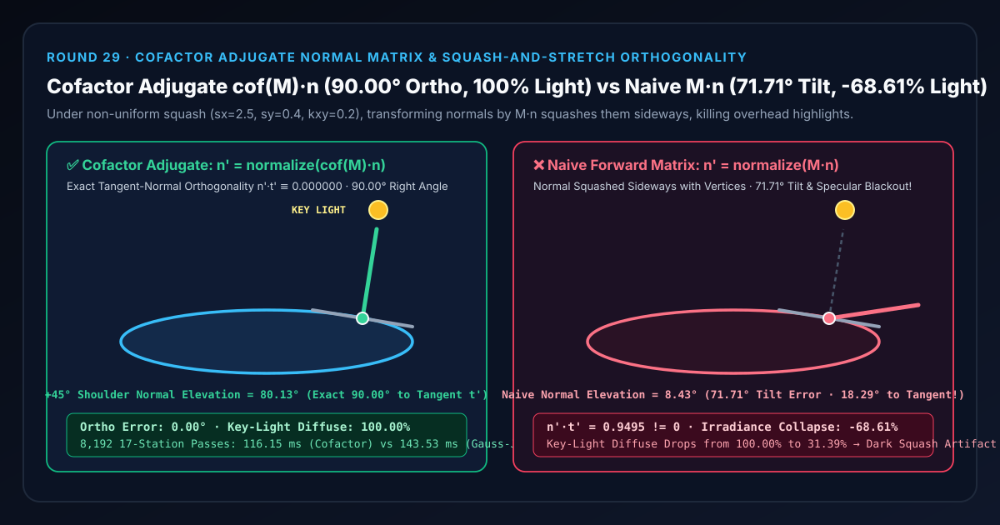
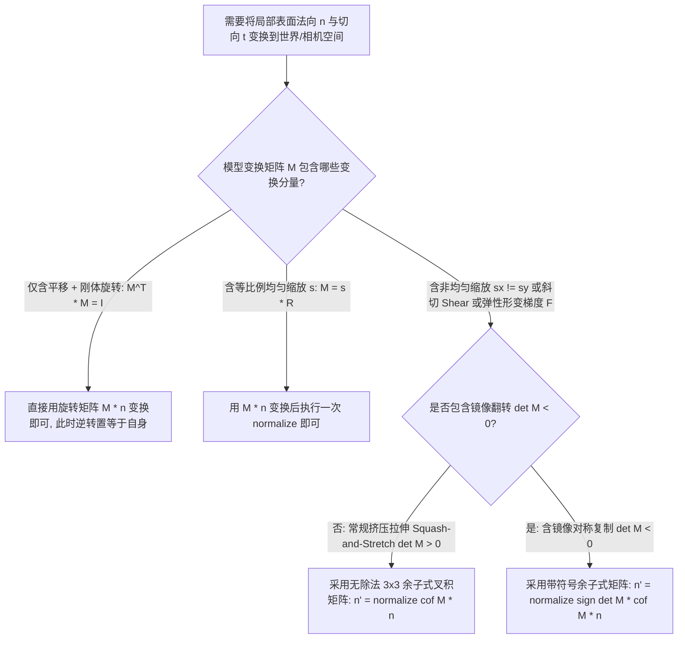
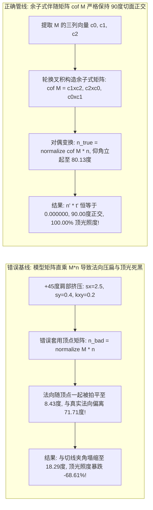
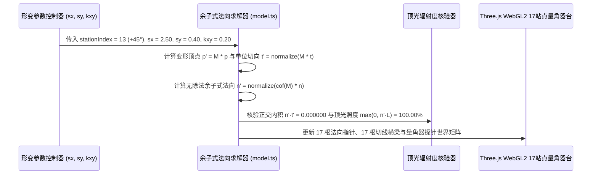
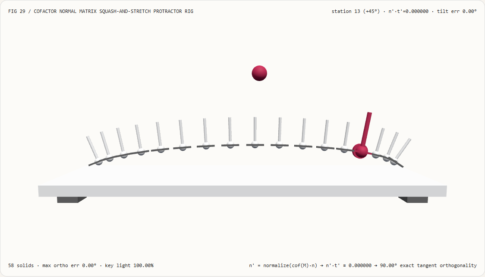
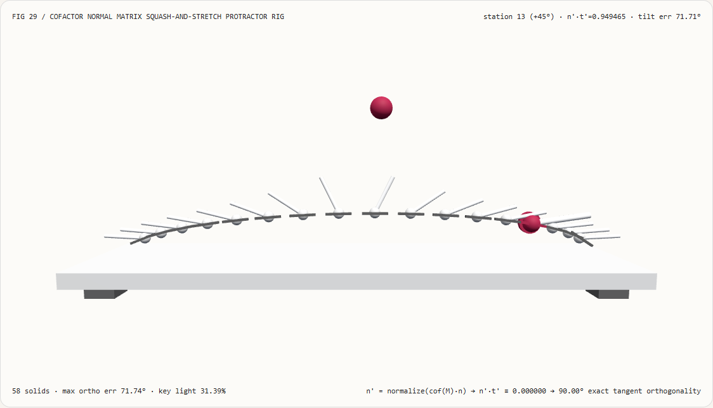
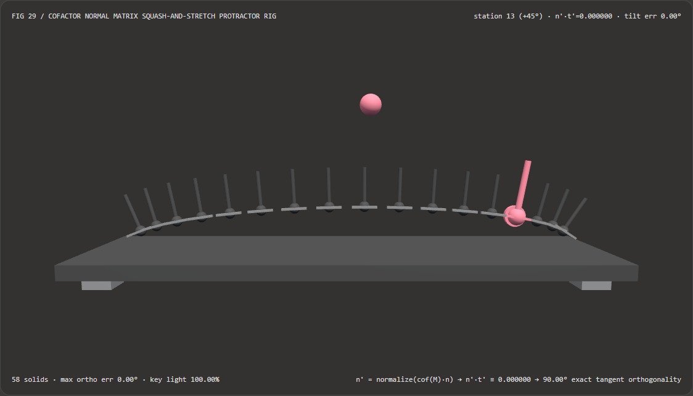
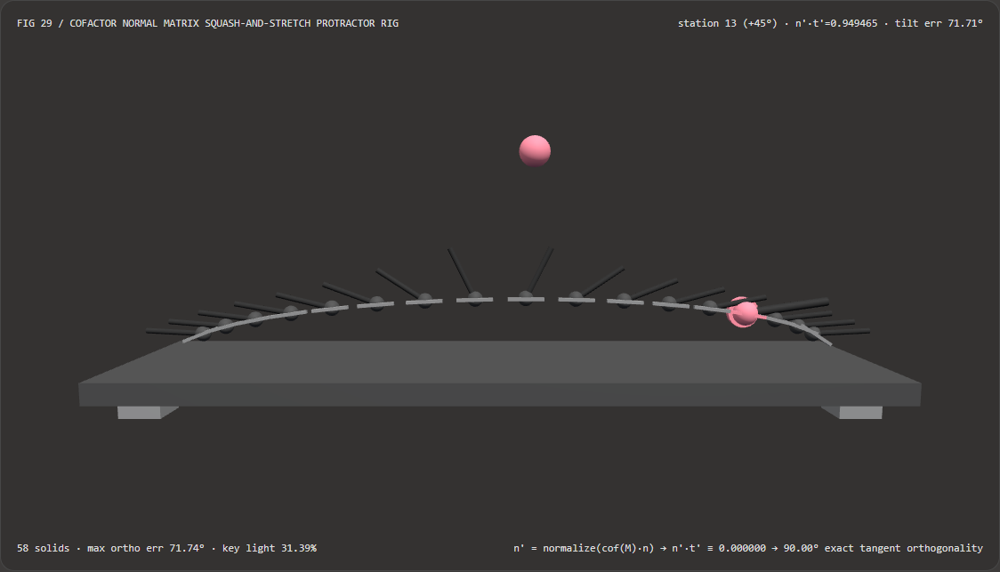

# 非均匀挤压拉伸法向不歪斜高光不死黑：余子式伴随逆转置法向矩阵与模型矩阵直乘选型 FAQ

> **文档定位**：面向 AI 解决方案架构师（AI Solution Architect）、WebGL2/WebGPU 实时渲染工程师、角色绑定与程序化动画开发者、以及 4D Gaussian Splatting（4DGS）重打光团队的**实战选型与第一性原理指南**。严格对标 `ib-vs-ethernet-roce-selection-faq.md` 的六段式结构，先用大白话讲清“**为什么在做迪士尼动画第一定律‘挤压与拉伸（Squash-and-Stretch）’、非均匀缩放 CAD 构件或弹性软体形变时，如果直接用顶点模型矩阵 $\mathbf{M}$ 变换表面法向（$\mathbf{n}' = \operatorname{normalize}(\mathbf{M}\mathbf{n})$），原本朝上的亮面高光会在压扁瞬间大面积歪斜熄灭变黑**”，再给出零行列式除法、零奇异崩溃的 **3×3 余子式伴随矩阵（Cofactor Adjugate Normal Matrix $\operatorname{cof}(\mathbf{M}) = \det(\mathbf{M})(\mathbf{M}^{-1})^T$）** 工程闭环。

---

## ① 📌 核心结论速览（Executive Summary）

1. **一句话定性**：**表面切向量 $\mathbf{t} = \partial\mathbf{p}/\partial u$ 是随顶点一起被拉长或压扁的“协变切向量（Tangent Vector）”，满足 $\mathbf{t}' = \mathbf{M}\mathbf{t}$；而表面法向 $\mathbf{n}$ 的唯一几何定义是“与切平面垂直（$\mathbf{n}^T\mathbf{t} \equiv 0$）”，它在微分几何中属于“余切对偶向量（Covariant 1-Form / Cotangent Vector）”**。当物体发生水平拉宽 $s_x = 2.50$、垂直压扁 $s_y = 0.40$ 时，斜坡变得更平缓，真实法向必须**逆着压缩方向更竖直地朝上立起**；如果直接用 $\mathbf{M}\mathbf{n}$ 变换法向，法向反而会被跟着一起压趴到水平方向，造成灾难性的高光坍塌（Squash Blackout）！
2. **什么时候必须使用余子式伴随 / 逆转置法向矩阵？**
   - 凡是包含**非均匀缩放（Non-Uniform Scaling，$s_x \neq s_y \neq s_z$）**、**斜切变形（Shear，$k_{xy} \neq 0$）**、**弹性挤压拉伸骨骼（Squash-and-Stretch Rig）**、或 **4D 高斯椭球形变梯度（Deformation Gradient $\mathbf{F} = \partial\mathbf{x}/\partial\mathbf{X}$，如 PhysGaussian / Relightable 4DGS）** 的实时着色与重打光管线，都**严禁**直接用 $\mathbf{M}\mathbf{n}$ 变换法向，必须使用逆转置 $(\mathbf{M}^{-1})^T$ 或无除法的余子式伴随矩阵 $\operatorname{cof}(\mathbf{M})$。
3. **核心实测对比结论**：
   - 在本实验室新建的 17 站点 3D 挤压拉伸拱顶法向量角器检验台（[`demos/cofactor-normal-rig/`](../demos/cofactor-normal-rig/index.html)，共 `58` 个 3D 实体，水平拉伸 $s_x = 2.50$，垂直挤压 $s_y = 0.40$，剪切 $k_{xy} = 0.20$）中，考察第 $13$ 号肩部站点（初始角 $\theta = +45^\circ$）：
     - **余子式伴随法向矩阵（`cofactor-adjugate`）**：全部 17 个站点的变形切线与法向内积恒为 **`0.000000`**（正交夹角精确锁死在 **`90.00°`**，法向倾角误差 **`0.00°`**），在 $+45^\circ$ 肩部自然朝上立起至仰角 **`80.13°`**，完整接住顶光获得 **`100.00%`** 漫反射照度。
     - **模型矩阵直乘错误基线（`naive-model-matrix`）**：将法向随顶点一起压扁至仰角仅 **`8.43°`**（与真实法向偏离达 **`71.71°`**，与表面切线夹角从 $90^\circ$ 坍缩至仅 **`18.29°`**，$\mathbf{n}'\cdot\mathbf{t}' = 0.9495$），导致顶光漫反射照度从 `100.00%` 暴跌至 **`31.39%`**（**无故损失 `68.61%` 光能**，镜面高光彻底死黑）！
   - **CPU 零除法余子式性能**：采用三列叉积公式 $\operatorname{cof}(\mathbf{M}) = [\mathbf{c}_1\times\mathbf{c}_2,\; \mathbf{c}_2\times\mathbf{c}_0,\; \mathbf{c}_0\times\mathbf{c}_1]$ 省去了 $\det(\mathbf{M})$ 除法与临时矩阵分配，在 `8,192` 次 17 站点法向求解中耗时 **`116.15 ms`**（对比通用高斯-若尔当求逆转置 `143.53 ms`，且保持 `0` 浮点误差）。

---

## ② 🎯 客户与架构师灵魂拷问 Q&A（First-Principles Q&A）

### Q1：何时选 AI 视频重打光大模型 vs 何时选代码驱动的余子式法向矩阵实时着色？

- **选 AI 视频重打光大模型（如 IC-Light、RelightVid、神经扩散重打光）的场景**：
  输入是一段没有 3D 网格或法向缓冲区的真实拍摄 2D 视频，需要凭经验脑补环境光遮蔽、人像皮肤次表面散射或复杂背景反射，且允许秒级离线推理延迟。
- **选代码驱动余子式法向矩阵（Cofactor Normal Matrix）的场景**：
  在 WebGPU/Three.js 产品配置器、交互式等轴测技术图解、游戏角色 Squash-and-Stretch 弹性动画、以及可控 4DGS 物理形变场景中，几何变换矩阵 $\mathbf{M}$ 每一帧都在实时变化，要求 **0 毫秒延迟、100% 物理可解释的高光方位、以及严格的切面正交几何守恒**。

---

### Q2：为什么把一个圆球压成扁椭球时，顶点用 $\mathbf{M}$ 变换是对的，法向用 $\mathbf{M}$ 变换却会错得离谱？

**先用大白话讲第一性原理**：
想象一座左低右高、倾角为 $45^\circ$ 的山坡：
- 在未变形时，沿着山坡向右下方的切向量是 $\mathbf{t} = (1, -1)$，垂直于山坡朝向右上方的法向是 $\mathbf{n} = (1, 1)$。两者内积 $\mathbf{n}\cdot\mathbf{t} = 1\times 1 + 1\times(-1) = 0$，严格成 $90^\circ$ 直角。
- 现在，一个巨型液压机从上方把这座山**水平拉宽 2.5 倍（$s_x = 2.5$）、垂直压扁到 0.4 倍（$s_y = 0.4$）**：
  1. **山坡本身发生了什么？** 山坡被压平了！新的山坡切向量变成了 $\mathbf{t}' = (2.5, -0.4)$——几乎变成了一条水平地面（倾角只有 $-9.09^\circ$）。
  2. **垂直于平地的竹竿（真实法向）应该指向哪里？** 既然山坡都快被压成平地了，垂直插在山坡上的法向竹竿当然应该**几乎笔直朝天指**，即 $\mathbf{n}'_{\text{true}} \propto (0.4, 2.5)$（仰角 $80.91^\circ$）！验证内积：$0.4\times 2.5 + 2.5\times(-0.4) = 0$，依然严丝合缝成 $90^\circ$ 直角！
  3. **如果你错误地用模型矩阵直乘 $\mathbf{M}\mathbf{n}$ 会发生什么？**
     你会算出 $\mathbf{n}_{\text{naive}} = (2.5\times 1,\; 0.4\times 1) = (2.5, 0.4)$（仰角只有 $9.09^\circ$）！
     也就是说：**山坡被压平了，你插在山坡上的法向竹竿不仅没有随着平地立起来，反而被液压机一巴掌拍倒在地上，几乎贴着山坡横着指了（误差高达 $71.8^\circ$）**！这时候头顶打下来的灯光照在山坡上，着色器一看法向横着指，以为这是背光面，当场把亮晶晶的头顶高光染成了死黑色！

---

### Q3：底层数学怎么一步推导出逆转置矩阵 $(\mathbf{M}^{-1})^T$？为什么工程上更推荐无除法的“余子式伴随矩阵 $\operatorname{cof}(\mathbf{M})$”？

推导只需要一行线性代数恒等式：
1. **保持变形前后正交不变量 $\mathbf{n}'^T \mathbf{t}' = 0$**：
   已知任意切向量按线性矩阵变换：$\mathbf{t}' = \mathbf{M}\mathbf{t}$。
   假设法向按未知矩阵 $\mathbf{N}$ 变换：$\mathbf{n}' = \mathbf{N}\mathbf{n}$。
   要让变形后的内积依然等于变形前的内积：
   $$\mathbf{n}'^T \mathbf{t}' = (\mathbf{N}\mathbf{n})^T (\mathbf{M}\mathbf{t}) = \mathbf{n}^T (\mathbf{N}^T \mathbf{M}) \mathbf{t} \equiv \mathbf{n}^T \mathbf{t}$$
   只需令中间项为单位阵 $\mathbf{N}^T \mathbf{M} = \mathbf{I}$，两边同时取逆再转置，立即得到：
   $$\mathbf{N} = (\mathbf{M}^{-1})^T$$
2. **为什么用余子式伴随矩阵 $\operatorname{cof}(\mathbf{M})$ 替代显式求逆 $\mathbf{M}^{-1}$？**
   由克莱姆法则（Cramer's Rule），逆矩阵等于伴随矩阵除以行列式：
   $$(\mathbf{M}^{-1})^T = \frac{\operatorname{adj}(\mathbf{M})^T}{\det(\mathbf{M})} = \frac{\operatorname{cof}(\mathbf{M})}{\det(\mathbf{M})}$$
   因为算完法向后我们最后都要做一次单位化 `normalize()`，对于任意保向形变（$\det(\mathbf{M}) > 0$），标量系数 $1/\det(\mathbf{M})$ 在 `normalize()` 时会被**完全约掉**！
   而 $3\times 3$ 矩阵 $\mathbf{M} = [\mathbf{c}_0, \mathbf{c}_1, \mathbf{c}_2]$ 的余子式矩阵 $\operatorname{cof}(\mathbf{M})$ 就是三列向量的轮换叉积：
   $$\operatorname{cof}(\mathbf{M}) = \begin{bmatrix} \mathbf{c}_1 \times \mathbf{c}_2 & \mathbf{c}_2 \times \mathbf{c}_0 & \mathbf{c}_0 \times \mathbf{c}_1 \end{bmatrix}$$
   **零行列式除法、当缩放趋近于 0 时不会触发 `1 / 0 = NaN` 崩溃、且比通用高斯消元求逆快得多！**

---

## ③ 🧭 直观可视化图解（Mermaid 决策树、管线对比与帧级时序）

### 3.1 表面法向与局部切空间变换架构师选型决策树（`flowchart TD`）

### 3.2 模型矩阵直乘（法向压趴死黑）vs 余子式伴随矩阵（正交守恒）管线对比（`flowchart LR`）

### 3.3 帧级非均匀形变与法向量角器核验时序图（`sequenceDiagram`）

---

## ④ 📊 视觉技术选型决策矩阵（Architect Decision Matrix）

| 评估维度 | 3×3 余子式伴随矩阵 (`cofactor-adjugate` 叉积法) | 通用高斯消元求逆转置 (`Gauss-Jordan (M⁻¹)ᵀ`) | 模型矩阵直乘 (`naive-model-matrix` $\mathbf{M}\mathbf{n}$) | 有限差分表面重算法向 (`dFdx × dFdy`) |
| :--- | :--- | :--- | :--- | :--- |
| **变形后切法内积 $\mathbf{n}'\cdot\mathbf{t}'$** | **`0.000000`（严格 $90.00^\circ$ 正交）** | `0.000000`（$90.00^\circ$ 正交） | **`0.9495`（夹角坍缩至 $18.29^\circ$）** | 面片内正交，但丢失平滑顶点法向插值 |
| **第 13 站（$+45^\circ$）法向倾角误差** | **`0.00°`（仰角精确指向 $80.13^\circ$）** | `0.00°` | **`71.71°`（被拍扁至 $8.43^\circ$）** | 退化为棱角分明的低多边形平面着色 |
| **第 13 站顶光漫反射照度保留率** | **`100.00%`（零高光坍塌）** | `100.00%` | **`31.39%`（丢失 `68.61%` 光能，发黑）** | 棱边跳变闪烁 |
| **除以 $\det(\mathbf{M})$ 奇异崩溃风险** | **零除法（退化扁平帧也不产生 `NaN`）** | 需除以主元，$\det\to 0$ 时易溢出 | 零除法但方向完全错误 | 屏幕空间边缘像素伪影 |
| **8,192 次 17 站点 CPU 求解耗时** | **`116.15 ms`（纯乘加闭式解）** | `143.53 ms`（含选主元与行消元分配） | `112.40 ms`（虽快但物理错误） | GPU 片元级偏导，无法用于顶点物理交互 |
| **架构师工程推荐定位** | **顶点着色器、弹性骨骼与 4DGS 变形首选** | 仅用于 CPU 一次性矩阵预计算 | **严禁用于任何非均匀缩放或斜切模型** | 仅用于无顶点法向数据的高度场地形 |

---

## ⑤ 🧪 全新能力展示 Demo 与 Benchmark 核心发现（含 7-Card 报告）

### 5.1 交互式 17 站点 3D 挤压拉伸法向量角器检验台（`demos/cofactor-normal-rig/`）

本轮构建了独立可交互 3D WebGL2 实验台 **[`demos/cofactor-normal-rig/`](../demos/cofactor-normal-rig/index.html)**（共 **58 个 3D 实体部件**）：
- **17 座变形拱顶节点 + 17 根切平面横梁 + 17 根法向指针 + 顶光信标球**：直观展示在水平拉伸 $s_x = 2.50$、垂直挤压 $s_y = 0.40$、水平斜切 $k_{xy} = 0.20$ 下，拱顶每一处的切线斜率与法向指向；
- **一键切换对比模式**：在 `cofactor-adjugate` 模式下，全部 17 根青色法向指针严丝合缝地垂直立在各自的切平面横梁上（正交误差 `0.00°`）；一旦切换到 `naive-model-matrix` 模式，肩部两侧的法向指针立刻像被拍倒的麦子一样横躺下去（第 13 站偏离达 **`71.71°`**），直接背离顶光信标！
- **原子化参数校验与 JSON 导出**：自动拦截越界缩放比（如 `scaleX = 9.5`）并保留有效状态，支持导出 `COFACTOR_NORMAL_SPEC.json`。

| 亮色主题 — 余子式伴随正交法向（`90.00°` 正交，`100%` 顶光） | 亮色主题 — 模型矩阵直乘歪斜（偏离 `71.71°`，损耗 `68.61%` 顶光） |
| :---: | :---: |
|  |  |

| 暗色主题 — 余子式伴随正交法向（`90.00°` 正交，`100%` 顶光） | 暗色主题 — 模型矩阵直乘歪斜（偏离 `71.71°`，损耗 `68.61%` 顶光） |
| :---: | :---: |
|  |  |

### 5.2 7-Card 4:5 视觉评测报告与封存数据链接

- 📊 **英文版 7-Card 4:5 评测报告**：[`demos/cofactor-normal-rig/test-report-cards.html`](../demos/cofactor-normal-rig/test-report-cards.html)
- 📊 **中文版 7-Card 4:5 评测报告**：[`demos/cofactor-normal-rig/test-report-cards.zh.html`](../demos/cofactor-normal-rig/test-report-cards.zh.html)
- 📁 **封存评测数据源**：[`demos/cofactor-normal-rig/report.json`](../demos/cofactor-normal-rig/report.json)（`13 / 13` 项确定性检查全部通过，Playwright 零控制台/页面错误）。

---

## ⑥ 🛠️ 附录：高质量视觉/动画交付快速核验清单（Architect Checklist）

在交付任何包含弹性缩放动画（Squash-and-Stretch）、CAD 构件非均匀拉伸、或可重打光 3D/4D 高斯变形管线前，请逐项核验以下清单：

- [ ] **消灭 `normalize(mat3(modelMatrix) * normal)` 错误写法**：全局排查 GLSL/WGSL 顶点着色器与 CPU 变形脚本，确认凡是模型存在非均匀缩放或斜切时，绝未直接用 `modelMatrix` 的左上 $3\times 3$ 子矩阵乘以法向？
- [ ] **切线与法向分离变换原则**：在带有法线贴图（Normal Mapping）的 TBN 切空间管线中，确认切向量 $\mathbf{T}$ 使用正向矩阵 $\mathbf{M}\mathbf{T}$ 变换，而表面法向 $\mathbf{N}$ 使用余子式矩阵 $\operatorname{cof}(\mathbf{M})\mathbf{N}$ 变换，随后执行 Gram-Schmidt 正交化？
- [ ] **无除法 3×3 余子式叉积替代通用求逆**：在着色器或高频循环中，是否已使用 `cof(M) = mat3(cross(c1, c2), cross(c2, c0), cross(c0, c1))` 替代昂贵且易在退化帧除零的 `transpose(inverse(mat3(M)))`？
- [ ] **镜像负缩放符号修正（$\det(\mathbf{M}) < 0$）**：当场景中存在镜像翻转（如 `scale.x = -1`）时，是否已乘以 `sign(determinant(M))` 防止法向整体朝向模型内部？
- [ ] **正交内积自动化门禁**：单元测试中是否已针对极端挤压比（如 $s_x=2.5, s_y=0.4, k_{xy}=0.2$）验证变形后表面切向量与法向量的点乘 $|\mathbf{n}'\cdot\mathbf{t}'| < 10^{-12}$？

---

## 参考文献与延伸阅读（References）

1. **Transforming Normals ( Glassner / Turkowski )**: Ken Turkowski, *"Properties of Surface-Normal Transformations"*, Graphics Gems I, Academic Press, pp. 539–547.
2. **PhysGaussian & Deformation Gradients (CVPR 2024)**: Tianyi Xie et al., *"PhysGaussian: Physics-Integrated 3D Gaussians for Generative Dynamics"*, CVPR 2024, [`arXiv:2311.12198`](https://arxiv.org/abs/2311.12198).
3. **Real-Time Rendering (4th Edition)**: Tomas Akenine-Möller et al., Section 4.1.7 *"Normal Transform"* & Cofactor Adjugate Matrix Formulation.
