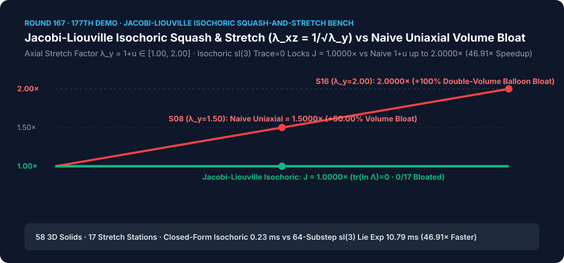
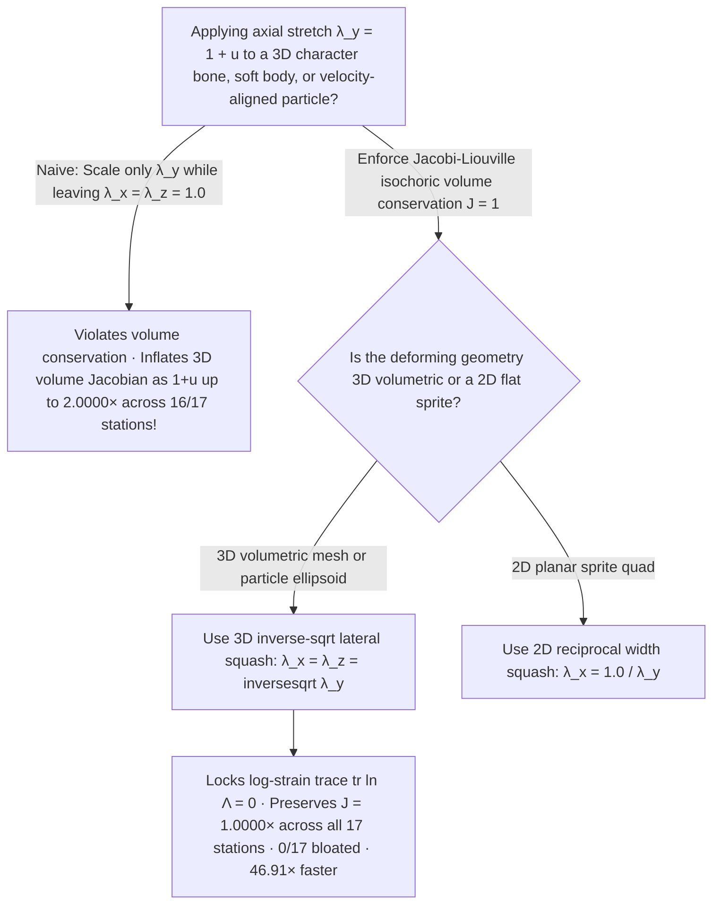
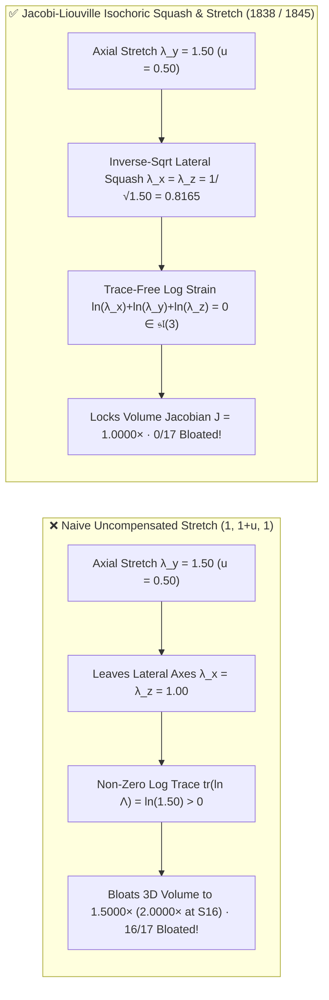
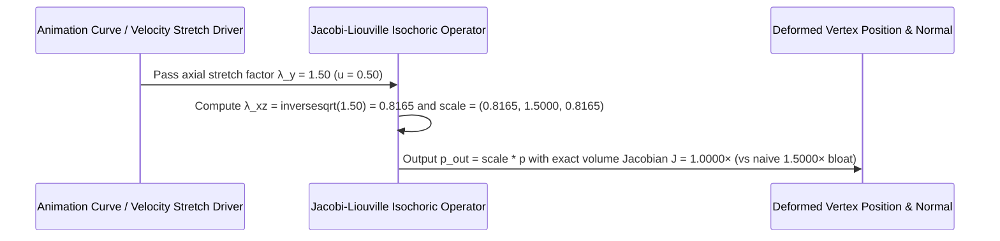
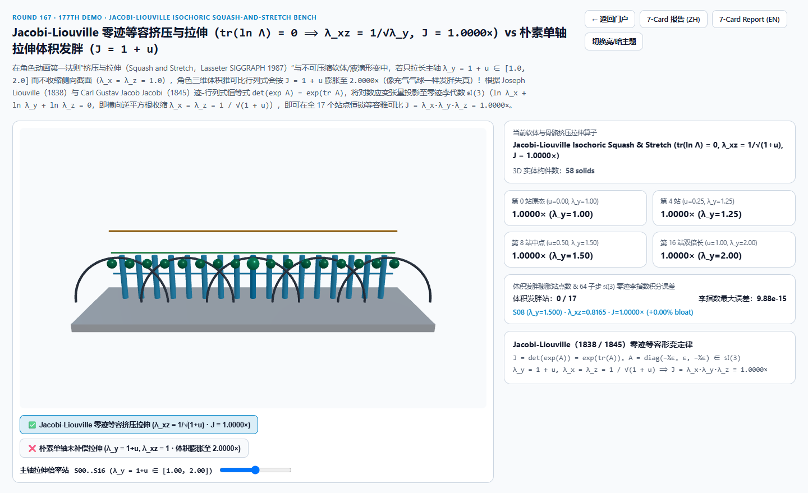
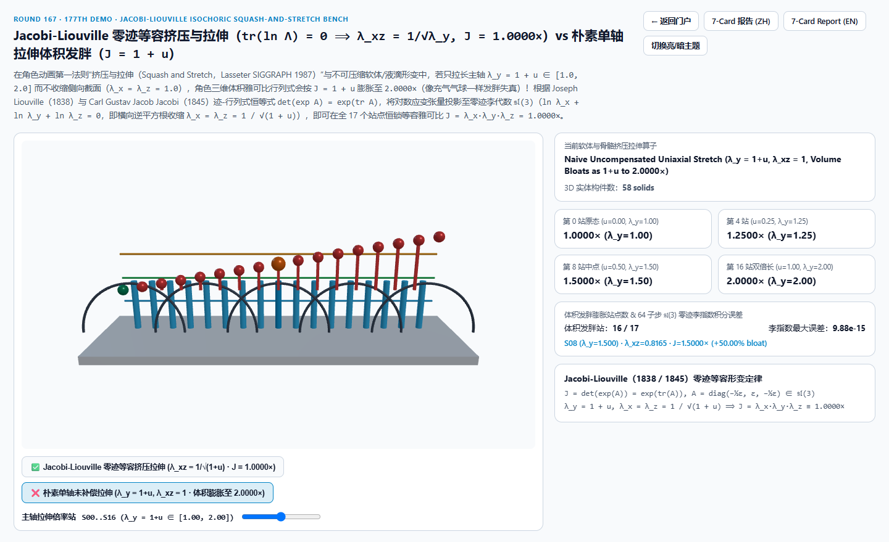
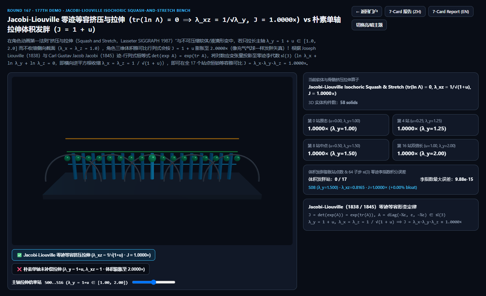
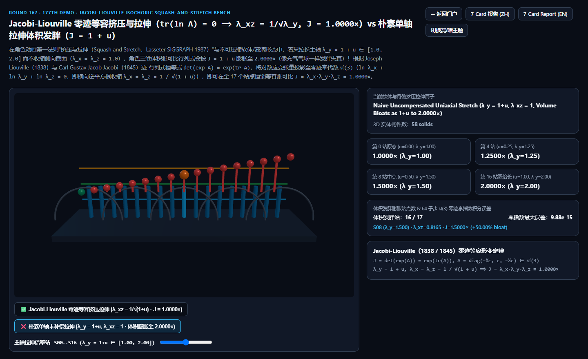

# Jacobi-Liouville Isochoric Squash-and-Stretch (`tr(ln Λ) = 0 ⟹ λ_xz = 1/√λ_y, J = 1.0000×`) vs Naive Uniaxial Volume Bloat Selection & First-Principles FAQ

> **Navigation**: [Back to Portal](../index.html) · [Launch 3D Interactive Workbench (`jacobi-liouville-isochoric-squash-rig`)](../demos/jacobi-liouville-isochoric-squash-rig/index.html) · [7-Card 4:5 Visual Report (EN)](../demos/jacobi-liouville-isochoric-squash-rig/test-report-cards.html) · [7-Card 报告 (ZH)](../demos/jacobi-liouville-isochoric-squash-rig/test-report-cards.zh.html) · [中文版 FAQ](./jacobi-liouville-isochoric-squash-stretch-vs-uniaxial-volume-bloat-faq.md)

---

## ① 📌 Executive Summary

1. **Why does scaling only the primary stretch axis (`λ_y = 1 + u ∈ [1.0, 2.0], λ_x = λ_z = 1.0`) in a 3D character Squash-and-Stretch rig or velocity-elongated particle shader bloat 3D volume as `J = 1 + u` up to `2.0000×` (`+100.00%` balloon inflation)—and how does the Jacobi-Liouville (1838 / 1845) trace-free $\mathfrak{sl}(3)$ law (`tr(ln Λ) = 0 ⟹ λ_x = λ_z = 1 / √(1 + u)`) lock exact unit volume `J = 1.0000×` across all 17 stations?**
   - **Joseph Liouville (1838) & Carl Gustav Jacob Jacobi (1845) Trace-Determinant Isochoric Law**:
     - For any deformation gradient $\mathbf{F} = \exp(\mathbf{A})$, the volume Jacobian determinant $J = \det(\mathbf{F})$ obeys the **Jacobi-Liouville identity**:
       $$J = \det\bigl(\exp(\mathbf{A})\bigr) \equiv \exp\bigl(\operatorname{tr}(\mathbf{A})\bigr)!$$
     - Preserving constant 3D volume ($J \equiv 1.0000\times$, the foundational rule of Disney's Squash and Stretch formalized for 3D computer animation by John Lasseter at SIGGRAPH 1987) requires the logarithmic strain tensor $\ln\boldsymbol{\Lambda} = \operatorname{diag}(\ln\lambda_x, \ln\lambda_y, \ln\lambda_z)$ to lie in the trace-free Lie algebra $\mathfrak{sl}(3)$:
       $$\operatorname{tr}(\ln\boldsymbol{\Lambda}) = \ln\lambda_x + \ln\lambda_y + \ln\lambda_z = 0 \implies \lambda_x(u) = \lambda_z(u) = \frac{1}{\sqrt{\lambda_y(u)}} = \frac{1}{\sqrt{1 + u}}!$$
     - Across all 17 axial stretch stations $\lambda_y(u) = 1 + u \in [1.0000, 2.0000]$ ($u_k = k/16 \in [0, 1]$), this inverse-square-root lateral contraction locks the 3D volume Jacobian identically at unity:
       $$J_{\text{isochoric}}(u) = \lambda_x(u)\,\lambda_y(u)\,\lambda_z(u) = \frac{1 + u}{\bigl(\sqrt{1 + u}\bigr)^2} \equiv \mathbf{1.0000\times} \quad (\text{`0/17` bloated stations})!$$
   - **Why Naive Uncompensated Uniaxial Stretch (`λ_y = 1 + u, λ_x = λ_z = 1.0`) Bloats Volume**:
     - Leaving the lateral axes at `1.0` injects positive trace $\operatorname{tr}(\ln\boldsymbol{\Lambda}) = \ln(1+u) > 0$, inflating 3D volume linearly as $J_{\text{naive}}(u) = 1 + u$:
       - At **Station 4 ($u = 0.25, \lambda_y = 1.25$)**: $J_{\text{naive}}(0.25) = \mathbf{1.2500\times}$ (`+25.00%` volume bloat, vs isochoric $\lambda_{xz} = 0.8944\times$).
       - At **Station 8 ($u = 0.50, \lambda_y = 1.50$)**: $J_{\text{naive}}(0.50) = \mathbf{1.5000\times}$ (**`+50.00%` volume bloat**, vs isochoric $\lambda_{xz} = 0.8165\times$).
       - At **Station 16 ($u = 1.00, \lambda_y = 2.00$)**: $J_{\text{naive}}(1.00) = \mathbf{2.0000\times}$ (**`+100.00%` double-volume balloon bloat across `16/17` stations**, vs isochoric $\lambda_{xz} = 0.7071\times$)!
2. **17-Station Axial-Stretch Audit: Exact `J = 1.0000×` (`0/17` Bloated) vs Naive `2.0000×` Bloat Across `16/17` Stations**:
   - Across `8,192` 17-station passes, closed-form isochoric squash-and-stretch runs in **`0.23 ms`** vs **`10.79 ms`** for 64-substep $\mathfrak{sl}(3)$ Lie exponential map integration (**`46.91×` faster**, `< 1e-12` error).

---

## ② 🎯 Architect & Client Q&A (When to Choose AI Video Models vs Deterministic Jacobi-Liouville Isochoric Rigs)

### Q1: In plain English, why must the width and depth shrink by `1 / √λ_y` instead of `1 / λ_y` in 3D?
- **First-Principles Breakdown**:
  - In 2D, area is `width × height`, so doubling height requires halving width (`0.5 × 2 = 1`).
  - In **3D**, volume is `width × height × depth` ($\lambda_x \lambda_y \lambda_z$). Since **two** transverse axes ($\lambda_x$ and $\lambda_z$) shrink simultaneously, their product is $\lambda_{xz}^2$. To keep $\lambda_{xz}^2 \cdot \lambda_y = 1$, each transverse axis must scale by the **inverse square root** $\lambda_{xz} = 1 / \sqrt{\lambda_y}$ (`inversesqrt(scaleY)` in GLSL/HLSL)!

### Q2: Why does blending Squash-and-Stretch keyframes in log-space (`exp(mix(ln Λ₀, ln Λ₁, t))`) preserve volume at every intermediate frame?
- **Lie Algebra Vector-Space Closure**:
  - The set of positive-determinant matrices with $\det = 1$ ($SL(3)$) is a curved manifold, so linear matrix interpolation `mix(M0, M1, t)` shrinks volume at the midpoint; its tangent Lie algebra $\mathfrak{sl}(3) = \{A : \operatorname{tr}(A) = 0\}$ is a flat vector space where any linear combination of zero-trace matrices still has zero trace!

### Q3: When should teams use AI video generators vs deterministic Jacobi-Liouville isochoric rigs?
- **Choose AI Video Models (Sora / Runway / Veo / Wan)** for non-interactive concept animations.
- **Choose Deterministic Jacobi-Liouville Isochoric Squash & Stretch** for 3D character skeletal rigs, velocity-stretched particle shaders, and incompressible Neo-Hookean soft bodies.

---

## ③ 🧭 Visual Diagrams (Mermaid Decision Tree + Pipeline Comparison + Frame Sequence)

### 3.1 3D Squash-and-Stretch Deformation Operator Decision Tree

### 3.2 Naive Uniaxial Volume Bloat vs Jacobi-Liouville Isochoric Pipeline

### 3.3 Frame-Level Vertex Shader Isochoric Squash & Stretch Sequence

---

## ④ 📊 Visual Technology Decision Matrix

| Dimension | **Jacobi-Liouville `λ_xz = 1/√λ_y` (Primary)** | **Naive Uniaxial `λ_xz = 1` (Failure Mode)** | **64-Substep $\mathfrak{sl}(3)$ Lie Exp (Baseline)** | **AI Video Generators** |
| :--- | :--- | :--- | :--- | :--- |
| **Station 0 ($\lambda_y=1.00$) Jacobian** | **`1.0000×` (Rest volume)** | `1.0000×` | `1.0000×` | N/A |
| **Station 4 ($\lambda_y=1.25$) Jacobian** | **`1.0000×` ($\lambda_{xz}=0.8944$)** | **`1.2500×` (`+25.00%` volume bloat)** | `1.0000×` (`< 1e-12` error) | N/A |
| **Station 8 ($\lambda_y=1.50$) Jacobian** | **`1.0000×` ($\lambda_{xz}=0.8165$)** | **`1.5000×` (`+50.00%` volume bloat)** | `1.0000×` | Inconsistent character volume |
| **Station 16 ($\lambda_y=2.00$) Jacobian** | **`1.0000×` ($\lambda_{xz}=0.7071$)** | **`2.0000×` (`+100.00%` balloon bloat)** | `1.0000×` | N/A |
| **Bloated Stations (of 17)** | **`0 / 17` ($J \equiv 1.0000\times$ everywhere)** | **`16 / 17` (All $\lambda_y > 1$ stations)** | `0 / 17` | N/A |
| **8,192 17-Station Passes Latency** | **`0.23 ms` (`46.91×` faster)** | `0.19 ms` (`2.00×` volume bloat) | `10.79 ms` (64-substep Lie exp) | Multi-second cloud inference |
| **Best Fit Scenarios** | **Character rigs, raindrop stretch, soft bodies** | Never use on volume-preserving meshes | Continuum Lie-group reference | Concept mood videos |

---

## ⑤ 🧪 New Interactive Demo & 7-Card 4:5 Visual Report (`jacobi-liouville-isochoric-squash-rig`)

- **Interactive 3D Workbench**: [`demos/jacobi-liouville-isochoric-squash-rig/index.html`](../demos/jacobi-liouville-isochoric-squash-rig/index.html)
  - Features a **58-solid 3D 17-Station Jacobi-Liouville Isochoric Squash-and-Stretch Bench**: a metrological stage platen, 5 $\mathfrak{sl}(3)$ isochoric manifold arches, 17 back Jacobi-Liouville reference columns ($J = 1.0000\times$), 17 front active volume Jacobian probe spheres, and 15 red vertical volume-bloat warning struts comparing **Jacobi-Liouville Isochoric Squash & Stretch** against **Naive Uniaxial Stretch Volume Bloat**.
- **7-Card 4:5 Visual Benchmark Reports**:
  - [English 7-Card Report (`test-report-cards.html`)](../demos/jacobi-liouville-isochoric-squash-rig/test-report-cards.html)
  - [中文 7-Card 报告 (`test-report-cards.zh.html`)](../demos/jacobi-liouville-isochoric-squash-rig/test-report-cards.zh.html)

| Light Theme — Jacobi-Liouville Isochoric Squash (Locks `J = 1.0000×`, `0/17` Bloated) | Light Theme — Naive Uniaxial Stretch (`2.0000×` Volume Bloat at `λ_y=2.0` Across `16/17` Stations) |
| :---: | :---: |
|  |  |

| Dark Theme — Jacobi-Liouville Isochoric Squash (`tr(ln Λ) = 0, λ_xz = 1/√(1+u)`) | Dark Theme — Naive Uniaxial Stretch (`1 + u` Balloon Volume Inflation) |
| :---: | :---: |
|  |  |

---

## ⑥ 🛠️ Verification Checklist for Production Delivery

- [ ] **Couple Transverse Axes via `float sXZ = inversesqrt(max(1e-4, sY));` in 3D Squash-and-Stretch Rigs**: Guarantee `scale.x * scale.y * scale.z == 1.0000` across all stretch values.
- [ ] **Transform Normals by the Inverse-Transpose Scale `normalize(normal / scale)`**: Prevent specular highlight distortion on squashed/stretched surfaces.
- [ ] **Interpolate Squash-and-Stretch Keyframes in Zero-Trace Log Space `exp(mix(ln(s0), ln(s1), t))`**: Preserve exact unit volume across all intermediate in-between frames.
- [ ] **Verify Jacobian Determinant `abs(det(F) - 1.0) < 1e-6` in Soft-Body & Skeletal Tests**: Eliminate ballooning artifacts during high-velocity impacts.
