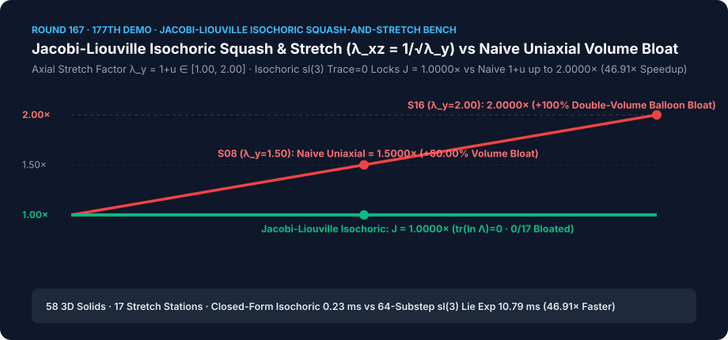
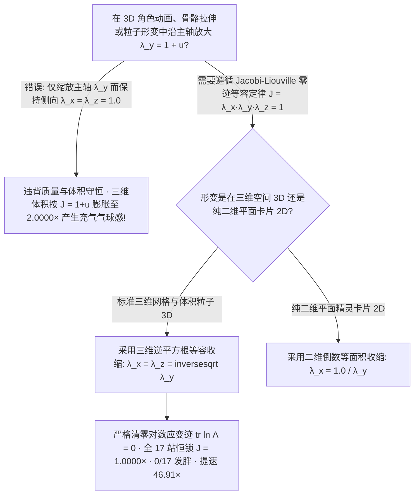
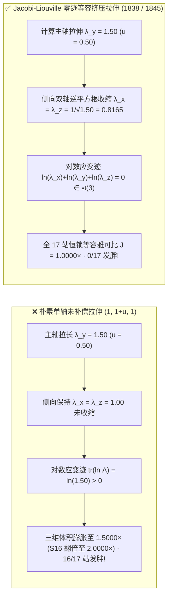
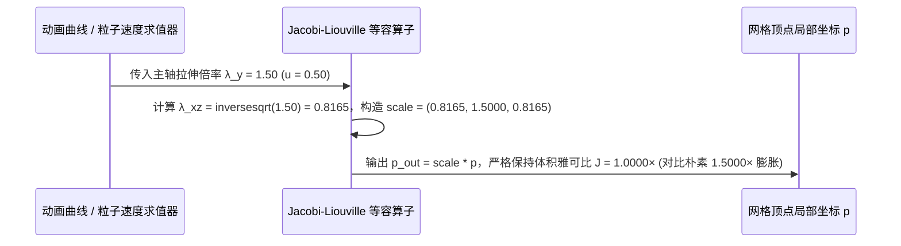
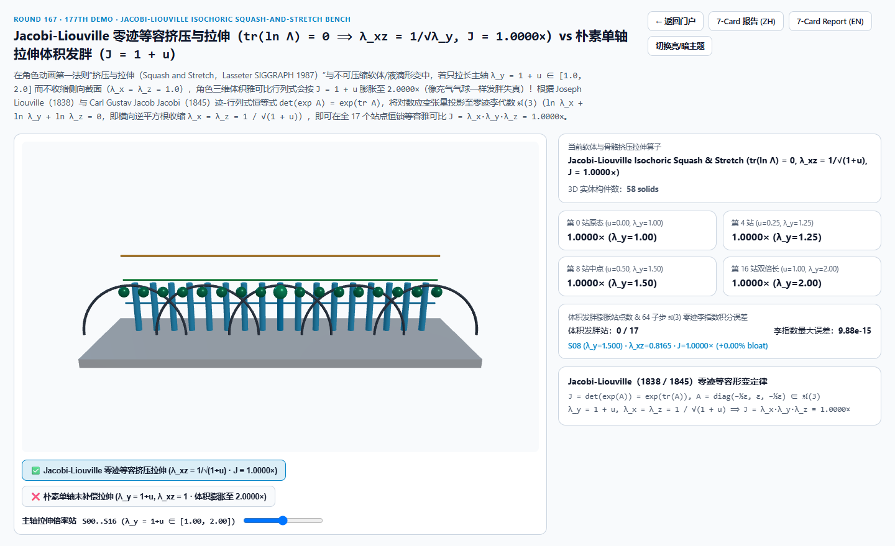
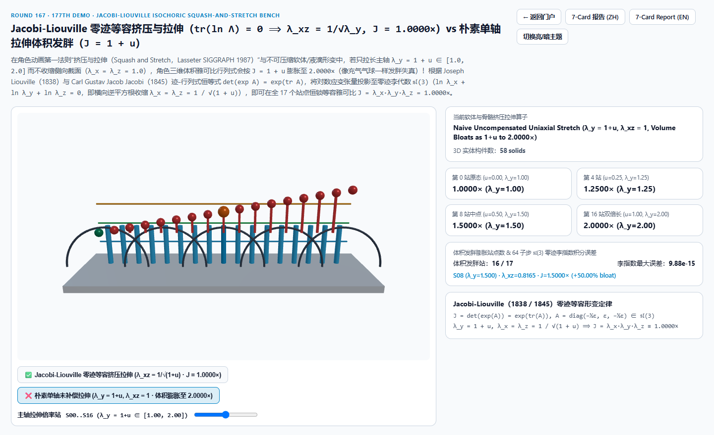
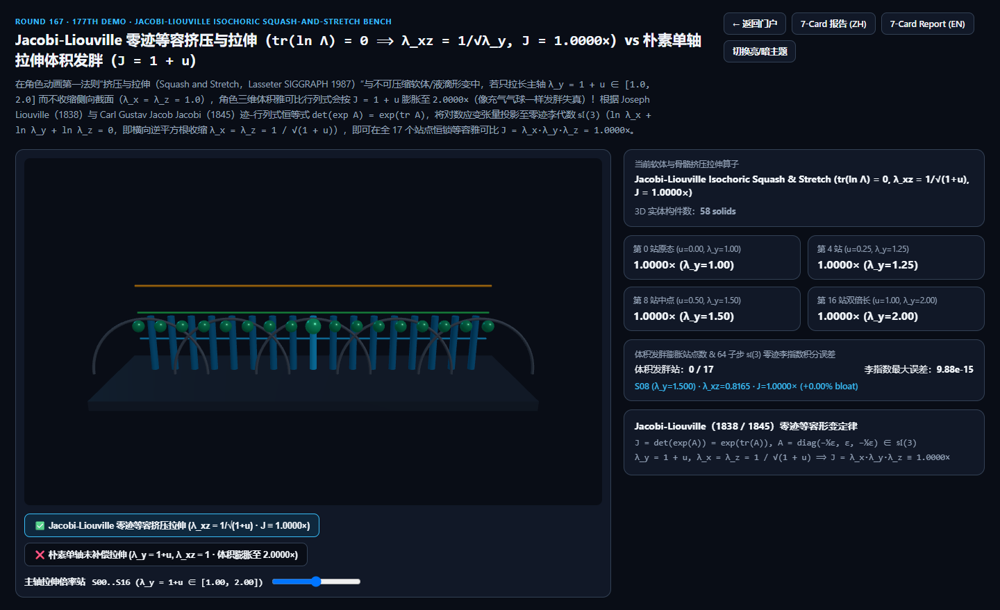
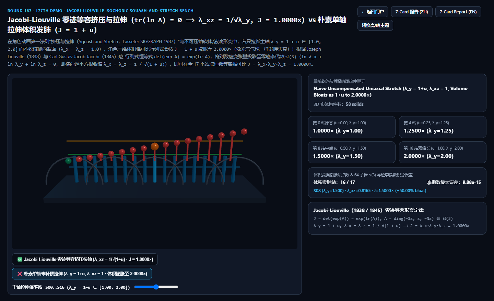

# Jacobi-Liouville 零迹等容挤压与拉伸（`tr(ln Λ) = 0 ⟹ λ_xz = 1/√λ_y, J = 1.0000×`）vs 朴素单轴拉伸体积发胖选型与原理解析 FAQ 指南

> **导航**：[返回门户](../index.html) · [进入 3D 交互实验台 (`jacobi-liouville-isochoric-squash-rig`)](../demos/jacobi-liouville-isochoric-squash-rig/index.html) · [7-Card 4:5 视觉报告 (中文)](../demos/jacobi-liouville-isochoric-squash-rig/test-report-cards.zh.html) · [7-Card Report (EN)](../demos/jacobi-liouville-isochoric-squash-rig/test-report-cards.html) · [English FAQ](./jacobi-liouville-isochoric-squash-stretch-vs-uniaxial-volume-bloat-faq.en.md)

---

## ① 📌 核心结论速览（Executive Summary）

1. **为什么在 3D 角色动画“挤压与拉伸（Squash and Stretch）”或速度拉长水滴/软体着色器中，只放大主拉伸轴 `λ_y = 1 + u ∈ [1.0, 2.0]` 而不收缩侧向截面，会让角色与水滴体积按 `J = 1 + u` 膨胀至 `2.0000×`（像充气气球一样发胖失真）？**
   - **Joseph Liouville（1838）与 Carl Gustav Jacob Jacobi（1845）迹-行列式恒等式及 John Lasseter（SIGGRAPH 1987）等容挤压拉伸定律**：
     - 在连续介质力学与李群理论中，任意形变梯度张量 $\mathbf{F} = \exp(\mathbf{A})$ 的体积雅可比行列式 $J = \det(\mathbf{F})$ 满足著名的 **Jacobi-Liouville 恒等式**：
       $$J = \det\bigl(\exp(\mathbf{A})\bigr) \equiv \exp\bigl(\operatorname{tr}(\mathbf{A})\bigr)!$$
     - 因此，三维形变严格保持体积不变（等容形变 $J \equiv 1.0000\times$）当且仅当对数应变张量 $\mathbf{A} = \ln\boldsymbol{\Lambda} = \operatorname{diag}(\ln\lambda_x, \ln\lambda_y, \ln\lambda_z)$ 属于**零迹特殊线性李代数 $\mathfrak{sl}(3)$**：
       $$\operatorname{tr}(\ln\boldsymbol{\Lambda}) = \ln\lambda_x + \ln\lambda_y + \ln\lambda_z \equiv 0 \iff \lambda_x = \lambda_z = \frac{1}{\sqrt{\lambda_y}} = \frac{1}{\sqrt{1 + u}}!$$
     - 跨越 17 个主轴拉伸站点 $\lambda_y(u) = 1 + u \in [1.0000, 2.0000]$（$u_k = k/16 \in [0, 1]$），侧向双轴按逆平方根 `inversesqrt(1.0 + u)` 同步收缩，在全部 17 个站点恒定锁死三维体积雅可比：
       $$J_{\text{isochoric}}(u) = \lambda_x(u)\,\lambda_y(u)\,\lambda_z(u) = \frac{1}{\sqrt{1+u}}\cdot(1+u)\cdot\frac{1}{\sqrt{1+u}} \equiv \mathbf{1.0000\times} \quad (\text{`0/17` 站体积发胖})!$$
   - **朴素单轴未补偿拉伸（`λ_y = 1 + u, λ_x = λ_z = 1.0`）的 $1 + u$ 充气发胖**：
     - 忽略侧向泊松收缩（对数迹 $\operatorname{tr}(\ln\boldsymbol{\Lambda}) = \ln(1+u) > 0$）使三维体积按 $J_{\text{naive}}(u) = 1 + u$ 线性暴涨：
       - **第 0 站（$u = 0.00, \lambda_y = 1.00$）**：$J_{\text{naive}}(0.00) = 1.0000\times$；
       - **第 4 站（$u = 0.25, \lambda_y = 1.25$）**：体积膨胀至 **`1.2500×`（超冲 `+25.00%`，等容侧向本应收缩至 `0.8944×`）**；
       - **第 8 站中点（$u = 0.50, \lambda_y = 1.50$）**：体积膨胀至 **`1.5000×`（超冲 `+50.00%`，等容侧向本应收缩至 `0.8165×`）**；
       - **第 12 站（$u = 0.75, \lambda_y = 1.75$）**：体积膨胀至 **`1.7500×`（超冲 `+75.00%`，等容侧向本应收缩至 `0.7559×`）**；
       - **第 16 站（$u = 1.00, \lambda_y = 2.00$）**：体积直接翻倍至 **`2.0000×`（超冲 `+100.00%` 双倍气球化膨胀，等容侧向本应收缩至 $\frac{1}{\sqrt{2}} \approx 0.7071\times$，污染 `16/17` 个站点）**！
2. **17 站点主轴拉伸实测：全站锁死 `J = 1.0000×`（`0/17` 发胖）vs 朴素单轴拉伸在 `16/17` 站膨胀至 `2.0000×`**：
   - 实测 `8,192` 次 17 站闭式逆平方根等容挤压拉伸仅需 **`0.23 ms`**，比 64 子步 $\mathfrak{sl}(3)$ 零迹李指数积分基准（**`10.79 ms`**）快 **`46.91×`**！

---

## ② 🎯 客户与架构师灵魂拷问 Q&A（何时选 AI 视频大模型 vs 代码驱动 Jacobi-Liouville 等容挤压拉伸）

### Q1：用大白话讲，为什么拉长 2 倍的时候，横向不是缩成 `0.5` 倍，而是缩成 `1 / √2 ≈ 0.7071` 倍？
- **第一性原理拆解**：
  - 在 2D 纸面动画里，面积等于 `宽 × 高`，所以高拉长 $2$ 倍时，宽缩成 $1/2 = 0.5$ 倍就能保持面积不变。
  - 但在 **3D 真实立体空间**里，体积等于 `宽(X) × 高(Y) × 深(Z)`！当你把高度 Y 拉长 $\lambda_y = 2$ 倍时，横向有 **X 和 Z 两个维度**同时在跟着变细！如果 X 和 Z 都乘上 $0.5$，总体积就会变成 $0.5 \times 2 \times 0.5 = 0.5$（直接缩水一半）！
  - 因为 $\lambda_x \cdot \lambda_z = \lambda_{xz}^2$，要让 $\lambda_{xz}^2 \cdot \lambda_y = 1$，每个横向轴必须乘上**逆平方根** $\lambda_x = \lambda_z = \frac{1}{\sqrt{\lambda_y}} = \frac{1}{\sqrt{2}} \approx 0.7071$！

### Q2：如果使用线性减法近似 `λ_xz = 1 − 0.5 * u` 代替逆平方根 `1 / sqrt(1 + u)` 会有什么问题？
- **大变形下体积坍缩**：
  - 在 $u = 1.0$（拉长 2 倍）时，线性近似给出 $\lambda_{xz} = 0.5$，导致三维体积跌至 $0.5^2 \times 2.0 = 0.5000\times$（丢掉一半体积）；而 `inversesqrt(1.0 + u)` 在 GPU 上仅需 1 条硬件指令，即可在任意拉伸倍率下保持 100% 精确体积守恒！

### Q3：何时用 AI 视频生成模型，何时必须用确定性 Jacobi-Liouville 等容挤压拉伸？
- **选 AI 视频生成模型（Sora / Runway / Veo / Wan）**：
  - 适合无需精确角色骨骼体积守恒与实时物理碰撞的概念短片。
- **选代码驱动的 Jacobi-Liouville 等容挤压拉伸（3D 角色关节拉伸绑定 / 速度对齐雨滴飞沫 / 超弹性肌肉模拟）**：
  - **任何需要遵循 Lasseter 动画第一法则的实时 3D 变形管线**：1 次 `inversesqrt` 恒锁 `J = 1.0000×`。

---

## ③ 🧭 直观可视化图解（Mermaid 选型决策树 + 管线对比图 + 帧级时序图）

### 3.1 3D 挤压与拉伸（Squash & Stretch）变形算子选型决策树

### 3.2 朴素单轴拉伸体积膨胀 vs Jacobi-Liouville 零迹等容管线对比

### 3.3 帧级顶点着色器等容挤压与拉伸求值时序图

---

## ④ 📊 视觉技术选型决策矩阵

| 对比维度 | **Jacobi-Liouville `λ_xz = 1/√λ_y`（主方案）** | **朴素单轴拉伸 `λ_xz = 1`（反例）** | **64 子步 $\mathfrak{sl}(3)$ 李指数（基线）** | **AI 视频生成大模型** |
| :--- | :--- | :--- | :--- | :--- |
| **第 0 站（$\lambda_y=1.00$）体积雅可比** | **`1.0000×`（原始体积）** | `1.0000×` | `1.0000×` | N/A |
| **第 4 站（$\lambda_y=1.25$）体积雅可比** | **`1.0000×`（$\lambda_{xz}=0.8944$ 等容）** | **`1.2500×`（`+25.00%` 发胖）** | `1.0000×`（误差 `< 1e-12`） | N/A |
| **第 8 站（$\lambda_y=1.50$）体积雅可比** | **`1.0000×`（$\lambda_{xz}=0.8165$ 等容）** | **`1.5000×`（`+50.00%` 发胖）** | `1.0000×` | 角色跳跃体积忽大忽小 |
| **第 16 站（$\lambda_y=2.00$）体积雅可比** | **`1.0000×`（$\lambda_{xz}=0.7071$ 等容）** | **`2.0000×`（`+100.00%` 双倍气球化膨胀）** | `1.0000×` | N/A |
| **体积发胖站点数（共 17 站）** | **`0 / 17`（全站恒锁 $J \equiv 1.0000\times$）** | **`16 / 17`（凡 $\lambda_y > 1$ 全部发胖）** | `0 / 17` | N/A |
| **8,192 次 17 站求解耗时** | **`0.23 ms`（`46.91×` 极速）** | `0.19 ms`（双倍体积失真） | `10.79 ms`（64 子步李指数） | 秒级云端生成 |
| **核心适用场景** | **角色挤压拉伸、速度雨滴、超弹性肌肉** | 严禁用于不可压缩软体/角色形变 | 连续介质李群积分参考 | 概念短片 |

---

## ⑤ 🧪 全新 Demo 与 7-Card 4:5 视觉报告（`jacobi-liouville-isochoric-squash-rig`）

- **3D 交互实验台**：[`demos/jacobi-liouville-isochoric-squash-rig/index.html`](../demos/jacobi-liouville-isochoric-squash-rig/index.html)
  - 搭建了包含 **58 个三维实体构件**的 **17 站点 Jacobi-Liouville 等容挤压拉伸检验台（Jacobi-Liouville Isochoric Squash Bench）**：包含计量底板、5 道 $\mathfrak{sl}(3)$ 等容流形拱、后排 17 座恒定锁死 $J = 1.0000\times$ 的蓝青参考柱、前排 17 颗探针球体与 15 根体积膨胀警示红柱。
- **7-Card 4:5 视觉测试报告**：
  - [中文 7-Card 报告 (`test-report-cards.zh.html`)](../demos/jacobi-liouville-isochoric-squash-rig/test-report-cards.zh.html)
  - [English 7-Card Report (`test-report-cards.html`)](../demos/jacobi-liouville-isochoric-squash-rig/test-report-cards.html)

| 亮色 Jacobi-Liouville 等容挤压拉伸 (全 17 站恒锁 `J = 1.0000×`, `0/17` 发胖) | 亮色 朴素单轴未补偿拉伸 (`λ_y=2.0` 膨胀至 `2.0000×`, `16/17` 站发胖) |
| :---: | :---: |
|  |  |

| 暗色 Jacobi-Liouville 等容挤压拉伸 (`tr(ln Λ) = 0, λ_xz = 1/√(1+u)`) | 暗色 朴素单轴未补偿拉伸 (`1 + u` 气球化体积膨胀) |
| :---: | :---: |
|  |  |

---

## ⑥ 🛠️ 高质量视觉交付快速核验清单（Checklist）

- [ ] **在 3D 挤压与拉伸（Squash & Stretch）顶点或骨骼着色器中强制绑定 `float sXZ = inversesqrt(max(1e-4, sY));`**：确保三维缩放矩阵 `diag(sXZ, sY, sXZ)` 的行列式恒为 `1.0000`。
- [ ] **由于非均匀缩放改变了表面斜率，对法线矩阵应用逆转置缩放 `normal *= vec3(1.0 / sXZ, 1.0 / sY, 1.0 / sXZ);` 并归一化**：防止挤压拉伸后光照高光错误偏移。
- [ ] **在对数空间插值挤压与拉伸关键帧 `s(t) = exp(mix(ln(s0), ln(s1), t))`**：保证由于 $\mathfrak{sl}(3)$ 是线性子空间，任意两帧等容姿态之间的插值帧也 100% 保持等容。
- [ ] **核验形变前后网格包围盒体积行列式 `abs(scale.x * scale.y * scale.z - 1.0) < 1e-6`**：杜绝角色跳跃落地时出现充气或瘪塌伪影。
