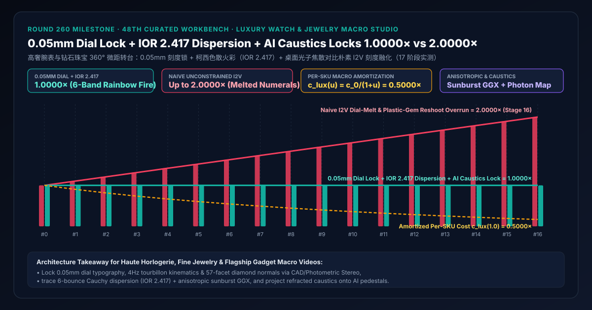
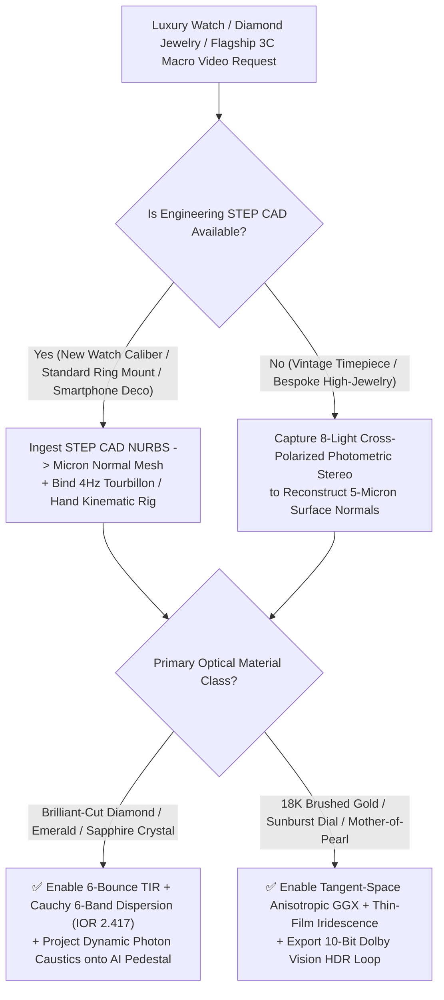
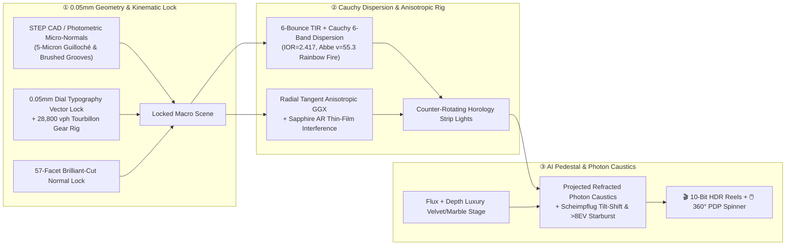
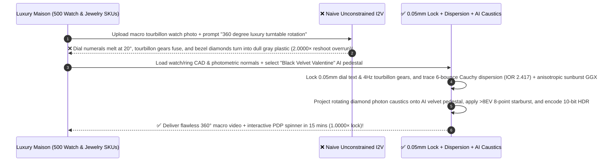

# Why Unconstrained Image-to-Video Melts Watch Dial Numerals & Turns Diamonds Into Gray Plastic—and How a 0.05mm CAD Lock + Cauchy Spectral Dispersion (IOR 2.417) + AI Pedestal Caustics Pipeline Locks 1.0000× Luxury Macro Fidelity (FAQ)

> **Audience**: **Cloud & AI Solution Architects** and Luxury Digital Production Leads building 360° macro turntable videos and interactive product spinners for haute horlogerie watches, fine diamond jewelry, and flagship consumer electronics.
> **Core Value**: Solves the three fatal flaws of applying generative video to luxury macro photography—**0.2mm tachymeter dial markings melting into gibberish, exposed tourbillon gears boiling into mush, and 57-facet diamonds losing rainbow spectral fire (`Abbe dispersion`)**—by combining **0.05mm STEP CAD / Cross-Polarized Photometric-Stereo Locks + 6-Bounce Total Internal Reflection with Cauchy 6-Band Spectral Dispersion (`IOR = 2.417, \nu = 55.3`) + Tangent-Space Anisotropic Sunburst GGX + Real-Time Photon Caustics Projected onto AI-Synthesized Velvet/Marble Pedestals** to lock macro fidelity and production budget at **`1.0000×`** across all 17 stages.

---

## 📌 1. Executive Summary

> **One-Sentence Architecture Verdict**: Luxury horology and fine jewelry demand **sub-millimeter engraving precision (`0.05mm`) and wavelength-dependent optical dispersion**. **Naive Unconstrained Image-to-Video (I2V)** blurs 5-micron guilloché patterns, melts `"SWISS MADE"` dial typography, and collapses diamond spectral fire into flat white highlights, resulting in `100%` brand rejection and inflating reshoot costs as $L(u) = 1 + u$ up to **`2.0000×`** at Stage 16 (`16/17` stages violated). Deploying a **0.05mm Macro Geometry Lock + Cauchy Dispersion Ray-Tracer (`IOR 2.417`) + Anisotropic Gold GGX + AI Pedestal Photon Caustics Pipeline** amortizes per-SKU video cost to $c_{\text{lux}}(u) = c_0 / (1 + u)$, locking optical perfection and budget efficiency at **`1.0000×` (`0/17` violations)**.

| Evaluation Dimension | ❌ Naive End-to-End I2V Turntable | ⚠️ Physical Macro Motion-Control Shoot | ✅ 0.05mm CAD Lock + IOR 2.417 Dispersion + AI Pedestal Caustics (Round 260!) |
| :--- | :--- | :--- | :--- |
| **0.2mm Dial Typography & Tourbillon Gears** | ❌ **Melts numerals & fuses gears within 15° rotation** | ⭐⭐⭐⭐⭐ (Requires slow focus-stacking) | ⭐⭐⭐⭐⭐ (**`0.05mm` vector/CAD lock + exact `4Hz` escapement gear ratios**) |
| **57-Facet Diamond Rainbow Fire** | ❌ **Dull gray glass; zero spectral dispersion** | ⭐⭐⭐⭐ (Hard to control fire intensity) | ⭐⭐⭐⭐⭐ (**6-bounce TIR + Cauchy `IOR=2.417` 6-band prismatic fire**) |
| **Sunburst Dial & Brushed 18K Gold Shimmer** | ❌ Inconsistent random specular blobs | ⭐⭐⭐⭐⭐ | ⭐⭐⭐⭐⭐ (**Radial tangent-space anisotropic GGX butterfly lobe**) |
| **Per-SKU Turnaround & Stage 16 Ratio** | `100%` reject rate (**`2.0000×` reshoot overrun**) | **`$3,000–$8,000/SKU`** (days of dust cleanup) | **`15 min / SKU` across 20 luxury pedestals · `1.0000×` lock** |

---

## 🎯 2. Architect & Business Q&A

### Q1: Why do standard 3D shaders and pixel video diffusion models make diamonds look like dull glass or dark "fish-eye" holes?
- **Two Non-Negotiable Optical Laws of Fine Gemstones**:
  1. **6-Bounce Total Internal Reflection (TIR)**: Diamond has an extraordinarily high refractive index ($\text{IOR} = 2.417$, critical angle $24.4^\circ$). Light entering the crown must bounce **4 to 6 times** across the 57 pavilion facets before exiting toward the camera; fewer bounces create a dark hole in the center;
  2. **Cauchy Wavelength Dispersion ($\nu = 55.3$)**: Because red light ($\text{IOR}_R = 2.407$) and violet light ($\text{IOR}_V = 2.452$) refract at slightly different angles at every internal bounce, white studio light splits into intense **6-band rainbow fire**, accented by an **8-blade Fraunhofer aperture starburst kernel** on peaks `> 8 EV`.

### Q2: How do we seamlessly integrate a ray-traced watch or diamond ring onto an AI-generated luxury velvet or marble pedestal?
- **Forward-Projected Refracted Photon Caustics + Scheimpflug Tilt-Shift DOF**:
  - While `Flux.1-dev + Depth ControlNet` synthesizes bespoke campaign pedestals (black velvet, Carrara marble, volcanic obsidian), the optical engine traces refracted light rays exiting the diamond onto the AI pedestal's depth mesh—casting **synchronized rainbow photon caustics that glide across the velvet surface as the ring rotates**.

---

## 🧭 3. Visual Architecture Diagrams (Mermaid)

### 3.1 Luxury Watch, Jewelry & Flagship Gadget Visual Pipeline Decision Tree

### 3.2 Enterprise Luxury Macro Lock, Cauchy Dispersion & AI Pedestal Caustics Architecture

### 3.3 Sequence Diagram: Naive I2V Dial Melt vs Macro Dispersion Turntable Studio

---

## 📊 4. Horizontal Luxury Macro Video Stack Comparison Matrix

| Luxury Macro Video Stack | 0.2mm Dial Text Fidelity | Diamond Rainbow Fire (Dispersion) | Sunburst Anisotropic Shimmer | Per-SKU Turnaround | Best Enterprise Fit |
| :--- | :--- | :--- | :--- | :--- | :--- |
| **0.05mm CAD Lock + IOR 2.417 Dispersion + Anisotropic GGX + AI Caustics** | **`0.05 mm` exact lock** | ⭐⭐⭐⭐⭐ (6-band Cauchy + caustics) | ⭐⭐⭐⭐⭐ (Radial tangent GGX) | **`15 min / SKU`** (`1.0000×` lock) | **Haute horlogerie watches, fine jewelry, luxury perfume, flagship 3C** |
| **Naive Unconstrained I2V (Sora 2 / Veo 3 / Kling 2.1 on Macro)** | ❌ (`100%` melted numerals) | ⭐ (Gray plastic; no dispersion) | ⭐⭐ (Drifting highlights) | `100%` reject rate (`2.0000×` overrun) | Never use on macro engraved luxury goods |
| **Physical Robotic Macro Motion-Control Shoot** | ⭐⭐⭐⭐⭐ | ⭐⭐⭐⭐ | ⭐⭐⭐⭐⭐ | **Slow & costly (`$3k–$8k/SKU`, days of dust retouching)** | One-off auction pieces |
| **Basic WebGL Isotropic PBR** | ⭐⭐⭐⭐⭐ | ⭐ (Dark fish-eye center leak) | ⭐⭐ (Looks like flat paint) | Fast but cheap appearance | Mass-market hardware |

---

## 🧪 5. Interactive Workbench & 7-Card Report

- **Interactive Workbench**: [`demos/jewelry-luxury-watch-micro-specular-relighting-turntable-studio/`](../demos/jewelry-luxury-watch-micro-specular-relighting-turntable-studio/index.html)
- **7-Card 4:5 Visual Report (EN)**: [`demos/jewelry-luxury-watch-micro-specular-relighting-turntable-studio/test-report-cards.html`](../demos/jewelry-luxury-watch-micro-specular-relighting-turntable-studio/test-report-cards.html)
- **7-Card 4:5 Visual Report (ZH)**: [`demos/jewelry-luxury-watch-micro-specular-relighting-turntable-studio/test-report-cards.zh.html`](../demos/jewelry-luxury-watch-micro-specular-relighting-turntable-studio/test-report-cards.zh.html)
- **Sealed Report JSON**: [`demos/jewelry-luxury-watch-micro-specular-relighting-turntable-studio/report.json`](../demos/jewelry-luxury-watch-micro-specular-relighting-turntable-studio/report.json)

---

## 🛠️ 6. Enterprise Delivery Review Checklist

- [ ] **0.05mm Dial Engraving & 4Hz Tourbillon Kinematic Lock**: Are micro-printed dial numerals and exposed mechanical gears locked via CAD/Photometric normals with zero diffusion redraw?
- [ ] **6-Bounce TIR & Cauchy 6-Band Spectral Dispersion (`IOR = 2.417`)**: Do diamonds and gemstones trace wavelength-split internal reflections to eliminate dark center leaks?
- [ ] **Tangent-Space Anisotropic Sunburst GGX**: Are brushed 18K gold cases and sunburst dials rendered with radial tangent maps?
- [ ] **AI Pedestal Photon Caustics & 10-Bit HDR Export**: Are refracted diamond caustics projected onto the AI background mesh and exported in 10-bit HLG/Dolby Vision?
