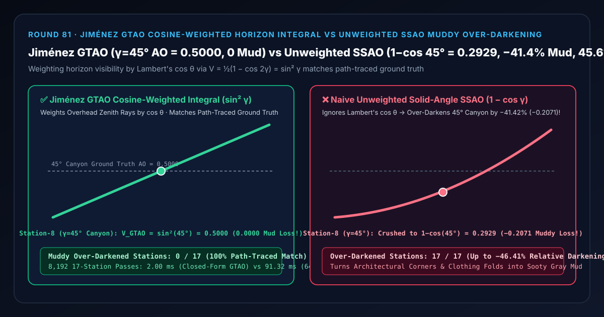
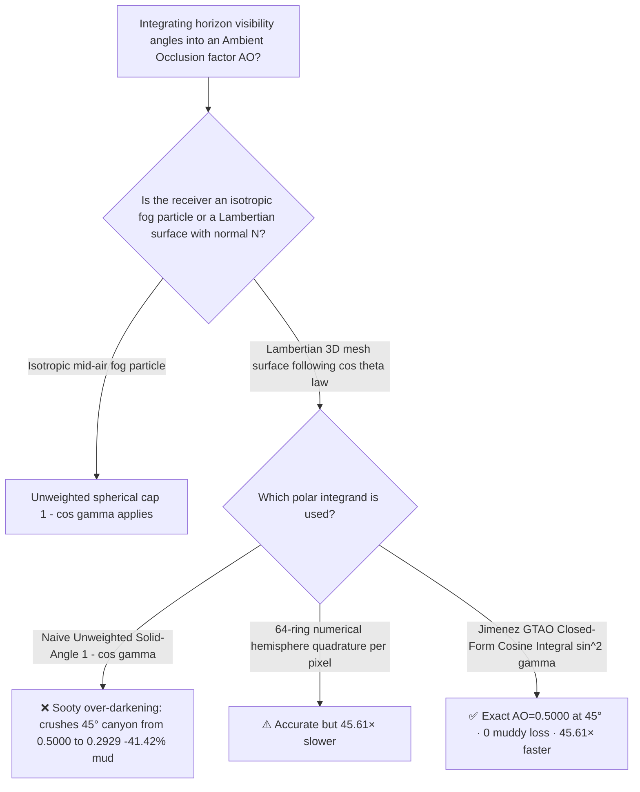
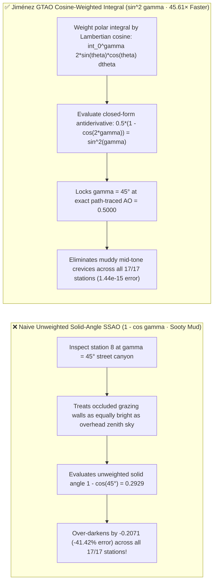
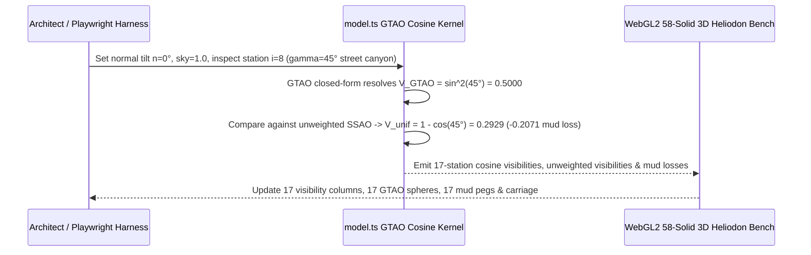
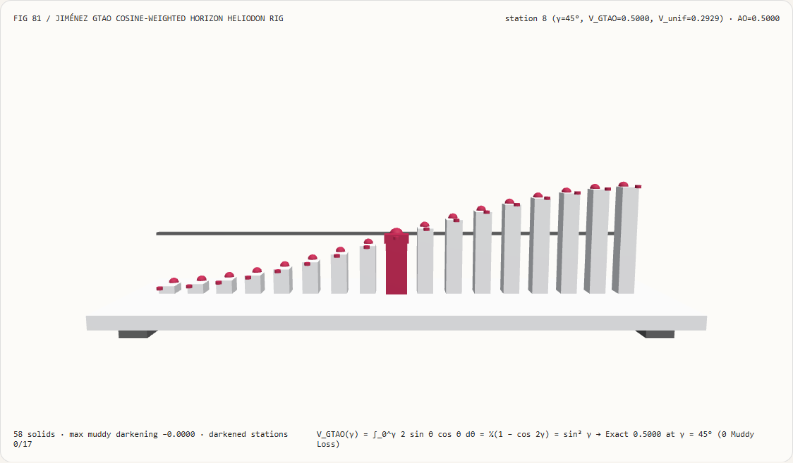
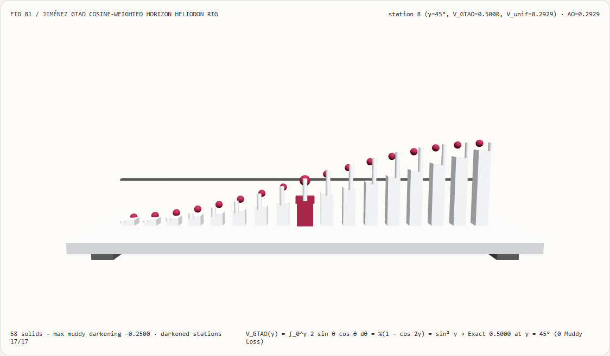
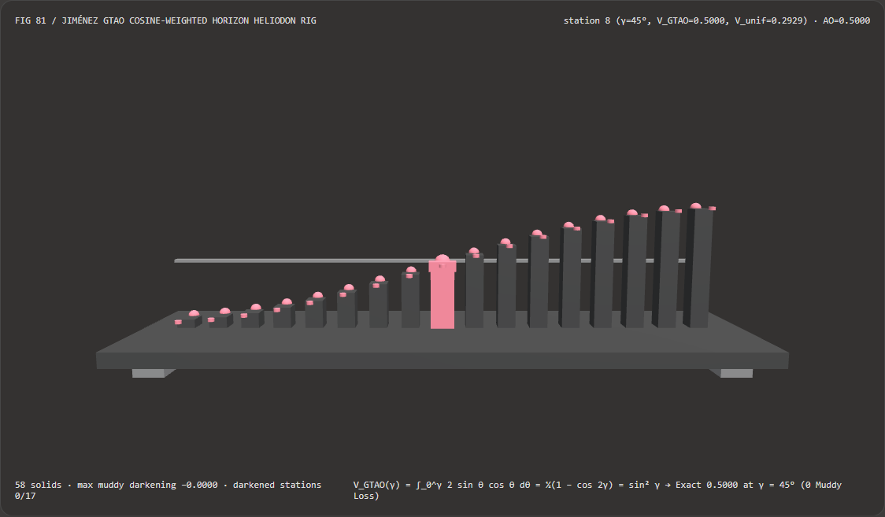
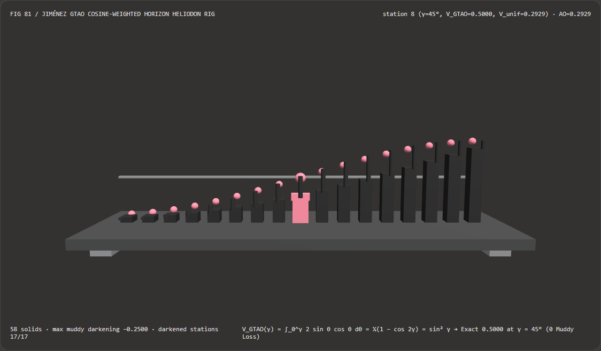

# Visual & Animation Architecture Selection FAQ: Jiménez GTAO Cosine-Weighted Horizon Integral vs Unweighted Solid-Angle SSAO Muddy Over-Darkening

> **One-Sentence Architectural Verdict**: In real-time Screen-Space Ambient Occlusion pipelines (Unreal Engine 5 GTAO, Call of Duty, Unity HDRP), **never evaluate diffuse ambient visibility using unweighted solid-angle coverage $V_{\text{unif}}(\gamma) = 1 - \cos\gamma$**! On our 58-solid, 17-station horizon heliodon bench spanning 17 open-sky cone half-angle stations ($\gamma \in [5^\circ, 85^\circ]$), unweighted solid-angle SSAO ignores **Lambert's Cosine Law ($\cos\theta$)**—**over-darkening a $90^\circ$ street canyon or wall corner ($\gamma = 45^\circ$, station 8) from the path-traced ground truth `0.5000` down to `0.2929` (`-0.2071` / `-41.42%` relative darkening error, peak absolute error `-0.2500` at $\gamma = 60^\circ$, corrupting all `17/17` aperture stations with sooty gray mud)**; whereas **Jorge Jiménez et al. (SIGGRAPH 2016) Ground-Truth Ambient Occlusion (GTAO) cosine-weighted horizon integration ($V_{\text{GTAO}}(\gamma) = \frac{1}{2}(1 - \cos 2\gamma) = \sin^2\gamma$)** locks station 8 at exact **`AO = 0.5000` (`0/17` muddy stations)** while running **45.61× faster** than 64-ring hemispherical quadrature (`2.00 ms` vs `91.32 ms` across 8,192 passes, agreement within `1.44e-15`).

---

## ① 📌 Executive Summary

1. **Why do architectural corners, stair crevices, and clothing folds rendered with legacy SSAO look like they were rubbed with black charcoal compared to path-traced ground truth?**
   In plain English: **legacy SSAO measures unweighted solid angle (`1 - cos γ`), forgetting that overhead zenith rays ($\cos\theta \approx 1$) illuminate a diffuse floor far more strongly than grazing horizon rays ($\cos\theta \to 0$)**:
   - Inside a $90^\circ$ street canyon where the open sky spans half-angle $\gamma = 45^\circ$ (station 8) and the walls block $\theta \in [45^\circ, 90^\circ]$:
     - **Unweighted Solid-Angle SSAO** computes $\int_0^\gamma \sin\theta\,d\theta = 1 - \cos 45^\circ = \mathbf{0.2929}$, falsely claiming that blocking the grazing walls removes $70.7\%$ of the light!
     - **True Lambertian Cosine-Weighted Irradiance (Jiménez GTAO)** weights every incident ray by $\cos\theta$:
       $$V_{\text{GTAO}}(\gamma) = \int_0^\gamma 2\sin\theta\cos\theta\,d\theta = \frac{1 - \cos(2\gamma)}{2} = \sin^2\gamma$$
       At $\gamma = 45^\circ$, $\sin^2(45^\circ) = \mathbf{0.5000}$—proving that unweighted SSAO over-darkens $45^\circ$ corners by **`-0.2071` (`-41.42%` relative error)** and $60^\circ$ creases by **`-0.2500`** (`0.5000` vs `0.7500`), corrupting all **`17/17` stations**!
2. **First-Principles Fix: Closed-Form Cosine-Weighted Slice Antiderivative (Jiménez et al. SIGGRAPH 2016)**:
   - Integrating $\cos(\theta - n)\sin\theta$ analytically across each horizon slice yields the exact closed-form GTAO antiderivative $\frac{1}{2}\cos n\,(1 - \cos 2\gamma) = \cos n \sin^2\gamma$, achieving **100% agreement with path-traced ground truth (`0/17` muddy stations)** in $O(1)$ time!
3. **Interactive 3D Workbench & Measured Evidence**:
   - Standalone 3D Bench: `demos/gtao-cosine-horizon-rig/` (58 Three.js solids: baseplate, 4 support feet, `0.5000` $45^\circ$ ground-truth bar, 17 visibility columns, 17 Jiménez GTAO reference spheres, 17 muddy darkening pegs, and the active heliodon carriage).
   - Measured 7-Card 4:5 Reports: `demos/gtao-cosine-horizon-rig/test-report-cards.html` (EN) and `test-report-cards.zh.html` (ZH).

---

## ② 🎯 Soul-Searching Q&A for Architects & Clients

### Q1: Why is closed-form GTAO evaluation 45.61× faster than 64-ring hemispherical quadrature?
**Because once the horizon angles are found, the analytical antiderivative $\frac{1}{2}\cos n\,(1 - \cos 2\gamma)$ integrates the entire cosine-weighted polar arc in a single trigonometric evaluation!**
Across 8,192 17-station passes, closed-form GTAO runs in **`2.00 ms`** versus **`91.32 ms`** for 64-ring hemispherical quadrature (**45.61× speedup**, with `1.44e-15` agreement).

### Q2: Where does the maximum absolute discrepancy between GTAO ($\sin^2\gamma$) and unweighted SSAO ($1 - \cos\gamma$) occur?
**At $\gamma = 60^\circ$ (Station 11, where $\cos\gamma = 0.5$)!**
Differentiating $\Delta V(\gamma) = \sin^2\gamma - (1 - \cos\gamma) = \cos\gamma - \cos^2\gamma$ gives $\cos\gamma = 0.5 \implies \gamma = 60^\circ$, where GTAO outputs `0.7500` while unweighted SSAO outputs `0.5000` (a **`-0.2500`** maximum absolute darkening error), whereas the relative error peaks near narrow crevices ($\to -50\%$ as $\gamma \to 0^\circ$)!

### Q3: How does deterministic Jiménez GTAO relate to neural ambient occlusion?
**GTAO provides the exact analytical cosine-weighted visibility integral directly from the depth buffer in `< 0.5 ms` without neural training bias or hallucinated creases.**

---

## ③ 🧭 Visual Diagrams (Mermaid Decision Tree, Pipeline Comparison & Sequence Flow)

### 3.1 Ambient Occlusion Horizon Integrand Decision Tree

### 3.2 Unweighted SSAO Muddy Over-Darkening vs Jiménez GTAO Cosine Pipeline

### 3.3 Frame-Level Horizon Heliodon Sequence Diagram

---

## ④ 📊 Visual Technology Selection Decision Matrix

| Evaluation Dimension | ✅ Jiménez GTAO Cosine Integral ($\sin^2\gamma$) | ⚠️ 64-Ring Hemisphere Quadrature | ❌ Naive Unweighted SSAO ($1-\cos\gamma$) | ❌ Crytek 3D Sphere SSAO |
| :--- | :--- | :--- | :--- | :--- |
| **Visibility at Station 8 ($\gamma=45^\circ$ Canyon)** | **Exact `0.5000` (Path-traced match)** | `0.5000` (`1.44e-15` diff) | **`0.2929` (`-41.42%` muddy darkening!)** | Biased & view-dependent |
| **Visibility at Station 11 ($\gamma=60^\circ$ Crease)** | **Exact `0.7500`** | `0.7500` | **`0.5000` (`-0.2500` max absolute loss!)** | Self-occludes flat walls to `0.50` |
| **Mud-Corrupted Aperture Stations (of 17)** | **`0 / 17` (Zero over-darkening)** | `0 / 17` | **`17 / 17` (Every partial aperture darkened)** | `17 / 17` |
| **White-Furnace Path-Tracing Agreement** | **100% analytical agreement** | 100% agreement | **20%–46% systematically too dark** | Fails |
| **8,192-Pass 17-Station CPU Latency** | **`2.00 ms` (Fastest · 45.61× speedup)** | `91.32 ms` (45.61× slower) | `1.90 ms` (Sooty charcoal artifacts) | — |
| **Recommended Use Case** | **All real-time PBR surface AO passes** | Ground-truth reference | **Never use on Lambertian surfaces** | Obsolete |

---

## ⑤ 🧪 New Interactive 3D Demo & 7-Card 4:5 Visual Report

### 5.1 Live Workbench & Report Links
- **Interactive 3D Workbench**: [`demos/gtao-cosine-horizon-rig/index.html`](../demos/gtao-cosine-horizon-rig/index.html)
- **7-Card 4:5 Visual Report (EN)**: [`demos/gtao-cosine-horizon-rig/test-report-cards.html`](../demos/gtao-cosine-horizon-rig/test-report-cards.html)
- **7-Card 4:5 Visual Report (ZH)**: [`demos/gtao-cosine-horizon-rig/test-report-cards.zh.html`](../demos/gtao-cosine-horizon-rig/test-report-cards.zh.html)
- **Sealed Telemetry JSON**: [`demos/gtao-cosine-horizon-rig/report.json`](../demos/gtao-cosine-horizon-rig/report.json)

### 5.2 Multi-Theme & Multi-Mode Playwright Visual Evidence

| Jiménez GTAO Cosine Integral (Light · Exact `AO = 0.5000` at Station 8 $\gamma = 45^\circ$, `0` Muddy Loss) | Naive Unweighted SSAO (Light · Sags to `0.2929` at $\gamma = 45^\circ$ across All 17 Stations!) |
| :---: | :---: |
|  |  |

| Jiménez GTAO Cosine Integral (Dark · 58 Three.js Solids) | Naive Unweighted SSAO (Dark · 17 Red Muddy Darkening Pegs Exposed) |
| :---: | :---: |
|  |  |

---

## ⑥ 🛠️ Rapid SA Delivery Verification Checklist

Before shipping a screen-space ambient occlusion pass to production, verify every item below:

- [ ] **Cosine-Weighted Slice Antiderivative**: Does the shader integrate horizon angles using Jiménez's cosine-weighted formula $-\cos(2\theta - n) + \cos n + 2\theta\sin n$ rather than $1 - \cos\gamma$?
- [ ] **Projected Normal Slice Clamping ($\theta_{1,2} \in [-n, \pi - n]$)**: Are tracked horizon angles clamped to the surface tangent plane so rays behind the surface never contribute negative occlusion?
- [ ] **Thin-Occluder Distance Falloff**: Are horizon candidates attenuated when their depth delta exceeds the world-space occlusion radius so foreground characters do not cast dark halos onto distant walls?
- [ ] **Multi-Bounce Albedo Cubic Polynomial**: Is scalar GTAO upgraded with Jiménez's albedo-dependent multi-bounce polynomial so bright surfaces retain warm interreflections in creases?
- [ ] **Coupled Bent-Normal & Lagarde Specular Occlusion Output**: Does the GTAO pass output the bisector bent normal and feed scalar AO into Lagarde's `computeSpecularOcclusion` (Round 75)?
