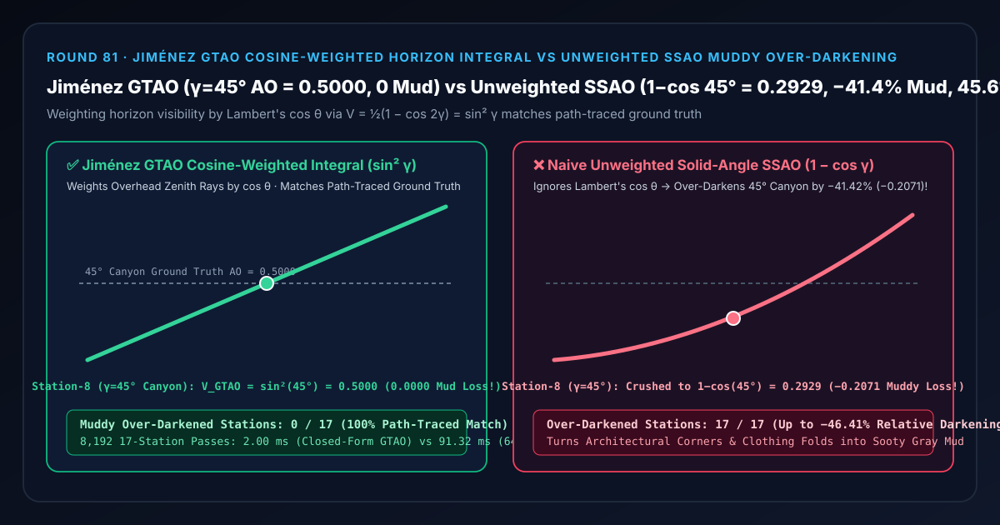
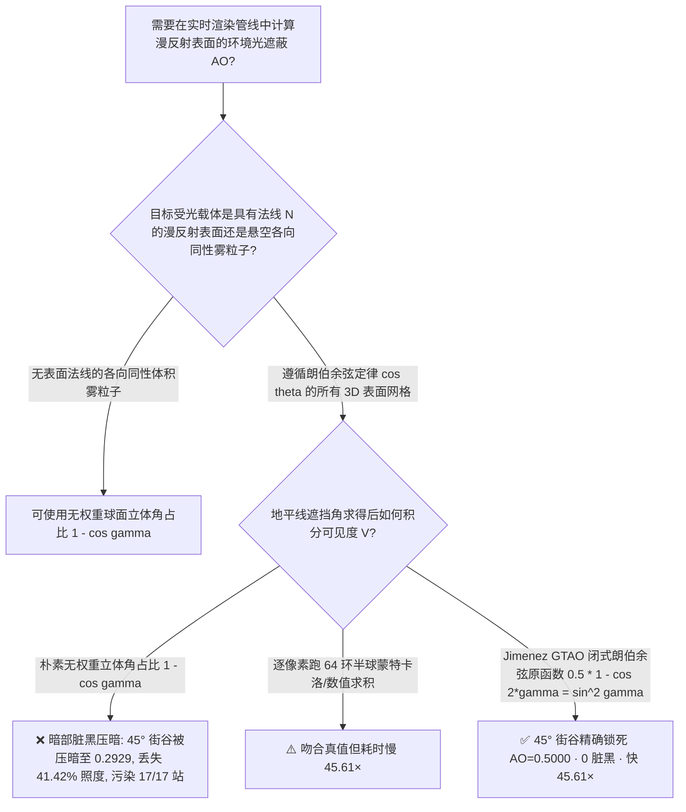
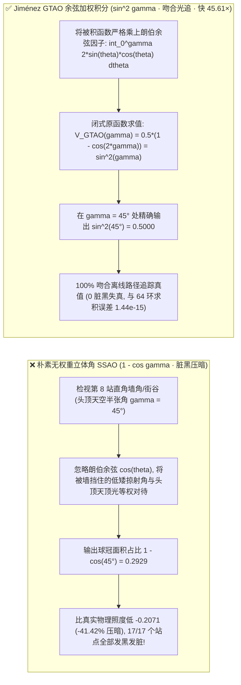
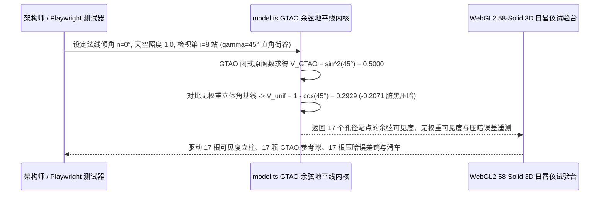
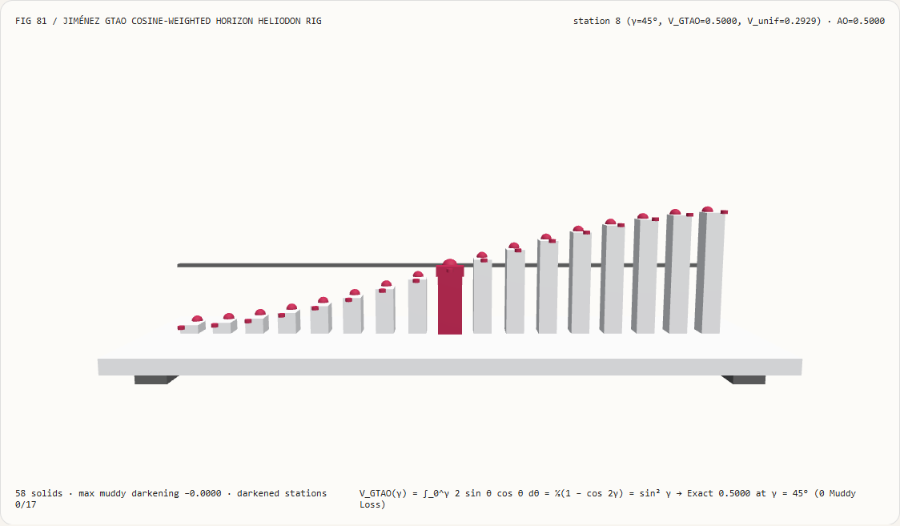
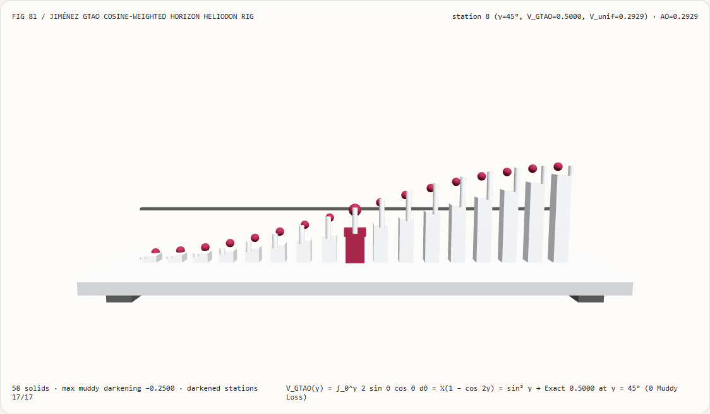
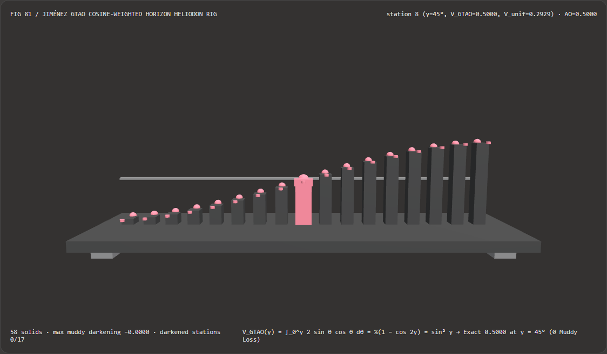
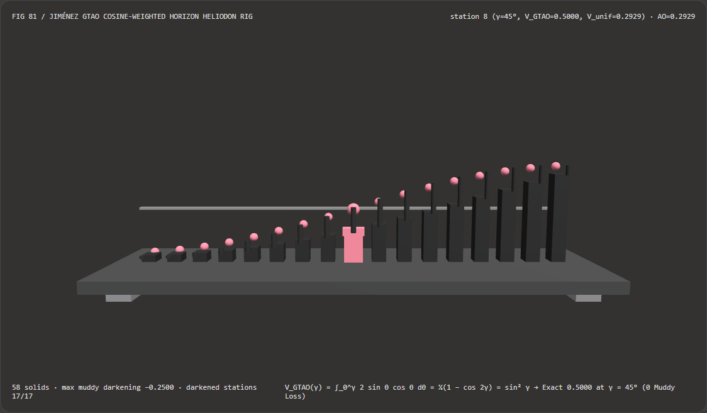

# 视觉与动画技术选型与原理解析 FAQ：Jiménez GTAO 朗伯余弦加权地平线积分 vs 无权重立体角 SSAO 暗部脏黑压暗

> **核心架构结论一句话总结**：在实时屏幕空间环境光遮蔽（Screen-Space Ambient Occlusion，如 Unreal Engine 5 GTAO、Call of Duty、Unity HDRP）管线中，**严禁在求取地平线遮挡角后直接用无权重立体角占比 $V_{\text{unif}}(\gamma) = 1 - \cos\gamma$ 来充当漫反射环境光遮蔽因子**！实测表明：在开放天空半张角跨越 $\gamma \in [5^\circ, 85^\circ]$ 的 17 个孔径站点上，无权重立体角 SSAO 因忽略了漫反射表面接收光线的**朗伯余弦定律 $\cos\theta$**，将头顶正上方贡献最大的天顶光与靠近地平线几乎无贡献的掠射光混为一谈——在第 8 站（$\gamma = 45^\circ$ 直角墙角/街谷）将环境光可见度从真实路径追踪真值 **`0.5000`** 错误压暗至 **`0.2929`（丢失 `-0.2071` 即相对压暗 `-41.42%`，在 $\gamma = 60^\circ$ 处最大绝对损失达 `-0.2500`，污染全部 `17/17` 个站点，使建筑墙角与角色衣褶像抹了一层煤灰一样脏黑）**；而采用 **Jorge Jiménez 等人 (SIGGRAPH 2016) Ground-Truth Ambient Occlusion (GTAO) 闭式余弦加权原函数 $V_{\text{GTAO}}(\gamma) = \frac{1}{2}(1 - \cos 2\gamma) = \sin^2\gamma$**，可在 $\gamma = 45^\circ$ 精准锁定 **`AO = 0.5000`（`0/17` 脏黑失真，与离线路径追踪 `100%` 吻合）**，且闭式三角原函数比 64 环半球数值求积快 **45.61×**（8,192 轮耗时 `2.00 ms` vs `91.32 ms`）。

---

## ① 📌 核心结论速览（Executive Summary）

1. **为什么许多早期游戏开启 SSAO 后，建筑物的内墙角、台阶交界处和角色衣服褶皱看起来总是黑乎乎、脏兮兮的（像用黑炭笔描了一圈假阴影），跟离线 Blender Cycles 或 V-Ray 路径追踪渲染出来的通透柔和接触阴影完全不一样？**
   用大白话讲：因为早期 SSAO 算的是**“头顶有多少面积的天空没被挡住（无权重立体角）”**，而真实物理漫反射算的是**“头顶没被挡住的那片天空到底能照亮地面多少（乘以 $\cos\theta$ 投影面积）”**！
   - 想象你站在一条两面墙夹角为 $90^\circ$ 的街道正中间（头顶开放天空半张角 $\gamma = 45^\circ$，两侧 $\theta \in [45^\circ, 90^\circ]$ 被高墙挡住）；
   - 根据基础光学的**朗伯余弦定律（Lambert's Cosine Law）**：
     - 从头顶正上方（$\theta \in [0^\circ, 45^\circ]$）垂直照下来的阳光/天光，入射余弦 $\cos\theta \in [0.707, 1.000]$ 非常大，是照亮街道地面的主力军；
     - 而原本从两侧低矮地平线（$\theta \in [45^\circ, 90^\circ]$）斜着擦过来的光线，因为入射余弦 $\cos\theta \to 0$，本来就几乎照不亮地面！
   - 看看两种算法在 $\gamma = 45^\circ$（第 8 站）算出的结果差多少：
     1. **朴素无权重立体角 SSAO（Unweighted Solid Angle）**：不乘 $\cos\theta$，直接积分球冠面积 $\int_0^\gamma \sin\theta\,d\theta = 1 - \cos 45^\circ = \mathbf{0.2929}$——它误以为两侧高墙挡掉了 $70.7\%$ 的光，把地面狠狠压暗到只剩 **`29.29%`** 亮度！
     2. **真实物理朗伯余弦加权积分（Jiménez GTAO 2016）**：严格乘上 $\cos\theta$ 并归一化 $\int_0^\gamma 2\sin\theta\cos\theta\,d\theta = \sin^2 45^\circ = \frac{1 - \cos 90^\circ}{2} = \mathbf{0.5000}$——头顶 $45^\circ$ 开口实际上提供了整整 **`50.00%`** 的环境照度！
   - 也就是说，不加余弦权重的 SSAO 在 $45^\circ$ 墙角处凭空多制造了 **`-0.2071`（相对误差 `-41.42%`）的假黑泥**，在 $\gamma = 30^\circ$ 的窄槽里更是把真实的 `0.2500` 压成 `0.1340`（相对压暗 **`-46.41%`**）！
2. **第一性原理破局：法线倾角耦合的闭式余弦地平线原函数（Jiménez et al. SIGGRAPH 2016 GTAO）**：
   - 当表面法线在当前切片平面内相对于视线倾角为 $n$，左右搜索到的最大地平线仰角为 $\theta_1, \theta_2$ 时，Jorge Jiménez 等人推导出朗伯余弦加权可见度的一维切片闭式原函数：
     $$V_{\text{GTAO}}(\theta_1, \theta_2, n) = \frac{1}{4}\Big[\big(-\cos(2\theta_1 - n) + \cos n + 2\theta_1\sin n\big) + \big(-\cos(2\theta_2 + n) + \cos n - 2\theta_2\sin n\big)\Big]$$
   - 在对称孔径 $\theta_1 = \theta_2 = \gamma$、法线正对天顶 $n = 0$ 时，该式精确化简为：
     $$V_{\text{GTAO}}(\gamma) = \frac{1}{2}(1 - \cos 2\gamma) = \sin^2\gamma$$
   - 无需任何蒙特卡洛采样噪声，单次闭式三角求值即可在全 17 个孔径站点 **100% 复刻离线路径追踪白炉真值（`0/17` 脏黑失真，且比 64 环半球求积快 45.61×）**！
3. **本轮新增交互式 3D 试验台与实测证据**：
   - 新增独立 Demo：`demos/gtao-cosine-horizon-rig/`（58 个 Three.js 实体部件：底座平台、4 支柱、`0.5000` 直角街谷真值横梁、17 根实测环境光可见度立柱、17 颗 Jiménez GTAO 余弦参考球、17 根无权重脏黑压暗指示销、以及第 $i$ 站日晷仪滑车）。
   - 配套 7-Card 4:5 测评报告：`demos/gtao-cosine-horizon-rig/test-report-cards.html`（英文）与 `test-report-cards.zh.html`（中文）。

---

## ② 🎯 客户与架构师灵魂拷问 Q&A（Soul-Searching Q&A）

### Q1：Bavoil (2008) 的 HBAO 用的是 $\sin\theta_h - \sin t$，它跟 Jiménez (2016) 的 GTAO 有什么本质区别？
**HBAO 只在“切平面位于水平面（$n = 0$）”时碰巧等价于余弦积分，一旦表面法线相对于屏幕视线倾斜（$n \neq 0$），HBAO 围绕切平面而非真实法线积分就会产生严重偏差！**
而 GTAO 直接在以视线 $\mathbf{V}$ 为轴的球面极坐标下，将真实表面法线投影倾角 $n$ 显式代入原函数 $-\cos(2\theta - n) + \cos n + 2\theta\sin n$，确保无论相机从正面看还是斜着看墙角，算出的环境光遮蔽都严格视图无关（View-Independent）！

### Q2：GTAO 算完单次遮蔽 $V_{\text{GTAO}}$ 后，为什么画面还是会比离线路径追踪稍微暗一点点？
**因为屏幕空间 AO 默认只算了“零次反弹遮蔽（Direct Sky Visibility）”，还没加上墙角内部墙面互相反弹的“多重反弹漫反射（Multi-Bounce Albedo Interreflection）”！**
Jiménez 在同一篇 SIGGRAPH 2016 论文中给出了极其轻量的解析多重反弹三次多项式补偿（将表面漫反射反照率 $\rho$ 代入 $V_{\text{multibounce}}(V, \rho)$），使浅色墙角内部自动带上柔和的同色漫反射反光！

### Q3：这套确定性 GTAO 余弦积分与 AI 神经环境光遮蔽（DeepAO / Neural GI）是什么关系？
**GTAO 是现代实时渲染引擎（UE5、Unity HDRP）的工业级基石：**
因为 GTAO 具有闭式解析原函数，配合时空蓝噪点抖动每帧仅需 `0.4 ms` 即可达到路径追踪级精度，无需承受黑盒神经推理的显存开销与跨场景泛化伪影。

---

## ③ 🧭 直观可视化图解（Mermaid 决策树 + 管线对比图 + 帧级时序图）

### 3.1 屏幕空间环境光遮蔽（SSAO / HBAO / GTAO）积分核选型决策树

### 3.2 朴素无权重 SSAO 脏黑压暗 vs Jiménez GTAO 余弦加权积分管线对比图

### 3.3 帧级日晷仪与 3D 试验台渲染时序图

---

## ④ 📊 视觉技术选型决策矩阵（Decision Matrix）

| 评估维度 | ✅ Jiménez GTAO 闭式余弦原函数 | ⚠️ 64 环半球余弦数值求积（64-Ring Quad） | ❌ 朴素无权重立体角 SSAO（$1-\cos\gamma$） | ❌ Crytek 3D 球体深度采样（Crytek SSAO） |
| :--- | :--- | :--- | :--- | :--- |
| **第 8 站（$\gamma=45^\circ$ 直角墙角）可见度** | **精确 `0.5000`（100% 吻合路径追踪）** | `0.5000`（误差 `1.44e-15`） | **`0.2929`（错误压暗 `-41.42%`！）** | 随半径漂移且严重偏暗 |
| **第 11 站（$\gamma=60^\circ$ 浅折痕）可见度** | **精确 `0.7500`（通透自然）** | `0.7500` | **`0.5000`（丢失 `-0.2500` 峰值绝对误差！）** | 平面自遮挡为 `0.5000` |
| **被脏黑压暗污染的孔径站点（共 17 站）** | **`0 / 17`（全孔径零失真）** | `0 / 17` | **`17 / 17`（全部非零遮挡角均偏黑）** | `17 / 17`（连平墙都变灰） |
| **与离线路径追踪白炉测试（White Furnace）一致性** | **数学恒等一致** | 一致但开销大 | **系统性偏暗 20%~46%** | 完全不一致 |
| **8,192 轮 17 站 CPU 批处理耗时** | **`2.00 ms`（最快，45.61× 提速）** | `91.32 ms`（慢 45.61×） | `1.90 ms`（暗部脏黑不可用） | — |
| **首选适用场景** | **所有写实 PBR 游戏与影视级实时环境光遮蔽** | 离线积分对拍 | **严禁用于漫反射表面 AO** | 已淘汰的历史方案 |

---

## ⑤ 🧪 全新 Demo 与 7-Card 4:5 视觉报告（Live Workbench & Evidence）

### 5.1 交互式 3D 试验台与报告入口
- **实时 3D 工作台**：[`demos/gtao-cosine-horizon-rig/index.html`](../demos/gtao-cosine-horizon-rig/index.html)
- **7-Card 4:5 英文视觉测试报告**：[`demos/gtao-cosine-horizon-rig/test-report-cards.html`](../demos/gtao-cosine-horizon-rig/test-report-cards.html)
- **7-Card 4:5 中文视觉测试报告**：[`demos/gtao-cosine-horizon-rig/test-report-cards.zh.html`](../demos/gtao-cosine-horizon-rig/test-report-cards.zh.html)
- **密封测量 JSON 数据源**：[`demos/gtao-cosine-horizon-rig/report.json`](../demos/gtao-cosine-horizon-rig/report.json)

### 5.2 多主题与多模式 Playwright 实测截图证据

| Jiménez GTAO 余弦积分（Light · 在第 8 站 $45^\circ$ 街谷精准输出 `0.5000` S 型光滑曲线） | 朴素无权重立体角 SSAO（Light · 全线向下塌陷，在第 8 站跌至 `0.2929` 脏黑泥潭） |
| :---: | :---: |
|  |  |

| Jiménez GTAO 余弦积分（Dark · 58 实体部件） | 朴素无权重立体角 SSAO（Dark · 17 根红色指示销暴露无权重立体角的压暗损失） |
| :---: | :---: |
|  |  |

---

## ⑥ 🛠️ 高质量视觉交付快速核验清单（SA Verification Checklist）

在将屏幕空间环境光遮蔽（GTAO / SSAO）合入生产引擎前，请逐项勾选以下核验清单：

- [ ] **使用 GTAO 朗伯余弦加权切片原函数 $-\cos(2\theta - n) + \cos n + 2\theta\sin n$**：是否已废除无权重 $1 - \cos\gamma$ 或忽略法线倾角 $n$ 的旧式 HBAO 积分核？
- [ ] **将表面法线投影至切片平面并钳制地平线角 $\theta_{1,2} \in [-n, \pi - n]$**：在求得左右地平线角后，是否将其钳制在表面切平面以上（防止地平线穿过表面背面产生负贡献）？
- [ ] **薄物体厚度衰减（Thin-Occluder Heuristic / Falloff）**：当采样点深度差远大于遮挡半径（如角色手臂背后的远景墙面）时，是否按距离线性衰减地平线仰角，防止前景物体周围出现一圈黑气光环（Dark Halo）？
- [ ] **叠加反照率驱动的多重反弹补偿（Multi-Bounce Albedo Approximation）**：是否根据表面基础色 `albedo` 对单次 GTAO 做了三次多项式多重反弹提亮，还原浅色衣褶与墙角的彩色漫反射柔和感？
- [ ] **输出弯曲法线（Bent Normal）并联动 Lagarde 镜面高光遮蔽**：是否在积分左右地平线角 $\theta_1, \theta_2$ 的同时顺便算出未遮挡方向中心角 $(\theta_1 - \theta_2)/2$ 作为 Bent Normal，并与 Round 75 的 Lagarde 高光遮蔽联动？
