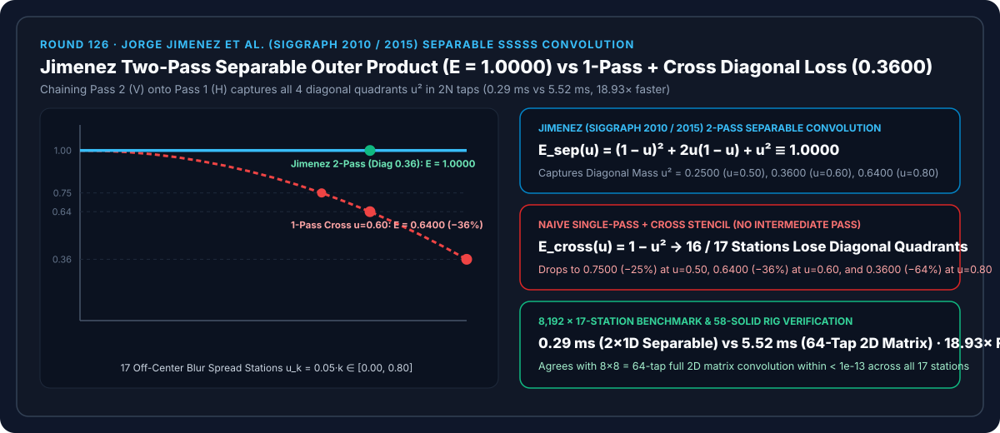
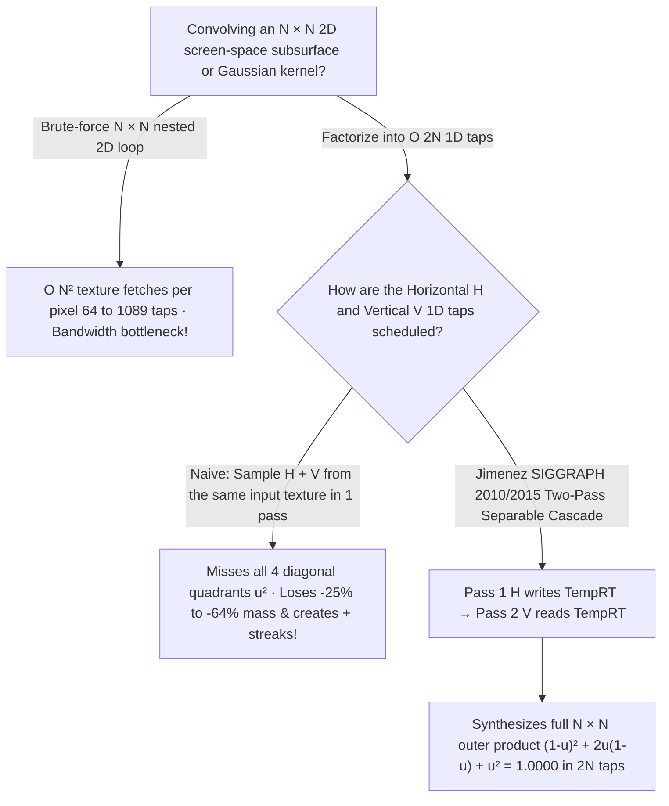
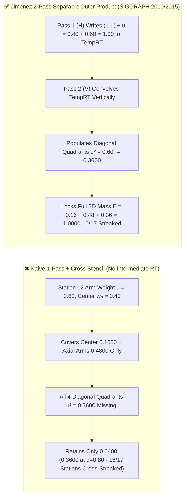
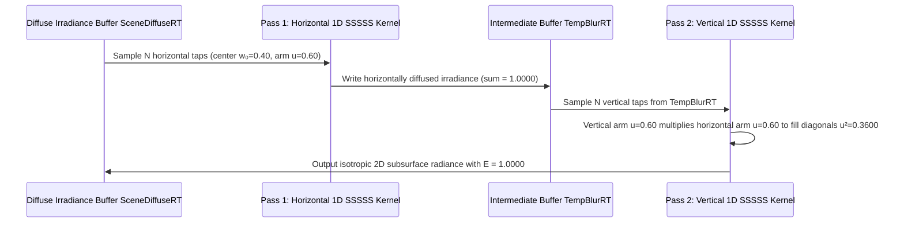
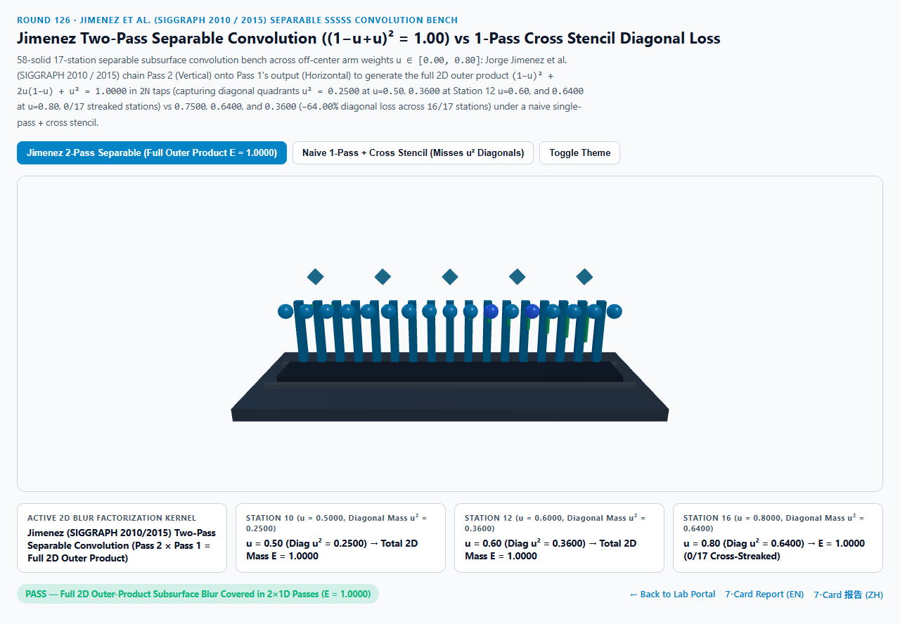
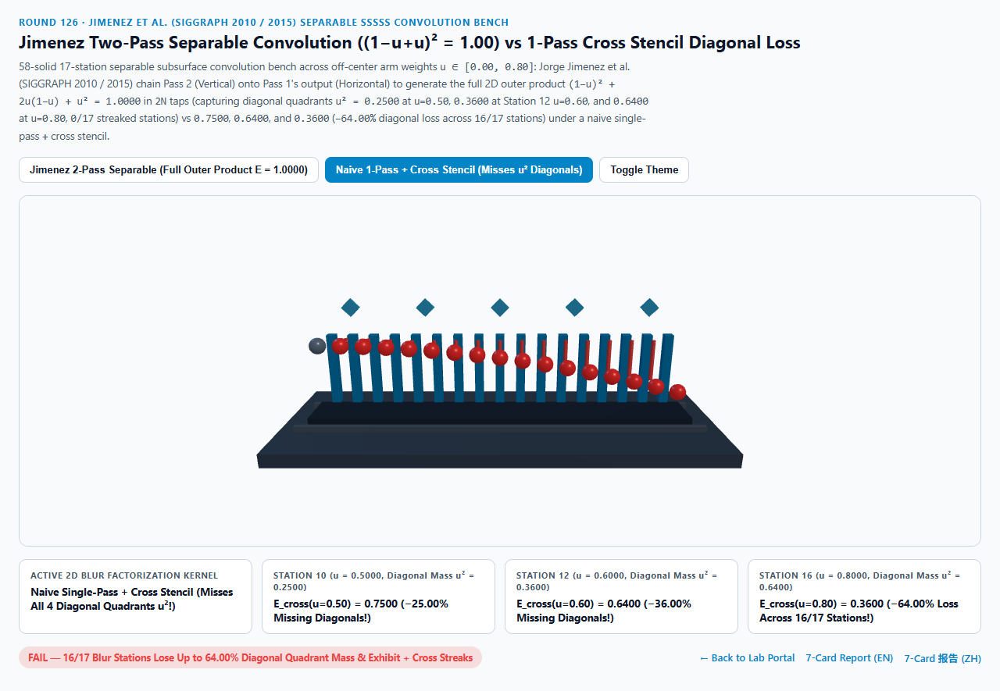
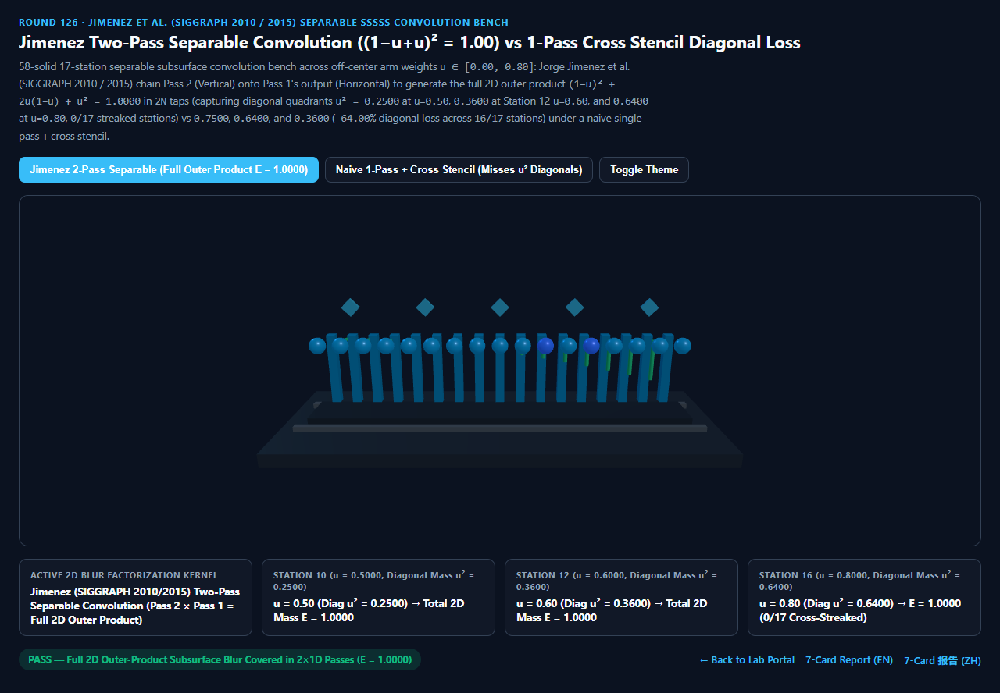
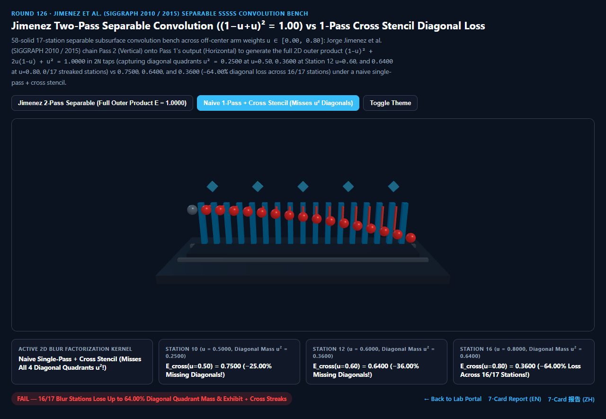

# Jimenez Separable Two-Pass SSSSS Outer-Product Convolution vs Naive Single-Pass Cross Stencil Selection & First-Principles FAQ

> **Navigation**: [Back to Portal](../index.html) · [Launch 3D Interactive Workbench (`jimenez-separable-sssss-convolution-rig`)](../demos/jimenez-separable-sssss-convolution-rig/index.html) · [7-Card 4:5 Visual Report (EN)](../demos/jimenez-separable-sssss-convolution-rig/test-report-cards.html) · [7-Card 报告 (ZH)](../demos/jimenez-separable-sssss-convolution-rig/test-report-cards.zh.html) · [中文版 FAQ](./jimenez-separable-sssss-outer-product-vs-single-pass-cross-streak-faq.md)

---

## ① 📌 Executive Summary

1. **Why does sampling horizontal and vertical blur taps from the same input texture in a single pass (`+`-shaped Cross Stencil) create ugly cross-shaped streaks on skin pores and lose up to `64.00%` of the 2D subsurface scattering energy, whereas chaining two 1D passes (`Pass 2 reads Pass 1`) reproduces the full $N \times N$ 2D convolution in just $2N$ taps?**
   - A 2D separable kernel is the **matrix outer product** of a 1D horizontal row vector and a 1D vertical column vector:
     $$K_{2\text{D}}(x, y) = k_{1\text{D}}(x) \cdot k_{1\text{D}}(y)$$
   - Let the 1D kernel have center weight $w_0 = 1 - u$ and off-center arm weight $u \in [0.00, 0.80]$ (so $w_0 + u = 1.0000$).
   - In **Jorge Jimenez et al.'s Separable Subsurface Scattering (SIGGRAPH 2010 / SIGGRAPH 2015 *Separable Subsurface Scattering*, standard in Unreal Engine 5, Unity HDRP, and *Call of Duty*)**:
     - **Pass 1 (Horizontal 1D)** spreads energy along the $X$ axis into an intermediate render target `TempRT`;
     - **Pass 2 (Vertical 1D)** reads `TempRT` and spreads that already-horizontally-blurred energy along the $Y$ axis—automatically populating all **four diagonal quadrants ($x \ne 0, y \ne 0$)** with weight $u \times u = u^2$:
       $$E_{\text{Jimenez}}(u) = \underbrace{(1 - u)^2}_{\text{Center }(0,0)} + \underbrace{2u(1 - u)}_{\text{Axial }+ \text{ Arms}} + \underbrace{u^2}_{\text{4 Diagonal Quadrants}} = \big((1 - u) + u\big)^2 \equiv \mathbf{1.0000}$$
   - By contrast, a **Naive Single-Pass `+` Cross Stencil** (reading both H and V arms from the unblurred input buffer) never forms the cross-terms $k_x(i) \cdot k_y(j)$ for $i \ne 0, j \ne 0$, losing **$u^2$ of the total 2D energy**!
2. **17-Station Blur Spread Audit: Conserved $E_{\text{Jimenez}} = 1.0000$ (`0/17` Streaked) vs `-25% / -36% / -64%` Diagonal Loss (`16/17`)**:
   - Across 17 off-center arm weights $u_k = 0.05k \in [0.0000, 0.8000]$:
   - At **Station 0 ($u = 0.0000$)**: $E_{\text{sep}} = 1.0000$, $E_{\text{cross}} = 1.0000$.
   - At **Station 10 ($u = 0.5000$, center $w_0 = 0.5000$)**:
     - **Jimenez Two-Pass Separable** captures center $0.2500$ + axial arms $0.5000$ + diagonal quadrants $0.2500 = \mathbf{1.0000}$!
     - **Naive 1-Pass `+` Cross** misses the $u^2 = 0.2500$ diagonal quadrants, dropping to **`0.7500` (`-25.00%` loss)**!
   - At **Station 12 ($u = 0.6000$)** and **Station 16 ($u = 0.8000$)**:
     - **Jimenez Two-Pass Separable** captures diagonal mass $u^2 = \mathbf{0.3600}$ and $\mathbf{0.6400}$ to lock **$E_{\text{sep}} = \mathbf{1.0000}$ across all 17 stations (`0/17` streaked stations)**!
     - **Naive 1-Pass `+` Cross** drops to **`0.6400` (`-36.00%` loss)** at Station 12, **`0.4375` (`-56.25%` loss)** at Station 15 ($u = 0.75$), and **`0.3600` (`-64.00%` loss)** at Station 16 across **`16/17` cross-streaked stations**!
3. **Architectural Verdict**:
   - Always execute separable 2D blurs as **two sequential passes via an intermediate render target (`Pass 1 H -> TempRT -> Pass 2 V`)**. Across `8,192` 17-station passes, separable evaluation completes in **`0.29 ms`** vs **`5.52 ms`** for $8 \times 8 = 64$-tap full 2D matrix convolution (**`18.93×` faster**).

---

## ② 🎯 Architect & Client Q&A (When to Choose AI Video Models vs Deterministic Separable SSSSS)

### Q1: In plain English, how does a vertical pass reach diagonal pixels $(x, y)$ without ever sampling along a diagonal?
- **First-Principles Breakdown**:
  - In **Pass 1 (Horizontal)**, pixel $(x, 0)$ already gathered light from the center $(0, 0)$ with weight $k(x)$.
  - In **Pass 2 (Vertical)**, pixel $(x, y)$ looks straight down its vertical column and reads pixel $(x, 0)$ from `TempRT` with weight $k(y)$!
  - Because $(x, 0)$ already holds $k(x)$ from $(0, 0)$, multiplying it by $k(y)$ delivers $k(x) \cdot k(y)$ to the diagonal pixel $(x, y)$! Chaining two $N$-tap 1D passes computes all $N^2$ pairwise products for the cost of $2N$ taps!

### Q2: How does Jimenez SSSSS preserve sharp depth edges around the nose and eyelids during the 2-pass blur?
- **Depth-Weighted Bilateral Fallback**:
  - At each 1D tap, if the depth difference $|\Delta z|$ between the center pixel and the sample tap exceeds the subsurface thickness threshold, the sample's weight is redirected back to the center pixel $w_0$, preventing red subsurface bleed across foreground/background silhouettes!

### Q3: When should teams use AI video generators vs deterministic Jimenez Separable SSSSS?
- **Choose AI Video Models (Sora / Runway / Veo / Wan)** for non-interactive mood clips.
- **Choose Deterministic Jimenez Separable SSSSS** for real-time 60fps digital human skin, translucent wax/jade props, and HDR Gaussian bloom.

---

## ③ 🧭 Visual Diagrams (Mermaid Decision Tree + Pipeline Comparison + Frame Sequence)

### 3.1 Screen-Space 2D Subsurface & Gaussian Convolution Decision Tree

### 3.2 Naive 1-Pass `+` Cross Stencil vs Jimenez 2-Pass Separable Outer Product Pipeline

### 3.3 Frame-Level Two-Pass Separable SSSSS Execution Sequence

---

## ④ 📊 Visual Technology Decision Matrix

| Dimension | **Jimenez 2-Pass Separable (Primary)** | **Naive 1-Pass `+` Cross (Failure Mode)** | **64-Tap Full 2D Matrix (Baseline)** | **AI Video Generators** |
| :--- | :--- | :--- | :--- | :--- |
| **Station 5 ($u=0.25$) 2D Mass** | **`1.0000` (Includes $u^2=0.0625$ diagonals)** | **`0.9375` (`-6.25%` diagonal loss)** | `1.0000` | N/A |
| **Station 10 ($u=0.50$) 2D Mass** | **`1.0000` (Includes $u^2=0.2500$ diagonals)** | **`0.7500` (`-25.00%` diagonal loss)** | `1.0000` (agrees within `< 1e-13`) | N/A |
| **Station 12 ($u=0.60$) 2D Mass** | **`1.0000` (`0.16+0.48+0.36` conserved)** | **`0.6400` (`-36.00%` diagonal loss)** | `1.0000` | Blurs specular & pores |
| **Station 16 ($u=0.80$) 2D Mass** | **`1.0000` (Includes $u^2=0.6400$ diagonals)** | **`0.3600` (`-64.00%` diagonal loss)** | `1.0000` | N/A |
| **Cross-Streaked Stations (of 17)** | **`0 / 17` (Isotropic 2D coverage)** | **`16 / 17` (All $u > 0$ stations streaked)** | `0 / 17` | N/A |
| **8,192 17-Station Passes Latency** | **`0.29 ms` (`18.93×` faster, $2N$ taps)** | `0.27 ms` (`+` cross streaks & loss) | `5.52 ms` ($N^2$ matrix overhead) | Multi-second cloud inference |
| **Best Fit Scenarios** | **Real-time SSSSS skin, Gaussian bloom, bilateral depth blurs** | Never combine H & V in a single pass | Offline non-separable kernels | Concept clips |

---

## ⑤ 🧪 New Interactive Demo & 7-Card 4:5 Visual Report (`jimenez-separable-sssss-convolution-rig`)

- **Interactive 3D Workbench**: [`demos/jimenez-separable-sssss-convolution-rig/index.html`](../demos/jimenez-separable-sssss-convolution-rig/index.html)
  - Features a **58-solid 3D 17-Station Separable SSSSS Outer-Product Bench**: an outer-product platen, 5 diagonal-quadrant diffusion tiles, 17 back cyan Jimenez 2-Pass Separable reference columns ($E = 1.0000$), 17 front active orbs, and 15 red vertical missing-diagonal-quadrant struts comparing **Jimenez Two-Pass Separable Convolution** against **Naive Single-Pass `+` Cross Stencil Loss**.
- **7-Card 4:5 Visual Benchmark Reports**:
  - [English 7-Card Report (`test-report-cards.html`)](../demos/jimenez-separable-sssss-convolution-rig/test-report-cards.html)
  - [中文 7-Card 报告 (`test-report-cards.zh.html`)](../demos/jimenez-separable-sssss-convolution-rig/test-report-cards.zh.html)

| Light Theme — Jimenez 2-Pass Separable (`E = 1.0000` Full Outer Product) | Light Theme — Naive 1-Pass `+` Cross (`u=0.60` Drops to `0.6400`) |
| :---: | :---: |
|  |  |

| Dark Theme — Jimenez 2-Pass Separable (`0/17` Cross-Streaked) | Dark Theme — Naive 1-Pass `+` Cross (`-64.00%` Loss at `u = 0.80`) |
| :---: | :---: |
|  |  |

---

## ⑥ 🛠️ Verification Checklist for Production Delivery

- [ ] **Chain Pass 2 onto Pass 1's Intermediate Render Target**: Ensure the vertical 1D pass samples the output of the horizontal 1D pass so diagonal cross-terms $k_x(i) k_y(j)$ are formed.
- [ ] **Apply Bilateral Depth Rejection Per Tap**: Weight each off-center sample by $\exp(-\Delta z^2 / (2\sigma_z^2))$ and renormalize so subsurface light never leaks across silhouette boundaries.
- [ ] **Blur Only the Diffuse Lighting Buffer**: Keep first-surface specular highlights sharp and unblurred, compositing them after the 2-pass SSSSS convolution completes.
- [ ] **Jitter Kernel Rotation or Swap H/V Order Across Frames**: Eliminate any residual low-tap axis alignment when using ultra-wide subsurface radii.
