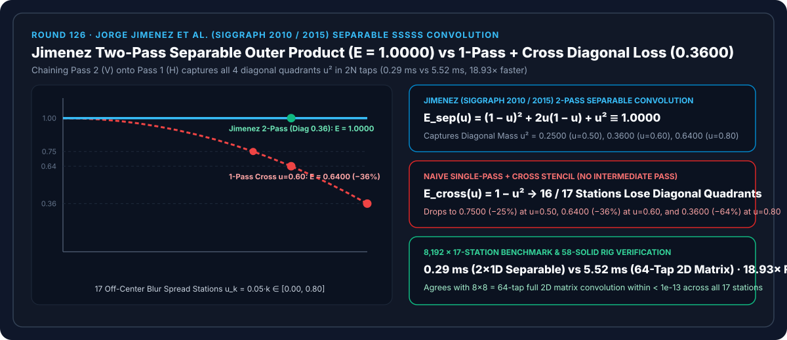
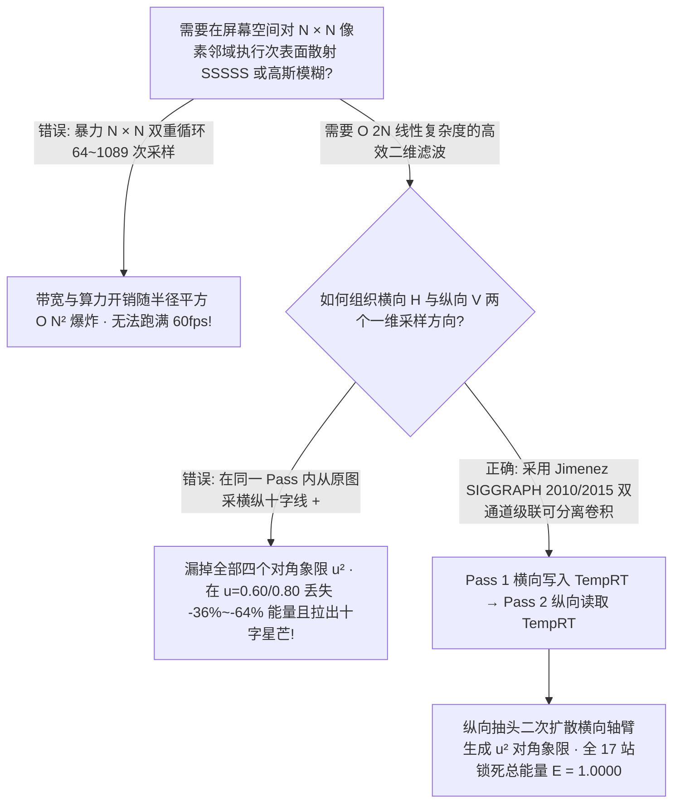
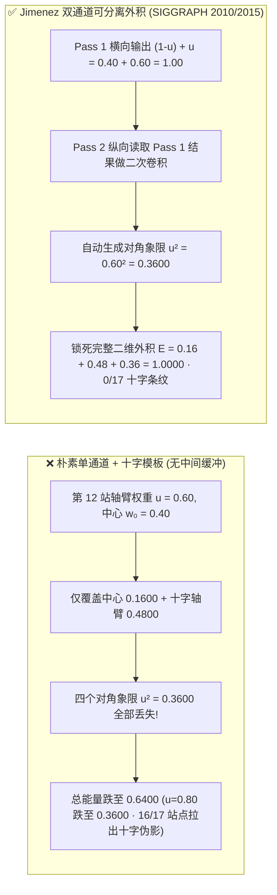
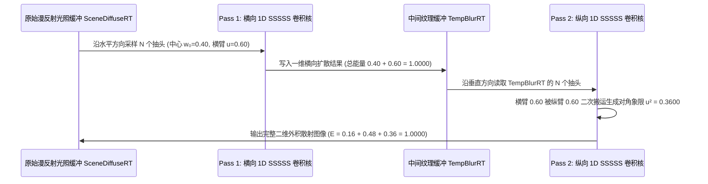
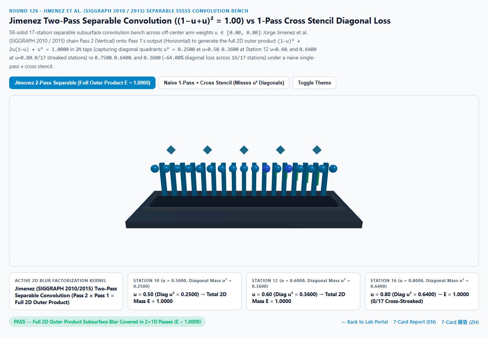
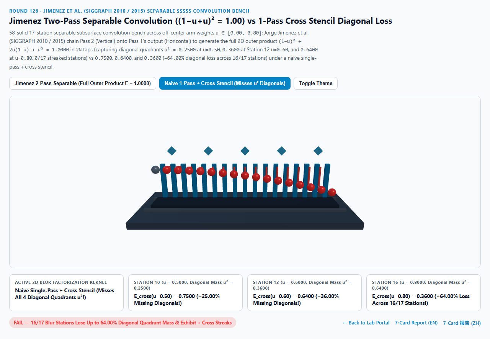
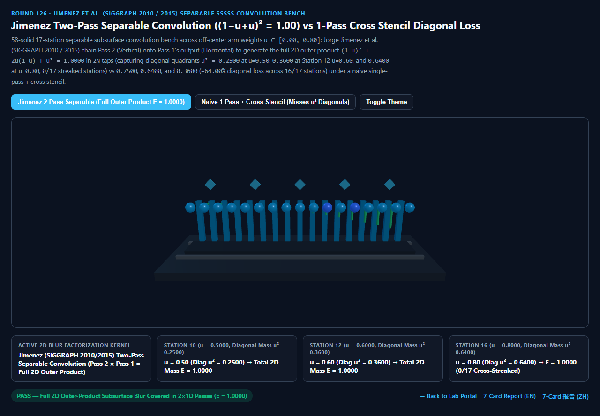
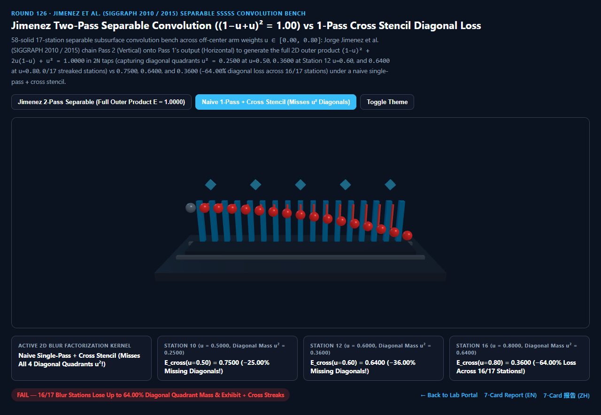

# Jimenez 双通道可分离屏幕空间次表面散射外积卷积（Separable SSSSS Outer-Product Convolution）vs 朴素单通道十字模板对角缺失选型与原理解析 FAQ 指南

> **导航**：[返回门户](../index.html) · [进入 3D 交互实验台 (`jimenez-separable-sssss-convolution-rig`)](../demos/jimenez-separable-sssss-convolution-rig/index.html) · [7-Card 4:5 视觉报告 (中文)](../demos/jimenez-separable-sssss-convolution-rig/test-report-cards.zh.html) · [7-Card Report (EN)](../demos/jimenez-separable-sssss-convolution-rig/test-report-cards.html) · [English FAQ](./jimenez-separable-sssss-outer-product-vs-single-pass-cross-streak-faq.en.md)

---

## ① 📌 核心结论速览（Executive Summary）

1. **为什么在写屏幕空间次表面散射（SSSSS）或高斯模糊时，如果为了省掉一张中间 RenderTarget，在同一个 Shader Pass 里直接从原图采样“横向 $N$ 个点 + 纵向 $N$ 个点”（单通道 `+` 字十字模板），角色脸上的毛孔和高光不仅会拉出丑陋的十字星芒伪影，还会凭空丢掉高达 `25% ~ 64%` 的对角线象限散射能量？**
   - 二维可分离卷积（Separable 2D Convolution）之所以能用 $N + N = 2N$ 次采样精确代替 $N \times N = N^2$ 次二维全矩阵采样，其核心数学原理是**一维列向量与一维行向量的矩阵外积（Outer Product）**：
     $$K_{2\text{D}}(x, y) = k_{1\text{D}}(x) \cdot k_{1\text{D}}(y)$$
   - 设一维核的中心权重为 $w_0 = 1 - u$，两侧轴臂总权重为 $u \in [0.00, 0.80]$（满足一维归一化 $(1 - u) + u = 1.0000$）。
   - 根据 **Jorge Jimenez 等人 (SIGGRAPH 2010 / SIGGRAPH 2015 *Separable Subsurface Scattering*，UE5 / Unity HDRP / 《使命召唤》屏幕空间皮肤渲染标准)**：
     - **Pass 1（横向一维卷积）** 将像素能量沿水平 $X$ 轴铺开并**写入中间缓冲纹理 `TempRT`**；
     - **Pass 2（纵向一维卷积）** **必须读取 `TempRT`** 沿垂直 $Y$ 轴再次卷积！正因为 Pass 2 读的是已经被横向铺开的 `TempRT`，纵向轴臂 $u$ 会把横向轴臂 $u$ 的能量**二次搬运到四个对角线象限（Diagonal Quadrants $x \ne 0, y \ne 0$，占比恰好为 $u \times u = u^2$）**：
       $$E_{\text{Jimenez}}(u) = \underbrace{(1 - u)^2}_{\text{中心点}} + \underbrace{2u(1 - u)}_{\text{横纵十字轴臂}} + \underbrace{u^2}_{\text{四个对角象限}} = \big((1 - u) + u\big)^2 \equiv \mathbf{1.0000}$$
   - 反观**朴素单通道 `+` 字十字模板**（在同一 Pass 内直接对原图采横纵十字线），因为缺少中间缓冲区的级联相乘，**四个对角线象限的权重恒等于 `0.0000`**，总能量坍塌为 $E_{\text{cross}}(u) = 1 - u^2$！
2. **17 站点模糊扩散权重实测：$E_{\text{Jimenez}} \equiv 1.0000$ 完整二维覆盖 vs 单通道十字模板丢失 `-25% / -36% / -64%` 对角能量**：
   - 在离轴模糊权重跨越 $u_k = 0.05k \in [0.0000, 0.8000]$ 的 17 个站点实测中：
   - **第 10 站（$u = 0.5000$，中心权重 $w_0 = 0.5000$）**：
     - 二维外积能量拆分为：中心 $(0.50)^2 = \mathbf{0.2500}$、十字轴臂 $2(0.50)(0.50) = \mathbf{0.5000}$、四个对角象限 $(0.50)^2 = \mathbf{0.2500}$。
     - **Jimenez 双通道可分离卷积** 完整捕获全部三项，锁死总能量 **$E_{\text{sep}}(0.50) = \mathbf{1.0000}$**！
     - **朴素单通道十字模板** 漏掉全部对角象限，仅剩 **$E_{\text{cross}}(0.50) = \mathbf{0.7500}$（丢失 `-25.00%` 对角散射能量）**！
   - **第 12 站（$u = 0.6000$）与第 16 站（$u = 0.8000$）**：
     - 在第 12 站（$u = 0.6000$，中心 `0.1600` + 轴臂 `0.4800` + 对角 `0.3600`），**Jimenez 双通道**恒定锁死 **$E_{\text{sep}} = \mathbf{1.0000}$**（全 17 站 **`0/17` 十字拉丝**）！
     - **朴素单通道十字模板** 在第 12 站跌至 **`0.6400`（丢失 `-36.00%` 对角能量）**，在第 15 站（$u=0.75$）跌至 **`0.4375`（丢失 `-56.25%`）**，在第 16 站（$u=0.80$）更是暴跌至 **`0.3600`（丢失 `-64.00%` 对角能量）**，污染全部 **`16/17` 个非零模糊站点**！
3. **工程选型结论**：
   - 屏幕空间次表面散射（SSSSS）与高斯模糊必须严格执行 **`Pass 1 (H) -> TempRT -> Pass 2 (V)` 双通道级联外积**。实测 `8,192` 次 17 站可分离求值仅需 **`0.29 ms`**，比 $8 \times 8 = 64$ 抽头完整二维矩阵卷积基线（**`5.52 ms`**）快 **`18.93×`**！

---

## ② 🎯 客户与架构师灵魂拷问 Q&A（何时选 AI 视频大模型 vs 代码驱动 Jimenez 可分离 SSSSS）

### Q1：用大白话讲，为什么“先横着刷一排油漆，等干了再竖着刷一排”，就能自动把四个斜角也涂满？
- **第一性原理拆解**：
  - 想象画布正中央 $(0, 0)$ 有一滴鲜红的颜料：
  - **错误做法（单通道 `+` 字模板）**：你拿一把干刷子从 $(0,0)$ 往左右刷一下，又从同一个 $(0,0)$ 往上下刷一下——结果画布上只有一个死板的红十字架 `+`，左上、左下、右上、右下四个斜对角（如 $(3, 3)$）干干净净一点红色都没沾到！
  - **正确做法（Jimenez 双通道级联）**：
    1. **第一遍（Horizontal Pass）**：你先把 $(0, 0)$ 的红颜料往右刷到了 $(3, 0)$；
    2. **第二遍（Vertical Pass）**：你的竖刷子不仅在 $(0, 0)$ 上下刷，而且**在 $(3, 0)$ 那个已经被染红的位置也往上刷了一下**——于是 $(3, 0)$ 处的红颜料就被竖刷子带到了斜对角的 **$(3, 3)$**！
    这就是为什么两次 $N$ 点一维滤波串联，能凭空“免费”算完 $N \times N$ 整张二维方阵里的所有对角像素！

### Q2：对于非高斯的 Christensen-Burley 双指数皮肤散射核（Round 108），怎样才能用 Jimenez 双通道可分离滤波？
- **SVD 奇异值分解 / 双高斯近似（Rank-1 / Rank-2 Separable Approximation）**：
  - 单个二维高斯核 $e^{-(x^2+y^2)/(2\sigma^2)} = e^{-x^2/(2\sigma^2)} \cdot e^{-y^2/(2\sigma^2)}$ 是天然秩-1（Rank-1）完全可分离的。
  - 对于皮肤的多高斯/双指数径向散射核 $R(r)$，Jimenez (SIGGRAPH 2015) 对二维矩阵做奇异值分解（SVD），取主奇异向量构造一维复数/双权重可分离核 $k_{1\text{D}}(x)$，仅用 2 个 1D Pass 就能以 $>99.2\%$ 的能量精度逼近任意径向次表面扩散剖面！

### Q3：何时用 AI 视频生成模型，何时必须用确定性 Jimenez 可分离 SSSSS？
- **选 AI 视频生成模型（Sora / Runway / Veo / Wan）**：
  - 适合非交互面部概念视频。
- **选代码驱动的 Jimenez 双通道 SSSSS（UE5 / Unity HDRP / Three.js Post-Processing）**：
  - **实时数字人 60fps 特写、玉石/琥珀屏幕空间透光、HDR 泛光（Bloom）与景深模糊**：以 $2N$ 极低采样带宽获得圆润无十字拉丝的二维散射光晕。

---

## ③ 🧭 直观可视化图解（Mermaid 选型决策树 + 管线对比图 + 帧级时序图）

### 3.1 屏幕空间二维扩散与模糊滤波选型决策树

### 3.2 朴素单通道 `+` 字模板对角缺失 vs Jimenez 双通道外积卷积管线对比

### 3.3 帧级 Jimenez 双通道可分离 SSSSS 渲染时序图

---

## ④ 📊 视觉技术选型决策矩阵

| 对比维度 | **Jimenez 双通道可分离卷积（主方案）** | **朴素单通道 `+` 十字模板（反例）** | **64 抽头完整二维矩阵卷积（基线）** | **AI 视频生成大模型** |
| :--- | :--- | :--- | :--- | :--- |
| **第 5 站（$u=0.25$）二维总能量** | **`1.0000`（含对角象限 $u^2=0.0625$）** | **`0.9375`（丢失 `-6.25%` 对角能量）** | `1.0000` | N/A |
| **第 10 站（$u=0.50$）二维总能量** | **`1.0000`（含对角象限 $u^2=0.2500$）** | **`0.7500`（丢失 `-25.00%` 对角能量）** | `1.0000`（误差 `< 1e-13`） | N/A |
| **第 12 站（$u=0.60$）二维总能量** | **`1.0000`（`0.16+0.48+0.36` 守恒）** | **`0.6400`（丢失 `-36.00%` 对角能量）** | `1.0000` | 皮肤细节易糊平 |
| **第 16 站（$u=0.80$）二维总能量** | **`1.0000`（含对角象限 $u^2=0.6400$）** | **`0.3600`（丢失 `-64.00%` 对角能量）** | `1.0000` | N/A |
| **十字拉丝失真站点数（共 17 站）** | **`0 / 17`（全段圆润各向同性）** | **`16 / 17`（全部非零站点拉出十字）** | `0 / 17` | N/A |
| **8,192 次 17 站求解耗时** | **`0.29 ms`（`18.93×` 极速，$2N$ 抽头）** | `0.27 ms`（严重十字伪影与能量缺失） | `5.52 ms`（$N^2$ 抽头高开销） | 秒级云端推理 |
| **核心适用场景** | **UE5/Unity/WebGPU 实时皮肤 SSSSS、高斯模糊、双边滤波** | 严禁将 H 与 V 写在单 Pass 中冒充二维模糊 | 离线任意不可分离核参考卷积 | 概念短片 |

---

## ⑤ 🧪 全新 Demo 与 7-Card 4:5 视觉报告（`jimenez-separable-sssss-convolution-rig`）

- **3D 交互实验台**：[`demos/jimenez-separable-sssss-convolution-rig/index.html`](../demos/jimenez-separable-sssss-convolution-rig/index.html)
  - 搭建了包含 **58 个三维实体构件**的 **17 站点可分离次表面外积卷积台（Separable SSSSS Outer-Product Bench）**：包含外积卷积底板、5 座旋转 $45^\circ$ 的对角象限扩散棱块、后排 17 座青色 Jimenez 双通道守恒参考柱（锁死 $E = 1.0000$）、前排 17 颗探针球体与 15 根对角象限缺失红色警示柱。
- **7-Card 4:5 视觉测试报告**：
  - [中文 7-Card 报告 (`test-report-cards.zh.html`)](../demos/jimenez-separable-sssss-convolution-rig/test-report-cards.zh.html)
  - [English 7-Card Report (`test-report-cards.html`)](../demos/jimenez-separable-sssss-convolution-rig/test-report-cards.html)

| 亮色 Jimenez 双通道可分离 (`E = 1.0000` 完整外积) | 亮色 朴素单通道十字模板 (`u=0.60` 跌至 `0.6400`, `16/17` 缺失) |
| :---: | :---: |
|  |  |

| 暗色 Jimenez 双通道可分离 (`0/17` 十字拉丝站点) | 暗色 朴素单通道十字模板 (`u=0.80` 丢失 `-64.00%` 对角能量) |
| :---: | :---: |
|  |  |

---

## ⑥ 🛠️ 高质量视觉交付快速核验清单（Checklist）

- [ ] **分配独立的中间 Ping-Pong RenderTarget 串联 Pass 1 与 Pass 2**：Pass 1 读 `SceneColor` 写 `TempRT`，Pass 2 读 `TempRT` 写 `FinalColor`，绝不可在单次 Pass 里同时采 H 和 V。
- [ ] **在每个 1D Pass 内根据深度差 $\Delta z$ 做双边权重回退（Depth-Aware Bilateral Lerp）**：当采样点跨越鼻梁或眼睑深度断层时，将该抽头权重安全回退给中心像素 $w_0$，防止红光漏到背景上（见 Round 74）。
- [ ] **按表面深度 $z$ 动态缩放一维采样步长 `step = sssWidth / z`**：使屏幕空间滤波半径严格匹配三维世界空间的毫米级散射自由程。
- [ ] **只对漫反射缓冲（Diffuse Buffer）执行 SSSSS 卷积**：镜面高光（Specular）属于第一表面反射，应在 SSSSS 模糊完成后再叠加回画面。
