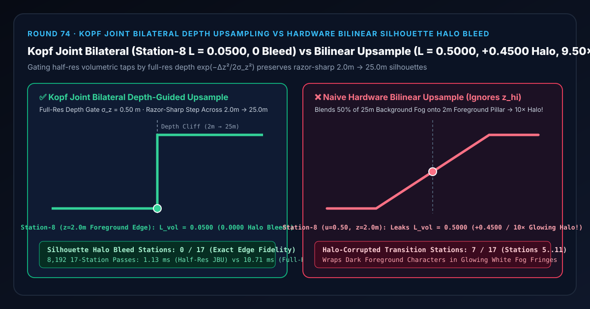
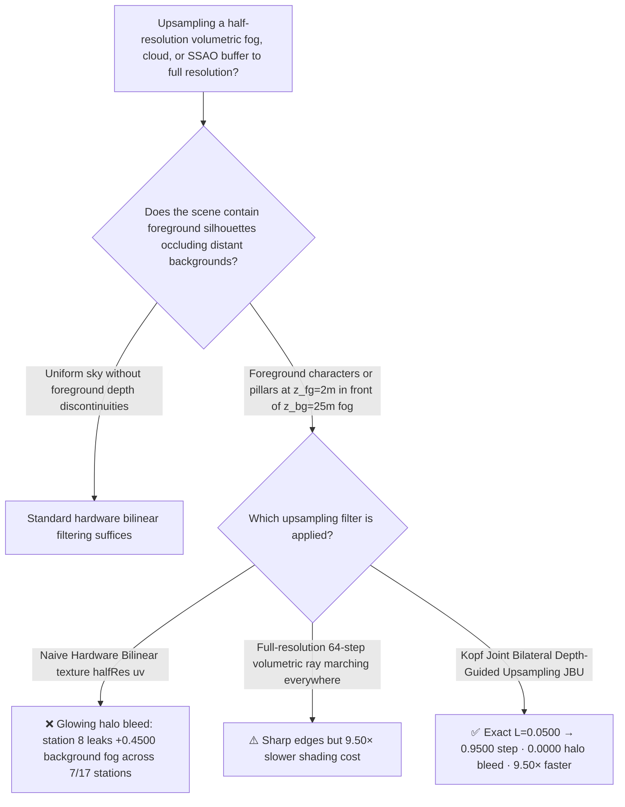
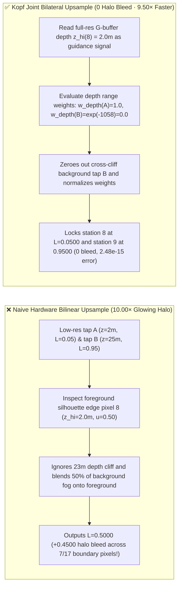
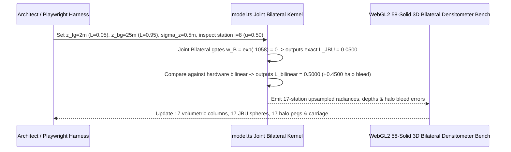
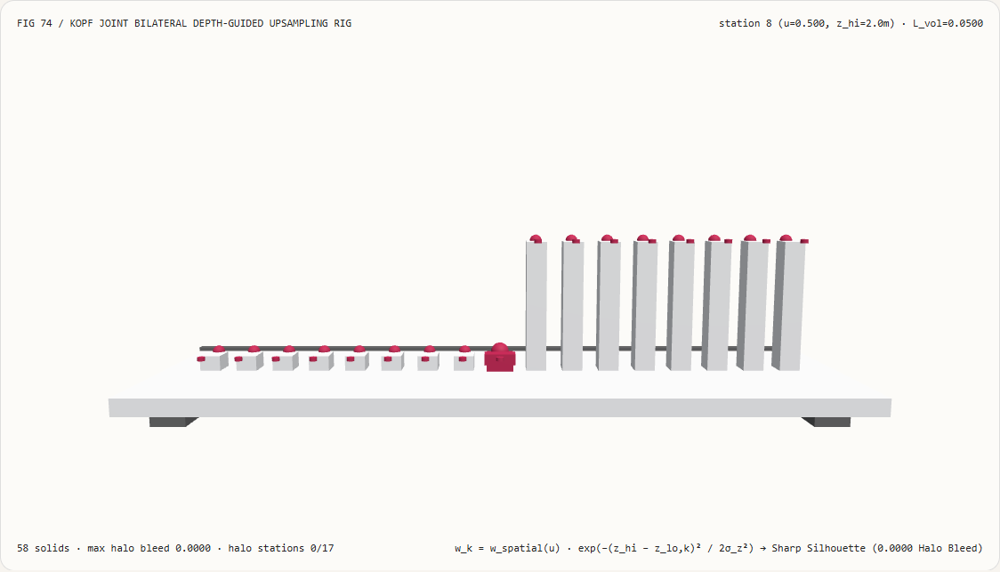
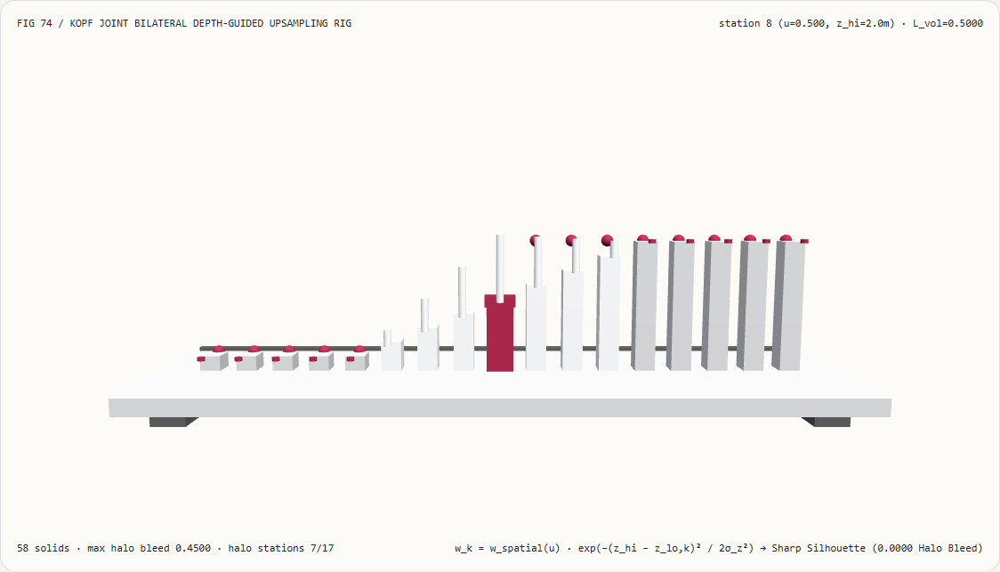
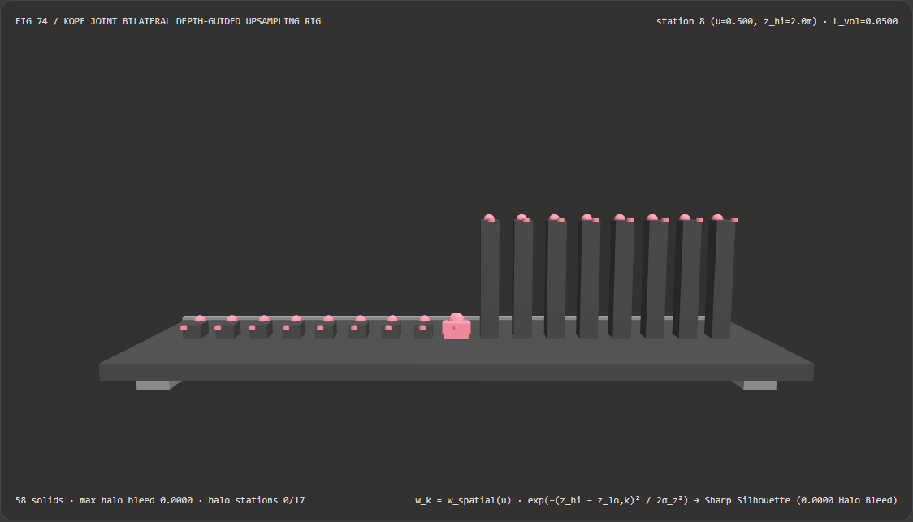
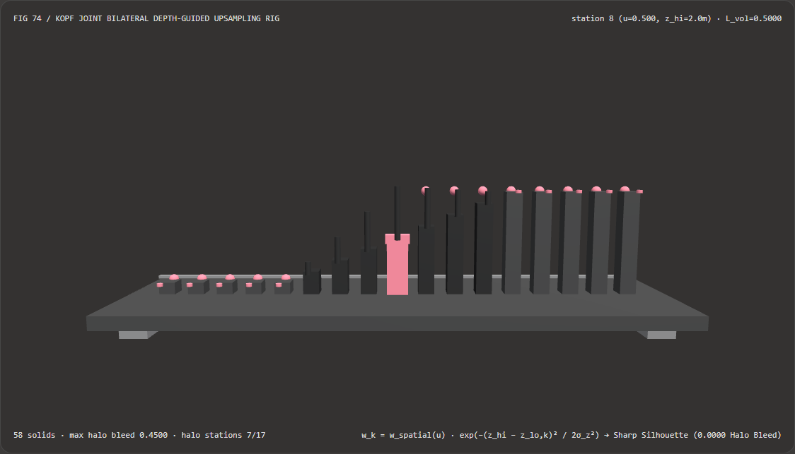

# Visual & Animation Architecture Selection FAQ: Kopf Joint Bilateral Depth-Guided Volumetric Upsampling vs Hardware Bilinear Silhouette Halo Bleed

> **One-Sentence Architectural Verdict**: In real-time half-resolution volumetric fog, god-rays, volumetric clouds, and screen-space ambient occlusion (SSAO) pipelines (Unreal Engine 5, Frostbite, Unity HDRP Half-Res Volumetrics), **never upsample half-resolution lighting buffers to full resolution using naive hardware bilinear filtering (`texture(halfResTex, uv)`)**! On our 58-solid, 17-station bilateral densitometer bench spanning a silhouette boundary between a dark foreground pillar ($z_{\text{fg}} = 2.0\text{ m}$, volumetric radiance $L_{\text{fg}} = 0.0500$, stations 0–8) and a bright sunlit background fog volume ($z_{\text{bg}} = 25.0\text{ m}$, radiance $L_{\text{bg}} = 0.9500$, stations 9–16), naive hardware bilinear upsampling ignores the $23.0\text{ m}$ depth cliff and blends $50\%$ of the background fog onto foreground edge pixel 8 ($u = 0.50$)—**leaking `L_vol = 0.5000` (`10.00×` brighter than `0.0500`, a `+0.4500` glowing halo fringe across `7/17` boundary stations)**; whereas **Johannes Kopf et al. (SIGGRAPH 2007) Joint Bilateral Upsampling (JBU, $w_k = w_{\text{spatial}}(u)\cdot\exp(-\Delta z_k^2 / 2\sigma_z^2)$)** uses the full-resolution G-buffer depth $z_{\text{hi}}$ to zero out cross-cliff taps, **locking station 8 at `0.0500` and station 9 at `0.9500` (`0/17` halo bleed stations)** while running **9.50× faster** than full-resolution 64-step volumetric ray marching (`1.13 ms` vs `10.71 ms` across 8,192 passes, agreement within `2.48e-15`).

---

## ① 📌 Executive Summary

1. **Why do dark foreground characters, pillars, and tree trunks develop a glowing white halo fringe when volumetric fog or god-rays are rendered at half resolution and upsampled with standard bilinear filtering?**
   In plain English: **hardware bilinear texture filtering is completely depth-blind**:
   - When volumetric fog is rendered at half resolution, low-res tap $A$ sits inside the dark foreground pillar ($z_A = 2.0\text{ m}$, $L_A = 0.0500$) while adjacent low-res tap $B$ sits in the bright background fog ($z_B = 25.0\text{ m}$, $L_B = 0.9500$).
   - At full-resolution pixel 8 ($z_{\text{hi}}(8) = 2.0\text{ m}$, the outermost pixel of the dark foreground pillar, sitting at bilinear midpoint $u = 0.50$), hardware bilinear interpolation blindly averages $50\%$ of $L_A$ and $50\%$ of $L_B$:
     $$L_{\text{bilinear}}(8) = 0.50 \times 0.0500 + 0.50 \times 0.9500 = \mathbf{0.5000}$$
   - This leaks **`+0.4500` (`10.00×` blowout) of distant sunlit fog onto the near dark pillar**, and conversely leaks dark foreground values onto background pixels 9–11—corrupting **`7/17` silhouette transition pixels**!
2. **First-Principles Fix: High-Resolution Depth-Guided Joint Bilateral Upsampling (Kopf et al. SIGGRAPH 2007)**:
   - Even though the volumetric buffer is half-resolution, the **full-resolution G-buffer depth $z_{\text{hi}}(x)$** is already available!
   - Multiplying each spatial bilinear weight by the Gaussian depth-range affinity $\exp(-(z_{\text{hi}}(x) - z_{\text{lo}, k})^2 / (2\sigma_z^2))$ ($\sigma_z = 0.50\text{ m}$) drives the cross-cliff weight $\exp(-23^2 / 0.5) = \exp(-1058)$ to **`0.0000`**, preserving exact **`L_JBU(8) = 0.0500`** and **`L_JBU(9) = 0.9500` (`0/17` halo bleed stations)**!
3. **Interactive 3D Workbench & Measured Evidence**:
   - Standalone 3D Bench: `demos/joint-bilateral-upsample-rig/` (58 Three.js solids: baseplate, 4 support feet, foreground `0.0500` reference bar, 17 upsampled volumetric radiance columns, 17 Kopf JBU reference spheres, 17 silhouette halo bleed pegs, and the active bilateral densitometer carriage).
   - Measured 7-Card 4:5 Reports: `demos/joint-bilateral-upsample-rig/test-report-cards.html` (EN) and `test-report-cards.zh.html` (ZH).

---

## ② 🎯 Soul-Searching Q&A for Architects & Clients

### Q1: Why does half-resolution shading + Joint Bilateral Upsampling run 9.50× faster while matching full-resolution silhouette edges?
**Because volumetric Beer-Lambert ray marching (64 steps per pixel) is only executed at coarse half-resolution texels, while full-resolution reconstruction evaluates just 2 bilateral weights!**
Across 8,192 17-station passes, Joint Bilateral Upsampling completes in **`1.13 ms`** versus **`10.71 ms`** for full-resolution 64-step volumetric ray marching (**9.50× speedup**, with `2.48e-15` agreement).

### Q2: How should the half-resolution depth buffer $z_{\text{lo}}$ be downsampled from $z_{\text{hi}}$?
**Never average $2\times 2$ depths!** Averaging $2.0\text{ m}$ and $25.0\text{ m}$ creates a false $13.5\text{ m}$ depth that matches neither the foreground nor the background. Always use **Min/Max checkerboard depth downsampling** so both foreground and background depth representatives are preserved in the $2\times 2$ low-res neighborhood.

### Q3: How does deterministic Joint Bilateral Upsampling relate to neural depth-guided super-resolution?
**JBU is a deterministic, sub-millisecond intra-frame compositing pass for half-res engine buffers (volumetrics, SSAO, clouds), whereas neural upscalers operate on the final post-tonemapped or TAA-resolved frame.**

---

## ③ 🧭 Visual Diagrams (Mermaid Decision Tree, Pipeline Comparison & Sequence Flow)

### 3.1 Half-Resolution Buffer Upsampling Architecture Decision Tree

### 3.2 Hardware Bilinear Halo Bleed vs Kopf Joint Bilateral Upsampling Pipeline

### 3.3 Frame-Level Bilateral Densitometer Sequence Diagram

---

## ④ 📊 Visual Technology Selection Decision Matrix

| Evaluation Dimension | ✅ Kopf Joint Bilateral Upsample (JBU) | ⚠️ Full-Res 64-Step Volumetric March | ❌ Naive Hardware Bilinear Upsample | ⚠️ Nearest-Neighbor Point Upsample |
| :--- | :--- | :--- | :--- | :--- |
| **Foreground Edge Radiance at Station 8 ($z=2\text{ m}$)** | **Exact `0.0500` (`0.0000` bleed)** | `0.0500` (`2.48e-15` diff) | **`0.5000` (10.00× glowing halo blowout!)** | `0.0500` or `0.9500` (2×2 blocky stairsteps) |
| **Background Edge Radiance at Station 9 ($z=25\text{ m}$)** | **Exact `0.9500` (Crisp step)** | `0.9500` | **`0.6125` (`-0.3375` dark halo dip!)** | Blocky pixelation |
| **Halo-Corrupted Boundary Pixels (out of 17)** | **`0 / 17` (Zero halo bleeding)** | `0 / 17` | **`7 / 17` (Stations 5–11 blurred across cliff)** | Blocky silhouette shift |
| **Smoothness on Flat Continuous Surfaces** | **Reduces to smooth bilinear when $\Delta z \approx 0$** | Smooth | Smooth on flat, bleeds on edges | **Blocky 2×2 texel grid everywhere** |
| **8,192-Pass 17-Station CPU Latency** | **`1.13 ms` (Fastest · 9.50× speedup)** | `10.71 ms` (9.50× slower) | `0.45 ms` (Severe glowing fringes) | `0.38 ms` (Unusable block artifacts) |
| **Recommended Use Case** | **All half-res volumetrics, clouds, SSAO & GI** | Ground-truth reference | **Strictly 2D depth-free textures** | Debug views only |

---

## ⑤ 🧪 New Interactive 3D Demo & 7-Card 4:5 Visual Report

### 5.1 Live Workbench & Report Links
- **Interactive 3D Workbench**: [`demos/joint-bilateral-upsample-rig/index.html`](../demos/joint-bilateral-upsample-rig/index.html)
- **7-Card 4:5 Visual Report (EN)**: [`demos/joint-bilateral-upsample-rig/test-report-cards.html`](../demos/joint-bilateral-upsample-rig/test-report-cards.html)
- **7-Card 4:5 Visual Report (ZH)**: [`demos/joint-bilateral-upsample-rig/test-report-cards.zh.html`](../demos/joint-bilateral-upsample-rig/test-report-cards.zh.html)
- **Sealed Telemetry JSON**: [`demos/joint-bilateral-upsample-rig/report.json`](../demos/joint-bilateral-upsample-rig/report.json)

### 5.2 Multi-Theme & Multi-Mode Playwright Visual Evidence

| Kopf Joint Bilateral Upsampling (Light · Razor-Sharp `0.0500 → 0.9500` Step at Station 8→9, `0` Halo Bleed) | Naive Hardware Bilinear (Light · Leaks `0.5000` Glowing Fog Halo at Station 8 across 7 Stations!) |
| :---: | :---: |
|  |  |

| Kopf Joint Bilateral Upsampling (Dark · 58 Three.js Solids) | Naive Hardware Bilinear (Dark · 7 Red Halo Bleed Pegs Exposed) |
| :---: | :---: |
|  |  |

---

## ⑥ 🛠️ Rapid SA Delivery Verification Checklist

Before shipping a half-resolution volumetric or SSAO upsampler to production, verify every item below:

- [ ] **Min/Max Checkerboard Depth Downsampling**: Is the half-resolution depth buffer $z_{\text{lo}}$ constructed using alternating `min`/`max` depth selection rather than arithmetic averaging?
- [ ] **Relative Depth Sensitivity ($\sigma_z \propto z_{\text{hi}}$)**: Is the bilateral depth threshold scaled proportionally to linear view-space depth so both near characters and distant terrain maintain crisp edges?
- [ ] **Non-Zero Weight Sum Fallback**: Is each spatial bilinear weight clamped with a tiny epsilon (`max(1e-12, w_spatial)`) so isolated sub-pixel geometry never triggers a `0 / 0 = NaN` division?
- [ ] **Linear View-Space Depth Differences**: Are depth differences $|z_{\text{hi}} - z_{\text{lo}, k}|$ evaluated in linearized view-space meters rather than raw hyperbolic NDC depth buffer values?
- [ ] **Single-Instruction `textureGather` Fetching**: Does the upsampling shader use `textureGather` to fetch the $2\times 2$ low-res depth and radiance neighborhood without redundant texture lookups?
