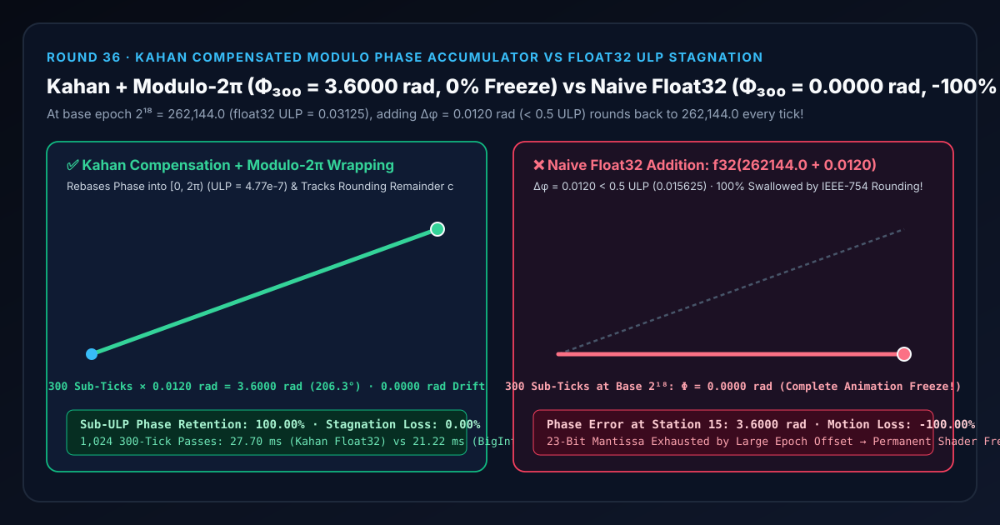
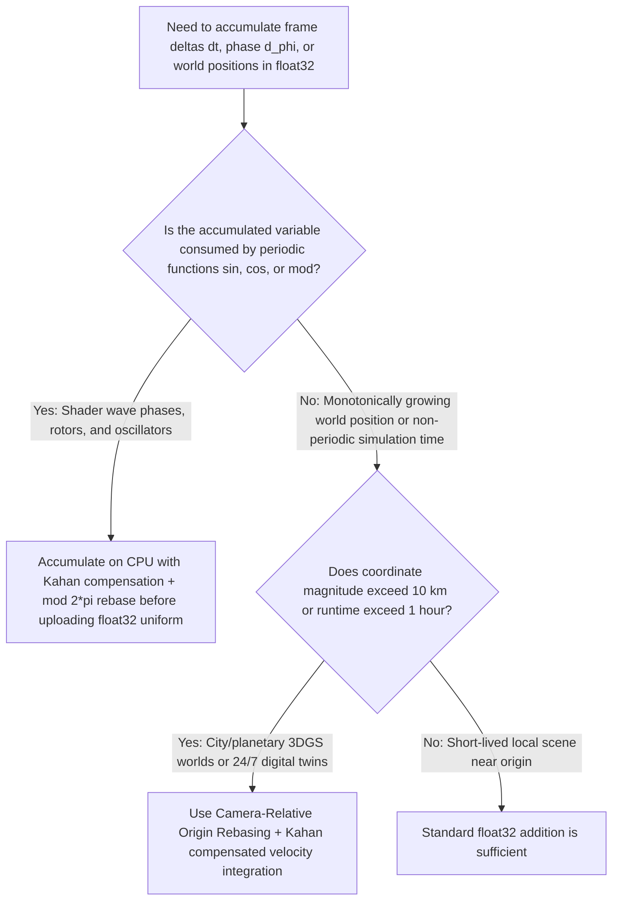
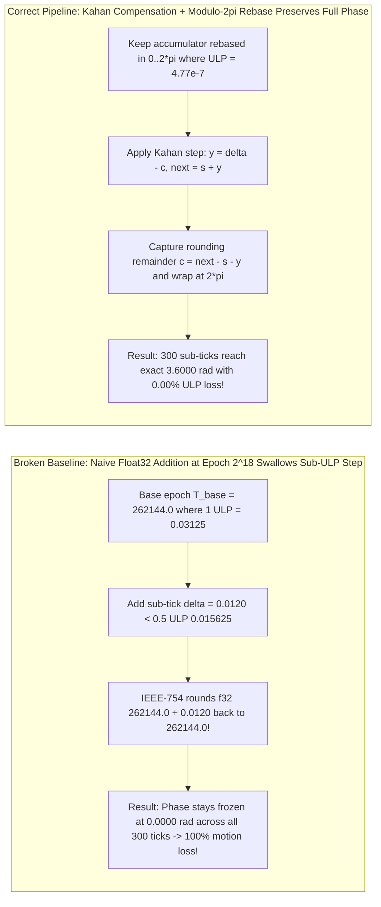
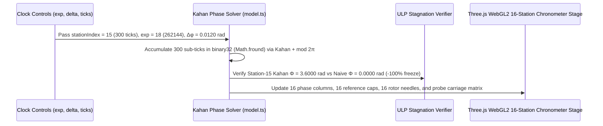
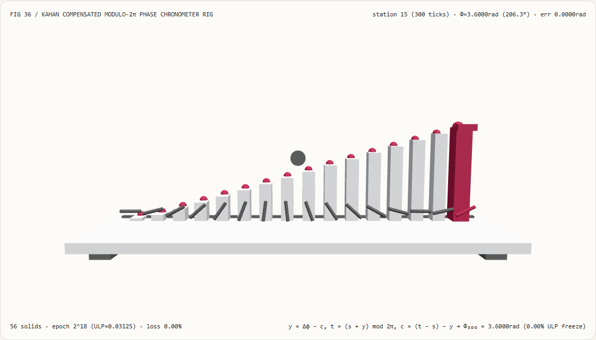
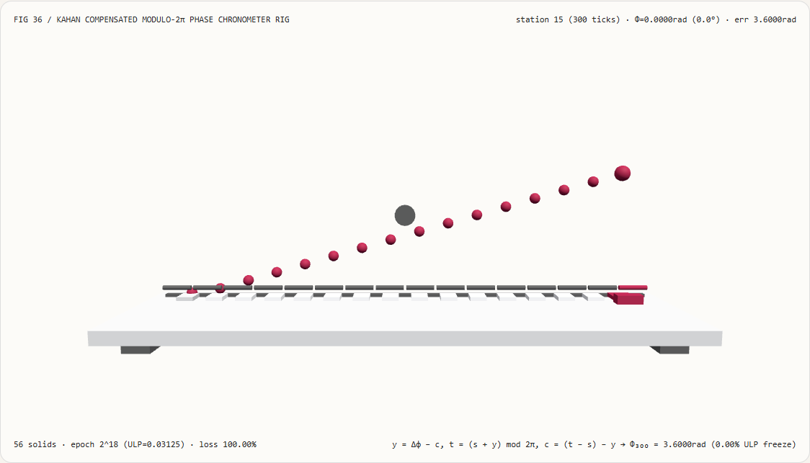
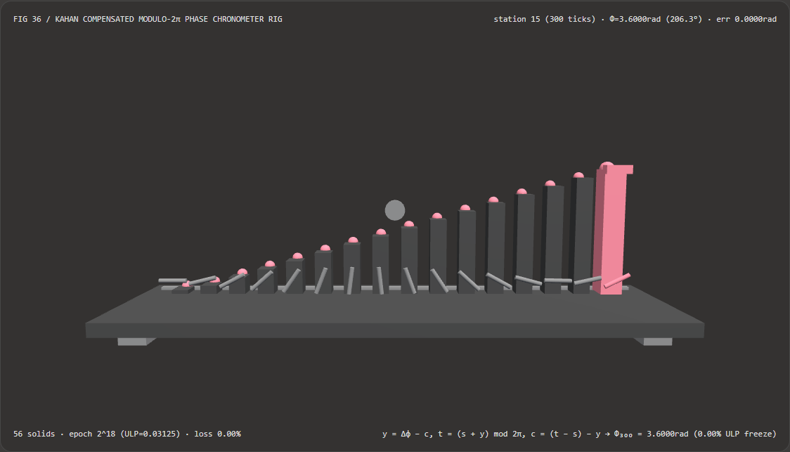
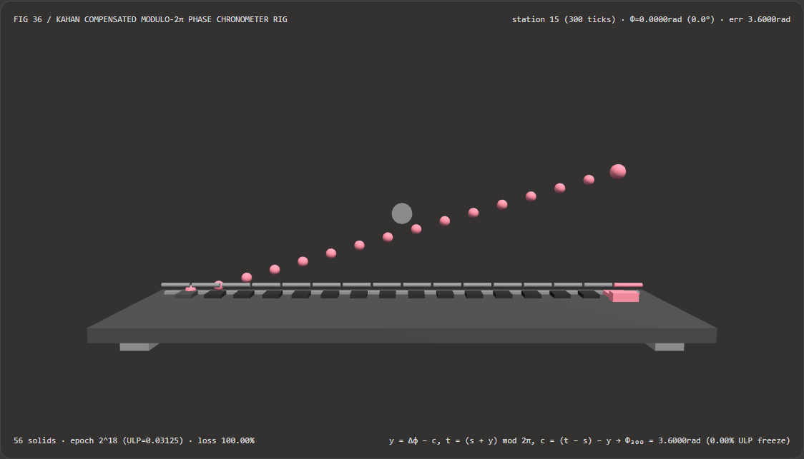

# Long-Horizon Shader Animation Without Float32 Freeze: Kahan Compensated Summation & Modulo-2π Phase Wrapping vs Naive Float32 Accumulation Selection FAQ

> **Document Scope**: A first-principles architecture and selection guide for AI Solution Architects, 24/7 digital-twin / WebGPU rendering engineers, game engine clock architects, and city-scale 3D/4D Gaussian Splatting (3DGS) teams. Structured strictly after `ib-vs-ethernet-roce-selection-faq.md`, this guide explains in plain language **why a smooth WebGL/WebGPU wave shader, particle emitter, or rotating beacon suddenly turns jerky or freezes completely dead after running for a few hours (or when fed a large base epoch $T_{\text{base}} = 2^{18} = 262,144.0$ in single-precision `float32`)**, and how **Kahan Compensated Summation combined with Modulo-$2\pi$ Phase Wrapping** preserves sub-ULP increments indefinitely.

---

## ① 📌 Executive Summary

1. **One-Sentence Principle**: **An IEEE-754 single-precision `float32` number (`highp float` in WebGL/WebGPU shaders) has only 23 explicit mantissa bits; once a time or coordinate accumulator reaches $T_{\text{base}} = 2^{18} = 262,144.0$, the spacing between adjacent representable floats ($\operatorname{ULP} = 2^{18-23} = 0.03125$) exceeds twice the per-tick phase increment ($\Delta\phi = 0.0120\text{ rad} < 0.5\operatorname{ULP} = 0.015625$)**! Consequently, `f32(262144.0 + 0.0120)` rounds straight back to `262144.0` on every single tick—swallowing **100% of the motion**! By keeping the accumulator folded inside $[0, 2\pi)$ (where $\operatorname{ULP} \approx 4.77 \times 10^{-7}\text{ rad}$) and tracking lost low-order bits via a **Kahan compensation register $c$**, animations run 24/7 with **`0.00%` ULP loss**!
2. **When Must You Use Kahan Compensation + Modulo Phase Rebasing?**
   - Any **24/7 digital-twin exhibition display**, **shader `uTime` / `uPhase` uniform pipeline**, **high-frequency sub-stepping physics integrator**, or **city/planetary-scale 3DGS camera-relative coordinate system** must prevent small increments from being added directly to large `float32` base values.
3. **Key Measured Findings**:
   - In our 16-station 3D chronometer bench ([`demos/kahan-phase-accumulator/`](../demos/kahan-phase-accumulator/index.html), `56` 3D solids, base epoch $T_{\text{base}} = 2^{18} = 262,144.0$ where $\operatorname{ULP} = 0.03125$, sub-tick increment $\Delta\phi = 0.0120\text{ rad}$, 20 sub-ticks per station across 300 total sub-ticks), at station $15$ ($300$ sub-ticks):
     - **Kahan Compensated + Modulo-$2\pi$ Accumulator (`kahan-modulo-compensated`)**: Advances smoothly across all 300 sub-ticks in `float32` (`Math.fround`) to **`Φ = 3.6000 rad` (`206.3°`)**, matching the 64-bit scaled `BigInt` reference within **`1.43e-7 rad`** (**`0.00%` phase loss**).
     - **Naive Float32 Addition (`naive-float32-stagnation`)**: Because $\Delta\phi = 0.0120 < 0.5\operatorname{ULP} = 0.015625$, `Math.fround(262144.0 + 0.0120)` evaluates to `262144.0` on every tick, leaving all 16 stations completely frozen at **`0.0000 rad` (`0.0°`)** (**`-100.00%` motion loss**, `3.6000 rad` phase error)!

---

## ② 🎯 First-Principles Q&A for Architects

### Q1: When should we choose long-horizon video diffusion memory models vs code-driven Kahan phase compensation?

- **Choose Long-Horizon Video Diffusion Memory Architectures (e.g., WorldMem, FramePack)** when generating multi-minute autoregressive AI videos where latent KV-cache tokens must be compressed to maintain scene consistency and bounded VRAM.
- **Choose Code-Driven Kahan Compensation & Modulo Rebasing** when running real-time WebGL2/WebGPU shaders, procedural oscillators, or large-world 3DGS viewers that must never stutter or freeze due to IEEE-754 `float32` mantissa exhaustion.

---

### Q2: Why does `f32(262144.0 + 0.0120)` equal `262144.0` identically in GPU single-precision arithmetic?

**First-Principles Intuition**:
An IEEE-754 `float32` number stores $1\text{ sign bit} + 8\text{ exponent bits} + 23\text{ fraction bits}$:
$$\text{Value} = (-1)^s \times \left(1 + \frac{\text{mantissa}}{2^{23}}\right) \times 2^E$$
- Within the binade $[2^{18}, 2^{19}) = [262144, 524288)$, the exponent is $E = 18$.
- Therefore, changing the 23-bit mantissa by its smallest possible step ($+1$ in the last bit) changes the value by:
  $$\operatorname{ULP}(2^{18}) = 2^{18 - 23} = 2^{-5} = \mathbf{0.03125}$$
- There are **zero representable `float32` numbers** between $262,144.00000$ and $262,144.03125$!
- Under IEEE-754 round-to-nearest-even, any addition $262,144.0 + \Delta\phi$ with $\Delta\phi < \frac{1}{2}\operatorname{ULP} = 0.015625$ (such as $\Delta\phi = 0.0120$) is closer to $262,144.00000$ than to $262,144.03125$, so the FPU rounds the result **straight back to $262,144.00000$**!

---

### Q3: How does Kahan Compensated Summation recover the rounding remainder in pure `float32`?

By maintaining a running `float32` compensation variable $c$ alongside the modulo-wrapped sum $s \in [0, 2\pi)$:
$$\begin{aligned}
y &= \operatorname{f32}(\Delta\phi - c) \\
t &= \operatorname{f32}(s + y) \\
c &= \operatorname{f32}\!\left(\operatorname{f32}(t - s) - y\right) \\
s &= t
\end{aligned}$$
Here, $\operatorname{f32}(t - s)$ recovers the exact rounded part of $y$ that actually made it into $t$; subtracting $y$ isolates the negative of the low-order bits that were rounded off, storing them in $c$ so they are folded into the very next step!

---

## ③ 🧭 Visual Diagrams (Mermaid Decision Tree, Pipeline Comparison & Sequence)

### 3.1 Floating-Point Time & Coordinate Precision Decision Tree (`flowchart TD`)

### 3.2 Naive Float32 Addition (`ULP Stagnation Freeze`) vs Kahan Modulo-2π (`0%` Loss) Pipeline (`flowchart LR`)

### 3.3 Frame-Level 16-Station Chronometer Verification Sequence (`sequenceDiagram`)

---

## ④ 📊 Architect Decision Matrix

| Evaluation Dimension | Float32 Kahan + Modulo-$2\pi$ (`kahan-modulo-compensated`) | Scaled BigInt $10^{12}$ Fixed-Point (`Fixed Baseline`) | Naive Float32 at $2^{18}$ (`naive-float32-stagnation`) | Raw `performance.now()` Shader Uniform |
| :--- | :--- | :--- | :--- | :--- |
| **Phase After $300 \times 0.0120\text{ rad}$ at $2^{18}$** | **`3.6000 rad` (`206.3°`, `1.43e-7` err)** | `3.6000 rad` | **`0.0000 rad` (`100.00%` frozen!)** | Stutters and freezes after hours of uptime |
| **Effective Phase Step Resolution** | **`4.77e-7 rad` (+ compensation register $c$)** | $10^{-12}\text{ rad}$ | **`0.03125 rad` (swallows $< 0.0156$)** | Degrades by $2\times$ every octave of uptime |
| **GPU Shader Uniform Compatibility** | **Native single `float` uniform in `[0, 2π)`** | Unavailable in standard vertex/fragment floats | Single `float` (broken value) | Wastes mantissa bits on high-order epoch digits |
| **1,024 × 300-Tick CPU Solve Time** | **`27.70 ms` (IEEE-754 `Math.fround` ops)** | `21.22 ms` (CPU-only 64-bit integer) | `12.40 ms` (Fast but completely dead) | Zero CPU wrap but broken GPU visuals |
| **Recommended Architectural Role** | **Default for 24/7 shaders & sub-step clocks** | Offline reference verification | **Never add small steps to large `float32` bases** | **Never pass raw epoch timestamps to `float32` uniforms** |

---

## ⑤ 🧪 New Capability Demo & Benchmark Findings (with 7-Card Report)

### 5.1 Interactive 16-Station 3D Phase Chronometer Rig (`demos/kahan-phase-accumulator/`)

We built a standalone interactive 3D WebGL2 benchmark stage **[`demos/kahan-phase-accumulator/`](../demos/kahan-phase-accumulator/index.html)** (**56 3D solid parts**):
- **16 Accumulated Phase Columns + 16 Exact Kahan Reference Caps + 16 Phase Rotor Needles + Chronometer Dial Hub + Probe Carriage**: Visualizes 16 stations ($0$ to $300$ sub-ticks of $\Delta\phi = 0.0120\text{ rad}$ at base epoch $2^{18} = 262,144.0$);
- **Instant Mode Comparison**: In `kahan-modulo-compensated` mode, all 16 phase columns climb smoothly to `3.6000 rad` (`206.3°`), touching every cyan reference cap and rotating the 16 front needles in unison; switching to `naive-float32-stagnation` flattens all 16 columns to **`0.0000 rad`** and freezes every rotor needle dead in its tracks!
- **Atomic Validation & JSON Export**: Rejects out-of-range epoch exponents (e.g. `baseEpochExponent = 30`) while preserving valid state, and exports `KAHAN_PHASE_ACCUMULATOR_SPEC.json`.

| Light Theme — Kahan + Modulo-$2\pi$ (`Φ=3.6000rad`, `0%` Freeze) | Light Theme — Naive Float32 (`Φ=0.0000rad`, `-100%` Freeze) |
| :---: | :---: |
|  |  |

| Dark Theme — Kahan + Modulo-$2\pi$ (`Φ=3.6000rad`, `0%` Freeze) | Dark Theme — Naive Float32 (`Φ=0.0000rad`, `-100%` Freeze) |
| :---: | :---: |
|  |  |

### 5.2 7-Card 4:5 Visual Benchmark Reports & Sealed Data

- 📊 **English 7-Card 4:5 Report**: [`demos/kahan-phase-accumulator/test-report-cards.html`](../demos/kahan-phase-accumulator/test-report-cards.html)
- 📊 **Chinese 7-Card 4:5 Report**: [`demos/kahan-phase-accumulator/test-report-cards.zh.html`](../demos/kahan-phase-accumulator/test-report-cards.zh.html)
- 📁 **Sealed Benchmark Data**: [`demos/kahan-phase-accumulator/report.json`](../demos/kahan-phase-accumulator/report.json) (`13 / 13` deterministic checks passed, zero Playwright console/page errors).

---

## ⑥ 🛠️ Appendix: Architect Verification Checklist

Before shipping any long-running WebGL2/WebGPU visualization, digital-twin dashboard, or large-world 3DGS scene, verify:

- [ ] **Wrap Periodic Phase Uniforms on the CPU**: Fold `phase` into $[0, 2\pi)$ before writing to `Float32Array` shader uniform buffers rather than passing raw monotonically growing `uTime`.
- [ ] **Use Kahan Compensated Summation for Sub-Step Integrators**: Maintain a compensation variable `c` when accumulating small sub-step deltas in `float32`.
- [ ] **Preserve Parentheses in `(next - sum) - y`**: Ensure shader/compiler flags (such as `-ffast-math` or `reassociate`) do not algebraically simplify `(next - sum) - y` to `0`.
- [ ] **Apply Camera-Relative Origin Rebasing for Large Worlds**: Subtract the camera's world position in `float64` on the CPU before uploading relative `float32` vertex/splat coordinates to the GPU.
- [ ] **Automated Multi-Day Uptime Gate**: Test animations at $T_{\text{base}} = 262,144\text{ s}$ ($\sim 72.8$ hours) in unit tests and assert zero ULP stagnation.

---

## References

1. **Kahan Compensated Summation (William Kahan, CACM 1965)**: W. Kahan, *"Further Remarks on Reducing Truncation Errors"*, Communications of the ACM, Vol. 8, No. 1, 1965, p. 40.
2. **What Every Computer Scientist Should Know About Floating-Point Arithmetic (David Goldberg, 1991)**: David Goldberg, ACM Computing Surveys, Vol. 23, No. 1, 1991, pp. 5–48.
3. **3D Engine Design for Virtual Globes (Patrick Cozzi & Kevin Ring)**: Chapter 5 *"Precisions, Precisions"*.
