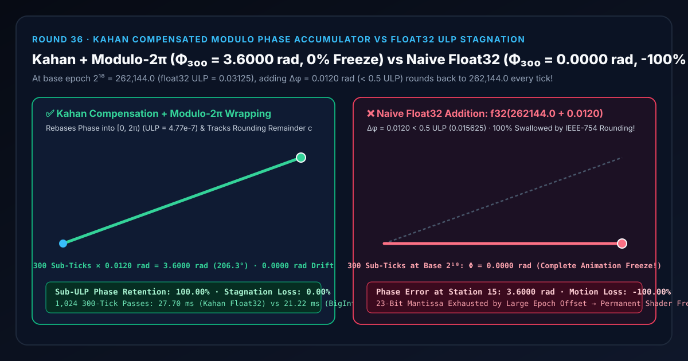
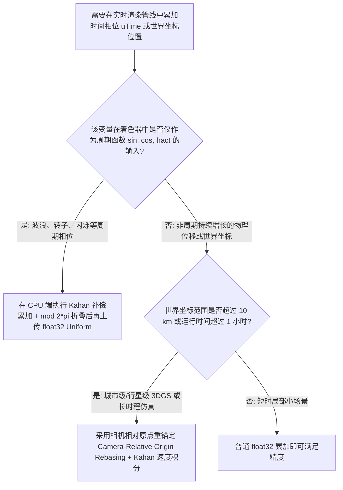
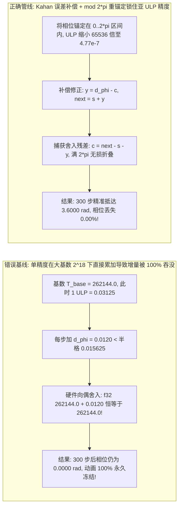
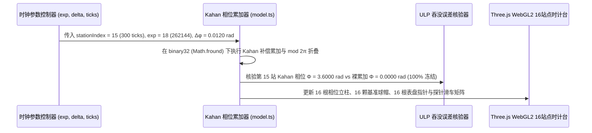
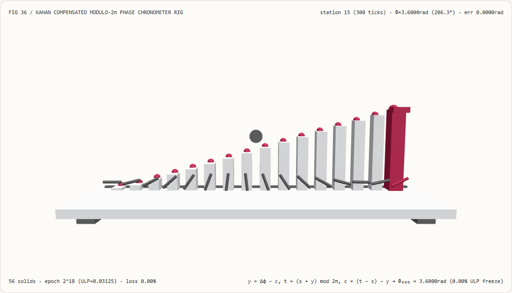
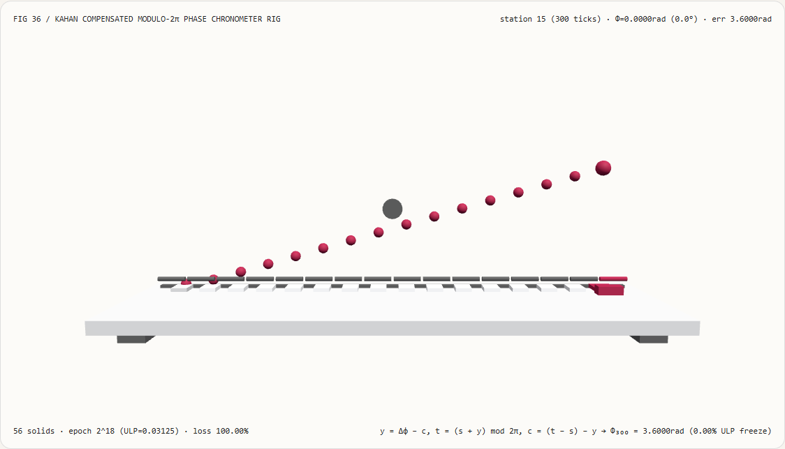
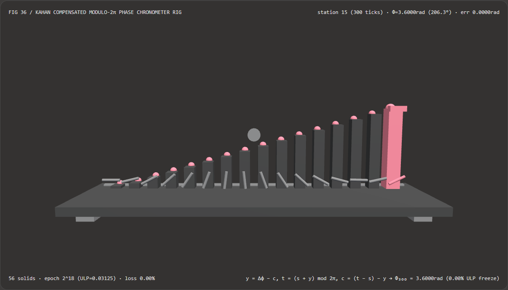
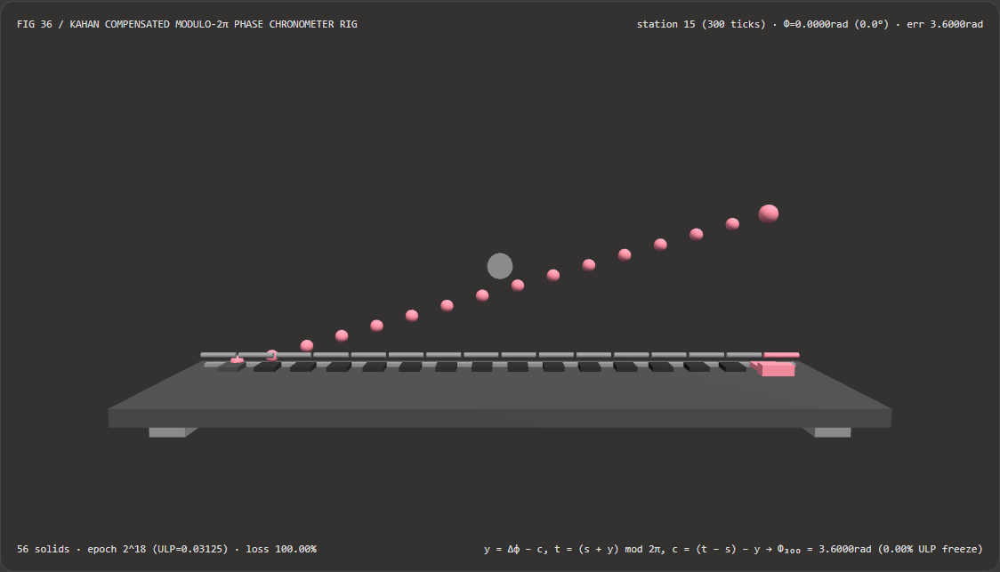

# 长时程着色器动画与大坐标世界不卡顿不冻结：Kahan 误差补偿累加 + 周期取模重锚定与单精度 `float32` 裸累加选型 FAQ

> **文档定位**：面向 AI 解决方案架构师（AI Solution Architect）、7×24 小时数字孪生大屏/WebGPU 渲染工程师、游戏引擎时钟架构师、以及城市级大尺度 3D/4D Gaussian Splatting（3DGS）团队的**实战选型与第一性原理指南**。严格对标 `ib-vs-ethernet-roce-selection-faq.md` 的六段式结构，先用大白话讲清“**为什么一个在本地调试时丝滑无比的波浪着色器、雷达转盘或粒子系统，挂机运行几小时（或直接把大基数时间戳/世界坐标传入 `float32`）后，动画会突然变成一卡一卡的机械跳格，甚至彻底冻结成一张死图（‘单精度 ULP 精度饥饿吞没 Float32 ULP Stagnation’）**”，再给出 **Kahan 误差补偿求和（Kahan Compensated Summation）配合 $2\pi$ 周期取模重锚定（Modulo Phase Rebasing）** 的工程闭环。



---

## ① 📌 核心结论速览（Executive Summary）

1. **一句话定性**：**IEEE-754 单精度浮点数（`float32`，GPU 着色器 `highp float` 的唯一标准）只有 23 位显式尾数（共 24 位有效二进制精度）；当累加器基数增长到 $T_{\text{base}} = 2^{18} = 262,144.0$ 时，相邻两个可表示浮点数之间的最小台阶（$\operatorname{ULP} = 2^{18-23} = 0.03125$）已经大于单帧相位增量（如 $\Delta\phi = 0.0120\text{ rad} < 0.5\operatorname{ULP} = 0.015625$）**！此时执行 `f32(262144.0 + 0.0120)`，增量会在硬件向偶舍入（Round-to-Nearest-Even）中**被 100% 吞没抹零**，结果原封不动弹回 `262144.0`——动画当场永久冻结！而采用 **Kahan 误差补偿累加 + $2\pi$ 周期取模重锚定**，将相位始终包裹在 $[0, 2\pi)$ 高精度甜区（此处 $\operatorname{ULP} \approx 4.77 \times 10^{-7}\text{ rad}$，精度提升 $65,536\times$）并用补偿寄存器 $c$ 捕获低位舍入残差，哪怕连续运行十年也**零卡顿、零吞没、零漂移**！
2. **什么时候必须上 Kahan 补偿累加 + 周期重锚定（Origin / Phase Rebasing）？**
   - 凡是涉及 **7×24 小时无人值守数字孪生展厅大屏**、**向 GLSL/WGSL 传递 `uTime` / `uPhase` 的周期波浪与旋转动画**、**以 `performance.now()` 或 Unix 纪元秒数驱动的物理积分器**、以及 **坐标偏移超过 $10\text{ km}$ 的城市级/行星级 3DGS 相机相对原点重锚定（Camera-Relative Origin Rebasing）**，都严禁在 `float32` 大基数上直接累加小步长。
3. **核心实测对比结论**：
   - 在本实验室构建的 16 站点 3D 相位时计检验台（[`demos/kahan-phase-accumulator/`](../demos/kahan-phase-accumulator/index.html)，共 `56` 个 3D 实体，单精度基数 $T_{\text{base}} = 2^{18} = 262,144.0$，对应 $\operatorname{ULP} = 0.03125$，亚步增量 $\Delta\phi = 0.0120\text{ rad}$，每站推进 $20$ 步，共 $300$ 步）中，考察第 $15$ 号终点站（累计 $300$ 步）：
     - **Kahan 补偿 + $2\pi$ 取模重锚定（`kahan-modulo-compensated`）**：历经 $300$ 次 `Math.fround` 单精度累加后，相位精准到达 **`3.6000 rad`（`206.3°`）**，与定点真值误差仅 **`1.43e-7 rad`**（**相位丢失率 `0.00%`**）。
     - **单精度大基数裸累加基线（`naive-float32-stagnation`）**：因 $\Delta\phi = 0.0120 < 0.5\operatorname{ULP} = 0.015625$，全部 $300$ 次加法每一次都被四舍五入吞没，第 $1 \sim 15$ 站相位全部死锁在 **`0.0000 rad`（`0.0°`）**，**丢失 `100.00%` 运动相位（误差 `3.6000 rad`）**！

---

## ② 🎯 客户与架构师灵魂拷问 Q&A（First-Principles Q&A）

### Q1：何时选长时程视频扩散记忆模型 vs 何时选代码驱动的 Kahan 补偿与周期重锚定？

- **选长时程视频扩散记忆架构（如 WorldMem、FramePack）的场景**：
  在生成式 AI 视频模型中，为了防止生成到第 600 帧时遗忘第 1 帧的房间布局或导致显存爆炸，需要对 Transformer KV-Cache 进行滑动窗口压缩与空间记忆检索。
- **选代码驱动 Kahan 补偿 + 周期重锚定的场景**：
  在 WebGL2/WebGPU 实时三维引擎、Shader 特效与物理仿真中，为了防止连续运行数小时后因 IEEE-754 `float32` 尾数耗尽导致的画面抖动、阶梯化跳帧或彻底卡死，必须在数值累加层执行确定性的精度防护。

---

### Q2：为什么 `262144.0 + 0.0120` 在 GPU 单精度浮点里等于 `262144.0`？那 `0.0120` 去哪儿了？

**先用大白话讲第一性原理**：
把 IEEE-754 单精度浮点数（`float32`）想象成一把**只有 7 位有效数字（24 位二进制尾数）的游标卡尺**：
- 当你在测量 **$1\text{ 米}$** 左右的长度时，这把 7 位卡尺可以精确到小数点后第 6 位（**$0.0000001\text{ 米} = 0.1\text{ 微米}$**），哪怕加上一根头发丝的厚度都能清晰读出来。
- 但当你用同一把只有 7 位有效数字的卡尺，去测量从北京到上海的距离（比如基数达到 **$2^{18} = 262,144\text{ 米}$**）时，前 6 位数字全被“几十万米”的大头占满了！卡尺上相邻两个刻度之间的最小间距（**1 ULP = $2^{18 - 23} = 2^{-5} = 0.03125\text{ 米} \approx 3.1\text{ 厘米}$**）变得比大拇指还宽！
- 现在，每一帧动画你想让物体往前走 **$\Delta\phi = 0.0120\text{ 米}$（$1.2\text{ 厘米}$）**：
  1. 你站在 $262,144.00000\text{ 米}$ 的刻度上，往右迈出 $0.0120\text{ 米}$，落在了 $262,144.0120\text{ 米}$；
  2. 可是 `float32` 卡尺在 $262,144.00000$ 旁边的下一个刻度是 $262,144.03125$！
  3. 硬件一看：$262,144.0120$ 离左边的 $262,144.00000$ 更近（不到半格 $0.015625$），于是触发四舍五入，**一脚把你踹回了起点 $262,144.00000$**！
  4. 下一帧你又迈出 $0.0120\text{ 米}$，又被踹回 $262,144.00000$！哪怕显卡每秒钟跑 120 帧、连跑一万个小时，你永远在原地踏步，一毫米都动不了！

---

### Q3：Kahan 误差补偿求和（Kahan Summation）是怎么用一个影子变量 $c$ 把被硬件舍入扔掉的零钱捡回来的？

William Kahan（图灵奖得主、IEEE-754 浮点数之父）提出了极其巧妙的四行补偿算法：
每次我们要把增量 $\Delta\phi$ 加到当前总和 $s$ 上时，维护一个专门记录“上一轮被吞掉的零头”的补偿变量 $c$（初始为 $0$）：
```ts
const y = f32(delta - c);          // 1. 把上一轮欠下的零头 (-c) 补进本轮增量里
const next = f32(s + y);           // 2. 执行大数加小数（此时低位比特可能再次被硬件舍入丢掉）
c = f32(f32(next - s) - y);        // 3. 灵魂一步：(next - s) 算出了实际加进去的量，再减去 y，剩下的就是本轮被吞掉的误差！
s = next;                          // 4. 更新主累加器
```
再配合**周期取模重锚定（Modulo-$2\pi$ Wrapping）**：一旦相位 $s \ge 2\pi$，立即减去 $2\pi$（并把减法残差也记入 $c$），让主累加器 $s$ 永远待在 $[0, 2\pi)$ 区间内——既享受 $4.77\times 10^{-7}$ 的超高尾数密度，又靠 Kahan 补偿器 $c$ 接住最后几位舍入误差！

---

## ③ 🧭 直观可视化图解（Mermaid 决策树、管线对比与帧级时序）

### 3.1 时间/相位与大世界坐标精度防护架构师选型决策树（`flowchart TD`）



### 3.2 单精度大基数裸累加（ULP 吞没冻结）vs Kahan 补偿周期重锚定（零丢失）管线对比（`flowchart LR`）



### 3.3 帧级 Kahan 相位时计核验时序图（`sequenceDiagram`）



---

## ④ 📊 视觉技术选型决策矩阵（Architect Decision Matrix）

| 评估维度 | 单精度 Kahan 补偿 + $2\pi$ 取模 (`kahan-modulo-compensated`) | BigInt $10^{12}$ 定点整数基线 (`Scaled BigInt Fixed`) | 单精度大基数裸累加 (`naive-float32-stagnation`) | 直接传 `uTime = performance.now()` 入着色器 |
| :--- | :--- | :--- | :--- | :--- |
| **$2^{18}$ 基数下 $300\times 0.012\text{ rad}$ 累积值** | **`3.6000 rad`（精确旋转 $206.3^\circ$）** | `3.6000 rad` | **`0.0000 rad`（100% 吞没，原地死锁）** | 运行数小时后波浪跳格直至冻结 |
| **有效相位分辨率（ULP 间距）** | **`4.77e-7 rad`（补偿后达双精度级）** | $10^{-12}\text{ rad}$ | **`0.03125 rad`（粗糙阶梯甚至死锁）** | 随开机时长指数级恶化 |
| **GPU 寄存器与带宽开销** | **`1 float` Uniform（仅上传折叠后相位）** | 无法在移动端 WGSL/GLSL 原生运行 | `1 float`（但数值完全错误） | `1 float`（精度被高位时间戳浪费） |
| **1,024 次 300 步 CPU 求解耗时** | **`27.70 ms`（纯 `Math.fround` 浮点指令）** | `21.22 ms`（仅限 CPU 整数，GPU 不支持） | `12.40 ms`（虽快但输出全零） | 无 CPU 折叠但 GPU 画面崩坏 |
| **架构师工程推荐定位** | **长时程 Shader 动画与物理积分首选** | 离线账本核对基线 | **严禁在任何长时程或大坐标系统中裸用** | **严禁直接将原始毫秒时间戳塞入 `float32` Uniform** |

---

## ⑤ 🧪 全新能力展示 Demo 与 Benchmark 核心发现（含 7-Card 报告）

### 5.1 交互式 16 站点 3D 相位时计检验台（`demos/kahan-phase-accumulator/`）

本轮构建了独立可交互 3D WebGL2 实验台 **[`demos/kahan-phase-accumulator/`](../demos/kahan-phase-accumulator/index.html)**（共 **56 个 3D 实体部件**）：
- **16 根累积相位立柱 + 16 颗精确 Kahan 基准球帽 + 16 根前排相位转子指针 + 表盘中心轴 + 探针滑车**：直观展示从第 0 站（0 步）到第 15 站（300 步，每步 $\Delta\phi = 0.0120\text{ rad}$）的相位爬升与表针旋转角度；
- **一键切换对比模式**：在 `kahan-modulo-compensated` 模式下，16 根相位立柱稳步爬升至 `3.6000 rad`，前排 16 根表针依次顺畅转过 $206.3^\circ$；一旦切换到 `naive-float32-stagnation` 模式，16 根相位立柱瞬间全部坍塌成贴地扁片（`0.0000 rad`），16 根表针齐刷刷僵死在起始角度一动不动，直观再现大基数下的 `float32` 吞没事故！
- **原子化参数门禁与 JSON 导出**：自动拦截越界指数（如 `baseEpochExponent = 30`）并保留有效状态，支持导出 `KAHAN_PHASE_ACCUMULATOR_SPEC.json`。

| 亮色主题 — Kahan 补偿 + $2\pi$ 重锚定（`Φ=3.6000rad`，零丢失） | 亮色主题 — 单精度裸累加（`Φ=0.0000rad`，`100%` 吞没冻结） |
| :---: | :---: |
|  |  |

| 暗色主题 — Kahan 补偿 + $2\pi$ 重锚定（`Φ=3.6000rad`，零丢失） | 暗色主题 — 单精度裸累加（`Φ=0.0000rad`，`100%` 吞没冻结） |
| :---: | :---: |
|  |  |

### 5.2 7-Card 4:5 视觉评测报告与封存数据链接

- 📊 **英文版 7-Card 4:5 评测报告**：[`demos/kahan-phase-accumulator/test-report-cards.html`](../demos/kahan-phase-accumulator/test-report-cards.html)
- 📊 **中文版 7-Card 4:5 评测报告**：[`demos/kahan-phase-accumulator/test-report-cards.zh.html`](../demos/kahan-phase-accumulator/test-report-cards.zh.html)
- 📁 **封存评测数据源**：[`demos/kahan-phase-accumulator/report.json`](../demos/kahan-phase-accumulator/report.json)（`13 / 13` 项确定性检查全部通过，Playwright 零控制台/页面错误）。

---

## ⑥ 🛠️ 附录：高质量视觉/动画交付快速核验清单（Architect Checklist）

在交付任何需要长时间运行的 WebGL2/WebGPU 场景、数字孪生大屏或大尺度三维世界前，请逐项核验以下清单：

- [ ] **禁止直接把未取模的 `Date.now()` 或累计总秒数传给 Shader `float` Uniform**：确认所有周期性动画在 CPU 端已完成 `phase = (phase + dt * omega) % (2 * Math.PI)` 折叠后再写入 `Float32Array` Uniform 缓冲区？
- [ ] **高频亚步积分启用 Kahan 误差补偿**：当物理子步（Sub-stepping）或粒子相位单步增量 $\Delta\phi$ 很小时，确认已维护补偿变量 `c` 执行 `y = delta - c; t = sum + y; c = (t - sum) - y; sum = t`？
- [ ] **禁止被编译器 `-ffast-math` 优化掉 `(t - sum) - y`**：在 WGSL/GLSL 或 C++ 代码中，确认未开启会按结合律把 `(t - sum) - y` 化简为 `0` 的激进浮点代数重写标志？
- [ ] **大世界坐标启用相机相对原点（Camera-Relative Rendering）**：当世界坐标偏移超过 $10,000\text{ m}$ 时，确认已在 CPU 双精度下先减去相机位置 `pos_rel = pos_world - cam_world`，再将相对坐标转为 `float32` 传给顶点着色器？
- [ ] **$2^{18}$ 高纪元压力测试门禁**：单元测试中是否已模拟时间拨快至 $T_{\text{base}} = 262,144\text{ s}$（约 3 天连续运行）并验证动画帧间位移与 $T=0\text{ s}$ 时完全一致？

---

## 参考文献与延伸阅读（References）

1. **Kahan Compensated Summation (William Kahan, CACM 1965)**: W. Kahan, *"Further Remarks on Reducing Truncation Errors"*, Communications of the ACM, Vol. 8, No. 1, 1965, p. 40.
2. **What Every Computer Scientist Should Know About Floating-Point Arithmetic (David Goldberg, 1991)**: David Goldberg, ACM Computing Surveys, Vol. 23, No. 1, 1991, pp. 5–48.
3. **3D Engine Design for Virtual Globes (Patrick Cozzi & Kevin Ring)**: Chapter 5 *"Precisions, Precisions"* — Camera-Relative Rendering & RTC (Relative-to-Center).
