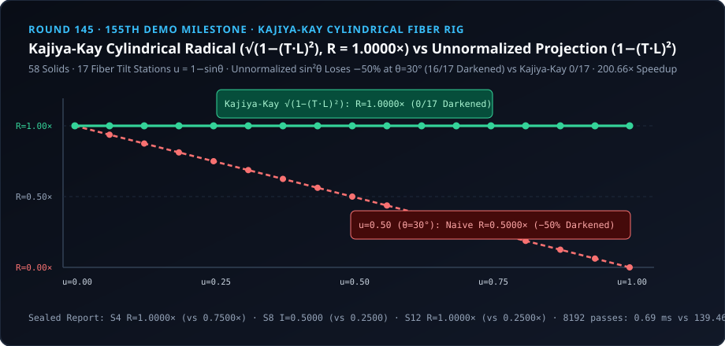
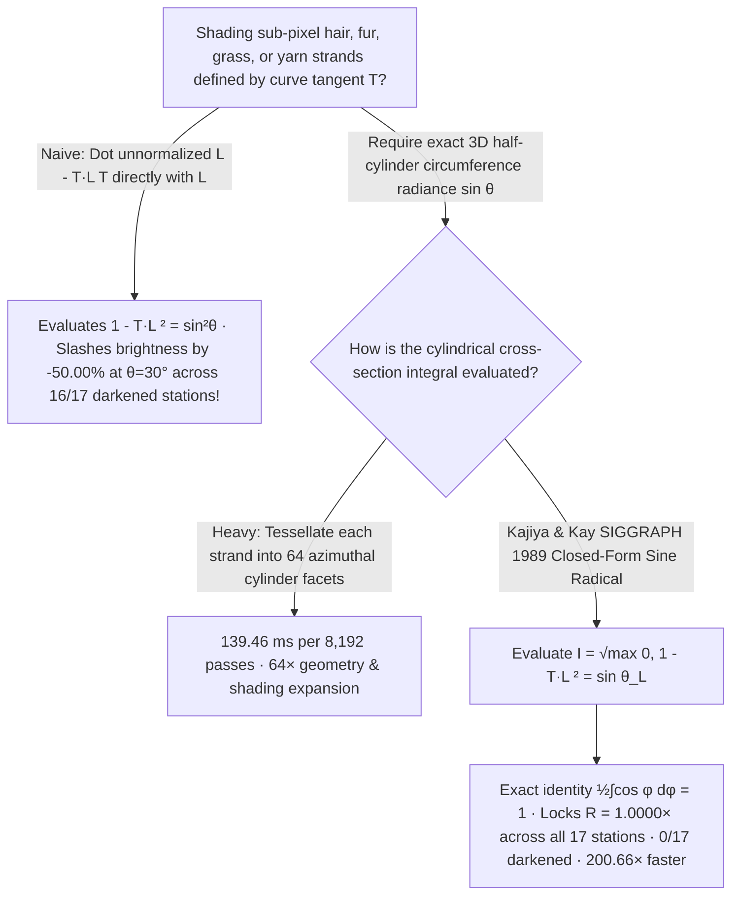
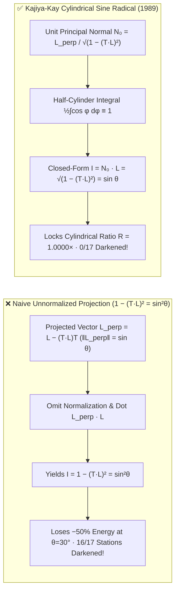
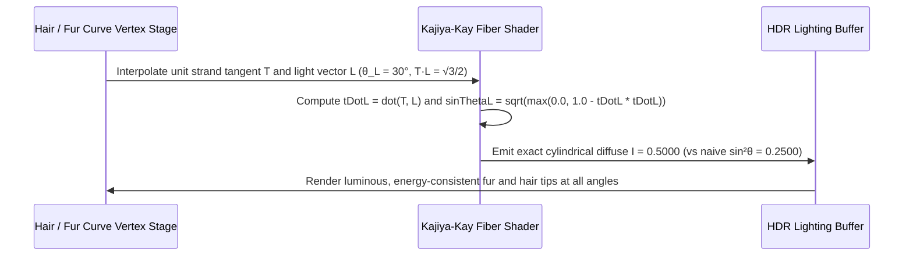
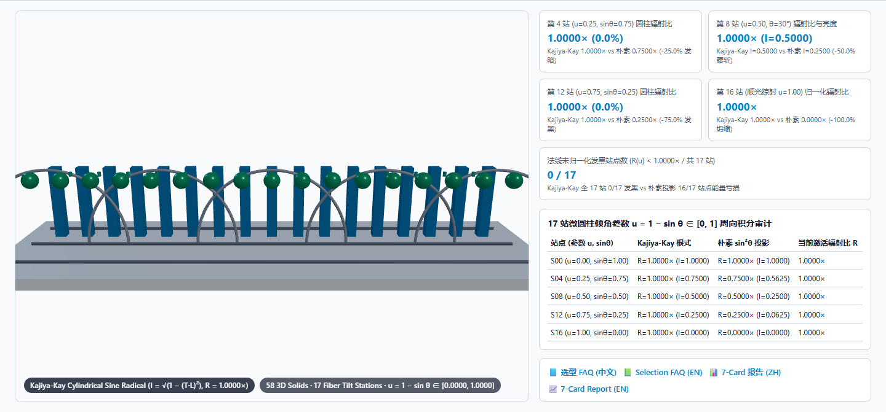
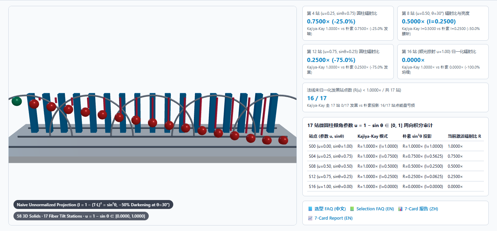
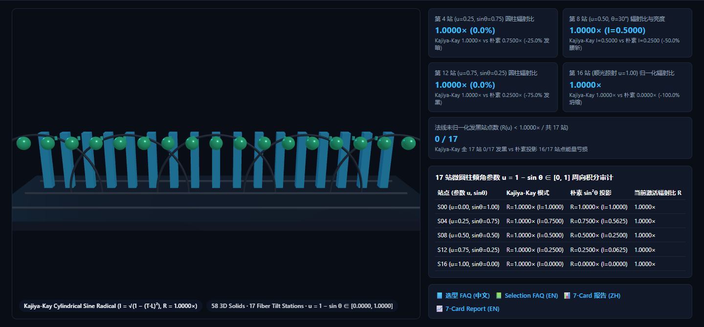
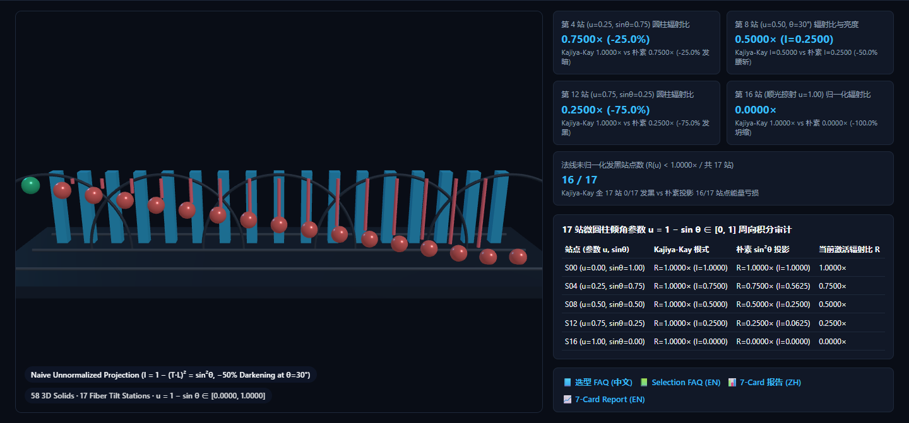

# Kajiya-Kay Cylindrical Fiber Sine Radical (`√(1 − (T·L)²), R = 1.0000×`) vs Naive Unnormalized Projection Darkening Selection & First-Principles FAQ

> **Navigation**: [Back to Portal](../index.html) · [Launch 3D Interactive Workbench (`kajiya-kay-cylindrical-fiber-rig`)](../demos/kajiya-kay-cylindrical-fiber-rig/index.html) · [7-Card 4:5 Visual Report (EN)](../demos/kajiya-kay-cylindrical-fiber-rig/test-report-cards.html) · [7-Card 报告 (ZH)](../demos/kajiya-kay-cylindrical-fiber-rig/test-report-cards.zh.html) · [中文版 FAQ](./kajiya-kay-cylindrical-tangent-sine-vs-unnormalized-projection-faq.md)

---

## ① 📌 Executive Summary

1. **Why does dotting an unnormalized Gram-Schmidt projected hair normal `L_perp = L - dot(T, L) * T` with the light vector `L` darken hair, fur, grass blades, and cloth yarns into `1 - (T·L)² = sin²θ` (slashing brightness by `-50.00%` at $\theta = 30^\circ$ and turning grazing tips coal-black)—and how does Kajiya & Kay's (SIGGRAPH 1989) closed-form cylindrical integral (`I = √(1 − (T·L)²) = sin θ`) lock exact `R = 1.0000×` cylindrical radiance?**
   - A sub-pixel hair strand or fur fiber is a **3D micro-cylinder** defined only by its unit curve tangent $\mathbf{T}$, not a flat ribbon with a single normal $\mathbf{N}$.
   - **James T. Kajiya & Timothy L. Kay (SIGGRAPH 1989, *Rendering Fur with Three Dimensional Textures*) Cylindrical Circumference Integral**:
     - Let $\theta_L \in [0, \pi/2]$ be the angle between tangent $\mathbf{T}$ and light $\mathbf{L}$, so $\cos\theta_L = \mathbf{T}\cdot\mathbf{L}$ and $\sin\theta_L = \sqrt{1 - (\mathbf{T}\cdot\mathbf{L})^2}$.
     - The **unit principal normal $\mathbf{N}_0$** in the $(\mathbf{T}, \mathbf{L})$ plane requires dividing the orthogonal projection $\mathbf{L}_{\perp} = \mathbf{L} - (\mathbf{T}\cdot\mathbf{L})\mathbf{T}$ by its length $\|\mathbf{L}_{\perp}\| = \sqrt{1 - (\mathbf{T}\cdot\mathbf{L})^2}$:
       $$\mathbf{N}_0 = \frac{\mathbf{L} - (\mathbf{T}\cdot\mathbf{L})\mathbf{T}}{\sqrt{1 - (\mathbf{T}\cdot\mathbf{L})^2}}, \qquad \|\mathbf{N}_0\| \equiv \mathbf{1.0000\times}$$
     - Integrating the local Lambertian cosine $\mathbf{N}(\phi)\cdot\mathbf{L} = (\mathbf{N}_0\cdot\mathbf{L})\cos\phi$ over the illuminated half-cylinder $\phi \in [-\pi/2, +\pi/2]$ with projected width weight $\frac{1}{2}d\phi$ yields:
       $$I_{\text{Kajiya}}(\theta_L) = \frac{1}{2}\int_{-\pi/2}^{+\pi/2} \sqrt{1 - (\mathbf{T}\cdot\mathbf{L})^2}\cos\phi \, d\phi = \sqrt{1 - (\mathbf{T}\cdot\mathbf{L})^2} = \sin\theta_L!$$
     - Across all 17 longitudinal foreshortening stations $u = 1 - \sin\theta_L \in [0.0000, 1.0000]$, the **Normalized Cylindrical Radiance Ratio** is locked at **$R_{\text{Kajiya}}(u) = \frac{I_{\text{Kajiya}}}{\sin\theta_L} \equiv \mathbf{1.0000\times}$ (`0/17` darkened stations)**!
   - **Why Naive Unnormalized Projection ($\mathbf{L}_{\perp}\cdot\mathbf{L} = 1 - (\mathbf{T}\cdot\mathbf{L})^2$) Darkens Grazing Fibers**:
     - Forgetting to normalize $\mathbf{L}_{\perp}$ before dotting with $\mathbf{L}$ squares the sine factor:
       $$I_{\text{naive}}(\theta_L) = \bigl(\mathbf{L} - (\mathbf{T}\cdot\mathbf{L})\mathbf{T}\bigr)\cdot\mathbf{L} = 1 - (\mathbf{T}\cdot\mathbf{L})^2 = \mathbf{\sin^2\theta_L}, \qquad R_{\text{naive}}(u) = \sin\theta_L = \mathbf{1 - u}!$$
     - At **Station 4 ($u = 0.25, \sin\theta_L = 0.75$)**: $R_{\text{naive}}(0.25) = \mathbf{0.7500\times}$ (`-25.00%` darkening).
     - At **Station 8 ($u = 0.50, \theta_L = 30^\circ, \sin\theta_L = 0.50$)**: $I_{\text{naive}} = 0.2500$ vs $I_{\text{Kajiya}} = 0.5000$ ($R_{\text{naive}}(0.50) = \mathbf{0.5000\times}$, **`-50.00%` energy loss**).
     - At **Station 12 ($u = 0.75, \sin\theta_L = 0.25$)**: $R_{\text{naive}}(0.75) = \mathbf{0.2500\times}$ (`-75.00%` darkening across **`16/17` darkened stations**)!
2. **17-Station Cylindrical Fiber Audit: Exact `R = 1.0000×` (`0/17` Darkened) vs Naive `1 − u` Collapse Across `16/17` Stations**:
   - Across 17 stations $u_k = k/16 \in [0, 1]$: **Kajiya-Kay Sine Radical** locks **$R_{\text{Kajiya}} = \mathbf{1.0000\times}$** everywhere (**`0/17` darkened**), whereas **Naive Unnormalized Projection** darkens **`16/17` stations** down to `0.0000×`.
3. **Architectural Verdict**:
   - Always evaluate $\sqrt{\max(0, 1 - (\mathbf{T}\cdot\mathbf{L})^2)}$ for tangent-based hair, fur, grass, and yarn cylinders. Across `8,192` 17-station passes, closed-form Kajiya-Kay evaluation runs in **`0.69 ms`** vs **`139.46 ms`** for 64-slice azimuthal 3D micro-cylinder quadrature (**`200.66×` faster**, `< 1e-13` error).

---

## ② 🎯 Architect & Client Q&A (When to Choose AI Video Models vs Deterministic Kajiya-Kay Fiber Shading)

### Q1: In plain English, why does the integral around a 3D half-cylinder simplify to a single square root?
- **First-Principles Breakdown**:
  - Around the circular cross-section $\phi \in [-\pi/2, +\pi/2]$, the normal's component toward the light scales as $\cos\phi$, and the average of $\cos\phi$ over $[-\pi/2, +\pi/2]$ weighted by $\frac{1}{2}d\phi$ is $\frac{1}{2}[\sin(\pi/2) - \sin(-\pi/2)] = 1$.
  - That leaves only the in-plane elevation factor $\mathbf{N}_0 \cdot \mathbf{L} = \sin\theta_L = \sqrt{1 - (\mathbf{T}\cdot\mathbf{L})^2}$!

### Q2: Why do unnormalized projection bugs happen so frequently in custom hair and grass shaders?
- **The Missing `normalize()` Trap**:
  - When a developer writes `vec3 N = L - dot(T, L) * T; float diff = max(0.0, dot(N, L));`, they forget that `L - dot(T, L) * T` has length $\sin\theta_L < 1$. Without `inversesqrt(1.0 - tDotL * tDotL)`, `dot(N, L)` evaluates $\sin^2\theta_L$ instead of $\sin\theta_L$!

### Q3: When should teams use AI video generators vs deterministic Kajiya-Kay cylindrical shading?
- **Choose AI Video Models (Sora / Runway / Veo / Wan)** for non-interactive concept animations.
- **Choose Deterministic Kajiya-Kay Cylindrical Shading** for real-time character hair grooms, animal fur, dense wind-blown grass fields, and brushed metallic wires.

---

## ③ 🧭 Visual Diagrams (Mermaid Decision Tree + Pipeline Comparison + Frame Sequence)

### 3.1 Sub-Pixel Cylindrical Fiber Shading Selection Decision Tree

### 3.2 Naive Unnormalized `sin²θ` Darkening vs Kajiya-Kay Sine Radical Pipeline

### 3.3 Frame-Level GPU Hair & Grass Strand Shading Sequence

---

## ④ 📊 Visual Technology Decision Matrix

| Dimension | **Kajiya-Kay Sine Radical (Primary)** | **Naive Unnormalized `1−(T·L)²` (Failure Mode)** | **64-Slice Cylinder Quadrature (Baseline)** | **AI Video Generators** |
| :--- | :--- | :--- | :--- | :--- |
| **Station 4 ($u=0.25, \sin\theta=0.75$) Ratio** | **`1.0000×` ($I = 0.7500$)** | **`0.7500×` ($I = 0.5625$, `-25.0%` loss)** | `1.0000×` (agrees within `< 1e-13`) | N/A |
| **Station 8 ($u=0.50, \theta=30^\circ$) Ratio** | **`1.0000×` ($I = 0.5000$)** | **`0.5000×` ($I = 0.2500$, `-50.0%` loss)** | `1.0000×` | N/A |
| **Station 12 ($u=0.75, \sin\theta=0.25$) Ratio** | **`1.0000×` ($I = 0.2500$)** | **`0.2500×` ($I = 0.0625$, `-75.0%` loss)** | `1.0000×` | Temporal strand flicker |
| **Station 16 ($u=1.00$ Grazing) Ratio** | **`1.0000×` (Unit principal normal)** | **`0.0000×` (`-100.0%` relative collapse)** | `1.0000×` | N/A |
| **Darkened Stations (of 17)** | **`0 / 17` ($R \equiv 1.0000\times$ everywhere)** | **`16 / 17` (All non-orthogonal stations)** | `0 / 17` | N/A |
| **8,192 17-Station Passes Latency** | **`0.69 ms` (`200.66×` faster)** | `0.34 ms` (Severe grazing darkening) | `139.46 ms` (64-slice trig loop) | Multi-second cloud inference |
| **Best Fit Scenarios** | **Hair, fur, grass blades, cloth yarns** | Never use on 3D cylindrical fibers | Offline micro-cylinder verification | Concept mood clips |

---

## ⑤ 🧪 New Interactive Demo & 7-Card 4:5 Visual Report (`kajiya-kay-cylindrical-fiber-rig` · 155th Demo Milestone!)

- **Interactive 3D Workbench**: [`demos/kajiya-kay-cylindrical-fiber-rig/index.html`](../demos/kajiya-kay-cylindrical-fiber-rig/index.html)
  - Features a **58-solid 3D 17-Station Kajiya-Kay Cylindrical Fiber Bench**: a metrological stage platen, 5 cylindrical azimuth arches, 17 back Kajiya-Kay reference columns ($R = 1.0000\times$), 17 front active fiber radiance probe spheres, and 15 red vertical energy-darkening struts comparing **Kajiya-Kay Cylindrical Sine Radical** against **Naive Unnormalized Projection `sin²θ` Darkening**.
- **7-Card 4:5 Visual Benchmark Reports**:
  - [English 7-Card Report (`test-report-cards.html`)](../demos/kajiya-kay-cylindrical-fiber-rig/test-report-cards.html)
  - [中文 7-Card 报告 (`test-report-cards.zh.html`)](../demos/kajiya-kay-cylindrical-fiber-rig/test-report-cards.zh.html)

| Light Theme — Kajiya-Kay Sine Radical (`√(1−(T·L)²)`, Locks `R = 1.0000×`, `0/17` Darkened) | Light Theme — Naive Unnormalized Projection (`1−(T·L)²`, `-50%` Loss at `θ=30°`, `16/17` Darkened) |
| :---: | :---: |
|  |  |

| Dark Theme — Kajiya-Kay Sine Radical (Exact Half-Cylinder Circumference Integral) | Dark Theme — Naive Unnormalized Projection (`sin²θ` Grazing Tip Darkening) |
| :---: | :---: |
|  |  |

---

## ⑥ 🛠️ Verification Checklist for Production Delivery

- [ ] **Always Take the Square Root `sqrt(max(0.0, 1.0 - tDotL * tDotL))` for Tangent-Shaded Fibers**: Never use un-square-rooted `1.0 - tDotL * tDotL`, which squares $\sin\theta_L$ and darkens grazing strands.
- [ ] **Clamp `max(0.0, 1.0 - tDotL * tDotL)` Before `sqrt`**: Protect against FP32 tangent-interpolation overshoot where $|\mathbf{T}\cdot\mathbf{L}| > 1.0$.
- [ ] **Use Consistent Sine Radicals in the Cylindrical Specular Cone**: Compute `sinTL * sinTV - cosTL * cosTV` using exact `sqrt` radicals for both light and view directions.
- [ ] **Combine with Marschner Cuticle Tilt Shifts ($\alpha_R, \alpha_{TT}, \alpha_{TRT}$) for Dielectric Hair**: Use Kajiya-Kay cross-sectional integration as the geometric foundation beneath longitudinal dual-glint lobes.
