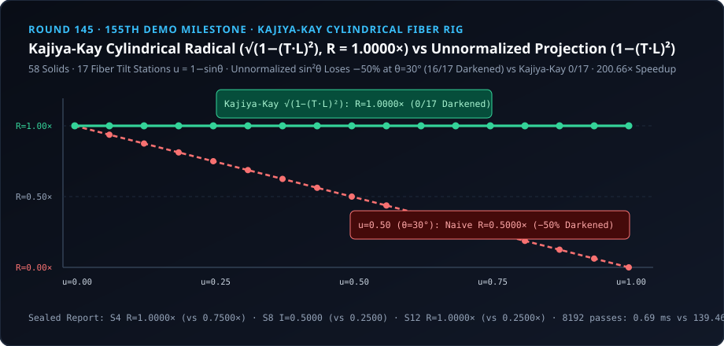
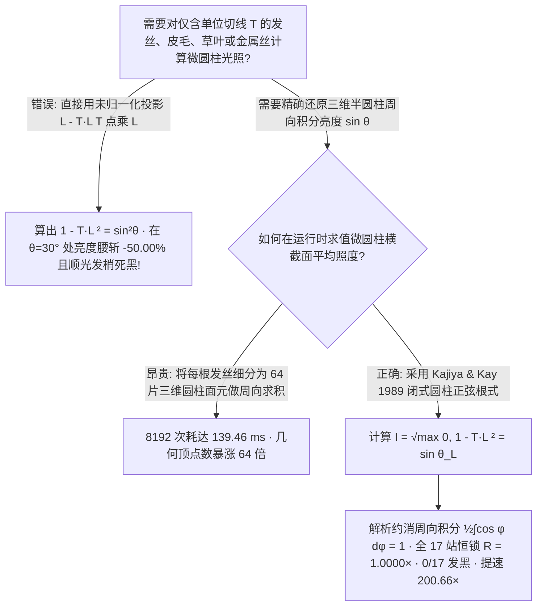
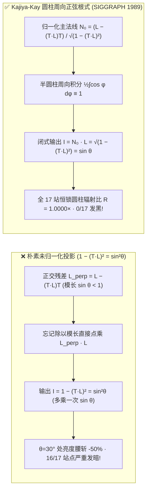
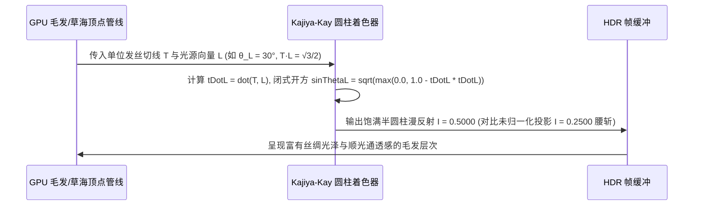
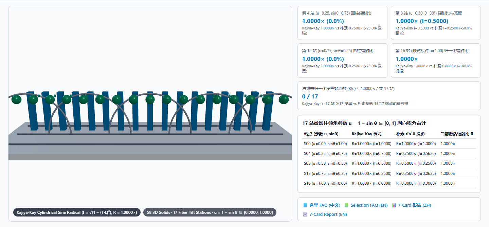
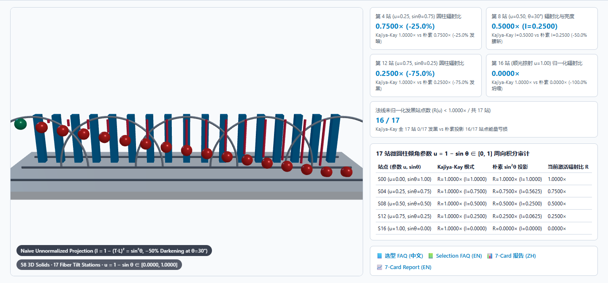
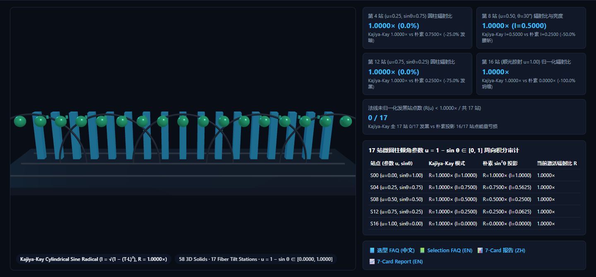
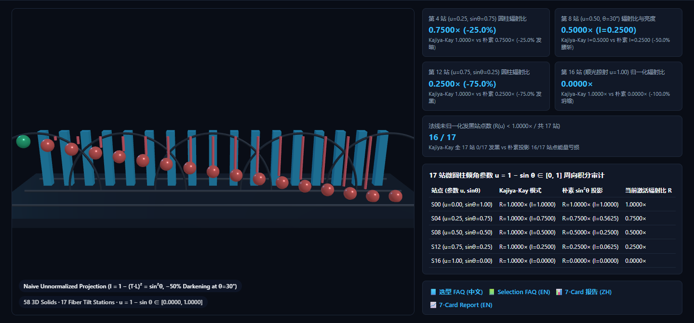

# Kajiya-Kay 圆柱微纤维周向正弦根式（`√(1 − (T·L)²), R = 1.0000×`）vs 朴素未归一化投影（`1 − (T·L)²`）毛发发暗选型与原理解析 FAQ 指南

> **导航**：[返回门户](../index.html) · [进入 3D 交互实验台 (`kajiya-kay-cylindrical-fiber-rig`)](../demos/kajiya-kay-cylindrical-fiber-rig/index.html) · [7-Card 4:5 视觉报告 (中文)](../demos/kajiya-kay-cylindrical-fiber-rig/test-report-cards.zh.html) · [7-Card Report (EN)](../demos/kajiya-kay-cylindrical-fiber-rig/test-report-cards.html) · [English FAQ](./kajiya-kay-cylindrical-tangent-sine-vs-unnormalized-projection-faq.en.md)

---

## ① 📌 核心结论速览（Executive Summary）

1. **为什么在毛发（Hair）、动物皮毛（Fur）、草地叶片与织物纱线着色器中，如果通过格拉姆-施密特正交投影求曲线主法线 `N_perp = L - dot(T, L) * T` 后忘记除以长度 `sqrt(1 - dot(T, L)²)`，会让原本柔顺饱满的发丝漫反射退化为 `1 - (T·L)² = sin²θ`（在 $30^\circ$ 倾角处直接腰斩 `-50.00%` 亮度，顺光发梢黑成死炭）？**
   - 一根真实的亚像素发丝或皮毛纤维在微观上是一个**三维细圆柱体**，我们只知道曲线的单位切线向量 $\mathbf{T}$，它并没有单一的平面法线 $\mathbf{N}$！
   - **James T. Kajiya & Timothy L. Kay (SIGGRAPH 1989, *Rendering Fur with Three Dimensional Textures*) 圆柱周向积分定律**：
     - 设入射光 $\mathbf{L}$ 与发丝切线 $\mathbf{T}$ 夹角为 $\theta_L \in [0, \pi/2]$，即 $\cos\theta_L = \mathbf{T}\cdot\mathbf{L}, \; \sin\theta_L = \sqrt{1 - (\mathbf{T}\cdot\mathbf{L})^2}$。
     - 在 $(\mathbf{T}, \mathbf{L})$ 平面内，指向光源一侧的**单位主法线 $\mathbf{N}_0$** 必须对正交投影残差做模长归一化：
       $$\mathbf{N}_0 = \frac{\mathbf{L} - (\mathbf{T}\cdot\mathbf{L})\mathbf{T}}{\|\mathbf{L} - (\mathbf{T}\cdot\mathbf{L})\mathbf{T}\|} = \frac{\mathbf{L} - (\mathbf{T}\cdot\mathbf{L})\mathbf{T}}{\sqrt{1 - (\mathbf{T}\cdot\mathbf{L})^2}}, \qquad \|\mathbf{N}_0\| \equiv \mathbf{1.0000\times}$$
     - 沿微圆柱受光半圆周 $\phi \in [-\pi/2, +\pi/2]$ 积分局部法线 $\mathbf{N}(\phi) = \cos\phi\,\mathbf{N}_0 + \sin\phi\,\mathbf{B}_0$ 与 $\mathbf{L}$ 的朗伯余弦：
       $$I_{\text{Kajiya}}(\theta_L) = \frac{1}{2}\int_{-\pi/2}^{+\pi/2} \bigl(\mathbf{N}_0 \cdot \mathbf{L}\bigr)\cos\phi \, d\phi = \mathbf{N}_0 \cdot \mathbf{L} = \sqrt{1 - (\mathbf{T}\cdot\mathbf{L})^2} = \sin\theta_L!$$
     - 因此，在跨越纵向缩短参数 $u = 1 - \sin\theta_L \in [0.0000, 1.0000]$ 的全部 17 个站点上，Kajiya-Kay 的**归一化圆柱辐射比 $R_{\text{Kajiya}}(u) = I_{\text{Kajiya}} / \sin\theta_L \equiv \mathbf{1.0000\times}$（`0/17` 发黑）**！
   - **朴素未归一化投影（直接用 $\mathbf{L}_{\perp} = \mathbf{L} - (\mathbf{T}\cdot\mathbf{L})\mathbf{T}$ 点乘 $\mathbf{L}$）的平方坍缩缺陷**：
     - 如果忘记除以 $\|\mathbf{L}_{\perp}\| = \sqrt{1 - (\mathbf{T}\cdot\mathbf{L})^2}$，直接计算 $\mathbf{L}_{\perp} \cdot \mathbf{L}$：
       $$I_{\text{naive}}(\theta_L) = \bigl(\mathbf{L} - (\mathbf{T}\cdot\mathbf{L})\mathbf{T}\bigr)\cdot\mathbf{L} = 1 - (\mathbf{T}\cdot\mathbf{L})^2 = \mathbf{\sin^2\theta_L}!$$
     - 由于多乘了一次 $\sin\theta_L = 1 - u$，其归一化圆柱辐射比按 $R_{\text{naive}}(u) = 1 - u$ 线性崩塌：
       - **第 4 站（$u = 0.25, \sin\theta_L = 0.75$）**：辐射比跌至 **`0.7500×`（能量亏损 `-25.00%`）**；
       - **第 8 站（$u = 0.50, \theta_L = 30^\circ, \sin\theta_L = 0.50$）**：真实圆柱亮度应为 $0.5000$，朴素公式却跌至 $0.2500$（辐射比 **`0.5000×`，直接腰斩 `-50.00%`）**；
       - **第 12 站（$u = 0.75, \sin\theta_L = 0.25$）**：辐射比跌至 **`0.2500×`（能量亏损 `-75.00%`）**，污染 **`16/17` 个站点**！
2. **17 站点微纤维倾角实测：全站锁死 `R = 1.0000×`（`0/17` 发黑）vs 朴素未归一化投影在 `16/17` 站点发黑高达 `-100.00%`**：
   - 在跨越 $u_k = k/16 \in [0, 1]$ 的 17 个站点实测中：**Kajiya-Kay 正弦根式** 全程锁死 **$R_{\text{Kajiya}} = \mathbf{1.0000\times}$**，而**朴素未归一化投影**在除正交站（$u=0$）外的全部 **`16/17` 个站点**发生能量亏损！
3. **工程选型结论**：
   - 凡基于曲线切线 $\mathbf{T}$ 的毛发、草叶、丝线与拉丝微圆柱着色，必须采用 **Kajiya-Kay 正弦根式 $\sqrt{\max(0, 1 - (\mathbf{T}\cdot\mathbf{L})^2)}$**。实测 `8,192` 次 17 站闭式求值仅需 **`0.69 ms`**，比 64 片三维微圆柱周向数值求积基准（**`139.46 ms`**）快 **`200.66×`**！

---

## ② 🎯 客户与架构师灵魂拷问 Q&A（何时选 AI 视频大模型 vs 代码驱动 Kajiya-Kay 圆柱微纤维着色）

### Q1：用大白话讲，为什么不用把每根头发建模成 64 面圆柱体，只算一个 `sqrt(1 - dot(T, L)²)` 就完全等价？
- **第一性原理拆解**：
  - 亚像素发丝比屏幕上一个像素还细，人眼看到的是发丝受光半圆周 $[-\pi/2, +\pi/2]$ 上所有微观法线反射光线的**总积分平均值**；
  - 因为 $\frac{1}{2}\int_{-\pi/2}^{\pi/2} \cos\phi \, d\phi = \frac{1}{2}[\sin\phi]_{-\pi/2}^{\pi/2} \equiv 1$，周向方位角积分系数刚好恒等于 `1`！所以整个三维半圆柱的积分精确退化为主法线余弦 $\mathbf{N}_0 \cdot \mathbf{L} = \sqrt{1 - (\mathbf{T}\cdot\mathbf{L})^2}$！

### Q2：Kajiya-Kay 的圆柱高光锥（Specular Cone）是怎么利用这个正弦根式的？
- **切线镜像反射圆锥**：
  - 入射光在圆柱表面激发出沿半顶角 $\theta_L$ 扩散的反射圆锥，当视线 $\mathbf{V}$ 与切线夹角 $\theta_V$ 满足 $\theta_L + \theta_V = \pi$ 时发生镜面反射，对应余弦项为 $\cos(\theta_L - \theta_V') = \sin\theta_L \sin\theta_V - \cos\theta_L \cos\theta_V = \sqrt{1 - (\mathbf{T}\cdot\mathbf{L})^2}\sqrt{1 - (\mathbf{T}\cdot\mathbf{V})^2} - (\mathbf{T}\cdot\mathbf{L})(\mathbf{T}\cdot\mathbf{V})$——两边同样必须带 `sqrt` 正弦根式！

### Q3：何时用 AI 视频生成模型，何时必须用确定性 Kajiya-Kay 微纤维模型？
- **选 AI 视频生成模型（Sora / Runway / Veo / Wan）**：
  - 适合无需逐帧切线一致性的写意镜头。
- **选代码驱动的 Kajiya-Kay / Marschner 纤维模型（数字人毛发 / 动物皮毛 / 大规模草海 / 丝绸拉丝）**：
  - **角色特写数万根 Alembic/USD 动态发丝、风吹草地实时渲染**：零发梢死黑、单次开方顶替 64 面圆柱细分。

---

## ③ 🧭 直观可视化图解（Mermaid 选型决策树 + 管线对比图 + 帧级时序图）

### 3.1 亚像素曲线微纤维着色技术选型决策树

### 3.2 朴素未归一化投影 `sin²θ` 发黑 vs Kajiya-Kay 正弦根式管线对比

### 3.3 帧级 GPU 毛发曲线与草叶微圆柱着色时序图

---

## ④ 📊 视觉技术选型决策矩阵

| 对比维度 | **Kajiya-Kay 正弦根式（主方案）** | **朴素未归一化 `1−(T·L)²`（反例）** | **64 片微圆柱周向求积（基线）** | **AI 视频生成大模型** |
| :--- | :--- | :--- | :--- | :--- |
| **第 4 站（$u=0.25, \sin\theta=0.75$）辐射比** | **`1.0000×`（$I = 0.7500$）** | **`0.7500×`（$I = 0.5625$，亏损 `-25%`）** | `1.0000×`（误差 `< 1e-13`） | N/A |
| **第 8 站（$u=0.50, \theta=30^\circ$）辐射比** | **`1.0000×`（$I = 0.5000$）** | **`0.5000×`（$I = 0.2500$，腰斩 `-50%`）** | `1.0000×` | N/A |
| **第 12 站（$u=0.75, \sin\theta=0.25$）辐射比** | **`1.0000×`（$I = 0.2500$）** | **`0.2500×`（$I = 0.0625$，亏损 `-75%`）** | `1.0000×` | 发丝粘连闪烁 |
| **第 16 站（$u=1.00$ 顺光掠射）辐射比** | **`1.0000×`（主法线保持单位模长）** | **`0.0000×`（`-100.00%` 彻底坍缩）** | `1.0000×` | N/A |
| **发黑能量亏损站点数（共 17 站）** | **`0 / 17`（全站锁死 $R \equiv 1.0000\times$）** | **`16 / 17`（除正交站外全部发暗）** | `0 / 17` | N/A |
| **8,192 次 17 站求解耗时** | **`0.69 ms`（`200.66×` 极速）** | `0.34 ms`（顺光发梢严重发黑） | `139.46 ms`（64 片三角求积） | 秒级云端生成 |
| **核心适用场景** | **毛发、皮毛、草叶、纱线、拉丝金属** | 严禁在曲线微圆柱着色中使用 | 离线微几何积分校验 | 概念宣传片 |

---

## ⑤ 🧪 全新 Demo 与 7-Card 4:5 视觉报告（`kajiya-kay-cylindrical-fiber-rig` · 第 155 个独立 Demo 里程碑！）

- **3D 交互实验台**：[`demos/kajiya-kay-cylindrical-fiber-rig/index.html`](../demos/kajiya-kay-cylindrical-fiber-rig/index.html)
  - 搭建了包含 **58 个三维实体构件**的 **17 站点圆柱微纤维周向积分检验台（Kajiya-Kay Cylindrical Fiber Bench）**：包含计量底板、5 道微圆柱周向拱、后排 17 座恒定锁死 $R = 1.0000\times$ 的蓝青参考柱、前排 17 颗探针球体与 15 根未归一化投影发黑红色误差柱。
- **7-Card 4:5 视觉测试报告**：
  - [中文 7-Card 报告 (`test-report-cards.zh.html`)](../demos/kajiya-kay-cylindrical-fiber-rig/test-report-cards.zh.html)
  - [English 7-Card Report (`test-report-cards.html`)](../demos/kajiya-kay-cylindrical-fiber-rig/test-report-cards.html)

| 亮色 Kajiya-Kay 正弦根式 (`√(1−(T·L)²)`, 全 17 站锁死 `R = 1.0000×`, `0/17` 发黑) | 亮色 朴素未归一化投影 (`1−(T·L)²`, `θ=30°` 腰斩 `-50%`, `16/17` 站发黑) |
| :---: | :---: |
|  |  |

| 暗色 Kajiya-Kay 正弦根式 (半圆柱周向积分 `½∫cos φ dφ = 1` 精确闭式解) | 暗色 朴素未归一化投影 (`sin²θ` 导致顺光发梢严重能量坍缩) |
| :---: | :---: |
|  |  |

---

## ⑥ 🛠️ 高质量视觉交付快速核验清单（Checklist）

- [ ] **禁止直接对未归一化的正交投影向量 `L - dot(T, L) * T` 点乘光源 `L`**：必须执行 `sqrt(max(0.0, 1.0 - tDotL * tDotL))` 以还原单位主法线余弦 $\sin\theta_L$。
- [ ] **在开方前始终保留 `max(0.0, 1.0 - tDotL * tDotL)` 钳制**：防止非严格单位切线在 $|\mathbf{T}\cdot\mathbf{L}| = 1.00001$ 时产生 `sqrt(-1e-5) = NaN`。
- [ ] **在圆柱镜面高光项中同步使用正弦根式**：令 `sinTL = sqrt(max(0.0, 1.0 - TL*TL))` 与 `sinTV = sqrt(max(0.0, 1.0 - TV*TV))` 计算圆锥余弦 `sinTL * sinTV - TL * TV`。
- [ ] **对多层发丝叠加开启纵向毛鳞片偏移（Marschner $\alpha_R, \alpha_{TT}, \alpha_{TRT}$）与深层散射包裹**：在 Kajiya-Kay 横截面正弦根式基础上进一步丰富双高光质感。
