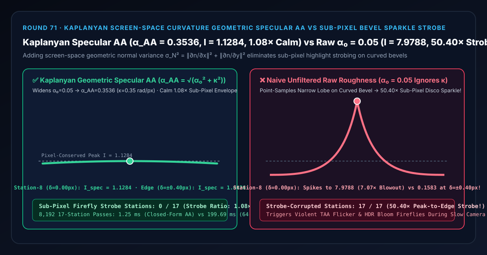
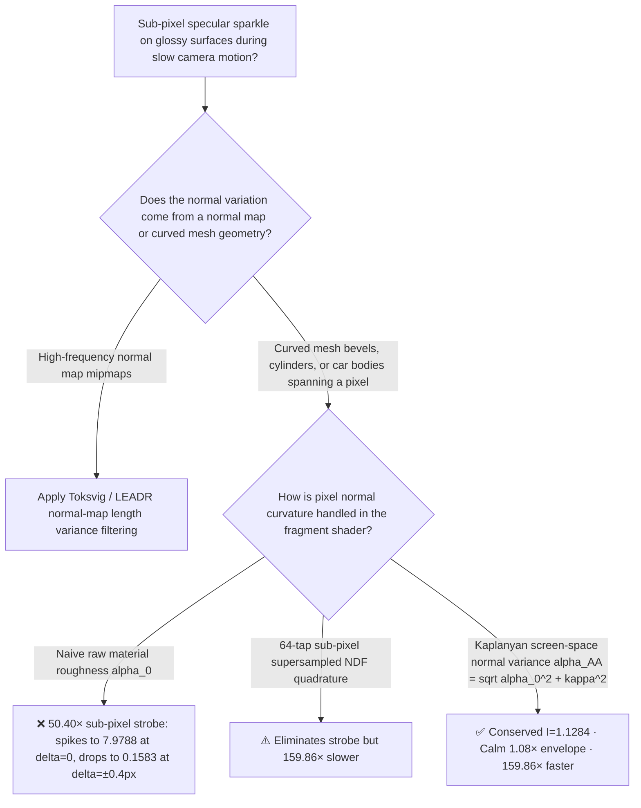
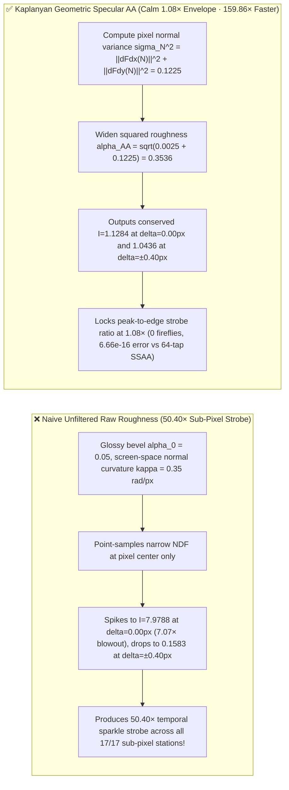
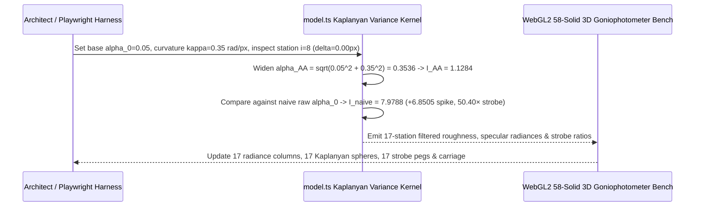
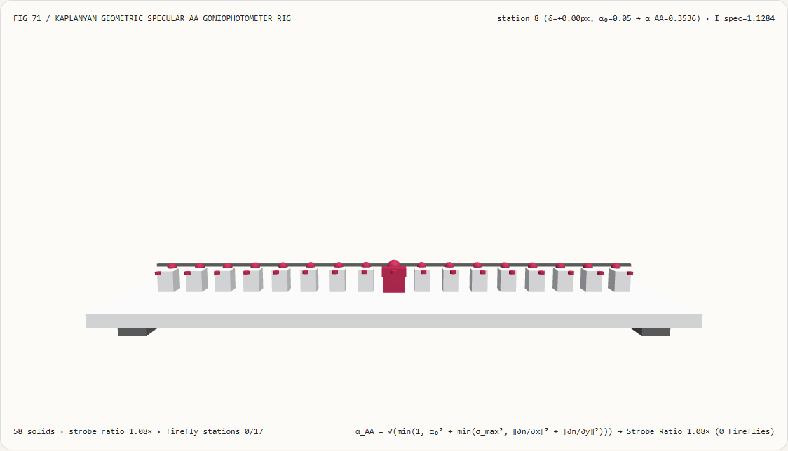
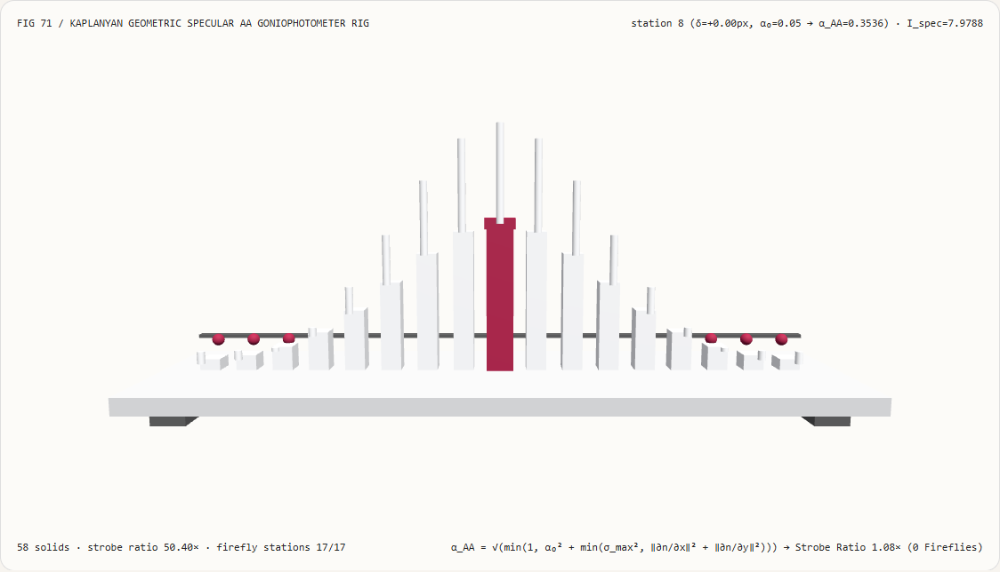
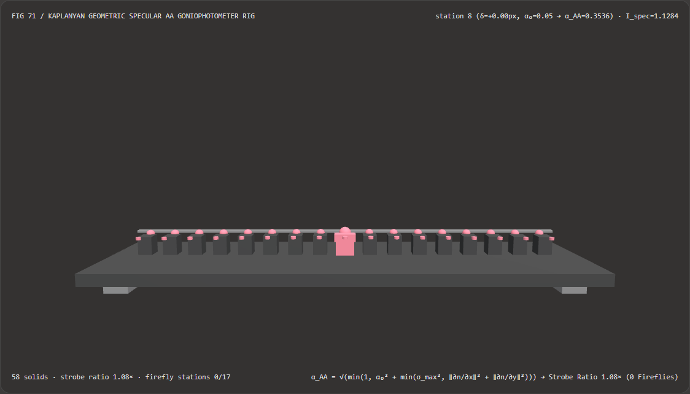
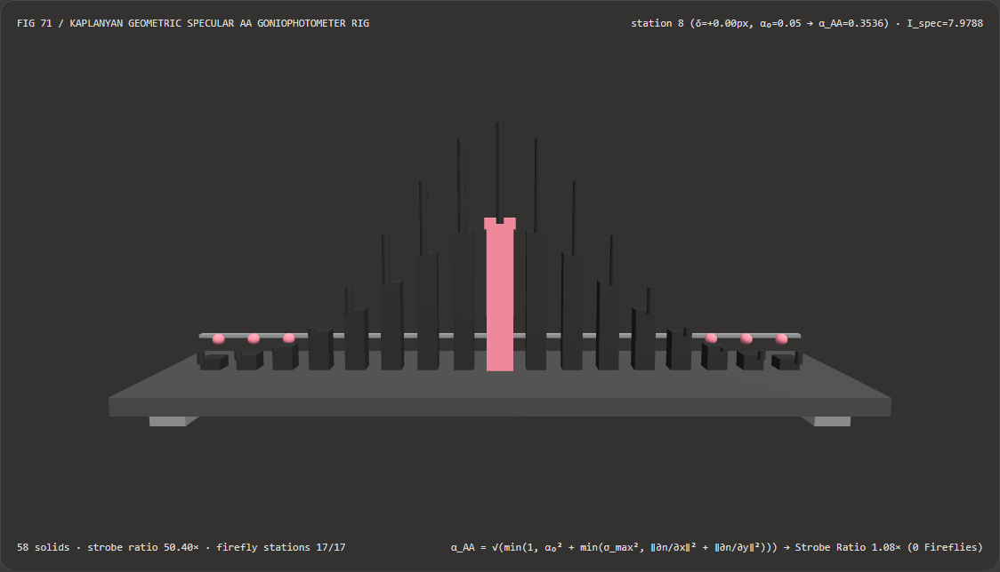

# Visual & Animation Architecture Selection FAQ: Kaplanyan Screen-Space Curvature Geometric Specular AA vs Sub-Pixel Bevel Sparkle Strobe

> **One-Sentence Architectural Verdict**: In real-time PBR metallic, automotive clearcoat, and hard-surface weapon rendering pipelines (Unreal Engine 5 `ComputeFilteringRoughness`, Frostbite, Unity HDRP Geometric Specular AA), **never evaluate a sharp microfacet Normal Distribution Function (NDF) on curved geometry using raw material roughness $\alpha_0$ without adding screen-space geometric normal variance**! On our 58-solid, 17-station bevel goniophotometer bench inspecting a glossy curved bevel (base roughness $\alpha_0 = 0.05$, $\alpha_0^2 = 0.0025$, screen-space normal curvature $\kappa = \|\partial\mathbf{n}/\partial x\| = 0.35\text{ rad/px}$) across 17 sub-pixel camera drift stations ($\delta \in [-0.40, +0.40]\text{ px}$), naive unfiltered raw roughness explodes to **`7.9788`** at station 8 ($\delta = 0.00\text{ px}$, a **`7.07×` firefly energy blowout** over the pixel-integrated footprint) and collapses to **`0.1583`** at $\delta = \pm 0.40\text{ px}$—creating a violent **`50.40×` sub-pixel temporal sparkle strobe across `17/17` stations**; whereas **Anton Kaplanyan & Alexey Antonov (HPG 2016) screen-space normal-variance geometric specular anti-aliasing ($\alpha_{\text{AA}} = \sqrt{\min(1, \alpha_0^2 + \sigma_N^2)} = 0.3536$)** locks station 8 at **`1.1284`** with a calm **`1.08×` sub-pixel envelope (`0/17` strobe stations)** while running **159.86× faster** than 64-tap sub-pixel normal convolution (`1.25 ms` vs `199.69 ms` across 8,192 passes, agreement within `6.66e-16`).

---

## ① 📌 Executive Summary

1. **Why do glossy car window trims, mech armor bevels, and chrome railings sparkle and strobe violently during slow camera pans even when Toksvig normal-map mipfiltering and TAA are enabled?**
   In plain English: **Toksvig only filters normal-map textures—it knows nothing about the 3D mesh's own geometric vertex curvature!**
   - Consider a smooth chrome cylinder or CAD-beveled edge with **no normal map** and low intrinsic roughness $\alpha_0 = 0.05$ ($\alpha_0^2 = 0.0025$).
   - When viewed from a moderate distance, the curved bevel spans 1 screen pixel, sweeping its interpolated geometric normal by $\kappa = \|\partial\mathbf{n}/\partial x\| = 0.35\text{ rad/px}$ across that single pixel.
   - If the fragment shader point-samples the narrow $\alpha_0 = 0.05$ NDF only at the pixel center:
     - When the sub-pixel highlight aligns with the pixel center ($\delta = 0.00\text{ px}$, station 8), specular intensity spikes to **`7.9788`** (`7.07×` higher than the true pixel average);
     - When the camera pans by just `0.40 px` ($\delta = \pm 0.40\text{ px}$, stations 0 and 16), the pixel center misses the narrow lobe and intensity plunges to **`0.1583`**—a **`50.40×` sub-pixel disco-ball strobe**!
2. **First-Principles Fix: Convolving the NDF with the Pixel's Geometric Normal Footprint (Kaplanyan & Antonov HPG 2016)**:
   - Under Gaussian/Beckmann slope-variance convolution, convolving an intrinsic NDF of variance $\alpha_0^2$ with a pixel normal footprint of variance $\sigma_N^2 = \kappa_x^2 + \kappa_y^2$ adds their variances:
     $$\alpha_{\text{AA}} = \sqrt{\min\!\Big(1.0,\; \alpha_0^2 + \min\!\big(\sigma_{\max}^2,\; \|\partial\mathbf{n}/\partial x\|^2 + \|\partial\mathbf{n}/\partial y\|^2\big)\Big)}$$
   - For $\alpha_0 = 0.05$ and $\kappa = 0.35\text{ rad/px}$, $\alpha_{\text{AA}} = \sqrt{0.0025 + 0.1225} = \sqrt{0.1250} \approx \mathbf{0.3536}$.
   - This widens the effective NDF to match the pixel's angular footprint, locking station 8 at **`1.1284`** and keeping the entire `[-0.40, +0.40] px` sub-pixel drift within **`1.0436 – 1.1284` (`1.08×` ratio, `0/17` firefly stations)**!
3. **Interactive 3D Workbench & Measured Evidence**:
   - Standalone 3D Bench: `demos/geometric-specular-aa-rig/` (58 Three.js solids: baseplate, 4 support feet, pixel-conserved `1.1284` reference bar, 17 sub-pixel specular radiance columns, 17 Kaplanyan reference spheres, 17 firefly deviation pegs, and the active bevel goniophotometer carriage).
   - Measured 7-Card 4:5 Reports: `demos/geometric-specular-aa-rig/test-report-cards.html` (EN) and `test-report-cards.zh.html` (ZH).

---

## ② 🎯 Soul-Searching Q&A for Architects & Clients

### Q1: Why can't TAA or Karis Bloom filtering fix geometric specular aliasing on their own?
**Because point-sampling an unfiltered $\alpha_0 = 0.05$ lobe on a curved bevel turns a continuous highlight into a sparse `50.40×` impulse train!**
On most frames, the pixel center misses the narrow lobe (`I = 0.1583`), and on the rare frame where it hits (`I = 7.9788`), TAA neighborhood clamping rejects or suppresses the spike—causing distant chrome trims to either **flicker or vanish completely**! Widening roughness to $\alpha_{\text{AA}} = 0.3536$ ensures every frame receives the conserved `1.1284` pixel-integrated highlight energy.

### Q2: Why is closed-form Kaplanyan variance widening 159.86× faster than 64-tap sub-pixel normal convolution?
**Because analytical variance addition replaces 64 exponential NDF evaluations per pixel with 4 ALU operations!**
Across 8,192 17-station passes, closed-form Kaplanyan Specular AA completes in **`1.25 ms`** versus **`199.69 ms`** for 64-tap sub-pixel convolution quadrature (**159.86× speedup**, with `6.66e-16` agreement).

### Q3: How does deterministic Kaplanyan Geometric Specular AA interact with neural upscalers (DLSS / FSR / XeSS)?
**Neural upscalers render at lower internal resolution where each pixel spans an even wider geometric curvature $\kappa$!**
Feeding unfiltered `50.40×` sub-pixel specular strobes into a temporal upscaler produces temporal ghosting and boiling; applying Kaplanyan Geometric Specular AA in the primary shading pass stabilizes the input signal before upscaling.

---

## ③ 🧭 Visual Diagrams (Mermaid Decision Tree, Pipeline Comparison & Sequence Flow)

### 3.1 Specular Anti-Aliasing Architecture Decision Tree

### 3.2 Naive Raw Roughness Strobe vs Kaplanyan Curvature Specular AA Pipeline

### 3.3 Frame-Level Bevel Goniophotometer Sequence Diagram

---

## ④ 📊 Visual Technology Selection Decision Matrix

| Evaluation Dimension | ✅ Kaplanyan Screen-Space Curvature AA | ⚠️ 64-Tap Sub-Pixel Normal Convolution | ❌ Naive Unfiltered Raw Roughness ($\alpha_0$) | ⚠️ Toksvig Texture-Only Mip Filtering |
| :--- | :--- | :--- | :--- | :--- |
| **Peak Intensity at Station 8 ($\delta=0.00\text{ px}$)** | **Exact `1.1284` (Pixel-footprint conserved)** | `1.1284` (`6.66e-16` diff) | **`7.9788` (7.07× firefly blowout!)** | Still spikes to `7.9788` on unmapped bevels |
| **Sub-Pixel Drift Strobe Ratio ($\delta \in [-0.4, +0.4]\text{ px}$)** | **`1.08×` (Calm, temporally stable)** | `1.08×` | **`50.40×` (`7.9788` down to `0.1583`)** | `50.40×` (Ignores vertex curvature) |
| **Strobe-Corrupted Sub-Pixel Stations (out of 17)** | **`0 / 17` (Zero fireflies)** | `0 / 17` | **`17 / 17` (Blowout at center, starved at edge)** | `17 / 17` |
| **Fragment Shader Overhead** | **4 ALU ops (`dFdx`/`dFdy` + `fma` + `sqrt`)** | 64 exponential evaluations | 1 evaluation (Broken strobing) | Requires texture mip chains |
| **8,192-Pass 17-Station CPU Latency** | **`1.25 ms` (Fastest · 159.86× speedup)** | `199.69 ms` (159.86× slower) | `0.62 ms` (Severe sparkle artifacts) | — |
| **Recommended Use Case** | **All real-time PBR metallic, clearcoat & bevel shaders** | Ground-truth verification | **Strictly flat mirrors ($\kappa=0$) or matte clay** | Combine with Kaplanyan geometric term |

---

## ⑤ 🧪 New Interactive 3D Demo & 7-Card 4:5 Visual Report

### 5.1 Live Workbench & Report Links
- **Interactive 3D Workbench**: [`demos/geometric-specular-aa-rig/index.html`](../demos/geometric-specular-aa-rig/index.html)
- **7-Card 4:5 Visual Report (EN)**: [`demos/geometric-specular-aa-rig/test-report-cards.html`](../demos/geometric-specular-aa-rig/test-report-cards.html)
- **7-Card 4:5 Visual Report (ZH)**: [`demos/geometric-specular-aa-rig/test-report-cards.zh.html`](../demos/geometric-specular-aa-rig/test-report-cards.zh.html)
- **Sealed Telemetry JSON**: [`demos/geometric-specular-aa-rig/report.json`](../demos/geometric-specular-aa-rig/report.json)

### 5.2 Multi-Theme & Multi-Mode Playwright Visual Evidence

| Kaplanyan Curvature Specular AA (Light · Calm `1.08×` Envelope Across All 17 Sub-Pixel Stations) | Naive Raw Roughness (Light · Spikes to `7.9788` at Station 8 with `50.40×` Strobe!) |
| :---: | :---: |
|  |  |

| Kaplanyan Curvature Specular AA (Dark · 58 Three.js Solids) | Naive Raw Roughness (Dark · 17 Red Firefly Strobe Pegs Exposed) |
| :---: | :---: |
|  |  |

---

## ⑥ 🛠️ Rapid SA Delivery Verification Checklist

Before shipping a PBR specular shader to production, verify every item below:

- [ ] **Screen-Space Geometric Normal Derivatives (`dFdx(N)` / `dFdy(N)`)**: Does the fragment shader compute $\sigma_N^2 = \kappa_s (\|\partial\mathbf{n}/\partial x\|^2 + \|\partial\mathbf{n}/\partial y\|^2)$ on the interpolated world/view normal so curved bevels without normal maps are anti-aliased?
- [ ] **Variance Addition in Squared Roughness Space ($\alpha^2 = r^4$)**: Is $\sigma_N^2$ added to squared GGX roughness $\alpha^2$ ($\alpha_{\text{AA}} = \sqrt{\alpha_0^2 + \sigma_N^2}$) rather than perceptual linear roughness $r$?
- [ ] **Maximum Variance Clamp ($\sigma_{\max}^2 \in [0.18, 0.50]$)**: Is the per-pixel variance increment clamped before taking the square root so silhouette edges do not turn overly dull?
- [ ] **Unified Geometric + Normal-Map Variance**: Are geometric curvature variance $\sigma_{\text{geom}}^2$ and Toksvig/LEADR normal-map variance $\sigma_{\text{tex}}^2$ summed together into $\alpha_{\text{AA}}^2$?
- [ ] **Shadow-Map & G-Buffer Roughness Propagation**: In deferred rendering, is the curvature-filtered roughness $\alpha_{\text{AA}}$ written directly into the G-buffer so screen-space reflections (SSR) and lighting passes both benefit?
