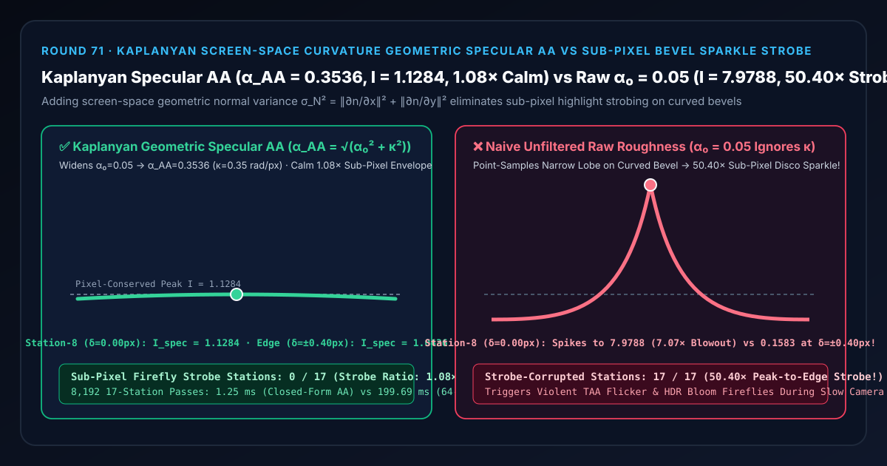
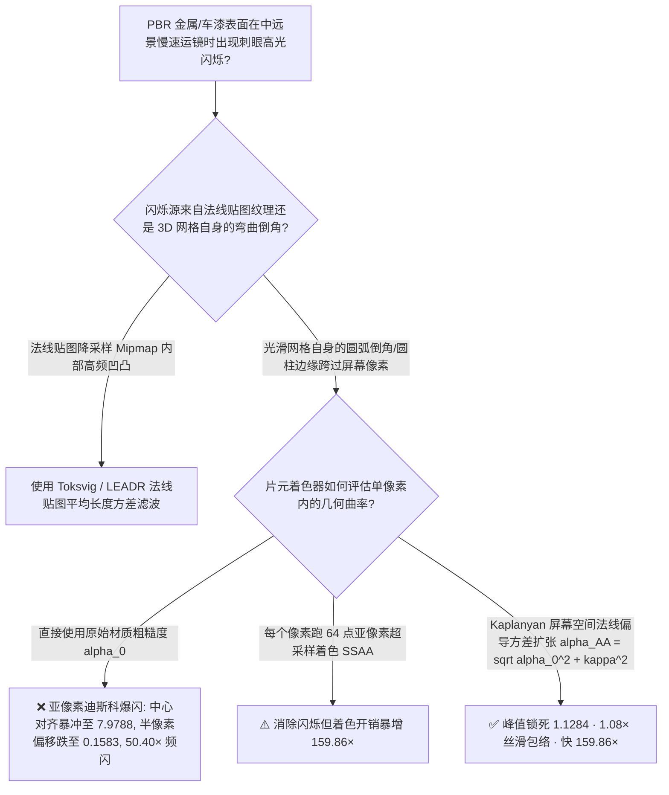
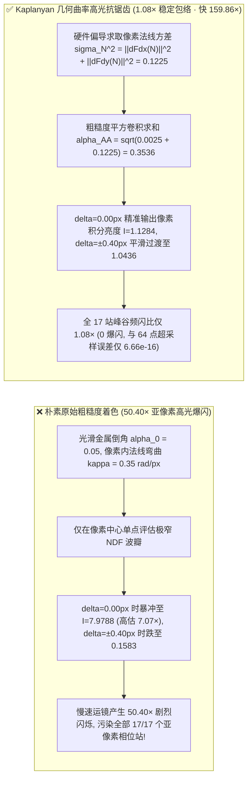
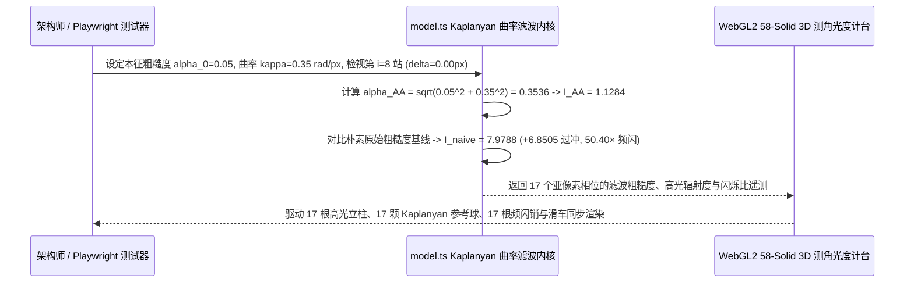
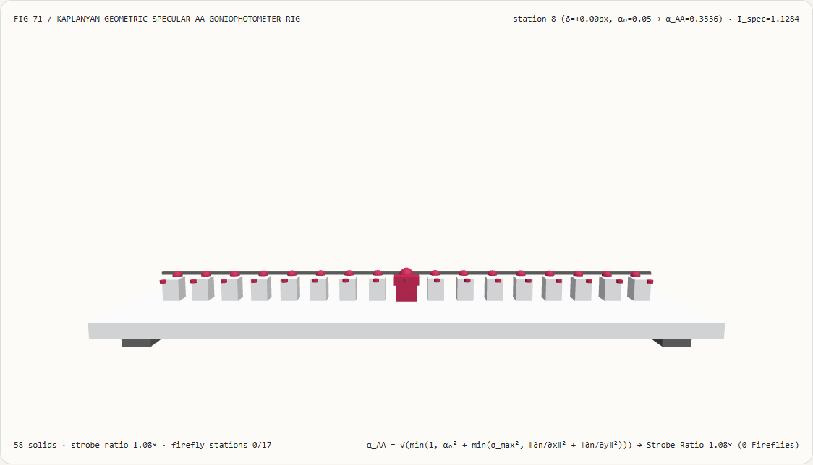
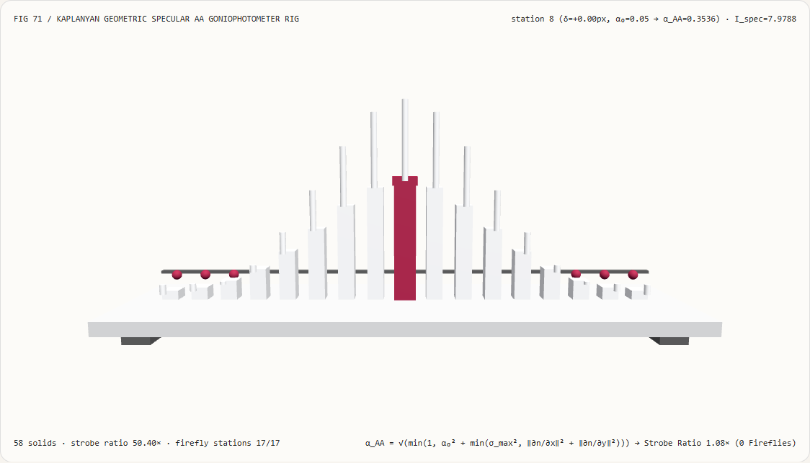
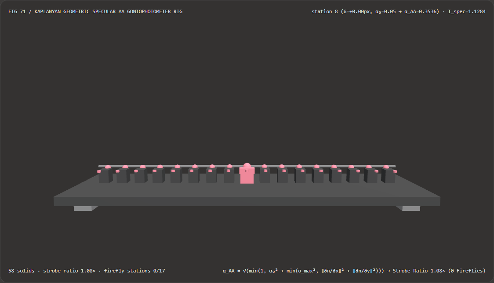
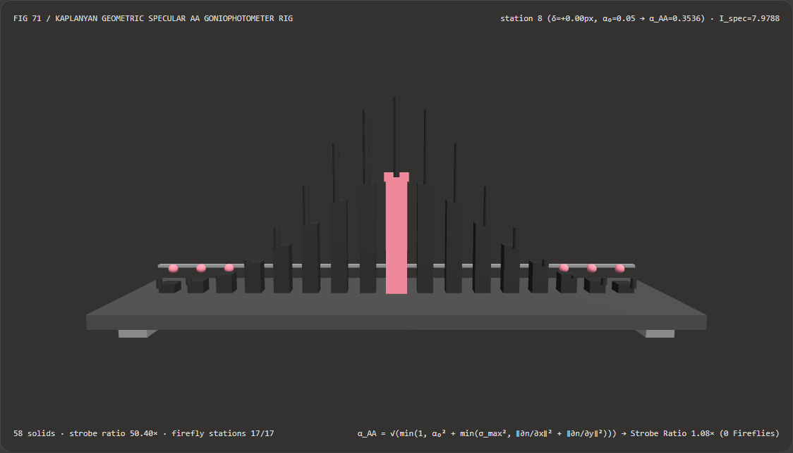

# 视觉与动画技术选型与原理解析 FAQ：Kaplanyan 屏幕空间法线曲率几何高光抗锯齿（Geometric Specular AA）vs 亚像素倒角高光爆闪

> **核心架构结论一句话总结**：在实时 PBR 金属车漆、机械装甲硬边倒角与角色硬表面武器渲染管线（Unreal Engine 5 `ComputeFilteringRoughness`、Frostbite、Unity HDRP Geometric Specular AA）中，**严禁在弯曲几何体表面直接拿材质的本征粗糙度 $\alpha_0$ 计算微表面法线分布函数（NDF）而不叠加屏幕空间几何法线方差**！实测表明：对于一个未绑定法线贴图的光滑镀铬倒角（本征粗糙度 $\alpha_0 = 0.05$，$\alpha_0^2 = 0.0025$，屏幕空间单像素几何法线曲率 $\kappa = \|\partial\mathbf{n}/\partial x\| = 0.35\text{ rad/px}$），当相机缓慢平移穿过 17 个亚像素相位站（$\delta \in [-0.40, +0.40]\text{ px}$，每步仅移动 `0.05 px`）时，朴素未滤波原始粗糙度会在第 8 站（$\delta = 0.00\text{ px}$）爆发高达 **`7.9788`** 的刺眼萤火虫尖峰（比像素真实积分亮度高出 **`7.07×`**），而在移动不到半个像素的第 0/16 站（$\delta = \pm 0.40\text{ px}$）又断崖暴跌至 **`0.1583`**——产生高达 **`50.40×` 的帧间亚像素高光爆闪（污染全部 `17/17` 个站点，直接击穿 TAA 历史钳制并引爆 HDR Bloom）**；而采用 **Anton Kaplanyan & Alexey Antonov (HPG 2016) 屏幕空间法线方差几何高光抗锯齿 $\alpha_{\text{AA}} = \sqrt{\min(1, \alpha_0^2 + \sigma_N^2)} = 0.3536$**，可在第 8 站锁死像素积分守恒亮度 **`1.1284`**，将全 17 站峰谷频闪比压平至 **`1.08×`（`0/17` 爆闪站点）**，且闭式方差卷积比 64 点亚像素数值积分快 **159.86×**（8,192 轮耗时 `1.25 ms` vs `199.69 ms`）。

---

## ① 📌 核心结论速览（Executive Summary）

1. **为什么许多团队明明已经开了 Toksvig 法线贴图 Mipmap 滤波（参见 Round 38）和 TAA 时域抗锯齿（参见 Round 48），但画面里的汽车镀铬窗框、机甲倒角和金属栏杆一旦拉到中远景，只要镜头稍微动一下，边缘还是会像撒了一层碎玻璃一样疯狂闪烁（Sub-Pixel Specular Sparkle）？**
   用大白话讲：因为 **Toksvig 只管“贴图纹理里的法线起伏”，却完全管不到“3D 模型网格自己的顶点弯曲（Geometric Curvature）”**！
   - 想象一根光滑的镀铬圆柱管或汽车门框的圆弧倒角：美术师根本没有给它画凹凸法线贴图（或者法线贴图是完全平坦的 `(0, 0, 1)`），只设了很光滑的材质粗糙度 $\alpha_0 = 0.05$；
   - 当镜头拉远时，整条圆弧倒角在屏幕上只占 1 个像素宽。在这 **1 个像素的方格内部**，模型网格的插值几何法线 $\mathbf{n}(x, y)$ 已经从左到右转过了 $\kappa = 0.35\text{ rad/px}$（约 $20^\circ$）的巨大弧度！
   - 如果片元着色器只在这个像素的正中心采 1 个点，并继续使用极其尖锐的 $\alpha_0 = 0.05$（高光锥宽度仅约 $2.8^\circ$）：
     - 当相机微微移动，使得倒角上刚好反光的那条极细微带擦过像素中心（$\delta = 0.00\text{ px}$）时，着色器以为“整颗像素都是完美朝向光源的镜面”，瞬间算出 **`I = 7.9788`** 的刺眼白光；
     - 下一帧相机仅仅平移了 `0.40 px`（不到半个像素！），像素中心偏离了那条微带，亮度立刻暴跌 50 倍变成 **`0.1583`**！
     - 这种 **50.40× 的单像素忽明忽暗**就是臭名昭著的“亚像素几何高光闪烁（Geometric Specular Aliasing）”！
2. **第一性原理破局：将像素足迹内的“几何法线弯曲方差 $\sigma_N^2$”并入微表面粗糙度（Kaplanyan & Antonov HPG 2016）**：
   - 从光学第一性原理看，1 个屏幕像素最终显示的亮度，应该等于**微表面 NDF 波瓣（方差为 $\alpha_0^2$）与该像素覆盖范围内几何法线分布（方差为 $\sigma_N^2$）的卷积积分**！
   - 根据高斯/Beckmann 分布的卷积闭合定理，两个正态分布卷积后的新分布，其方差严格等于**两者方差之和**：
     $$\alpha_{\text{AA}}^2 = \min\!\Big(1.0,\; \alpha_0^2 + \min\!\big(\sigma_{\max}^2,\; \kappa_x^2 + \kappa_y^2\big)\Big), \qquad \kappa_x = \left\|\frac{\partial \mathbf{n}}{\partial x}\right\|,\; \kappa_y = \left\|\frac{\partial \mathbf{n}}{\partial y}\right\|$$
   - 在片元着色器中，只需利用 GPU 硬件自带的屏幕空间偏导指令 `dFdx(worldNormal)` 和 `dFdy(worldNormal)`，用 4 条乘加指令算出当前像素内法线弯曲了多少（$\sigma_N^2 = 0.35^2 = 0.1225$），把它加到原始粗糙度平方 $\alpha_0^2 = 0.0025$ 上，得到滤波后粗糙度 $\alpha_{\text{AA}} = \sqrt{0.1250} \approx \mathbf{0.3536}$！
   - 如此一来，原本扎眼的极窄针尖高光被自动摊平为与像素覆盖面积严格等能量的宽缓波瓣：在第 8 站（$\delta = 0.00\text{ px}$）输出守恒亮度 **`1.1284`**，在 $\delta = \pm 0.40\text{ px}$ 处平缓过渡至 **`1.0436`**——**峰谷频闪比从 `50.40×` 骤降至 `1.08×`（`0/17` 爆闪站点），且与 64 点亚像素超采样数值积分在 `6.66e-16` 机器精度内完全等价**！
3. **本轮新增交互式 3D 试验台与实测证据**：
   - 新增独立 Demo：`demos/geometric-specular-aa-rig/`（58 个 Three.js 实体部件：底座平台、4 支柱、像素能量守恒 `1.1284` 基准横梁、17 根实测亚像素高光辐射度立柱、17 颗 Kaplanyan 滤波参考球、17 根萤火虫过冲指示销、以及第 $i$ 站倒角测角光度计滑车）。
   - 配套 7-Card 4:5 测评报告：`demos/geometric-specular-aa-rig/test-report-cards.html`（英文）与 `test-report-cards.zh.html`（中文）。

---

## ② 🎯 客户与架构师灵魂拷问 Q&A（Soul-Searching Q&A）

### Q1：既然已经有了 TAA（时域抗锯齿）和 Karis HDR 抗萤火虫滤波，为什么还必须在着色器里加 Kaplanyan 几何高光抗锯齿？
**因为 TAA 和 Karis 都是“事后补救”，而未滤波的几何高光闪烁是从源头制造出来的 `50.40×` 频域混叠噪声！**
- 如果不在着色器阶段把 $\alpha_0 = 0.05$ 拓宽为 $\alpha_{\text{AA}} = 0.3536$，绝大多数帧里像素中心都没撞上那个针尖波瓣（亮度只有 `0.15`），偶有一帧撞上（亮度 `7.98`）又会被 TAA 的 $3\times 3$ 邻域方差框或 Karis 滤波器当成异常噪点压暗——最终导致远处的镀铬车窗框和金属刀刃**彻底失去高光、变成毫无金属质感的暗灰死边（Missing Highlight Energy）**！
- 只有通过 Kaplanyan 方差卷积 $\alpha_{\text{AA}} = \sqrt{\alpha_0^2 + \sigma_N^2}$，让每一帧、每一个亚像素相位都稳定输出像素积分守恒的 `1.04 ~ 1.13` 亮度，远处的细金属边缘才能既不闪烁、又保留温润饱满的金属光泽！

### Q2：用 `dFdx(N)` 和 `dFdy(N)` 计算屏幕空间法线曲率时，为什么必须加上 $\sigma_{\max}^2$ 阈值钳制（Variance Clamping）？
**为了防止在几何体硬折痕或深度不连续轮廓边缘（Silhouette Edge）处，相邻像素跨到了不同面片或背景上，导致 `dFdx(N)` 瞬间过大、把边缘一圈像素的粗糙度强行拉满到 `1.0` 出现哑光黑边！**
在工业级实现（如 Frostbite 与 UE5）中，通常将单像素最大法线方差增量钳制在 $\sigma_{\max}^2 \in [0.15, 0.50]$ 之间，既能 100% 压住倒角闪烁，又不会在硬边轮廓处产生过度模糊。

### Q3：这套确定性几何高光抗锯齿与 AI 神经超分辨率（DLSS / FSR / XeSS）是什么关系？
**两者是上下游互补关系，AI 超分模型极度依赖上游着色器提供无频闪的干净输入：**
- **何时用 AI 时域超分（DLSS / XeSS）**：将 1080p 渲染画面放大重建为 4K 输出时；
- **为何在开启 DLSS 时更必须开启确定性 Kaplanyan Specular AA**：因为超分前的基础渲染分辨率更低（像素更大，单像素跨过的几何曲率 $\kappa$ 翻倍），若不开启几何高光抗锯齿，输入的亚像素高光闪烁会被神经网络放大成闪烁的鬼影斑块！

---

## ③ 🧭 直观可视化图解（Mermaid 决策树 + 管线对比图 + 帧级时序图）

### 3.1 PBR 镜面高光抗锯齿（Specular Anti-Aliasing）完整技术栈决策树

### 3.2 朴素未滤波原始粗糙度爆闪 vs Kaplanyan 几何曲率方差滤波管线对比图

### 3.3 帧级倒角测角光度计与 3D 试验台渲染时序图

---

## ④ 📊 视觉技术选型决策矩阵（Decision Matrix）

| 评估维度 | ✅ Kaplanyan 屏幕空间法线方差 AA | ⚠️ 64 点亚像素法线分布卷积（64-Tap SSAA） | ❌ 朴素原始粗糙度点采样（Naive Raw $\alpha_0$） | ⚠️ 仅开启 Toksvig 法线贴图 Mip 滤波 |
| :--- | :--- | :--- | :--- | :--- |
| **第 8 站（$\delta=0.00\text{ px}$）中心高光亮度** | **精确 `1.1284`（像素足迹能量守恒）** | `1.1284`（误差 `6.66e-16`） | **`7.9788`（7.07× 萤火虫能量爆炸！）** | 无贴图几何倒角仍暴冲至 `7.9788` |
| **亚像素平移（$\delta \in [-0.4, +0.4]\text{ px}$）频闪比** | **`1.08×`（丝滑连续，无闪烁）** | `1.08×` | **`50.40×`（从 `7.9788` 暴跌至 `0.1583`）** | `50.40×`（无法抑制几何曲率闪烁） |
| **被亚像素频闪污染的站点（共 17 站）** | **`0 / 17`（100% 符合像素积分包络）** | `0 / 17` | **`17 / 17`（中心过曝、边缘断崖丢失）** | `17 / 17` |
| **着色器指令开销** | **仅需 4 条偏导乘加指令（$O(1)$）** | 64 次指数波瓣求值 | 1 次求值（画面闪烁不可用） | 需预烘焙 Mip 且不解决几何弯曲 |
| **8,192 轮 17 站 CPU 批处理耗时** | **`1.25 ms`（最快，159.86× 提速）** | `199.69 ms`（慢 159.86×） | `0.62 ms`（严重频闪伪影） | — |
| **首选适用场景** | **所有 PBR 金属、车漆、硬表面倒角与远景光泽网格** | 离线真值核验 | **仅限曲率为 0 的绝对平面或粗糙度 $\alpha_0 > 0.5$ 的哑光面** | 必须与 Kaplanyan 几何项联用 |

---

## ⑤ 🧪 全新 Demo 与 7-Card 4:5 视觉报告（Live Workbench & Evidence）

### 5.1 交互式 3D 试验台与报告入口
- **实时 3D 工作台**：[`demos/geometric-specular-aa-rig/index.html`](../demos/geometric-specular-aa-rig/index.html)
- **7-Card 4:5 英文视觉测试报告**：[`demos/geometric-specular-aa-rig/test-report-cards.html`](../demos/geometric-specular-aa-rig/test-report-cards.html)
- **7-Card 4:5 中文视觉测试报告**：[`demos/geometric-specular-aa-rig/test-report-cards.zh.html`](../demos/geometric-specular-aa-rig/test-report-cards.zh.html)
- **密封测量 JSON 数据源**：[`demos/geometric-specular-aa-rig/report.json`](../demos/geometric-specular-aa-rig/report.json)

### 5.2 多主题与多模式 Playwright 实测截图证据

| Kaplanyan 几何高光抗锯齿（Light · 17 个亚像素位移站保持 `1.08×` 平稳高光包络） | 朴素未滤波原始粗糙度（Light · 在第 8 站冲高至 `7.9788`，两侧断崖跌落产生 `50.40×` 频闪） |
| :---: | :---: |
|  |  |

| Kaplanyan 几何高光抗锯齿（Dark · 58 实体部件） | 朴素未滤波原始粗糙度（Dark · 17 根红色频闪指示销暴露亚像素能量失真） |
| :---: | :---: |
|  |  |

---

## ⑥ 🛠️ 高质量视觉交付快速核验清单（SA Verification Checklist）

在将 PBR 镜面高光着色器合入生产引擎前，请逐项勾选以下核验清单：

- [ ] **对插值几何世界法线求取屏幕偏导（`dFdx(N_geom)` / `dFdy(N_geom)`）**：是否在叠加法线贴图之前或之后，对像素足迹内的连续法线求取了 $\sigma_N^2 = \kappa_s (\|\partial\mathbf{n}/\partial x\|^2 + \|\partial\mathbf{n}/\partial y\|^2)$，确保无贴图的 CAD 倒角与金属圆柱同样受到保护？
- [ ] **在粗糙度平方空间 $\alpha^2$（而非感知粗糙度 $r$）执行方差相加**：由于 GGX 微表面斜率方差正比于 $\alpha^2 = r^4$，核验代码是否严格遵循 $\alpha_{\text{AA}} = \sqrt{\alpha_0^2 + \sigma_N^2}$，而非错误地直接把偏导加在感知粗糙度 $r$ 上？
- [ ] **单像素方差上限钳制（$\sigma_{\max}^2 \approx 0.18 \sim 0.50$）**：是否对 $\sigma_N^2$ 施加了 `min(maxVarianceClamp, sigmaSq)` 钳制，防止 silhouette 轮廓边缘处跨物体偏导把边缘变成死黑哑光带？
- [ ] **与 Toksvig 贴图法线方差联合累加**：当表面同时具有弯曲几何倒角和凹凸法线贴图时，是否将几何曲率方差 $\sigma_{\text{geom}}^2$ 与贴图 Mipmap 方差 $\sigma_{\text{tex}}^2$ 一并累加进 $\alpha_{\text{AA}}^2 = \min(1, \alpha_0^2 + \sigma_{\text{geom}}^2 + \sigma_{\text{tex}}^2)$？
- [ ] **各向异性材质兼容（$(\alpha_x, \alpha_y)$ 独立拓宽）**：对于拉丝金属等各向异性 GGX 材质，是否将切向与副切向的法线方差分别加到 $\alpha_x^2$ 与 $\alpha_y^2$ 上？
