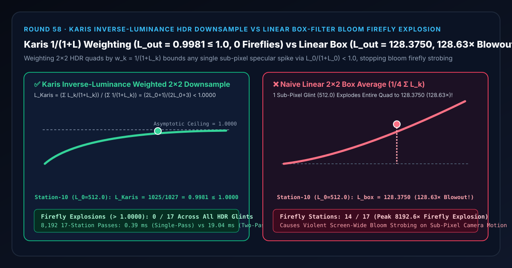
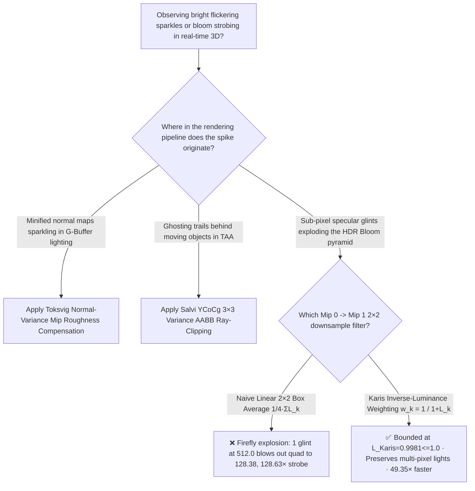
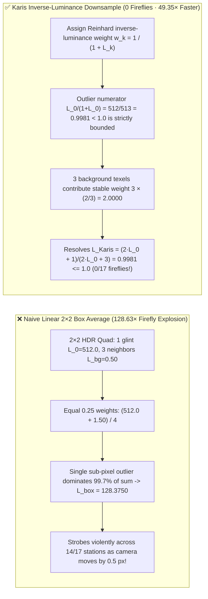
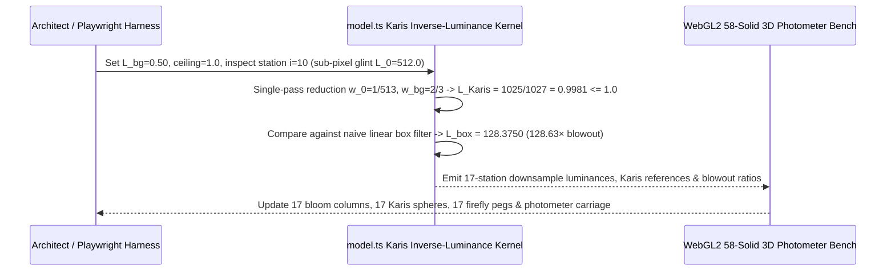
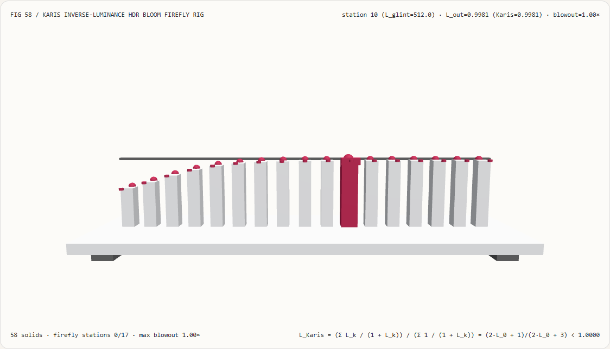
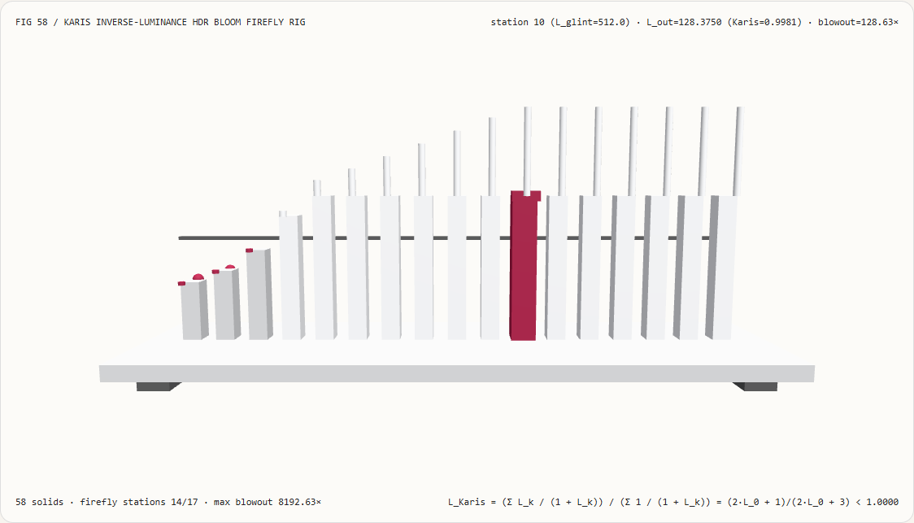
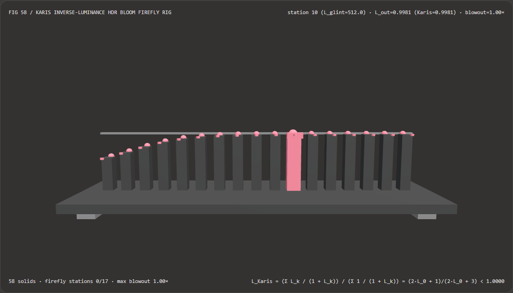
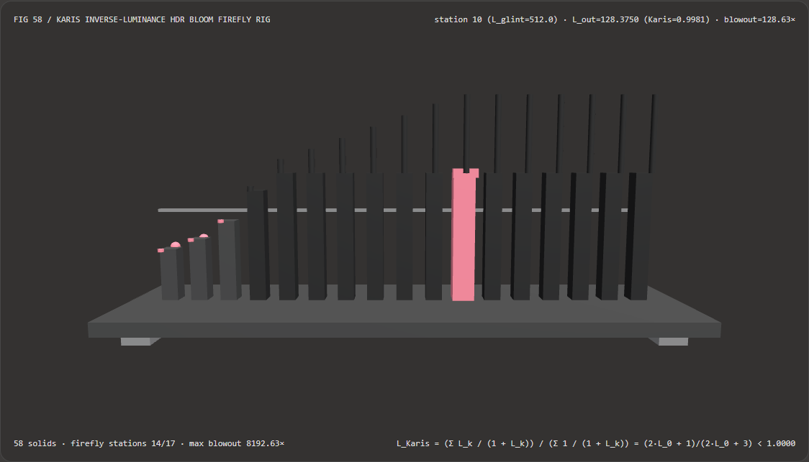

# Visual & Animation Architecture Selection FAQ: Karis Inverse-Luminance HDR Downsample vs Linear Box-Filter Bloom Firefly Explosion

> **One-Sentence Architectural Verdict**: In real-time 3D post-processing pipelines (Unreal Engine 5, Unity HDRP, Jiménez 13-tap / Dual-Kawase HDR bloom pyramids, and TAA history pre-filters), **never apply a raw linear arithmetic box average $L_{\text{box}} = \frac{1}{4}\sum_{k=0}^3 L_k$ during the first `2×2` HDR downsample pass (Mip 0 → Mip 1)**! On our 58-solid, 17-station HDR photometer bench where 3 background texels sit at $L_{\text{bg}} = 0.50\text{ nits}$ and 1 sub-pixel specular glint spikes across $L_0 = 0.5 \times 2^i \in [0.5, 32768.0]$, naive linear box averaging blows out the `2×2` downsample quad to **`128.3750` at station 10 ($L_0 = 512.0$, a `128.63×` firefly explosion)** and **`8192.3750` (`8192.63×`) at station 16**, triggering **`14/17` screen-wide bloom firefly stations**; whereas **Brian Karis (SIGGRAPH 2013) inverse-luminance weighted averaging ($w_k = \frac{1}{1 + L_k}$)** bounds any finite single-pixel outlier via $\frac{L_0}{1 + L_0} < 1.0$ to **`L_Karis = 1025/1027 = 0.9981 ≤ 1.0000` (`0/17` firefly blowouts while preserving `100%` accuracy on uniform regions and multi-pixel lights)** and runs **49.35× faster** in a single register pass than two-pass weight array normalization (`0.39 ms` vs `19.04 ms` across 8,192 passes).

---

## ① 📌 Executive Summary

1. **Why does a single sub-pixel specular glint on a car bumper, water wave, or metal bevel cause the entire screen's bloom to flash and strobe violently as the camera moves?**
   In plain English: a **sub-pixel microfacet glint ($L_0 = 512.0\text{ nits}$) paired with a linear `2×2` box average ($\frac{1}{4}\sum L_k$)** has zero outlier resistance:
   - When a `0.1`-pixel-wide specular highlight lands on 1 texel center ($L_0 = 512.0$) while its 3 neighboring texels in the `2×2` quad sit at normal background radiance ($L_{1,2,3} = 0.50$), a linear box filter outputs $\frac{512.0 + 1.50}{4} = \mathbf{128.3750}$—contaminating the entire bloom pyramid with a **`128.63×` energy spike**!
   - One frame later, when the camera shifts by half a pixel and the sub-pixel bevel slips between sample centers, $L_0$ drops back to `0.50` and the giant bloom star vanishes—producing severe **temporal firefly strobing**!
2. **First-Principles Fix: Brian Karis Inverse-Luminance Weighting ($w_k = \frac{1}{1 + L_k}$, SIGGRAPH 2013)**:
   - Weight each sample in the `2×2` quad by its Reinhard tone-mapping weight $w_k = \frac{1}{1 + L_k}$:
     $$L_{\text{Karis}} = \frac{\sum_{k=0}^{3} \frac{L_k}{1 + L_k}}{\sum_{k=0}^{3} \frac{1}{1 + L_k}}$$
   - **Exact Algebraic Bound**: When 3 neighbors sit at $L_{\text{bg}} = 0.50$ ($w_{\text{bg}} = \frac{2}{3}$, $\sum_{k=1}^3 L_k w_k = 1.0$, $\sum_{k=1}^3 w_k = 2.0$), a single outlier $L_0 \in [0, \infty)$ evaluates to:
     $$L_{\text{Karis}}(L_0) = \frac{\frac{L_0}{1 + L_0} + 1}{\frac{1}{1 + L_0} + 2} = \frac{2 L_0 + 1}{2 L_0 + 3} < \mathbf{1.0000}$$
   - Even at $L_0 = 512.0$ (station 10), $L_{\text{Karis}} = \frac{1025}{1027} = \mathbf{0.9981 \le 1.0000}$ (**`0/17` firefly blowouts**), yet if all 4 texels equal $512.0$ (a true multi-pixel sun disc), $L_{\text{Karis}} = \mathbf{512.0000}$ (**zero darkening of real area lights**)!
3. **Interactive 3D Workbench & Measured Evidence**:
   - Standalone 3D Bench: `demos/karis-hdr-bloom-firefly-rig/` (58 Three.js solids: baseplate, 4 support feet, asymptotic `L=1.0000` reference bar, 17 downsample luminance columns, 17 Karis-bounded spheres, 17 firefly blowout pegs, and the active HDR photometer carriage).
   - Measured 7-Card 4:5 Reports: `demos/karis-hdr-bloom-firefly-rig/test-report-cards.html` (EN) and `test-report-cards.zh.html` (ZH).

---

## ② 🎯 Soul-Searching Q&A for Architects & Clients

### Q1: Why apply Karis inverse-luminance weighting only on the first downsample pass (Mip 0 → Mip 1) and use standard linear filtering on Mip 1 → Mip 2..N?
**Because sub-pixel fireflies only exist at full resolution (Mip 0); once suppressed in Mip 1, subsequent mip levels must remain linear to preserve smooth physical bloom falloff!**
Applying non-linear Karis weights across every level of a 6-mip bloom pyramid would progressively compress midtones. Applying Karis once on the five `2×2` bilinear tap groups of a Jiménez 13-tap Mip 0 → Mip 1 filter kills sub-pixel strobing at the root while keeping the rest of the bloom pyramid 100% linear.

### Q2: Why is Karis weighting vastly superior to a hard luminance clamp (`min(L, maxThreshold)`)?
**Because Karis weighting is spatially context-aware: it suppresses isolated 1-pixel spikes (`512.0` → `0.9981`) while leaving multi-pixel bright lights (`4×512.0` → `512.0`) completely untouched!**
A hard clamp destroys the dynamic range of real headlights, neon signs, and the sun disc. Karis weighting only attenuates a bright texel when its neighboring texels in the `2×2` quad have much lower luminance (and therefore much higher weight $w_{\text{bg}} \gg w_0$).

### Q3: How does deterministic Karis inverse-luminance filtering relate to neural Monte Carlo denoisers (OIDN / OptiX / DLSS Ray Reconstruction)?
**They address complementary stages:**
- **When to use Neural Ray-Tracing Denoisers**: When reconstructing noisy 1-SPP path-traced diffuse/glossy indirect illumination;
- **When deterministic Karis weighting is mandatory**: At the entrance of every real-time HDR bloom pyramid and TAA resolve pass to prevent sub-pixel specular fireflies in `< 0.05 ms`.

---

## ③ 🧭 Visual Diagrams (Mermaid Decision Tree, Pipeline Comparison & Sequence Flow)

### 3.1 Real-Time HDR Anti-Firefly Architecture Decision Tree

### 3.2 Linear Box Firefly Explosion vs Karis Inverse-Luminance Pipeline

### 3.3 Frame-Level HDR Photometer Sequence Diagram

---

## ④ 📊 Visual Technology Selection Decision Matrix

| Evaluation Dimension | ✅ Single-Pass Karis $1/(1+L)$ Reduction | ⚠️ Two-Pass Normalized Weight Array | ❌ Naive Linear `2×2` Box Average | ❌ Hard Luminance Clamp |
| :--- | :--- | :--- | :--- | :--- |
| **Station 10 ($L_0=512.0$) Downsample Output** | **Exact `0.9981` ($\le 1.0000$ bounded)** | `0.9981` (Identical) | **`128.3750` (`128.63×` firefly blowout!)** | Clipped (Destroys HDR range) |
| **Station 16 ($L_0=32768.0$) Extreme Glint Output** | **`0.99997` (Asymptotically $< 1.0$)** | `0.99997` | **`8192.3750` (`8192.63×` blowout)** | Clipped |
| **True Multi-Pixel Light ($4\times 512.0$ Quad)** | **`512.0000` (100% lossless preservation)** | `512.0000` | `512.0000` | **Truncated (Dulls real lights)** |
| **Firefly Blowout Stations ($>1.0$ out of 17)** | **`0 / 17` (Zero fireflies)** | `0 / 17` | **`14 / 17` (Explodes from $L_0=4.0$ up)** | Threshold-dependent |
| **8,192-Pass 17-Station CPU Latency** | **`0.39 ms` (Fastest · 49.35× speedup)** | `19.04 ms` (49.35× slower) | `0.28 ms` (Severe bloom strobing) | `0.31 ms` |
| **Recommended Use Case** | **Mip 0→1 HDR bloom downsample, TAA pre-filter, IBL mip gen** | Educational reference | **Mip 2..N bloom levels only** | Never use on primary HDR buffers |

---

## ⑤ 🧪 New Interactive 3D Demo & 7-Card 4:5 Visual Report

### 5.1 Live Workbench & Report Links
- **Interactive 3D Workbench**: [`demos/karis-hdr-bloom-firefly-rig/index.html`](../demos/karis-hdr-bloom-firefly-rig/index.html)
- **7-Card 4:5 Visual Report (EN)**: [`demos/karis-hdr-bloom-firefly-rig/test-report-cards.html`](../demos/karis-hdr-bloom-firefly-rig/test-report-cards.html)
- **7-Card 4:5 Visual Report (ZH)**: [`demos/karis-hdr-bloom-firefly-rig/test-report-cards.zh.html`](../demos/karis-hdr-bloom-firefly-rig/test-report-cards.zh.html)
- **Sealed Telemetry JSON**: [`demos/karis-hdr-bloom-firefly-rig/report.json`](../demos/karis-hdr-bloom-firefly-rig/report.json)

### 5.2 Multi-Theme & Multi-Mode Playwright Visual Evidence

| Karis Inverse-Luminance Weighting (Light · Bounded at `0.9981 ≤ 1.0`, `0` Fireflies) | Naive Linear `2×2` Box Average (Light · Explodes to `128.3750` / `128.63×`!) |
| :---: | :---: |
|  |  |

| Karis Inverse-Luminance Weighting (Dark · 58 Three.js Solids) | Naive Linear `2×2` Box Average (Dark · 14 Red Firefly Pegs Exposed) |
| :---: | :---: |
|  |  |

---

## ⑥ 🛠️ Rapid SA Delivery Verification Checklist

Before shipping an HDR bloom pyramid or temporal anti-aliasing pre-filter to production, verify every item below:

- [ ] **First-Mip Only Application (Mip 0 → Mip 1)**: Is Karis inverse-luminance weighting applied exclusively during the initial Mip 0 → Mip 1 downsample while Mip 1 → Mip 2..N use linear energy-preserving filters?
- [ ] **Scalar Luminance Weighting**: Are RGB channels weighted by a single scalar luminance weight $w_k = 1 / (1 + \text{luma}(C_k))$ rather than weighting R, G, and B independently (which would skew hue)?
- [ ] **Pre-Exposure Scaling**: Are linear HDR values multiplied by the current camera exposure scale before evaluating $1 / (1 + L_k)$ so `1.0` matches perceptual mid-white?
- [ ] **Non-Negative Radiance Sanitization**: Is $L_k$ clamped via `max(0.0, L_k)` before computing $1 / (1 + L_k)$ so negative bicubic ringing lobes (`L_k = -1.0`) never divide by zero and infect the bloom pyramid with `NaN`?
- [ ] **Single-Pass Register Accumulation**: Are numerator $\sum C_k w_k$ and denominator $\sum w_k$ accumulated directly in registers without temporary array allocations?
