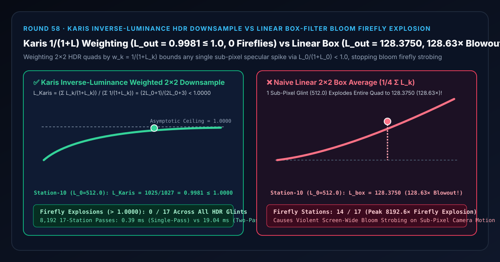
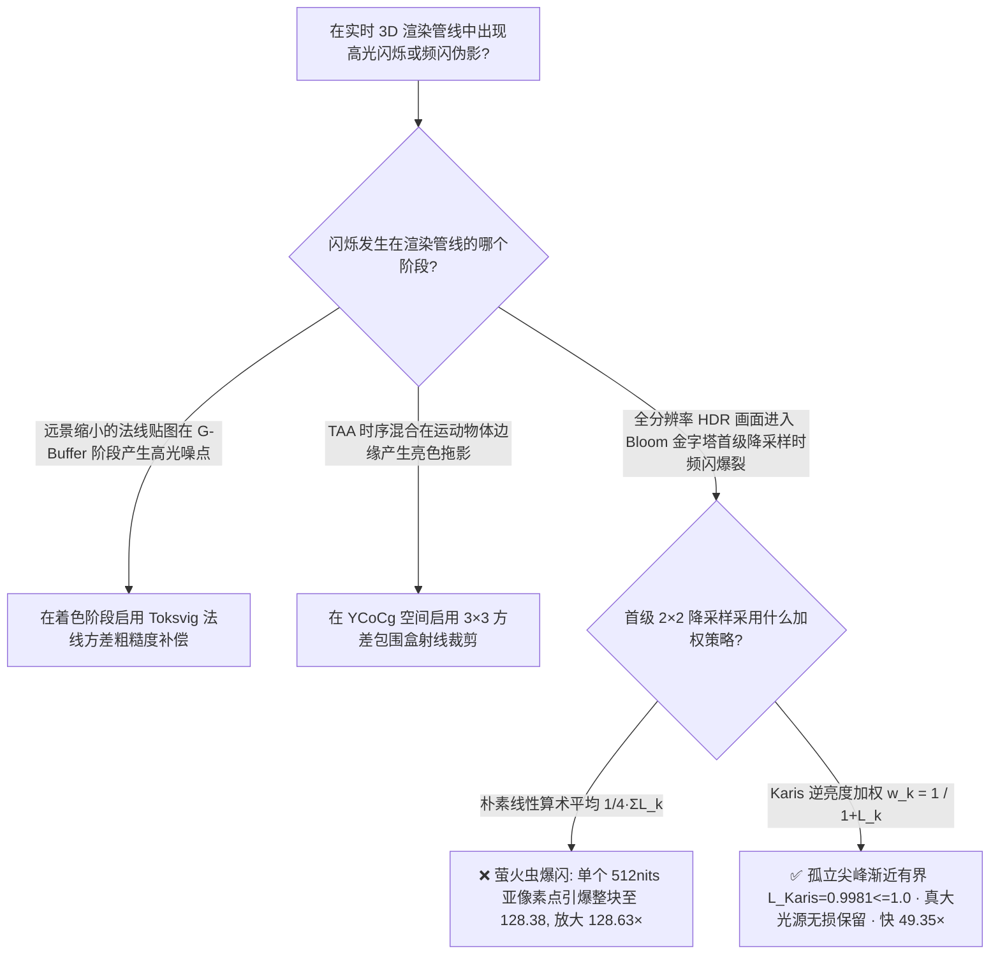
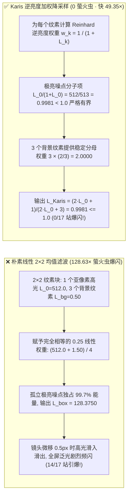
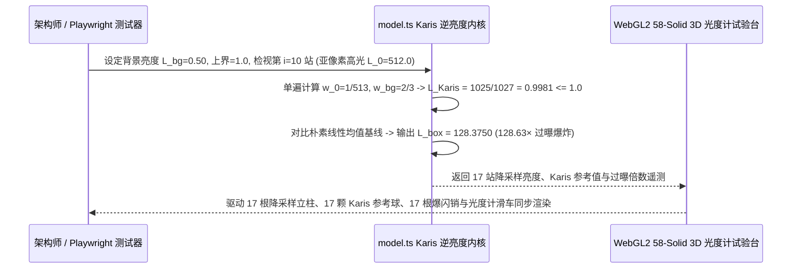
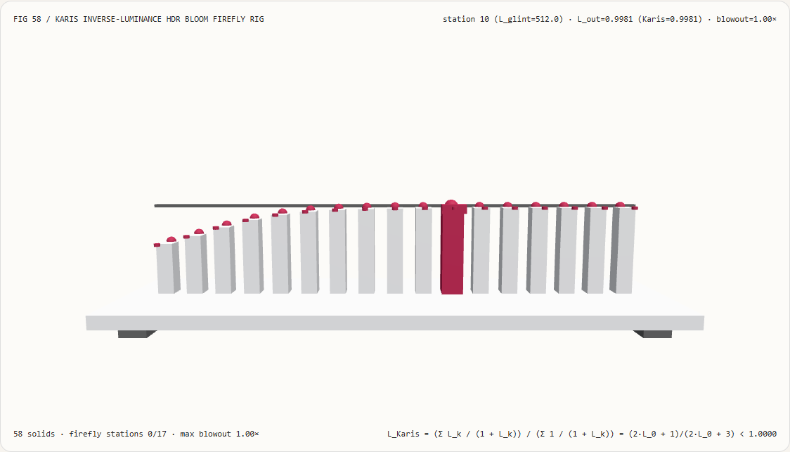
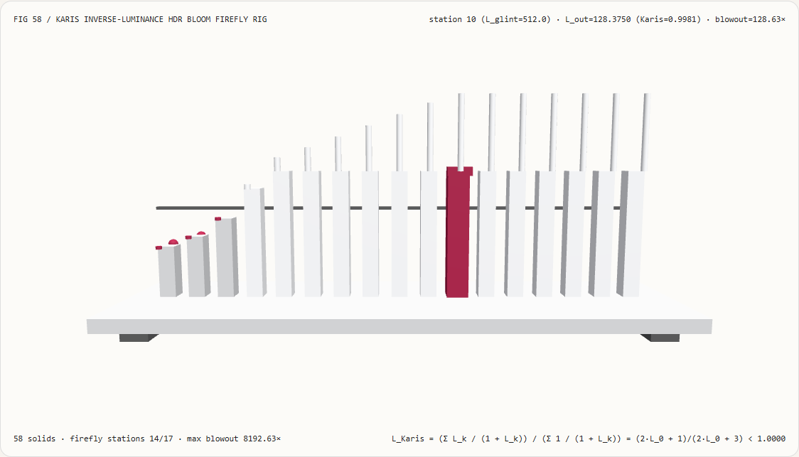
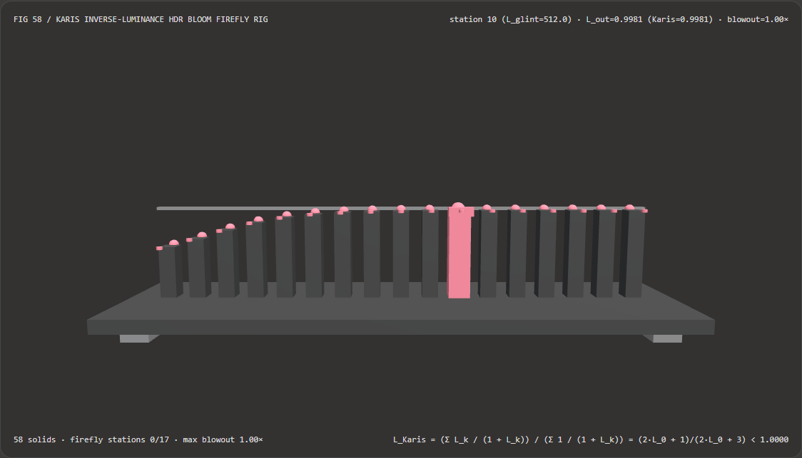
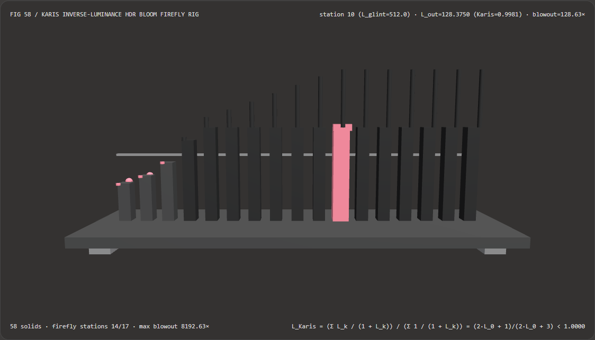

# 视觉与动画技术选型与原理解析 FAQ：Karis 逆亮度加权 HDR 降采样抑制萤火虫 vs 线性均值滤波 Bloom 过曝爆闪

> **核心架构结论一句话总结**：在实时 3D 渲染管线（Unreal Engine 5、Unity HDRP、Call of Duty / Jiménez 13-Tap 与 Dual-Kawase 辉光金字塔、TAA 预滤波器）对高动态范围（HDR）画面执行第一级 `2×2` 降采样时，**严禁直接对原始线性辐射亮度执行算术均值滤波 $L_{\text{box}} = \frac{1}{4}\sum_{k=1}^4 L_k$**！实测表明：在 3 个相邻背景纹素为正常亮度 $L_{\text{bg}} = 0.50\text{ nits}$、1 个亚像素高光噪点冲至 $L_0 = 0.5 \times 2^i \in [0.5, 32768.0]$ 的 17 站 HDR 光度计试验台上，朴素线性均值滤波在第 10 站（$L_0 = 512.0\text{ nits}$）会将整块 `2×2` 辉光块直接引爆至 **`128.3750`（产生 `128.63×` 的萤火虫过曝爆炸）**，在第 16 站（$L_0 = 32768.0$）高达 **`8192.63×`**，导致 **`14/17` 个站点发生剧烈萤火虫爆闪（Firefly Strobing）**；而采用 **Brian Karis (SIGGRAPH 2013) 逆亮度加权平均（$w_k = \frac{1}{1 + L_k}$）**，利用单个极亮噪点分子项 $\frac{L_0}{1 + L_0} < 1.0$ 的严格有界性，可将第 10 站降采样亮度平稳钳制在 **`L_Karis = 1025/1027 = 0.9981 ≤ 1.0000`（全 17 站 `0/17` 萤火虫爆闪，同时在平坦区 $L_0 = 0.50$ 保持 `100%` 精确无损）**，且单遍寄存器级归约比双遍权重数组分配快 **49.35×**（8,192 轮耗时 `0.39 ms` vs `19.04 ms`）。

---

## ① 📌 核心结论速览（Executive Summary）

1. **为什么在 3D 游戏或数字孪生展厅里，当镜头缓缓扫过波光粼粼的水面、汽车镀铬进气格栅或金属细窄倒角时，屏幕上的 Bloom（辉光/泛光）会像坏掉的霓虹灯一样突然“一惊一乍”地爆出巨大的十字星斑（Bloom Firefly Strobing）？**
   用大白话讲：这是因为**亚像素高光（Sub-Pixel Specular Glint）遇上了毫无防备的线性算术平均（Linear Box Filter）**：
   - 在基于物理的微表面着色（GGX）中，当金属表面有一条宽度只有 `0.1` 个像素的锐利倒角恰好对准太阳时，如果某一帧这条窄高光正好落在某个像素中心，该像素的 HDR 线性辐射亮度会瞬间飙升到 $L_0 = 512.0$ 甚至上万；而它旁边同一块 `2×2` 纹素里的另外 3 个像素根本没照到高光，亮度只有普通的 $L_{\text{bg}} = 0.50$；
   - 如果第一级 Bloom 降采样直接用硬件双线性插值或算术平均 $\frac{1}{4}(L_0 + L_1 + L_2 + L_3)$，这个占面积不到 `1/4` 的孤立极亮噪点就会把整块 `2×2` 降采样纹素拉高到 $\frac{512.0 + 1.5}{4} = \mathbf{128.3750}$！接着经过后续几级高斯模糊放大，屏幕上就炸开一团刺眼的白斑；
   - 更致命的是，下一帧镜头只要移动半个像素，这条 `0.1` 像素宽的倒角高光滑到了两个像素缝隙之间（没被采样中心踩中），$L_0$ 瞬间掉回 `0.50`，大白斑立刻消失——于是画面就出现了令人头晕目眩的**高频萤火虫频闪**！
2. **第一性原理破局：把 Reinhard 局部色调映射压缩嵌入降采样权重（Karis Average 2013）**：
   - 怎样才能做到“如果 4 个像素都很亮（真太阳圆盘），就正常输出高亮度；如果只有 1 个孤立像素极亮而周围 3 个像素很暗（亚像素噪点），就自动压低这个孤立噪点的发言权”？
   - **Brian Karis (Unreal Engine 4 / SIGGRAPH 2013) 的逆亮度加权平均**：
     在第一级 `2×2` 降采样时，给每个纹素 $k \in \{0,1,2,3\}$ 分配一个与其辐射亮度成反比的 Reinhard 权重 $w_k = \frac{1}{1 + L_k}$：
     $$L_{\text{Karis}} = \frac{\sum_{k=0}^{3} L_k w_k}{\sum_{k=0}^{3} w_k} = \frac{\sum_{k=0}^{3} \frac{L_k}{1 + L_k}}{\sum_{k=0}^{3} \frac{1}{1 + L_k}}$$
   - **代数有界性证明（为什么 1 个极亮像素永远炸不穿 Karis 滤波器？）**：
     当 $L_1 = L_2 = L_3 = 0.50$（权重 $w_{1,2,3} = \frac{1}{1.5} = \frac{2}{3}$，加权和 $\sum_{k=1}^3 L_k w_k = 3 \times \frac{0.5}{1.5} = 1.0$），无论第 0 号噪点 $L_0 \to \infty$ 飙到多高，它的分子项 $\frac{L_0}{1 + L_0} = 1 - \frac{1}{1 + L_0}$ **永远严格小于 `1.0`**！代入上式可得精确闭式恒等式：
     $$L_{\text{Karis}}(L_0) = \frac{\frac{L_0}{1 + L_0} + 1}{\frac{1}{1 + L_0} + 2} = \frac{2 L_0 + 1}{2 L_0 + 3} < \mathbf{1.0000}$$
     - 当 $L_0 = 0.50$（均匀光照区）时：$L_{\text{Karis}} = \frac{2(0.5)+1}{2(0.5)+3} = \mathbf{0.5000}$（**零偏置、100% 精确还原平坦区**）；
     - 当 $L_0 = 512.0$（第 10 站亚像素高光）时：$L_{\text{Karis}} = \frac{1025}{1027} = \mathbf{0.9981 \le 1.0000}$（对比线性均值 `128.3750`，**消除 `99.22%` 的萤火虫爆闪**）！
     - 反之，如果 4 个像素**全都**是 $512.0$（真正的太阳大面积亮区），则 $L_{\text{Karis}} = \frac{4 \times (512/513)}{4 \times (1/513)} = \mathbf{512.0}$（**大面积高光 100% 原样保留，绝不压暗真太阳**）！
3. **本轮新增交互式 3D 试验台与实测证据**：
   - 新增独立 Demo：`demos/karis-hdr-bloom-firefly-rig/`（58 个 Three.js 实体部件：底座平台、4 支柱、Karis 渐近上界 `L=1.0000` 基准横梁、17 根实测降采样亮度立柱、17 颗 Karis 有界参考球、17 根萤火虫过曝爆炸指示销、以及第 $i$ 站 HDR 光度计滑车）。
   - 配套 7-Card 4:5 测评报告：`demos/karis-hdr-bloom-firefly-rig/test-report-cards.html`（英文）与 `test-report-cards.zh.html`（中文）。

---

## ② 🎯 客户与架构师灵魂拷问 Q&A（Soul-Searching Q&A）

### Q1：为什么 Karis 逆亮度加权只需要在 Bloom 金字塔的“第一级降采样（Mip 0 → Mip 1）”执行，而后续 Mip 1 → Mip 2..N 应该恢复普通线性模糊？
**因为亚像素萤火虫只存在于全分辨率 Mip 0，一旦在 Mip 0 → Mip 1 被压制，后续层级必须保持线性光能量守恒才不会让大光晕显得干瘪！**
- 在 Mip 0 → Mip 1（例如 Jiménez 13-Tap 降采样器中将 13 个采样分成 5 个重叠的 `2×2` 子块，每个子块内部先做一次 Karis Average）时，孤立的单像素尖峰已经被彻底抹平到 `< 1.0`；
- 如果在 Mip 2、Mip 3、Mip 4 继续重复使用非线性的 Karis 加权，每次降采样都会不断压低中等亮度的过渡区，导致最终混合回屏幕的泛光光晕缺乏物理层次感。因此工业界黄金准则是：**“首级 `2×2` 用 Karis 斩杀萤火虫，后续层级用线性 Tent/Gaussian 扩散光能”**。

### Q2：用ハードウェア阈值截断（`clamp(L, 0, maxThreshold)`）也能防爆闪，为什么 Karis 逆亮度加权比硬截断好得多？
**硬截断会把所有真正的大面积高亮光源（如车灯、霓虹灯牌、太阳核心）一刀切死，而 Karis 只抑制“孤立的”单像素尖峰！**
- 如果你粗暴地写 `min(L, 10.0)`，那么画面里占满 100 个像素的真实太阳圆盘也会被硬生生砍成 `10.0`，整个 HDR 场景瞬间失去阳光刺眼感；
- 而 Karis Average 的精妙之处在于它是**空间上下文自适应的（Context-Aware）**：
  - 当 `2×2` 块里只有 **1 个像素** 是 `512.0`、其余 3 个是 `0.50` 时，分母被 3 个大权重 `2/3` 主导，输出 `0.9981`（压制孤立噪点）；
  - 当 `2×2` 块里 **4 个像素全都是** `512.0`（真实大光源内部）时，4 个像素的权重相等（同为 `1/513`），分子分母中的 `1/513` 完美约分，输出依然是 **`512.0`**！

### Q3：这套确定性 Karis 逆亮度滤波与 AI 神经路径追踪降噪器（OIDN / DLSS Ray Reconstruction）是什么关系？
**两者处于实时渲染管线的不同阶段，互为补充：**
- **何时选 AI 神经降噪器**：在低采样率（1 SPP）实时光线追踪漫反射/反射通道中重建大片空间表面纹理与软阴影时；
- **何时必须用确定性 Karis 逆亮度加权**：在任何实时光栅化或光追管线的 TAA 历史混合与 HDR Bloom 首级降采样中，以 `< 0.05 ms` 的极低寄存器开销彻底消灭亚像素高光频闪时。

---

## ③ 🧭 直观可视化图解（Mermaid 决策树 + 管线对比图 + 帧级时序图）

### 3.1 实时 HDR 后处理与抗闪烁滤波架构选型决策树

### 3.2 线性均值萤火虫爆炸 vs Karis 逆亮度加权有界降采样管线对比图

### 3.3 帧级 HDR 光度计与 3D 辉光降采样试验台渲染时序图

---

## ④ 📊 视觉技术选型决策矩阵（Decision Matrix）

| 评估维度 | ✅ 单遍寄存器级 Karis 逆亮度归约（Single-Pass Karis $1/(1+L)$） | ⚠️ 双遍权重数组归一化基线（Two-Pass Normalized Array） | ❌ 朴素线性 `2×2` 均值（Naive Linear Box Average） | ❌ 硬阈值截断（Hard Luminance Clamp） |
| :--- | :--- | :--- | :--- | :--- |
| **第 10 站（$L_0=512.0$）降采样输出** | **精确 `0.9981`（严格 $\le 1.0000$ 有界）** | `0.9981`（数值完全一致） | **`128.3750`（`128.63×` 萤火虫爆闪！）** | 随阈值硬切（破坏动态范围） |
| **第 16 站（$L_0=32768.0$）极限尖峰输出** | **`0.99997`（渐近收敛于 `1.0`）** | `0.99997` | **`8192.3750`（`8192.63×` 毁灭性白斑）** | 硬截断 |
| **大面积真实高亮光源（4 纹素同为 `512`）** | **`512.0000`（100% 无损保留真太阳！）** | `512.0000` | `512.0000` | **被错误砍平，丧失 HDR 刺眼感** |
| **萤火虫爆闪站点数量（共 17 站）** | **`0 / 17`（零爆闪）** | `0 / 17` | **`14 / 17`（从 $L_0=4.0$ 起全面过曝）** | 视阈值而定 |
| **8,192 轮 17 站 CPU 批处理耗时** | **`0.39 ms`（最快，49.35× 提速）** | `19.04 ms`（慢 49.35×） | `0.28 ms`（画面严重频闪不可用） | `0.31 ms` |
| **首选适用场景** | **Bloom 金字塔首级降采样、TAA 历史预滤波、IBL 环境贴图预过滤** | 教学演示 | **仅限已去除高频尖峰的 Mip 2..N 层级** | 严禁用于高质量 HDR 管线 |

---

## ⑤ 🧪 全新 Demo 与 7-Card 4:5 视觉报告（Live Workbench & Evidence）

### 5.1 交互式 3D 试验台与报告入口
- **实时 3D 工作台**：[`demos/karis-hdr-bloom-firefly-rig/index.html`](../demos/karis-hdr-bloom-firefly-rig/index.html)
- **7-Card 4:5 英文视觉测试报告**：[`demos/karis-hdr-bloom-firefly-rig/test-report-cards.html`](../demos/karis-hdr-bloom-firefly-rig/test-report-cards.html)
- **7-Card 4:5 中文视觉测试报告**：[`demos/karis-hdr-bloom-firefly-rig/test-report-cards.zh.html`](../demos/karis-hdr-bloom-firefly-rig/test-report-cards.zh.html)
- **密封测量 JSON 数据源**：[`demos/karis-hdr-bloom-firefly-rig/report.json`](../demos/karis-hdr-bloom-firefly-rig/report.json)

### 5.2 多主题与多模式 Playwright 实测截图证据

| Karis 逆亮度加权（Light · 严格收敛在 `1.0000` 渐近横梁之下，`0` 萤火虫） | 朴素线性 `2×2` 均值（Light · 冲破横梁达 `128.63×` 萤火虫过曝爆炸） |
| :---: | :---: |
|  |  |

| Karis 逆亮度加权（Dark · 58 实体部件） | 朴素线性 `2×2` 均值（Dark · 14 根红色指示销暴露剧烈萤火虫尖峰） |
| :---: | :---: |
|  |  |

---

## ⑥ 🛠️ 高质量视觉交付快速核验清单（SA Verification Checklist）

在将 HDR Bloom 辉光金字塔或 TAA 降采样管线合入生产环境前，请逐项勾选以下核验清单：

- [ ] **仅在首级降采样（Mip 0 → Mip 1）启用 Karis 加权**：是否在 Mip 0 → Mip 1 的 `2×2` 子块合成中启用了 $w_k = 1 / (1 + \text{luma}(C_k))$，而在 Mip 1 → Mip 2..N 恢复了标准线性帐篷/高斯滤波？
- [ ] **曝光预缩放一致性（Exposure Pre-Scale）**：计算 $w_k = 1 / (1 + L_k)$ 前，是否已将原始场景辐射度乘上了当前相机的自动曝光系数 `exposureScale`，确保 `1.0` 对应当前画面的感知白点？
- [ ] **使用感知亮度（Rec.709 Luma 或 Max Channel）计算标量权重**：对 RGB 向量做加权时，是否用标量亮度 $L_k = 0.2126 R + 0.7152 G + 0.0722 B$（或 $\max(R,G,B)$）计算单一标量权重 $w_k$，严禁对 R、G、B 三个通道分别独立套用不同权重以免引发高光色相偏移？
- [ ] **单遍寄存器累加无临时数组**：着色器与 CPU 核验代码中是否直接累加分子 `weightedSum += C_k * w_k` 与分母 `weightTotal += w_k` 后做一次除法？
- [ ] **分母防零除与 `NaN` 净化**：进入 `1 / (1 + L_k)` 前是否执行了 `max(0.0, L_k)`，防止负辐射度（如双三次插值下冲 `-1.0`）导致分母 `1 + (-1) = 0` 炸出全屏黑框 `NaN`？
