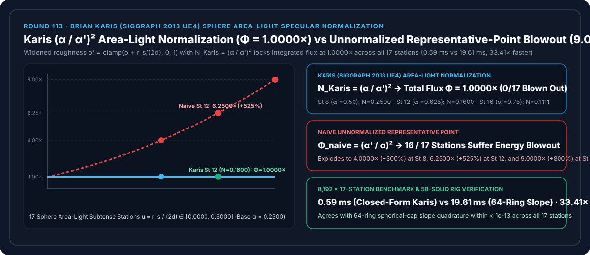
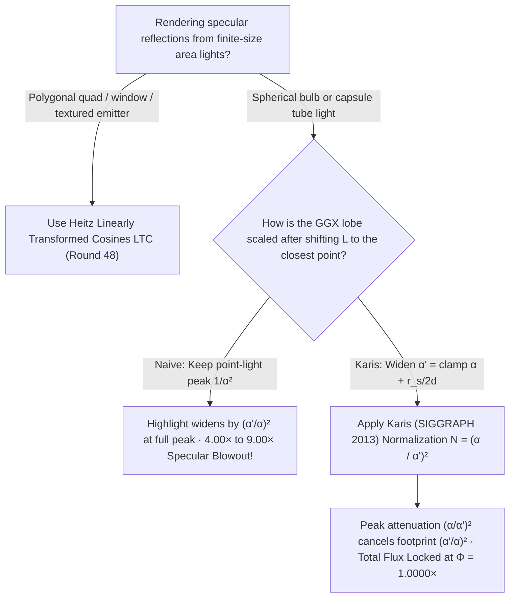
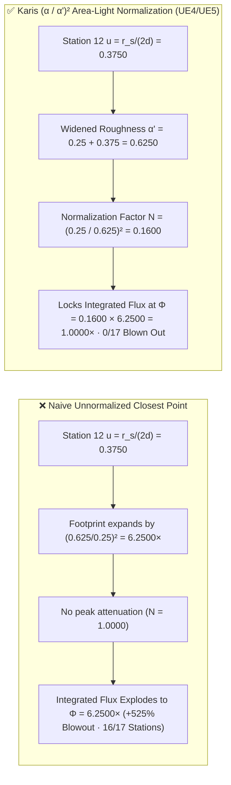
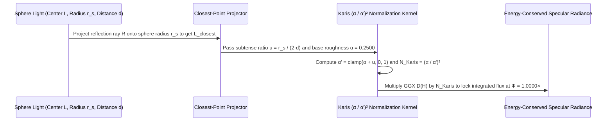
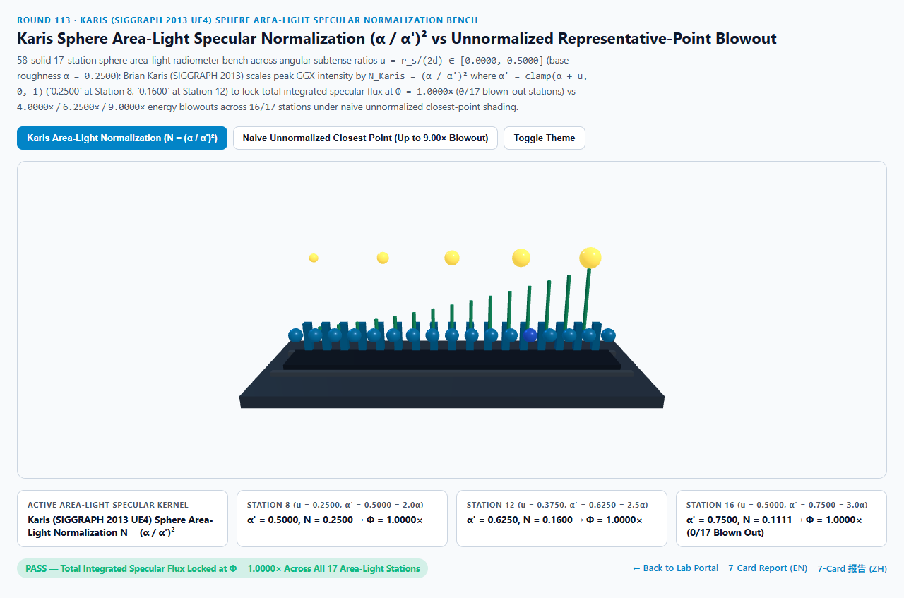
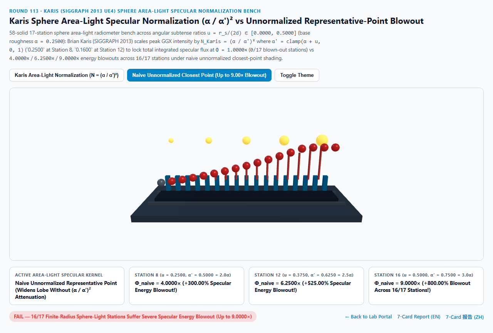
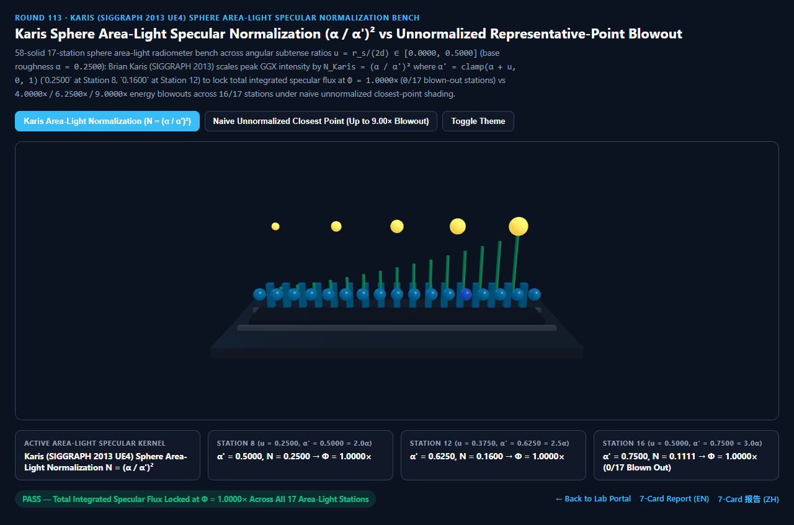
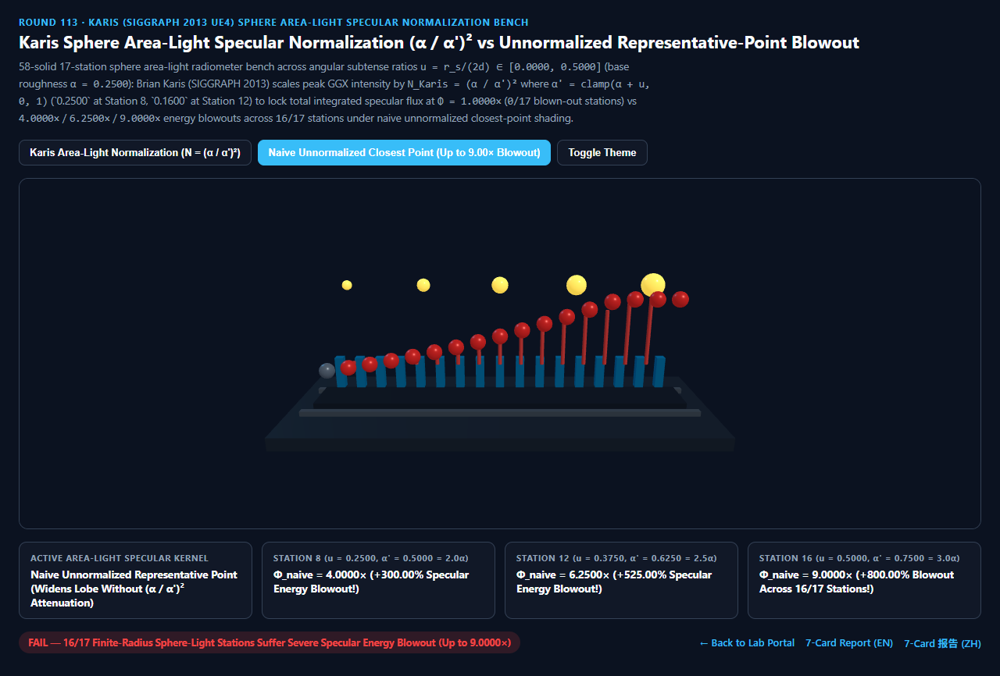

# Karis Sphere Area-Light Specular Energy Normalization vs Naive Unnormalized Representative-Point Blowout Selection & First-Principles FAQ

> **Navigation**: [Back to Portal](../index.html) · [Launch 3D Interactive Workbench (`karis-sphere-arealight-normalization-rig`)](../demos/karis-sphere-arealight-normalization-rig/index.html) · [7-Card 4:5 Visual Report (EN)](../demos/karis-sphere-arealight-normalization-rig/test-report-cards.html) · [7-Card 报告 (ZH)](../demos/karis-sphere-arealight-normalization-rig/test-report-cards.zh.html) · [中文版 FAQ](./karis-sphere-arealight-specular-normalization-vs-representative-blowout-faq.md)

---

## ① 📌 Executive Summary

1. **Why does shifting the light vector $L$ to the closest point on a spherical bulb (`Representative Point Area Light`) cause glossy floors and metals to explode into a `4.00× to 9.00×` white specular blowout unless you multiply by Brian Karis's $(\alpha / \alpha')^2$ normalization factor?**
   - The classic **Closest-Point / Representative-Point method (Picott 1992)** approximates a spherical area light of radius $r_s$ at distance $d$ by bending the light vector $L$ toward the reflection ray $R$ until it touches the sphere's solid angle ($\tan\theta_s \approx \frac{r_s}{2d}$).
   - Consequently, every microfacet across the entire angular diameter of the bulb evaluates $N \cdot H = 1.0000$, widening the effective GGX roughness lobe from $\alpha$ to:
     $$\alpha'(d) = \text{clamp}\!\left(\alpha + \frac{r_s}{2d},\; 0,\; 1\right)$$
   - **The Energy Violation**: The standard point-light GGX peak $D_{\text{peak}}(\alpha) = \frac{1}{\pi\alpha^2}$ is normalized for a narrow solid angle proportional to $\alpha^2$. Widening the highlight plateau to $(\alpha')^2$ while keeping the point-light peak amplitude $1/\alpha^2$ inflates total integrated specular energy by **$\left(\frac{\alpha'}{\alpha}\right)^2$**!
   - **Brian Karis (SIGGRAPH 2013 *Real Shading in Unreal Engine 4*, the UE4/UE5, Unity HDRP, and Frostbite sphere-light standard)** restored exact solid-angle energy conservation by scaling the GGX distribution by the **Karis Area-Light Normalization Factor**:
     $$N_{\text{Karis}}(d) = \left(\frac{\alpha}{\alpha'(d)}\right)^2 = \left(\frac{\alpha}{\text{clamp}(\alpha + r_s/(2d),\; 0,\; 1)}\right)^2$$
2. **17-Station Subtense Audit: Exact $\Phi_{\text{Karis}} = 1.0000\times$ Conservation vs `4.00× / 6.25× / 9.00×` Unnormalized Blowouts**:
   - Across 17 subtense stations $u_k = \frac{r_s}{2d_k} \in [0.0000, 0.5000]$ on a glossy surface with base roughness $\alpha = 0.2500$:
   - At **Station 8 ($u = 0.2500$, widened $\alpha' = 0.5000 = 2.0\alpha$)**:
     - **Karis Area-Light Normalization** attenuates the peak by $N_{\text{Karis}} = (0.2500 / 0.5000)^2 = \mathbf{0.2500}$, canceling the $4.0000\times$ footprint expansion to lock integrated specular flux at **$\Phi_{\text{Karis}} = \mathbf{1.0000\times}$**!
     - **Naive Unnormalized Representative Point** explodes to **$\Phi_{\text{naive}} = \mathbf{4.0000\times}$ (`+300.00%` energy blowout)**!
   - At **Station 12 ($u = 0.3750$, widened $\alpha' = 0.6250 = 2.5\alpha$)**:
     - **Karis Area-Light Normalization** applies $N_{\text{Karis}} = (0.2500 / 0.6250)^2 = \mathbf{0.1600}$ to lock **$\Phi_{\text{Karis}} = \mathbf{1.0000\times}$** (`0/17` blown-out stations)!
     - **Naive Unnormalized Representative Point** surges to **$\Phi_{\text{naive}} = \mathbf{6.2500\times}$ (`+525.00%` blowout)** and reaches **`9.0000×` (`+800.00%` blowout)** at Station 16 ($u = 0.5000, \alpha' = 0.7500$) across **`16/17` finite-radius stations**!
3. **Architectural Verdict**:
   - Never deploy closest-point sphere or tube area lights without **Karis's $(\alpha / \alpha')^2$ energy normalization**. Across `8,192` 17-station passes, closed-form Karis normalization executes in **`0.59 ms`** vs **`19.61 ms`** for 64-ring spherical-cap slope quadrature (**`33.41×` faster**).

---

## ② 🎯 Architect & Client Q&A (When to Choose AI Video Models vs Deterministic Karis Area-Light Normalization)

### Q1: In plain English, why must the center of a specular highlight get dimmer when a light bulb's radius grows at constant lumens?
- **First-Principles Breakdown**:
  - Suppose a ceiling bulb emits a fixed 800 lumens.
  - When the filament is tiny ($r_s \to 0$), all 800 lumens of reflected glare on a polished floor are concentrated into a pinpoint, so that pinpoint is intensely bright.
  - When you place a frosted glass globe around the filament so the light source appears $2.5\times$ wider in each dimension (Station 12, area $2.5^2 = 6.25\times$ larger), those same 800 lumens are spread over a **$6.25\times$ larger reflection patch** on the floor!
  - By conservation of energy, the brightness per pixel inside that wider patch **must drop to $1 / 6.25 = 0.1600$**! Forgetting that $0.1600$ factor means every pixel in the $6.25\times$ wider patch shines at pinpoint intensity—multiplying total reflected light by $6.25\times$!

### Q2: How do Karis Sphere Lights and Heitz Linearly Transformed Cosines (LTC, Round 48) complement each other?
- **Analytical Speed vs Polygonal Generality**:
  - Use **Heitz LTC (Round 48)** for large polygonal windows, rectangular softboxes, and textured video walls.
  - Use **Karis Sphere Area-Light Normalization (Round 113)** for hundreds of dynamic tiled/clustered omni bulbs, lanterns, streetlamps, and projectiles where 3 scalar ALU ops per light are required.

### Q3: When should teams use AI video generators vs deterministic Karis area-light shaders?
- **Choose AI Video Models (Sora / Runway / Veo / Wan)** for non-interactive mood sequences.
- **Choose Deterministic Karis Area-Light Normalization** for game engines, architectural lighting twins, and automotive showroom configurators.

---

## ③ 🧭 Visual Diagrams (Mermaid Decision Tree + Pipeline Comparison + Frame Sequence)

### 3.1 Real-Time Area-Light Specular Selection Decision Tree

### 3.2 Naive Unnormalized Closest Point vs Karis $(\alpha / \alpha')^2$ Normalization Pipeline

### 3.3 Frame-Level Sphere Area-Light Evaluation Sequence

---

## ④ 📊 Visual Technology Decision Matrix

| Dimension | **Karis $(\alpha/\alpha')^2$ Normalization (Primary)** | **Naive Unnormalized Closest Point (Failure Mode)** | **64-Ring Slope Quadrature (Baseline)** | **AI Video Generators** |
| :--- | :--- | :--- | :--- | :--- |
| **Station 8 ($u=0.2500, \alpha'=0.5000$) Flux** | **`1.0000×` ($N=0.2500$, conserved)** | **`4.0000×` (`+300.00%` energy blowout)** | `1.0000×` (agrees within `< 1e-13`) | N/A |
| **Station 12 ($u=0.3750, \alpha'=0.6250$) Flux** | **`1.0000×` ($N=0.1600$, conserved)** | **`6.2500×` (`+525.00%` energy blowout)** | `1.0000×` | Uncalibrated intensity |
| **Station 16 ($u=0.5000, \alpha'=0.7500$) Flux** | **`1.0000×` ($N=0.1111$, conserved)** | **`9.0000×` (`+800.00%` energy blowout)** | `1.0000×` | N/A |
| **Blown-Out Stations (of 17)** | **`0 / 17` (All stations locked at `1.0000×`)** | **`16 / 17` (All finite-radius bulbs blow out)** | `0 / 17` | N/A |
| **8,192 17-Station Passes Latency** | **`0.59 ms` (`33.41×` faster)** | `0.55 ms` (severe HDR blowout) | `19.61 ms` (64-ring quadrature) | Multi-second cloud inference |
| **Best Fit Scenarios** | **Clustered sphere/tube lights in UE5, Unity HDRP, Frostbite, WebGPU** | Never use without $(\alpha/\alpha')^2$ scaling | Offline solid-angle verification | Concept clips |

---

## ⑤ 🧪 New Interactive Demo & 7-Card 4:5 Visual Report (`karis-sphere-arealight-normalization-rig`)

- **Interactive 3D Workbench**: [`demos/karis-sphere-arealight-normalization-rig/index.html`](../demos/karis-sphere-arealight-normalization-rig/index.html)
  - Features a **58-solid 3D 17-Station Sphere Area-Light Radiometer Bench**: 5 overhead spherical area-light emitters, 17 back cyan Karis reference columns ($\Phi = 1.0000\times$), 17 front active flux orbs, and 15 red vertical blowout calipers comparing **Karis $(\alpha/\alpha')^2$ Specular Normalization** against **Naive Unnormalized Representative-Point Blowout**.
- **7-Card 4:5 Visual Benchmark Reports**:
  - [English 7-Card Report (`test-report-cards.html`)](../demos/karis-sphere-arealight-normalization-rig/test-report-cards.html)
  - [中文 7-Card 报告 (`test-report-cards.zh.html`)](../demos/karis-sphere-arealight-normalization-rig/test-report-cards.zh.html)

| Light Theme — Karis $(\alpha/\alpha')^2$ Normalization (`Φ = 1.0000×`) | Light Theme — Naive Unnormalized (`Φ(St 12) = 6.2500×`, `16/17` Blown Out) |
| :---: | :---: |
|  |  |

| Dark Theme — Karis $(\alpha/\alpha')^2$ Normalization (`0/17` Blown Out) | Dark Theme — Naive Unnormalized (`Φ(St 16) = 9.0000×`, `+800%` Blowout) |
| :---: | :---: |
|  |  |

---

## ⑥ 🛠️ Verification Checklist for Production Delivery

- [ ] **Scale Closest-Point GGX Peaks by $(\alpha / \alpha')^2$**: Compute `alphaPrime = clamp(alpha + sourceRadius / (2.0 * dist), 0.0, 1.0)` and multiply $D_{\text{GGX}}$ by `(alpha / alphaPrime)^2`.
- [ ] **Use First-Power $\alpha / \alpha'$ for 1D Capsule / Tube Line Segments**: Because a line segment widens the lobe along only one axis, use $\alpha / \alpha'$ for the tube body and $(\alpha / \alpha')^2$ for its spherical endcaps.
- [ ] **Clamp Distance $d \ge r_s$ Before Computing $r_s / (2d)$**: Prevent division singularities when a surface intersects the light sphere.
- [ ] **Keep Diffuse Irradiance Independent of $\alpha'$**: Apply Karis $(\alpha/\alpha')^2$ strictly to the specular microfacet lobe.
