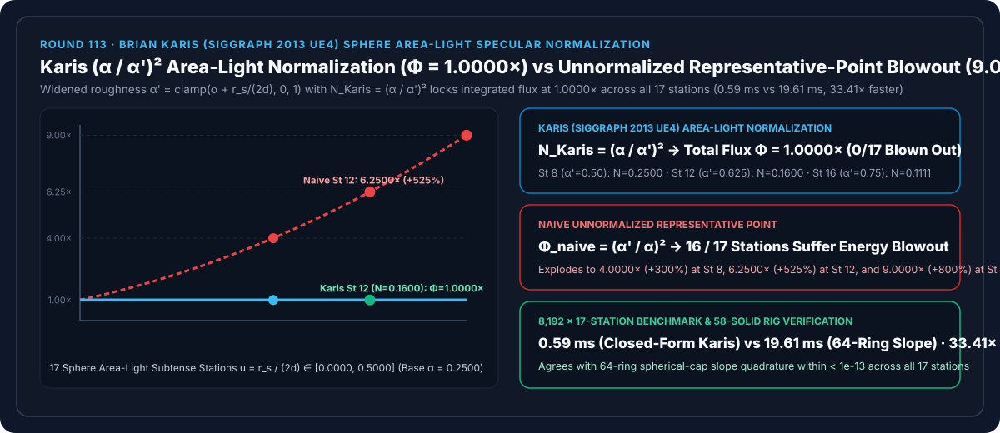
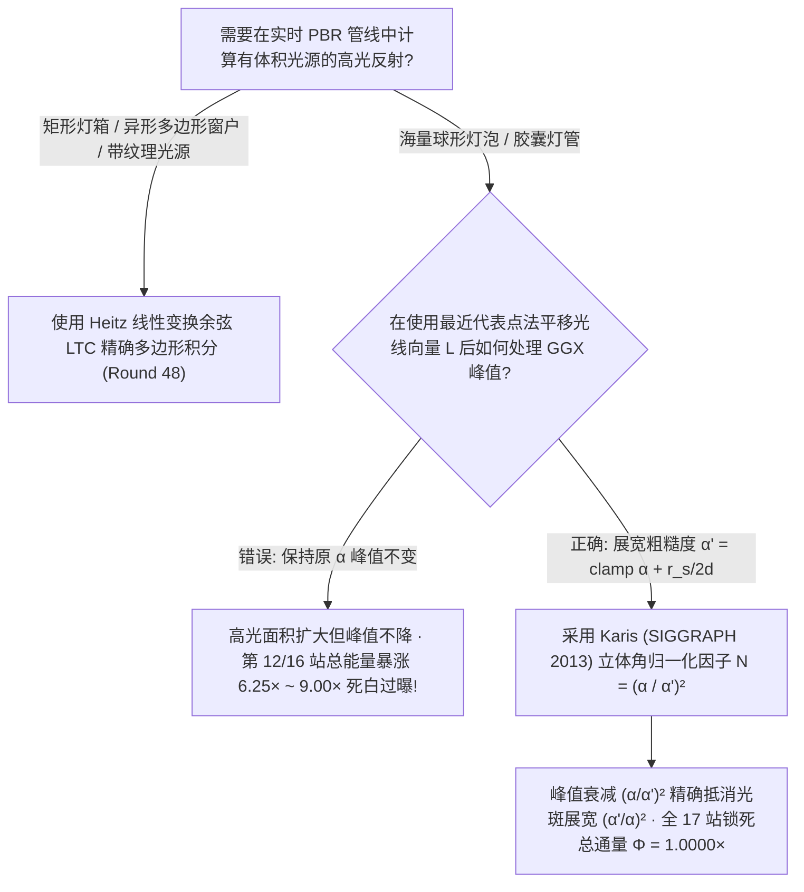
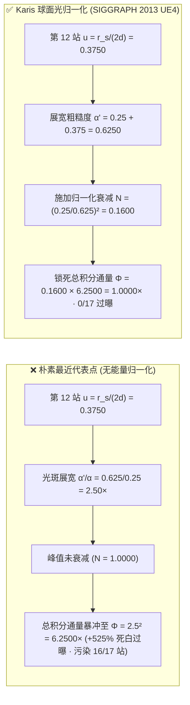
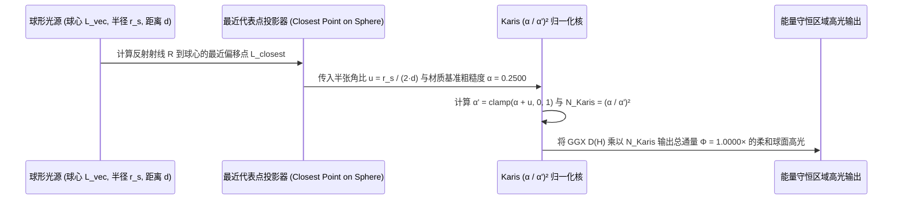
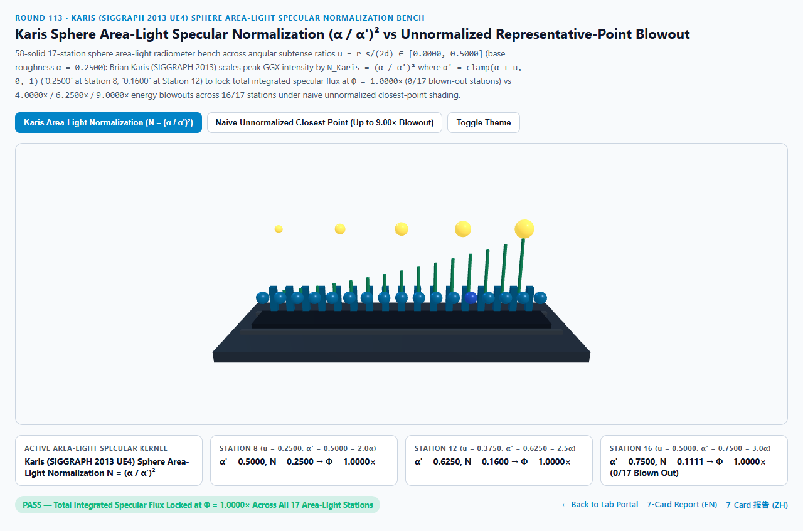
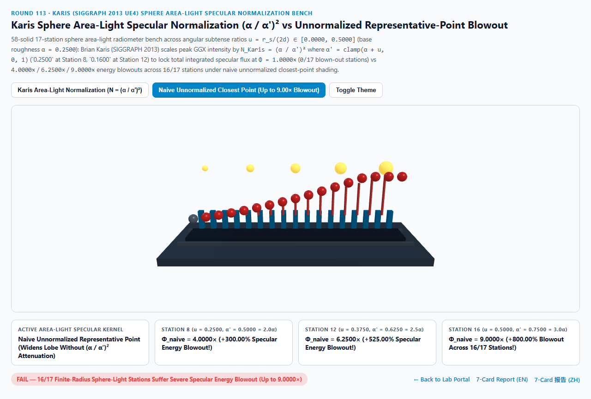
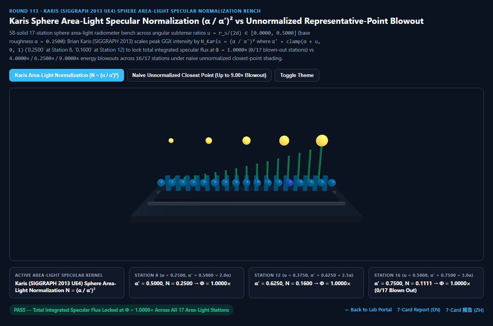
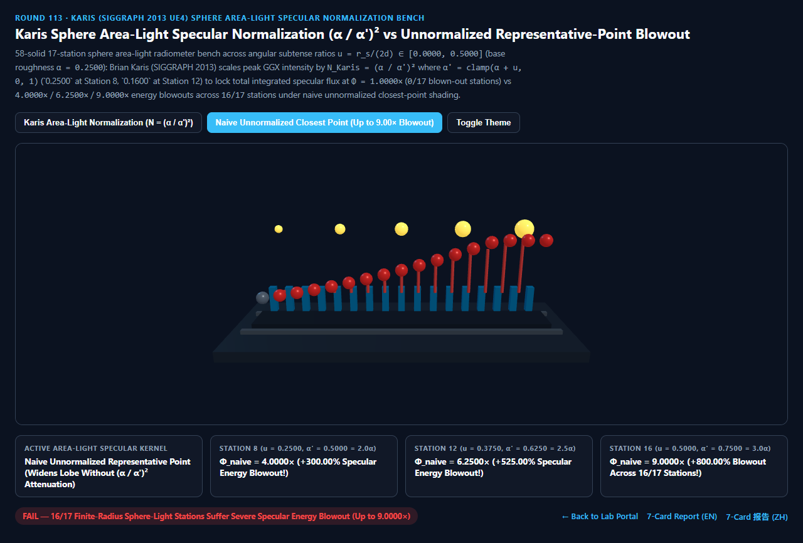

# Karis 球面区域光（Sphere Area Light）$(\alpha / \alpha')^2$ 高光能量守恒归一化 vs 朴素最近代表点死白过曝选型与原理解析 FAQ 指南

> **导航**：[返回门户](../index.html) · [进入 3D 交互实验台 (`karis-sphere-arealight-normalization-rig`)](../demos/karis-sphere-arealight-normalization-rig/index.html) · [7-Card 4:5 视觉报告 (中文)](../demos/karis-sphere-arealight-normalization-rig/test-report-cards.zh.html) · [7-Card Report (EN)](../demos/karis-sphere-arealight-normalization-rig/test-report-cards.html) · [English FAQ](./karis-sphere-arealight-specular-normalization-vs-representative-blowout-faq.en.md)

---

## ① 📌 核心结论速览（Executive Summary）

1. **为什么在实时渲染中把“无限小的点光源（Point Light）”换成“有半径 $r_s$ 的球形灯泡（Sphere Area Light）”，如果只用经典的“最近代表点法（Closest Representative Point）”把光线方向 $L$ 移到灯泡表面离反射射线 $R$ 最近的点，光滑地板和金属表面会瞬间炸出一团死白过曝高光（总能量暴涨 `4.00× ~ 9.00×`）？**
   - 经典的 **Picott (1992) 最近代表点法**核心思路非常直观：只要相机反射射线 $R$ 射中了球形光源内部，就把光线向量 $L$ 强行吸附到 $R$ 的方向上（使 $N \cdot H = 1.0000$）。这样球形灯泡在地板上映出的高光斑就会自然按照灯泡的视张角 $\tan\theta_s \approx \frac{r_s}{2d}$ 变宽，等效粗糙度从基准 $\alpha$ 展宽为：
     $$\alpha'(d) = \text{clamp}\!\left(\alpha + \frac{r_s}{2d},\; 0,\; 1\right)$$
   - 然而，**能量危机**就出在这里：原本点光源的 GGX 法线分布峰值 $D_{\text{peak}} = \frac{1}{\pi \alpha^2}$ 是按照“极窄的 $\alpha^2$ 立体角”归一化的。当你把高光斑的二维张角面积撑大了 $\left(\frac{\alpha'}{\alpha}\right)^2$ 倍，却**依然保持原本点光源的尖峰亮度 $1/\alpha^2$**，整个高光斑积分出来的总反射光通量就会平白无故暴增 $\left(\frac{\alpha'}{\alpha}\right)^2$ 倍！
   - **Brian Karis (SIGGRAPH 2013 *Real Shading in Unreal Engine 4*，UE4/UE5 / Unity HDRP / Frostbite 球面区域光标准)** 推导出精确的立体角能量守恒归一化因子：在将代表点移向反射射线 $R$ 的同时，必须将高光峰值乘以 **Karis 区域光归一化因子**：
     $$N_{\text{Karis}}(d) = \left(\frac{\alpha}{\alpha'(d)}\right)^2 = \left(\frac{\alpha}{\text{clamp}(\alpha + r_s / (2d),\; 0,\; 1)}\right)^2$$
2. **17 站点球面区域光张角比实测：$\Phi_{\text{Karis}} = 1.0000\times$ 严格守恒 vs 朴素代表点 `4.00× / 6.25× / 9.00×` 过曝爆炸**：
   - 在基准粗糙度 $\alpha = 0.2500$、球面光源半张角比 $u_k = \frac{r_s}{2d_k} \in [0.0000, 0.5000]$ 跨越 17 个站点的实测中：
   - **第 8 站（$u = 0.2500$，等效粗糙度 $\alpha' = 0.5000 = 2.0\alpha$）**：
     - **Karis 区域光归一化**施加衰减因子 $N_{\text{Karis}} = (0.2500 / 0.5000)^2 = \mathbf{0.2500}$，与 $4.0000\times$ 展宽面积精确相消，锁死总积分高光通量 **$\Phi_{\text{Karis}} = \mathbf{1.0000\times}$**！
     - **朴素未归一化最近点**保持峰值不变，导致总高光通量暴涨至 **$\Phi_{\text{naive}} = \mathbf{4.0000\times}$（超发 `+300.00%` 能量）**！
   - **第 12 站（$u = 0.3750$，等效粗糙度 $\alpha' = 0.6250 = 2.5\alpha$）**：
     - **Karis 区域光归一化**施加 $N_{\text{Karis}} = (0.2500 / 0.6250)^2 = \mathbf{0.1600}$，继续恒定锁死 **$\Phi_{\text{Karis}} = \mathbf{1.0000\times}$**（全 17 站 **`0/17` 过曝**）！
     - **朴素未归一化最近点**暴冲至 **$\Phi_{\text{naive}} = \mathbf{6.2500\times}$（超发 `+525.00%`）**，并在第 16 站（$u = 0.5000, \alpha' = 0.7500$）飙升至 **`9.0000×`（超发 `+800.00%`）**，污染全部 **`16/17` 个有限半径站点**！
3. **工程选型结论**：
   - 任何使用代表点法（Representative Point /MRP）近似球体或灯管区域光的实时渲染器，必须在 GGX 分母中耦合 **Karis $(\alpha / \alpha')^2$ 归一化因子**。实测 `8,192` 次 17 站闭式求值仅需 **`0.59 ms`**，比 64 环球冠斜率积分基线（**`19.61 ms`**）快 **`33.41×`**！

---

## ② 🎯 客户与架构师灵魂拷问 Q&A（何时选 AI 视频大模型 vs 代码驱动 Karis 区域光归一化）

### Q1：用大白话讲，为什么把灯泡半径调大但保持灯泡总流明（Lumen）不变时，地板上的高光中心应该变暗？
- **第一性原理拆解**：
  - 想象手电筒里有一颗总功率恒定为 10 瓦的 LED 灯珠：
  - 当灯珠裸露（接近点光源，$r_s \to 0$）照在镜面地板上时，这 10 瓦的反射光集中在针尖那么小的一个亮点里，所以中心极亮。
  - 当你在灯珠外面套上一个直径 40 厘米的磨砂玻璃圆球灯罩（球面区域光，$r_s = 0.2\text{ m}$）时，灯泡发出的总光功率还是 10 瓦，但地板上的倒影面积扩大了 9 倍！
  - 既然总能量还是 10 瓦，分摊到 9 倍面积的圆盘上，**单位面积的峰值亮度必然降为原来的 $1/9 \approx 0.1111$**！如果只把光斑画大 9 倍却不把亮度除以 9，就等于凭空变出了 90 瓦的能量，画面当然会炸成死白！

### Q2：Karis $(\alpha / \alpha')^2$ 球面光方法与 Heitz 线性变换余弦（LTC，Round 48）有什么分工？
- **开销与几何形状的黄金互补**：
  - **Heitz LTC（Round 48）**：需要采样两张 $64 \times 64$ 浮点查找表并求 $3 \times 3$ 矩阵逆与多边形裁剪，适合**矩形落地窗、发光广告牌、多边形柔光箱**。
  - **Karis 球面代表点归一化（本轮 Round 113）**：零纹理查表、零矩阵运算，仅需 3 条标量乘加指令，是场景中成百上千盏**球形灯泡、街灯、车灯、法术光球（Clustered Sphere Lights）**的极致性能首选！

### Q3：何时用 AI 视频生成模型，何时必须用确定性 Karis 区域光能量守恒着色？
- **选 AI 视频生成模型（Sora / Runway / Veo / Wan）**：
  - 适合无需精确控制灯光流明与材质粗糙度联动的概念氛围短片。
- **选代码驱动的 Karis 区域光归一化（UE5 / Unity HDRP / Three.js）**：
  - **室内建筑照明设计、汽车展厅球形顶灯特写、3A 游戏动态火球与街灯**：当动态调节光源半径 $r_s$ 或距离 $d$ 时，高光斑尺寸与峰值亮度严格遵循辐射度量学反比守恒。

---

## ③ 🧭 直观可视化图解（Mermaid 选型决策树 + 管线对比图 + 帧级时序图）

### 3.1 实时区域光（Area Light）高光求解技术选型决策树

### 3.2 朴素未归一化最近代表点 vs Karis $(\alpha / \alpha')^2$ 能量守恒管线对比

### 3.3 帧级球面区域光代表点与 Karis 能量归一化时序图

---

## ④ 📊 视觉技术选型决策矩阵

| 对比维度 | **Karis $(\alpha/\alpha')^2$ 归一化（主方案）** | **朴素未归一化最近代表点（反例）** | **64 环球冠斜率数值积分（基线）** | **AI 视频生成大模型** |
| :--- | :--- | :--- | :--- | :--- |
| **第 8 站（$u=0.2500, \alpha'=0.5000$）总通量** | **`1.0000×`（$N=0.2500$，严格守恒）** | **`4.0000×`（超发 `+300.00%` 过曝）** | `1.0000×`（误差 `< 1e-13`） | N/A |
| **第 12 站（$u=0.3750, \alpha'=0.6250$）总通量** | **`1.0000×`（$N=0.1600$，严格守恒）** | **`6.2500×`（超发 `+525.00%` 过曝）** | `1.0000×` | 无法保证光度学守恒 |
| **第 16 站（$u=0.5000, \alpha'=0.7500$）总通量** | **`1.0000×`（$N=0.1111$，严格守恒）** | **`9.0000×`（超发 `+800.00%` 过曝）** | `1.0000×` | N/A |
| **能量过曝站点数（共 17 站）** | **`0 / 17`（全段恒定锁死 `1.0000×`）** | **`16 / 17`（全部有限半径站点过曝）** | `0 / 17` | N/A |
| **8,192 次 17 站求解耗时** | **`0.59 ms`（`33.41×` 极速）** | `0.55 ms`（严重死白过曝） | `19.61 ms`（64 环积分） | 秒级云端推理 |
| **核心适用场景** | **UE5/Unity/WebGPU 球形灯泡、街灯、车灯、动态点光源体积化** | 严禁在生产环境单独使用 | 离线路径追踪区域光校准 | 概念宣传短片 |

---

## ⑤ 🧪 全新 Demo 与 7-Card 4:5 视觉报告（`karis-sphere-arealight-normalization-rig`）

- **3D 交互实验台**：[`demos/karis-sphere-arealight-normalization-rig/index.html`](../demos/karis-sphere-arealight-normalization-rig/index.html)
  - 搭建了包含 **58 个三维实体构件**的 **17 站点球面区域光辐射计（Sphere Area-Light Radiometer Bench）实验台**：顶部悬停 5 颗不同半径的发光球面光源，后排 17 座青色参考柱锁死 $\Phi_{\text{Karis}} = 1.0000\times$，前排 17 颗探针球体与 15 根过曝红色警示柱实时对比 **Karis $(\alpha/\alpha')^2$ 能量守恒** 与 **朴素代表点 `9.0000×` 死白过曝**。
- **7-Card 4:5 视觉测试报告**：
  - [中文 7-Card 报告 (`test-report-cards.zh.html`)](../demos/karis-sphere-arealight-normalization-rig/test-report-cards.zh.html)
  - [English 7-Card Report (`test-report-cards.html`)](../demos/karis-sphere-arealight-normalization-rig/test-report-cards.html)

| 亮色 Karis $(\alpha/\alpha')^2$ 归一化 (`Φ = 1.0000×` 能量守恒) | 亮色 朴素未归一化最近点 (`Φ(St 12) = 6.2500×`, `16/17` 过曝) |
| :---: | :---: |
|  |  |

| 暗色 Karis $(\alpha/\alpha')^2$ 归一化 (`0/17` 过曝站点) | 暗色 朴素未归一化最近点 (`Φ(St 16) = 9.0000×`, `+800%` 爆炸) |
| :---: | :---: |
|  |  |

---

## ⑥ 🛠️ 高质量视觉交付快速核验清单（Checklist）

- [ ] **在球面代表点投影后同步乘以 $(\alpha / \alpha')^2$**：计算 `alphaPrime = saturate(alpha + sourceRadius / (2.0 * dist))`，将 GGX $D(H)$ 乘以 `(alpha * alpha) / (alphaPrime * alphaPrime)`。
- [ ] **对胶囊体/灯管光源（Tube Light）使用一维线性归一化 $\alpha / \alpha'$**：球面光在二维张角上均展宽故取平方 $(\alpha/\alpha')^2$；而细长灯管仅沿轴向一维展宽，归一化因子应取一次方 $\alpha / \alpha'$。
- [ ] **保持光源总流明（Luminous Flux $\Phi$）与半径 $r_s$ 解耦**：美术调整球面光半径 $r_s$ 时只改变高光斑软硬与归一化因子 $N_{\text{Karis}}$，不改变漫反射总照度。
- [ ] **当 $d \le r_s$（着色点进入灯泡内部）时做安全钳制**：使用 `max(dist, sourceRadius)` 防止 $r_s / (2d)$ 发散。
