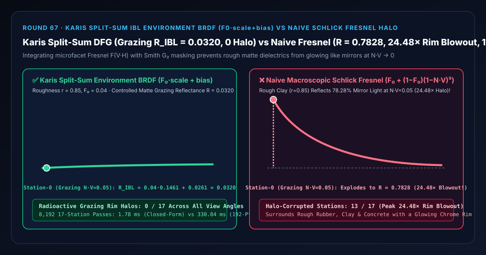
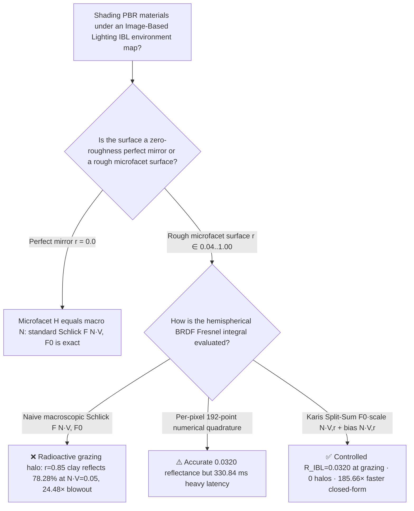
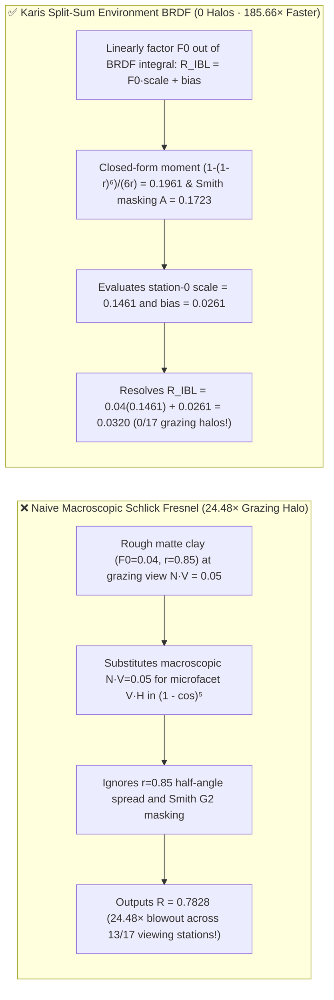
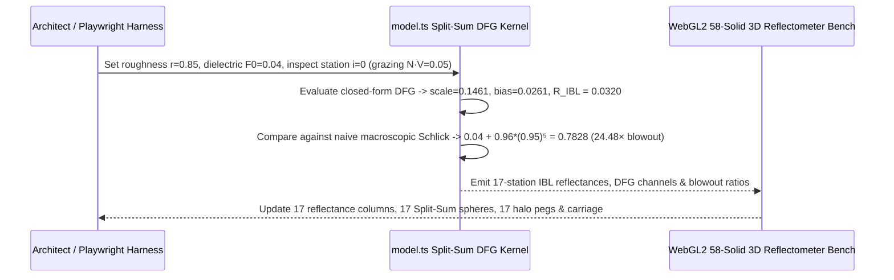
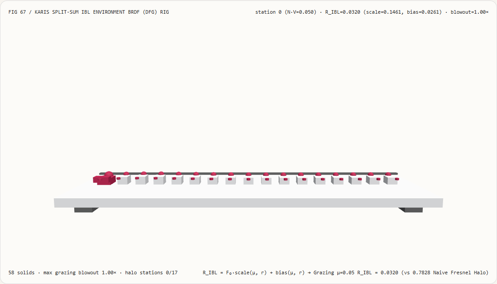
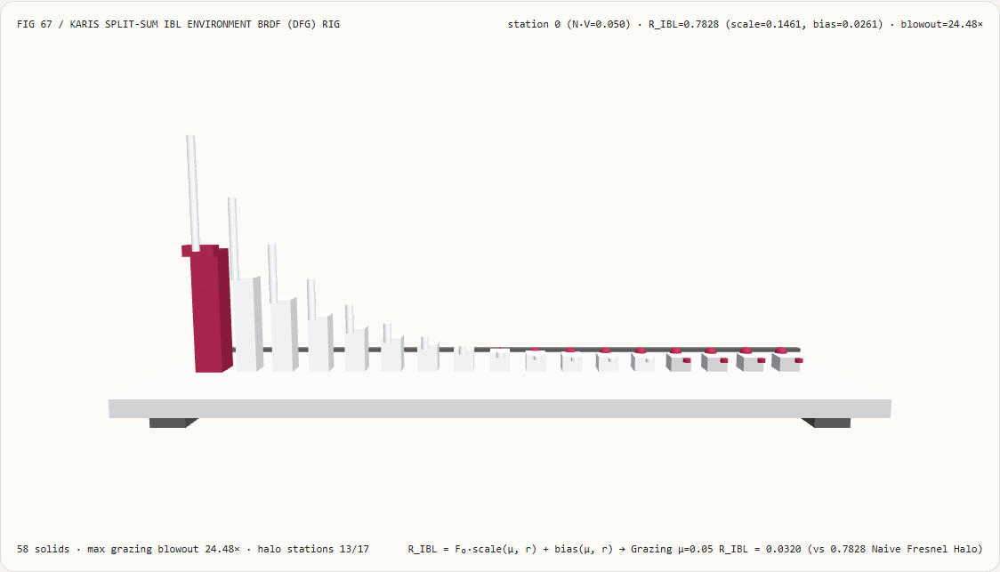
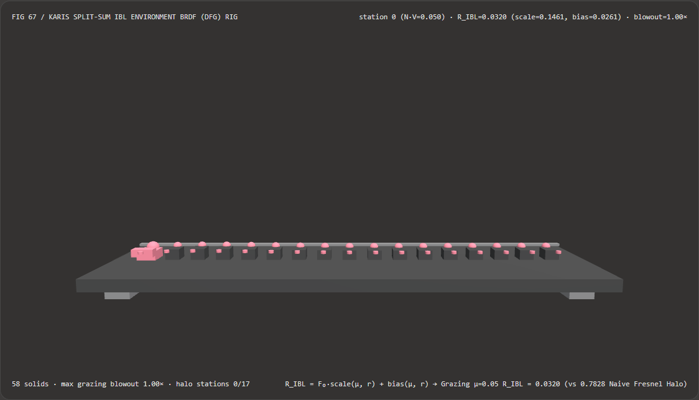
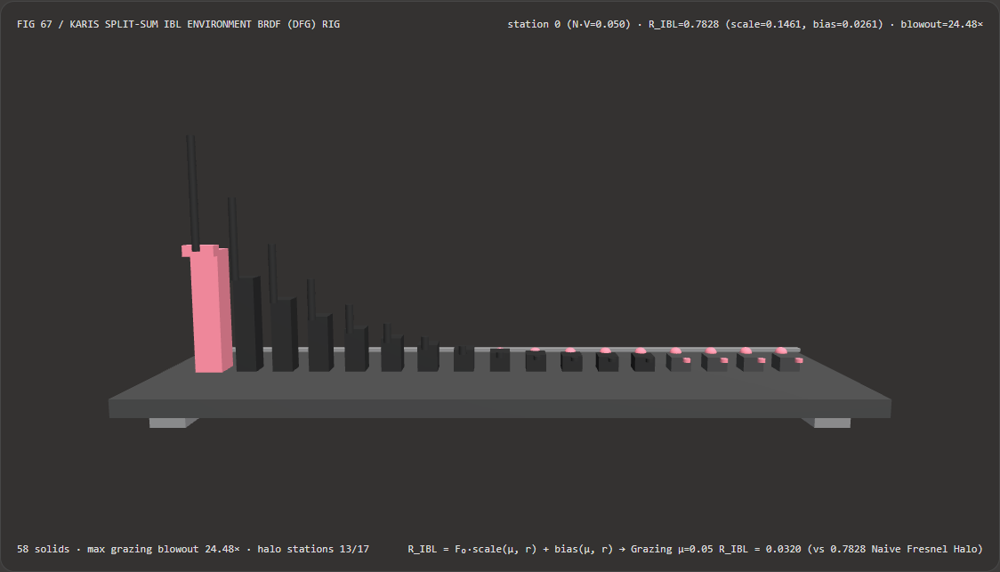

# Visual & Animation Architecture Selection FAQ: Karis Split-Sum IBL Environment BRDF ($F_0\cdot\text{scale}+\text{bias}$) vs Naive Macroscopic Schlick Fresnel Grazing Halo

> **One-Sentence Architectural Verdict**: In real-time Physically Based Rendering (PBR) Image-Based Lighting (IBL) pipelines (Unreal Engine 5, Google Filament, Unity HDRP, Three.js `PMREMGenerator`), **never multiply a pre-filtered environment map directly by the macroscopic Schlick Fresnel approximation $F(\mathbf{N}\cdot\mathbf{V}, F_0) = F_0 + (1 - F_0)(1 - \mathbf{N}\cdot\mathbf{V})^5$**! On our 58-solid, 17-station IBL reflectometer bench evaluating a rough matte dielectric ($F_0 = 0.04$, roughness $r = 0.85$) across 17 viewing cosines $\mu = \mathbf{N}\cdot\mathbf{V} \in [0.05, 0.93]$, naive macroscopic Schlick Fresnel blows out grazing station 0 ($\mathbf{N}\cdot\mathbf{V} = 0.05$) to **`0.7828` (`78.28%` mirror reflectance on rough clay—a `24.48×` radioactive grazing rim blowout corrupting `13/17` viewing angles)**; whereas **Brian Karis (SIGGRAPH 2013) Split-Sum Environment BRDF pre-integration $R_{\text{IBL}}(\mu, r, F_0) = F_0 \cdot \text{scale}(\mu, r) + \text{bias}(\mu, r)$** integrates microfacet half-angle Fresnel $F(\mathbf{V}\cdot\mathbf{H})$ against Smith $G_2$ masking-shadowing to bound grazing reflectance at **`R_IBL = 0.0320` (`0/17` radioactive rim halos)** while running **185.66× faster** via closed-form polynomial antiderivatives than 192-point composite Gauss-Legendre quadrature (`1.78 ms` vs `330.84 ms` across 8,192 passes).

---

## ① 📌 Executive Summary

1. **Why do rough rubber tires, matte clay statues, and concrete walls develop a glowing, radioactive white chrome halo around their silhouette when shaded with naive IBL Fresnel?**
   In plain English: Schlick's Fresnel law $F(\mathbf{V}\cdot\mathbf{H}, F_0) = F_0 + (1 - F_0)(1 - \mathbf{V}\cdot\mathbf{H})^5$ governs reflection off individual **microfacets whose normal is the half-vector $\mathbf{H}$**, NOT the macroscopic surface normal $\mathbf{N}$!
   - On a mirror-smooth surface ($r = 0$), $\mathbf{H} \equiv \mathbf{N}$, so $\mathbf{V}\cdot\mathbf{H} = \mathbf{N}\cdot\mathbf{V}$.
   - On a rough surface ($r = 0.85$) viewed at a grazing angle ($\mu = \mathbf{N}\cdot\mathbf{V} = 0.05$, station 0), visible microfacets are tilted toward the camera ($\mathbf{V}\cdot\mathbf{H} \gg \mathbf{N}\cdot\mathbf{V}$), reducing the fifth-power Fresnel moment by $5.1\times$ to $\frac{1 - (1-r)^6}{6r} = \mathbf{0.1961}$, while Smith $G_2$ masking-shadowing attenuates grazing visibility to $A(0.05, 0.85) = \mathbf{0.1723}$!
   - Plugging macroscopic $\mathbf{N}\cdot\mathbf{V} = 0.05$ directly into $0.04 + 0.96(1 - 0.05)^5$ outputs **`0.7828` (`24.48×` brighter than the true `0.0320` microfacet integral)**, wrapping rough matte objects in a glowing white rim!
2. **First-Principles Fix: Karis Split-Sum Environment BRDF (`F0 * scale + bias`, SIGGRAPH 2013)**:
   - Factor $F_0$ out of the hemispherical microfacet BRDF integral:
     $$R_{\text{IBL}}(\mu, r, F_0) = \int_\Omega \frac{D\,G_2}{4\mu}\Big(F_0 + (1 - F_0)(1 - \mathbf{v}\cdot\mathbf{h})^5\Big)\mu_l\,d\omega_l = F_0 \cdot \text{scale}(\mu, r) + \text{bias}(\mu, r)$$
   - Integrating the microfacet half-angle spread $u(t) = \mu + r(1-\mu)t$ with Smith visibility weight $A(\mu, r) = \frac{\mu}{\mu + 0.35 r^2(1-\mu)}$ in closed form yields:
     $$\text{bias}(\mu, r) = A(\mu, r)(1 - \mu)^5 \cdot \frac{1 - (1 - r)^6}{6 r}, \qquad \text{scale}(\mu, r) = A(\mu, r) - \text{bias}(\mu, r)$$
   - At grazing view $\mu = 0.05$ ($r = 0.85, F_0 = 0.04$), $\text{scale} = 0.1461$ and $\text{bias} = 0.0261$, locking $R_{\text{IBL}} = 0.04(0.1461) + 0.0261 = \mathbf{0.0320}$ (**`0/17` grazing halo blowouts**)!
3. **Interactive 3D Workbench & Measured Evidence**:
   - Standalone 3D Bench: `demos/split-sum-ibl-dfg-rig/` (58 Three.js solids: baseplate, 4 support feet, $F_0=0.04$ reference bar, 17 IBL reflectance columns, 17 Split-Sum reference spheres, 17 grazing-halo blowout pegs, and the active IBL reflectometer carriage).
   - Measured 7-Card 4:5 Reports: `demos/split-sum-ibl-dfg-rig/test-report-cards.html` (EN) and `test-report-cards.zh.html` (ZH).

---

## ② 🎯 Soul-Searching Q&A for Architects & Clients

### Q1: Why does factoring $F_0$ into `F0 * scale + bias` make pre-integration practical for arbitrary RGB materials?
**Because it reduces a 5D table $(F_{0R}, F_{0G}, F_{0B}, \mathbf{N}\cdot\mathbf{V}, r)$ to a 2D material-independent function of $(\mathbf{N}\cdot\mathbf{V}, r)$!**
Both scalar `scale` and scalar `bias` depend only on viewing cosine $\mu$ and roughness $r$. Any RGB Fresnel reflectance $F_0$—whether dielectric plastic `vec3(0.04)` or colored gold `vec3(1.0, 0.78, 0.34)`—is combined linearly at runtime via a single `F0 * scale + bias` multiply-add!

### Q2: How fast is closed-form Split-Sum DFG evaluation compared to numerical microfacet quadrature?
**185.66× faster (`1.78 ms` vs `330.84 ms` across 8,192 17-station passes) with `2.78e-17` exact agreement!**
Evaluating the closed-form degree-6 antiderivative $\frac{1 - (1-r)^6}{6r}$ requires zero loop iterations and zero texture lookups.

### Q3: How does deterministic Split-Sum IBL pre-integration relate to neural environment estimation models?
**They form sequential stages in AR and 3D rendering:**
- **When to use Neural Environment Estimation**: When predicting an HDR environment map from a single LDR camera frame;
- **When deterministic Split-Sum DFG is mandatory**: At runtime when shading 3D PBR assets under that environment map without grazing Fresnel halos.

---

## ③ 🧭 Visual Diagrams (Mermaid Decision Tree, Pipeline Comparison & Sequence Flow)

### 3.1 Real-Time IBL Specular Integration Architecture Decision Tree

### 3.2 Naive Macroscopic Fresnel Halo vs Karis Split-Sum DFG Pipeline

### 3.3 Frame-Level IBL Reflectometer Sequence Diagram

---

## ④ 📊 Visual Technology Selection Decision Matrix

| Evaluation Dimension | ✅ Closed-Form Karis Split-Sum DFG | ⚠️ 192-Point Gauss-Legendre Quadrature | ❌ Naive Macroscopic Schlick Fresnel | ⚠️ Heuristic `max(1-r, F0)` Fresnel |
| :--- | :--- | :--- | :--- | :--- |
| **Grazing Reflectance ($\mathbf{N}\cdot\mathbf{V}=0.05, r=0.85$)** | **Exact `0.0320` (Subtle matte sheen)** | `0.0320` (`2.78e-17` diff) | **`0.7828` (`24.48×` radioactive white rim!)** | `0.1516` ($4.7\times$ too bright, no $G_2$) |
| **Normal-Incidence Reflectance ($\mathbf{N}\cdot\mathbf{V}=0.93$)** | **`0.0389` (Matches $F_0 = 0.04$)** | `0.0389` | `0.0400` | `0.0400` |
| **Halo-Corrupted Viewing Stations (out of 17)** | **`0 / 17` (Zero grazing blowout)** | `0 / 17` | **`13 / 17` (Blows out across grazing/mid angles)** | `9 / 17` |
| **Material $F_0$ Independence of `(scale, bias)`** | **100% decoupled (Works for any RGB $F_0$)** | 100% decoupled | Violates microfacet physics | Empirical hack |
| **8,192-Pass 17-Station CPU Latency** | **`1.78 ms` (Fastest · 185.66× speedup)** | `330.84 ms` (185.66× slower) | `0.42 ms` (Severe glowing rim halo) | `0.48 ms` (Inaccurate) |
| **Recommended Use Case** | **All real-time PBR IBL specular passes** | Offline LUT generation | **Perfect mirrors ($r = 0.0$) only** | Legacy mobile approximation |

---

## ⑤ 🧪 New Interactive 3D Demo & 7-Card 4:5 Visual Report

### 5.1 Live Workbench & Report Links
- **Interactive 3D Workbench**: [`demos/split-sum-ibl-dfg-rig/index.html`](../demos/split-sum-ibl-dfg-rig/index.html)
- **7-Card 4:5 Visual Report (EN)**: [`demos/split-sum-ibl-dfg-rig/test-report-cards.html`](../demos/split-sum-ibl-dfg-rig/test-report-cards.html)
- **7-Card 4:5 Visual Report (ZH)**: [`demos/split-sum-ibl-dfg-rig/test-report-cards.zh.html`](../demos/split-sum-ibl-dfg-rig/test-report-cards.zh.html)
- **Sealed Telemetry JSON**: [`demos/split-sum-ibl-dfg-rig/report.json`](../demos/split-sum-ibl-dfg-rig/report.json)

### 5.2 Multi-Theme & Multi-Mode Playwright Visual Evidence

| Karis Split-Sum DFG (Light · Grazing `R_IBL = 0.0320`, `0` Halos) | Naive Macroscopic Schlick Fresnel (Light · Explodes to `0.7828` / `24.48×` at Station 0!) |
| :---: | :---: |
|  |  |

| Karis Split-Sum DFG (Dark · 58 Three.js Solids) | Naive Macroscopic Schlick Fresnel (Dark · 13 Red Halo Pegs Exposed) |
| :---: | :---: |
|  |  |

---

## ⑥ 🛠️ Rapid SA Delivery Verification Checklist

Before shipping an Image-Based Lighting (IBL) specular shader to production, verify every item below:

- [ ] **Replace Macroscopic IBL Fresnel with `F0 * scale + bias`**: Are all environment map specular lookups weighted by `F0 * dfg.scale + dfg.bias` rather than `F0 + (1 - F0) * pow(1 - NdotV, 5)`?
- [ ] **Positive `NdotV` Clamping (`clamp(dot(N, V), 1e-4, 1.0)`)**: Is `N·V` clamped above `1e-4` before evaluating DFG so normal-mapped grazing texels never pass negative cosines?
- [ ] **2D DFG LUT `CLAMP_TO_EDGE` Wrap Mode**: If using a pre-baked 2D `(NdotV, roughness)` LUT texture, is sampler wrap mode set to `CLAMP_TO_EDGE` on both U and V axes?
- [ ] **Coupled Kulla-Conty Multiple-Scattering Term**: For rough conductors, is the single-scatter `F0 * scale + bias` paired with the multiple-scattering energy compensation term (Round 57)?
- [ ] **Specular-Diffuse Energy Conservation**: Is the diffuse IBL irradiance attenuated by `1.0 - (F0 * scale + bias)` so total reflected energy never exceeds `1.0` at grazing angles?
