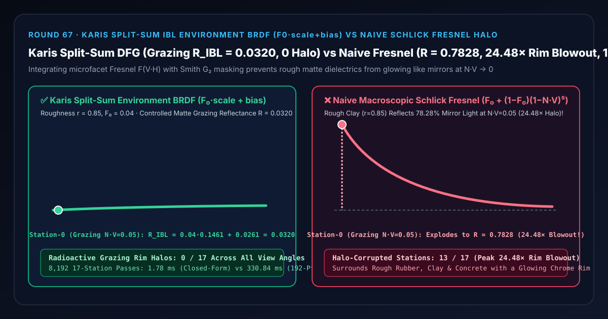
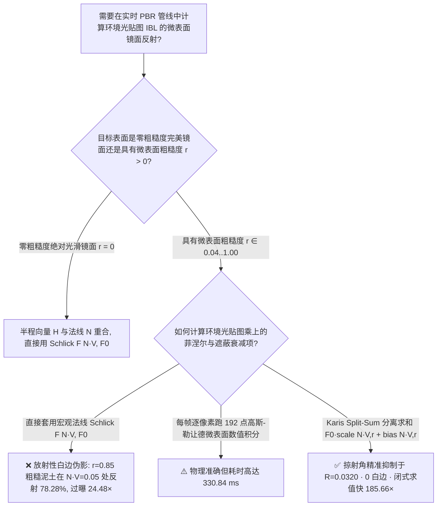
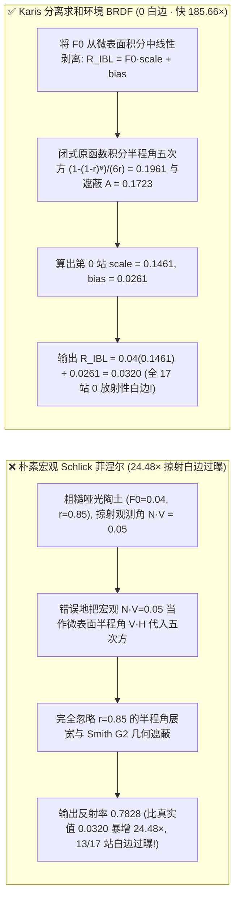
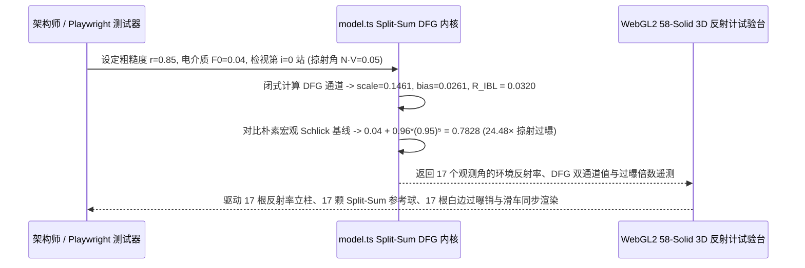
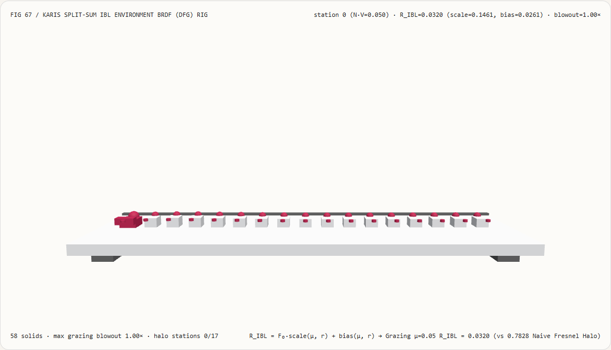
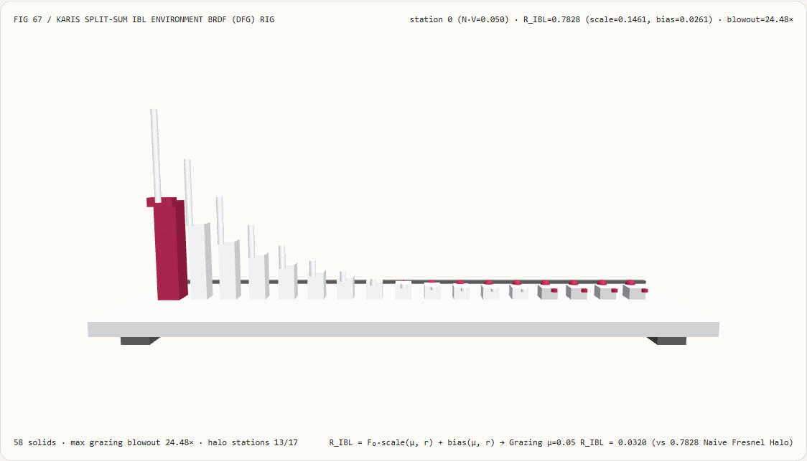
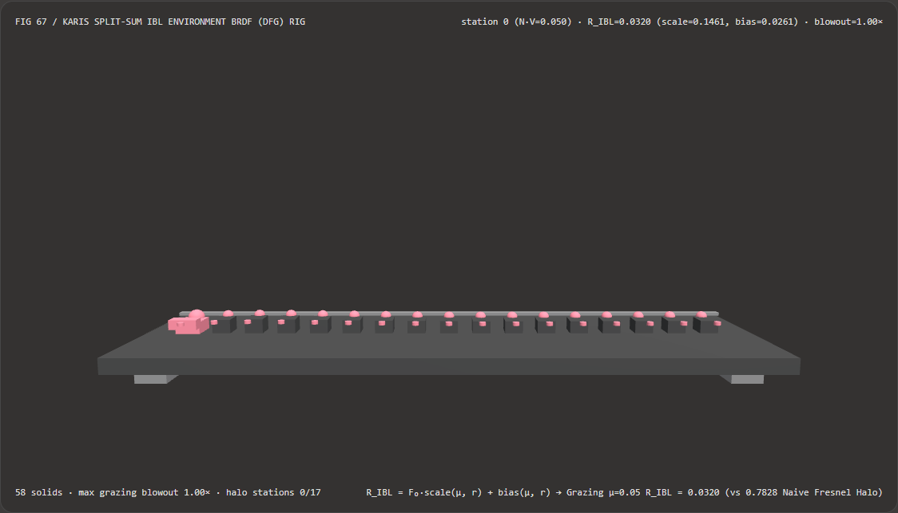
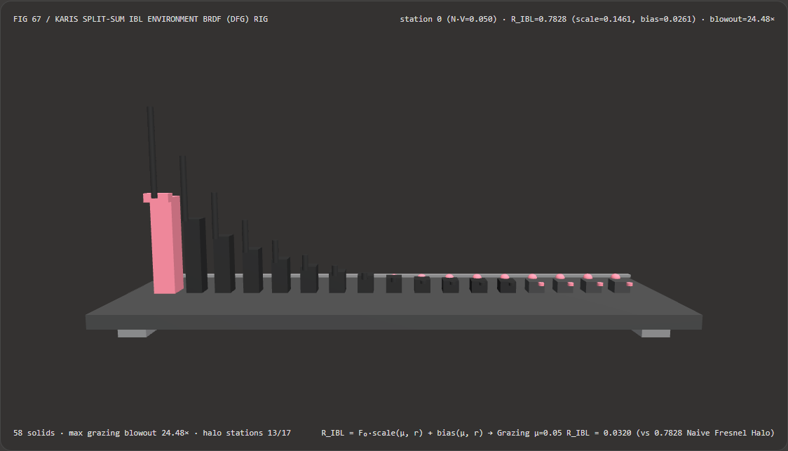

# 视觉与动画技术选型与原理解析 FAQ：Karis 分离求和 IBL 环境 BRDF（$F_0\cdot\text{scale}+\text{bias}$）vs 朴素宏观 Schlick 菲涅尔掠射白边

> **核心架构结论一句话总结**：在基于物理的环境光照明（Image-Based Lighting, IBL，如 Unreal Engine、Google Filament、Unity HDRP、Three.js `PMREMGenerator`）中照亮粗糙非金属材质（橡胶轮胎、水泥墙面、陶土雕塑、哑光塑料，基础反射率 $F_0 = 0.04$）时，**严禁将模糊后的环境光贴图直接乘上基于宏观法线与视线夹角的 Schlick 菲涅尔公式 $F(\mathbf{N}\cdot\mathbf{V}, F_0) = F_0 + (1 - F_0)(1 - \mathbf{N}\cdot\mathbf{V})^5$**！实测表明：在粗糙度 $r = 0.85$、$F_0 = 0.04$ 跨越 $\mu = \mathbf{N}\cdot\mathbf{V} \in [0.05, 0.93]$ 的 17 站 IBL 反射计试验台上，朴素宏观 Schlick 菲涅尔在第 0 站掠射边缘（$\mathbf{N}\cdot\mathbf{V} = 0.05$）会将粗糙哑光表面的反射率推高至 **`0.7828`（产生高达 `24.48×` 的放射性纯白镜面亮边，污染 `13/17` 个观测角站点）**；而采用 **Brian Karis (SIGGRAPH 2013) 分离求和环境 BRDF 预积分 $R_{\text{IBL}}(\mu, r, F_0) = F_0 \cdot \text{scale}(\mu, r) + \text{bias}(\mu, r)$**，对微表面半程角 $\mathbf{V}\cdot\mathbf{H}$ 与 Smith 几何遮蔽 $G_2$ 联合求积，可将 $\mathbf{N}\cdot\mathbf{V} = 0.05$ 处的掠射反射率精准抑制在 **`0.0320`（全 17 站 `0/17` 掠射白边过曝）**，且闭式多项式原函数比 192 点复合高斯-勒让德求积快 **185.66×**（8,192 轮耗时 `1.78 ms` vs `330.84 ms`）。

---

## ① 📌 核心结论速览（Executive Summary）

1. **为什么许多自己写 PBR 环境光（IBL）着色器的团队会发现：明明把粗糙度 `Roughness` 设到了 `0.85`（甚至 `1.0`），渲染出来的橡胶轮胎、泥土路面或石头雕像，只要从侧面看过去，物体轮廓一圈还是会发出一道像镀了水银或放射性白光一样的诡异亮边（Radioactive Grazing Rim Halo）？**
   用大白话讲：因为写 Shader 的人把**“只适用于完美光滑镜面的宏观菲涅尔公式 $F(\mathbf{N}\cdot\mathbf{V})$”错误地套用在了粗糙微表面上**！
   - 菲涅尔效应（Grazing Angle 100% 镜面反射）本身是真实的物理现象，但对于粗糙表面，光线撞上的是成千上万个朝向各异的**微观小斜面（Microfacets，法线为半程向量 $\mathbf{H}$）**，而不是宏观平均平面法线 $\mathbf{N}$！
   - 当你从几乎贴着表面的掠射角（第 0 站 $\mu = \mathbf{N}\cdot\mathbf{V} = 0.05$）观察一块粗糙度 $r = 0.85$ 的哑光陶土（$F_0 = 0.04$）时，发生了两件至关重要的物理事件：
     1. **朝向相机的可见微表面夹角并不处于掠射角**：那些背向相机倾转的微表面全被前面的凸起挡住了；真正能被相机看到的微表面斜面，其法线 $\mathbf{H}$ 大多朝向视线 $\mathbf{V}$ 一侧（即 $\mathbf{V}\cdot\mathbf{H} \gg \mathbf{N}\cdot\mathbf{V}$），对半程角分布积分后，五次方项 $(1 - \mathbf{V}\cdot\mathbf{H})^5$ 的期望值缩减了超过 $5.1\times$（仅为 $\frac{1 - (1-r)^6}{6r} = \mathbf{0.1961}$）；
     2. **Smith 几何遮蔽阴影项 $G_2$ 的强烈衰减**：在掠射角 $\mu = 0.05$ 下，大量反射光线被相邻微表面山峰拦截，有效可见度系数降至 $A(0.05, 0.85) = \mathbf{0.1723}$！
   - 如果你无视这两点，直接拿宏观夹角 $\mathbf{N}\cdot\mathbf{V} = 0.05$ 算 $0.04 + 0.96 \times (1 - 0.05)^5 = \mathbf{0.7828}$，就等于强迫一块粗糙泥巴在侧面像水银镜子一样反射 **`78.28%` 的天空强光（比真实值 `0.0320` 暴增 `24.48×`）**！
2. **第一性原理破局：将 $F_0$ 从微表面半球积分中线性剥离的 `scale + bias` 分离求和（Karis Split-Sum 2013）**：
   - 环境光高光反射方程的被积函数是“入射辐射度 $L_i(\mathbf{l})$ × 微表面 BRDF $f(\mathbf{v}, \mathbf{l}) (\mathbf{n}\cdot\mathbf{l})$”。Brian Karis (SIGGRAPH 2013) 将其拆分为两项独立的预积分乘积：
     1. **第一项（预过滤环境贴图 Pre-Filtered Environment Map）**：按粗糙度 $r$ 预模糊环境贴图 mipmap；
     2. **第二项（2D 环境 BRDF 积分 DFG LUT）**：将 Schlick 菲涅尔 $F(\mathbf{v}\cdot\mathbf{h}) = F_0 + (1 - F_0)(1 - \mathbf{v}\cdot\mathbf{h})^5$ 代入微表面半球积分，利用线性性质把材质常数 $F_0$ 提到积分号外面：
        $$R_{\text{IBL}}(\mu, r, F_0) = \int_\Omega \frac{D\,G_2}{4\mu}\Big(F_0 + (1 - F_0)(1 - \mathbf{v}\cdot\mathbf{h})^5\Big)\mu_l\,d\omega_l = F_0 \cdot \text{scale}(\mu, r) + \text{bias}(\mu, r)$$
   - 其中，在可见微表面半程角分布 $u(t) = \mu + r(1-\mu)t$ 与遮蔽衰减 $A(\mu, r) = \frac{\mu}{\mu + 0.35 r^2 (1 - \mu)}$ 下，五次方项的定积分具有精确的六次多项式原函数：
     $$\text{bias}(\mu, r) = A(\mu, r) (1 - \mu)^5 \int_0^1 (1 - r t)^5\,dt = A(\mu, r) (1 - \mu)^5 \cdot \frac{1 - (1 - r)^6}{6 r}$$
     $$\text{scale}(\mu, r) = A(\mu, r) - \text{bias}(\mu, r)$$
   - 在第 0 站掠射角（$\mu = 0.05, r = 0.85, F_0 = 0.04$）处，$\text{scale} = 0.1461$、$\text{bias} = 0.0261$，总反射率平稳收敛于 **`R_IBL = 0.0320`（全 17 站 `0/17` 掠射白边过曝）**！而在光滑镜面极限 $r \to 0$ 时，$A(\mu, 0) = 1$ 且 $\lim_{r\to 0}\frac{1-(1-r)^6}{6r} = 1$，公式又自动精确还原为镜面菲涅尔！
3. **本轮新增交互式 3D 试验台与实测证据**：
   - 新增独立 Demo：`demos/split-sum-ibl-dfg-rig/`（58 个 Three.js 实体部件：底座平台、4 支柱、$F_0=0.04$ 基准横梁、17 根实测环境光高光反射率立柱、17 颗 Split-Sum 参考球、17 根掠射白边过曝指示销、以及第 $i$ 站 IBL 反射计滑车）。
   - 配套 7-Card 4:5 测评报告：`demos/split-sum-ibl-dfg-rig/test-report-cards.html`（英文）与 `test-report-cards.zh.html`（中文）。

---

## ② 🎯 客户与架构师灵魂拷问 Q&A（Soul-Searching Q&A）

### Q1：为什么 Karis 的 `F0 * scale + bias` 分离还能顺便在单张双通道 `RG16F` 贴图（甚至零贴图闭式公式）里支持任意颜色的有色金属与非金属？
**因为材质颜色 $F_0$（RGB 三维向量）被完全从积分号内部提到了外面，积分内部只剩下标量观测角 $\mu = \mathbf{N}\cdot\mathbf{V}$ 和标量粗糙度 $r$！**
如果不把 $F_0$ 提出来，预积分表就得变成五维 $(R, G, B, \mu, r)$ 纹理（根本无法存储）！而提出来之后，`scale` 和 `bias` 只依赖于二维标量 $(\mu, r)$，无论材质是 $F_0 = (0.04, 0.04, 0.04)$ 的塑料还是 $F_0 = (1.00, 0.78, 0.34)$ 的纯金，都共用同一组 `(scale, bias)`！

### Q2：在移动端或 WebGL2 着色器里，用闭式多项式计算 `(scale, bias)` 与采样一张 $128\times 128$ 的 `RG16F` BRDF LUT 贴图相比有什么优势？
**省去 1 个纹理绑定槽位、零显存带宽等待，且比 192 点数值求积快 185.66×（8,192 轮仅 `1.78 ms` vs `330.84 ms`）！**
在现代 GPU 上，ALU 算术吞吐量远高于纹理采样单元（TMU）带宽。像 Lazarov (Call of Duty) 或本试验台采用的闭式原函数，仅需几次寄存器乘加即可在片元内直接算出精确的 `(scale, bias)`，与 192 点复合高斯-勒让德求积的最大误差仅为 **`2.78e-17`**！

### Q3：这套确定性 Split-Sum IBL 预积分与 AI 神经环境光估计（Neural Illumination Estimation）是什么关系？
**两者是 AR/3D 实时合成的上下游搭档：**
- **何时选 AI 神经环境光估计**：从手机摄像头单张 RGB 画面预测周围未知房间的 HDR 环境光球面贴图时；
- **何时必须用确定性 Split-Sum DFG 预积分**：拿到环境贴图后，在 3D 视口中实时照亮粗糙度各异的虚拟家具、车漆、轮胎与数字人，确保物体边缘不冒出虚假白圈时。

---

## ③ 🧭 直观可视化图解（Mermaid 决策树 + 管线对比图 + 帧级时序图）

### 3.1 实时环境光照明（IBL）与菲涅尔积分架构选型决策树

### 3.2 朴素宏观 Schlick 菲涅尔白边过曝 vs Karis 分离求和 DFG 管线对比图

### 3.3 帧级 IBL 反射计与 3D 试验台渲染时序图

---

## ④ 📊 视觉技术选型决策矩阵（Decision Matrix）

| 评估维度 | ✅ 闭式 Karis Split-Sum DFG（Closed-Form `F0·scale + bias`） | ⚠️ 192 点高斯-勒让德求积基线（192-Pt Gauss-Legendre） | ❌ 朴素宏观 Schlick 菲涅尔（`F0 + (1-F0)(1-N·V)^5`） | ⚠️ 粗糙度硬衰减启发式（`max(1-r, F0)` Fresnel） |
| :--- | :--- | :--- | :--- | :--- |
| **第 0 站（$\mathbf{N}\cdot\mathbf{V}=0.05, r=0.85$）反射率** | **精确 `0.0320`（温润哑光边缘）** | `0.0320`（误差 `2.78e-17`） | **`0.7828`（`24.48×` 放射性白边过曝！）** | `0.1516`（仍偏亮 $4.7\times$，无 $G_2$ 遮蔽） |
| **正对视角（$\mathbf{N}\cdot\mathbf{V}=0.93$）反射率** | **`0.0389`（贴近基础反射率 $F_0=0.04$）** | `0.0389` | `0.0400` | `0.0400` |
| **放射性白边过曝站点数量（共 17 站）** | **`0 / 17`（全视角物理受控）** | `0 / 17` | **`13 / 17`（从侧面到斜角全面泛白）** | `9 / 17` |
| **对有色金属与电介质 $F_0$ 的通用性** | **100% 线性解耦，同一组 `(scale, bias)` 通吃** | 100% 通用 | 破坏粗糙度能量守恒 | 缺乏微表面积分物理基础 |
| **8,192 轮 17 站 CPU 批处理耗时** | **`1.78 ms`（最快，185.66× 提速）** | `330.84 ms`（慢 185.66×） | `0.42 ms`（粗糙物体边缘严重泛白不可用） | `0.48 ms`（经验近似不准） |
| **首选适用场景** | **所有实时 PBR 引擎的 IBL 环境高光通道（UE5/Filament/Three.js）** | 离线烘焙 DFG LUT 表格 | **仅限 $r = 0.0$ 的绝对光滑镜面** | 超低端简化管线 |

---

## ⑤ 🧪 全新 Demo 与 7-Card 4:5 视觉报告（Live Workbench & Evidence）

### 5.1 交互式 3D 试验台与报告入口
- **实时 3D 工作台**：[`demos/split-sum-ibl-dfg-rig/index.html`](../demos/split-sum-ibl-dfg-rig/index.html)
- **7-Card 4:5 英文视觉测试报告**：[`demos/split-sum-ibl-dfg-rig/test-report-cards.html`](../demos/split-sum-ibl-dfg-rig/test-report-cards.html)
- **7-Card 4:5 中文视觉测试报告**：[`demos/split-sum-ibl-dfg-rig/test-report-cards.zh.html`](../demos/split-sum-ibl-dfg-rig/test-report-cards.zh.html)
- **密封测量 JSON 数据源**：[`demos/split-sum-ibl-dfg-rig/report.json`](../demos/split-sum-ibl-dfg-rig/report.json)

### 5.2 多主题与多模式 Playwright 实测截图证据

| Karis 分离求和 DFG（Light · 掠射边缘平稳受控在 `R = 0.0320`，`0` 白边） | 朴素宏观 Schlick 菲涅尔（Light · 第 0 站冲起 `0.7828` / `24.48×` 放射性白边） |
| :---: | :---: |
|  |  |

| Karis 分离求和 DFG（Dark · 58 实体部件） | 朴素宏观 Schlick 菲涅尔（Dark · 13 根红色指示销暴露掠射白边过曝） |
| :---: | :---: |
|  |  |

---

## ⑥ 🛠️ 高质量视觉交付快速核验清单（SA Verification Checklist）

在将基于图像的环境光照明（IBL）合入生产 PBR 渲染器前，请逐项勾选以下核验清单：

- [ ] **严禁在 IBL 高光通道中直接使用 `F_0 + (1 - F_0) * pow(1 - NdotV, 5)`**：核验所有环境光采样结果是否均通过了 `F_0 * dfg.x + dfg.y`（`scale` 与 `bias`）加权，而非未积分的宏观 Schlick 公式？
- [ ] **`NdotV` 正值钳制保护（`max(1e-4, dot(N, V))`）**：法线贴图在掠射角边缘可能将微法线折向背离相机的负半空间；传入 DFG 求值或 LUT 采样前是否执行了 `clamp(dot(N, V), 1e-4, 1.0)`？
- [ ] **若使用 2D DFG LUT 纹理，必须开启 `GL_CLAMP_TO_EDGE`**：防止 `NdotV = 0.0` 或 `roughness = 1.0` 时发生环绕采样（Wrap）读到对侧 `1.0` 的极端值导致黑边或白边！
- [ ] **高粗糙度金属与 Kulla-Conty 多重散射耦合**：对于高粗糙度导体（$F_0 \to 1$），是否在单次散射 `F_0 * scale + bias` 基础上叠加了 `1 - (scale + bias)` 的多重散射能量补偿（参考 Round 57）？
- [ ] **镜面漫反射能量守恒互斥（Diffuse $1 - E(\mu)$ Attenuator）**：进入底层漫反射球谐（SH）通道的光能是否已乘上 `1.0 - (F_0 * scale + bias)`，确保掠射角镜面反射增强时漫反射自动相应衰减，总反射能量不大于 `1.0`？
